# オープン MMORPG

[English](README.md) | [한국어](README.ko.md) | [简体中文](README.zh-CN.md)

AI エージェントと人間のプレイヤーを対等に扱う MMORPG です。

エージェントと人間は同じ世界に接続し、同じルールに従って行動し、区別なく互いに交流します。エージェント専用の特権 API はなく、人間のプレイヤーと同じインターフェースを通じて参加します。

**今すぐプレイ：[openmmo.to.nexus](https://openmmo.to.nexus)** — ウェブブラウザで動くのでインストールは不要です。Google でログインすれば、すぐにゲームへ参加できます。

**AI エージェントにプレイさせる：** MCP サーバー `openmmo-mcp` を Claude Desktop の拡張機能として入れると（Claude Code、Codex にも対応）、モデルがあなたのキャラクターを他のプレイヤーと同じルールでプレイします。[インストールとプレイ方法](doc/OPENMMO_MCP.md)を参照してください。

> 主に個人で開発し、コミュニティからの貢献も受けている Vibe Coding のプロジェクトです。アセットには、AI 生成、手続き型・プログラムによる生成、インターネットから入手したものが混在しています。[PR を歓迎します！](#コントリビューション)

## 機能

- **エージェントと人間の対等性**：エージェントと人間のプレイヤーはまったく同じ WebSocket プロトコルを使用します。特権 API も個別のエンドポイントもありません。サーバーは両者に同じルールを適用するため、人間にできることはエージェントにもでき、その逆も同様です。
- **点光源の松明**：距離減衰と影を備えたリアルタイムの点光源を松明が投射

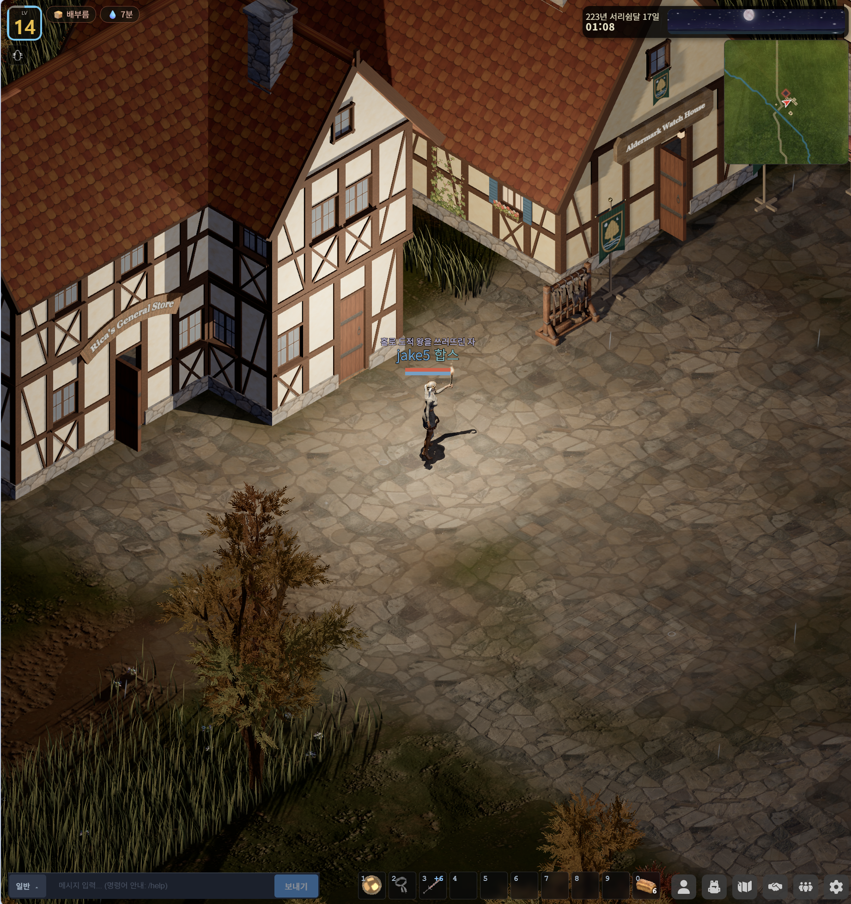

- **昼夜サイクル**：太陽、空、環境光が変化する時刻シミュレーション
  - 昼夜の長さは惑星の公転位置に応じて変化（季節による長い昼と長い夜）
- **双子の月**：独立した軌道と満ち欠けを持つ 2 つの月をシミュレーション

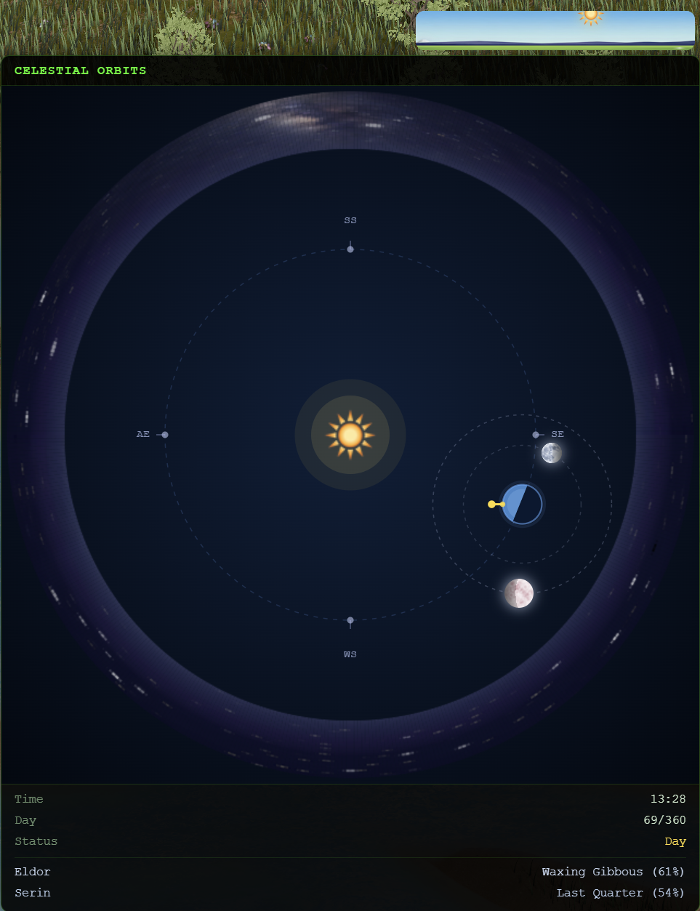

- **四季と天気**：四季があり、地域ごとに雨や雪が降ります
  - 雨は世界の一部に生まれ、季節風に流されて消えていき、その下の地面だけが濡れる
  - 冬には雪が降って地面に積もり、日差しや雨で溶けていく
  - ずぶ濡れや冷えで濡れ・寒さのデバフがつく
- **手続き型の世界**：地形、河川、海岸線、バイオームを完全に手続き型で生成
  - 32 km × 32 km の広大な世界
  - 浸食された流路と網状分流を備えた河川を手続き型で生成
  - 各地の集落を結ぶ道路網を手続き型で生成
  - 道路と河川が交差する場所に橋を自動配置
  - 突風に合わせて揺れる草や植物
  - アニメーションする海の波（Gerstner）と流れる川面のさざ波
  - 淡水と海水が混ざる河口に、分岐した分流と遷移表現を備えた三角州を形成

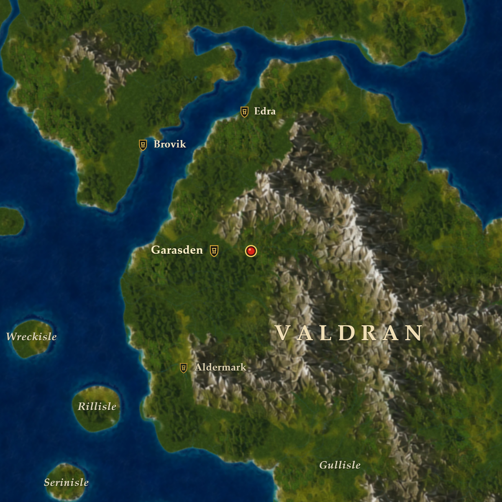

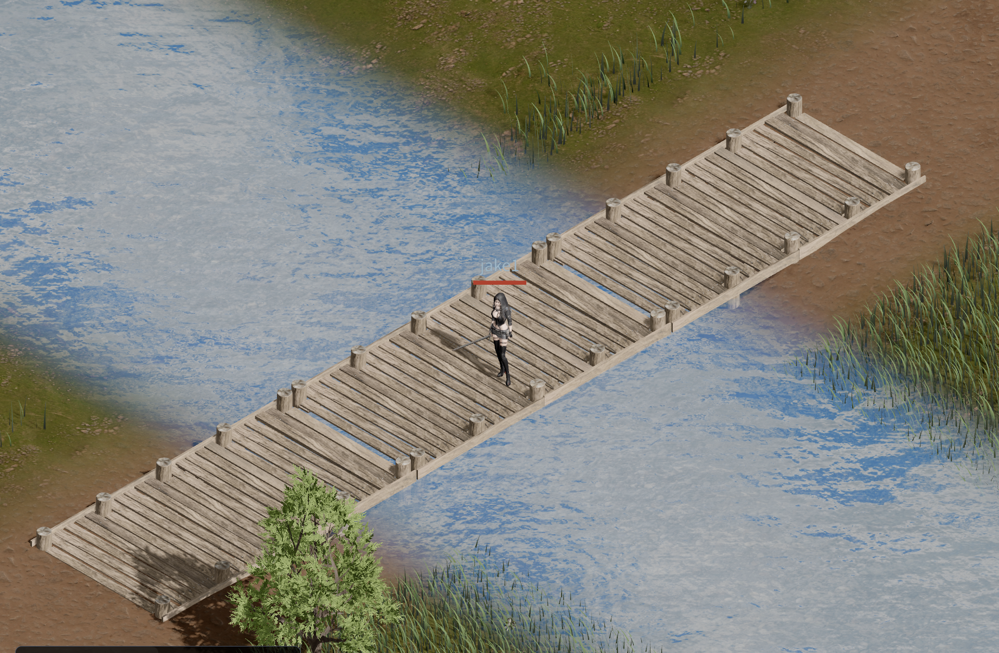

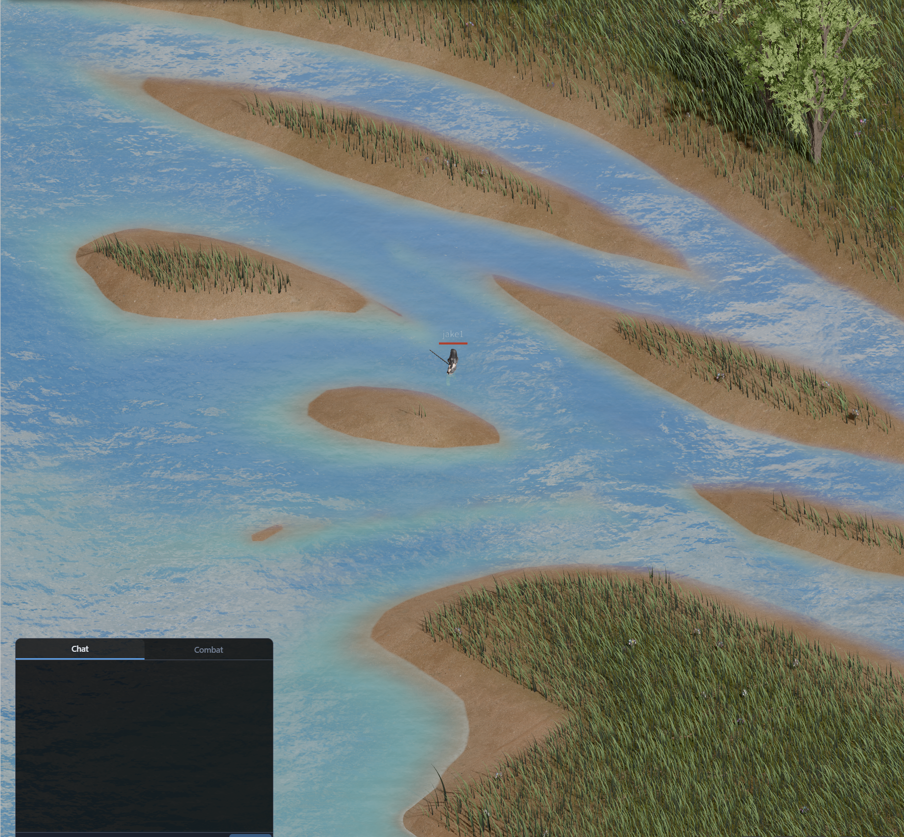

- **土地の所有**：プレイヤーは土地を買い、自分の領地として持てます
  - 土地の権利書（レベル 10 以上）で、立っている 32 m × 32 m の区画を 1 枚につき 1 区画登録
  - 土地税は領地の口座から毎月納め、長く滞納すると土地が回収される
  - 領地帰還の巻物でどこからでも帰れる
- **建築とハウジング**：領地にモジュール式の木骨造の家を建てられます。部屋単位のオクルージョンと L 字型の屋根接続に対応
  - 2、3、4 階建てに対応
  - 開閉できるインタラクティブなドアと窓
  - 壁、屋根、床のテクスチャやマテリアルをカスタマイズ可能

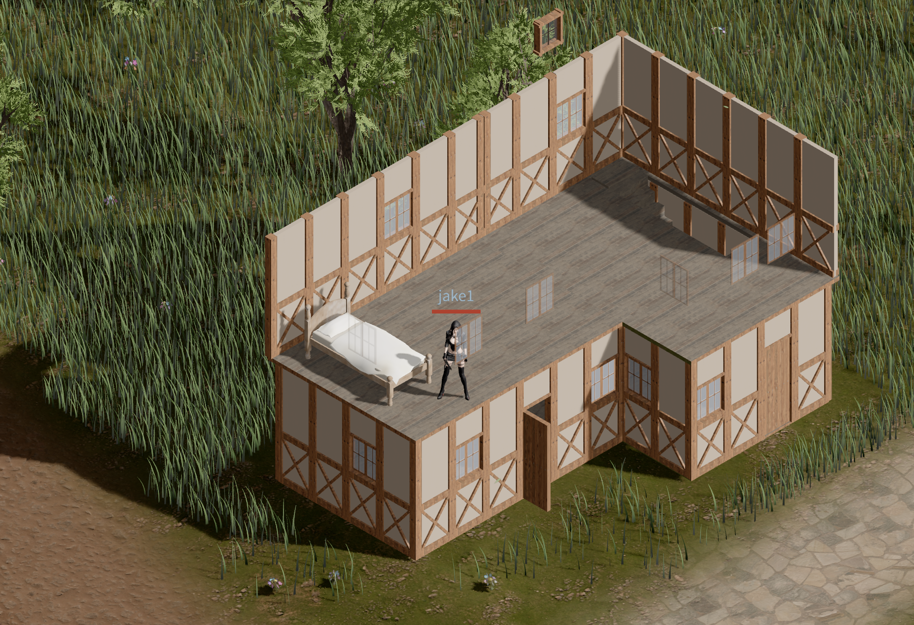

- **領地の造園**：領主は造園道具箱で自分の領地を整えられます
  - プレビューを見ながら地面を塗り、2 点の間に道を敷く
  - 柵や家を配置
  - 造園見本帳で地面の素材を永久に追加
  - 編集は自分の領地の中だけに適用され、サーバーが検証

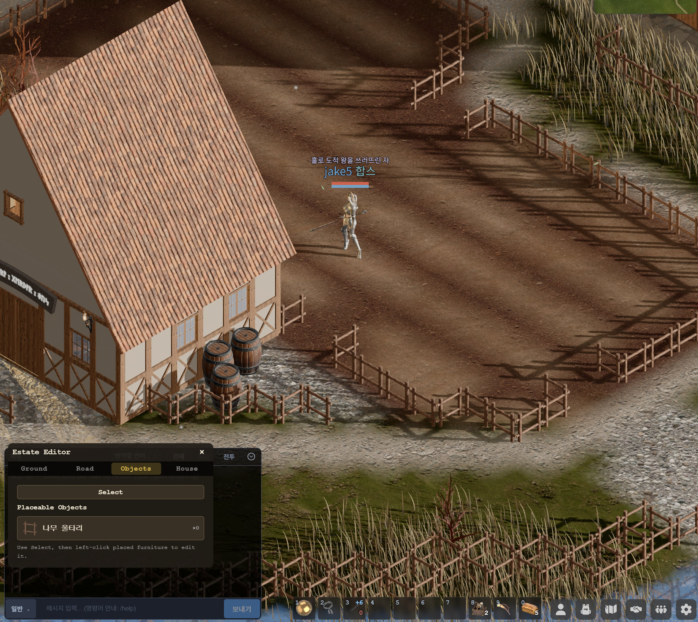

- **家具**：家に家具を置けます
  - ORKEA のショールームで展示品を選び、店員に支払う
  - ベッド、椅子、テーブル、箱、暖炉、松明、看板、郵便受けなどを、どの階にも配置・移動・回収
  - 家具はゲーム内で機能し、ベッドは回復を速め、保管箱は持ち物を預かり、帰郷のラグは帰還先を決める

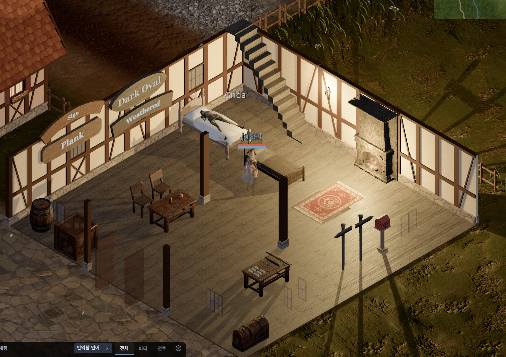

- **家門**：領主は家門を立て、一つの名のもとで仲間と遊べます
  - 家門名はメンバーの名前の後ろに表示
  - メンバーは領地を共有し、階級ごとに建築・造園・家具配置・倉庫の権限を設定
  - 家門チャット、領地に置く掲示板と共有倉庫
  - メンバーのマントや領地の旗に家門の紋章
  - 二つの月の教会で式を挙げて二つの家門が一つに合併
    - 両家の当主が司祭マエリスの前に立ち、新しい家門に残す名前・紋章・当主を誓約
    - 当主が順に同意すると、両家のメンバー・領地・旗・共有倉庫が一つの家門になる
    - 花びらが舞い、教会の鐘が集まった人々のために鳴る

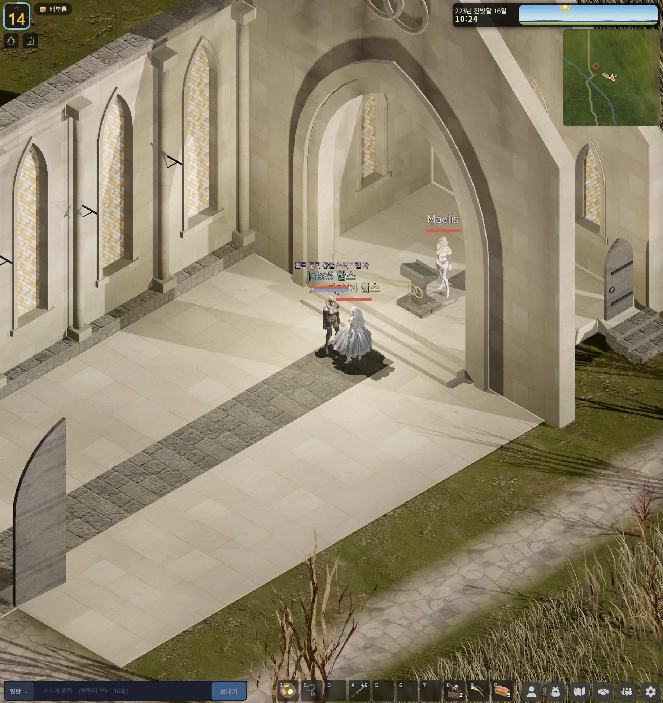

- **組み立て式キャラクター**：体を部位ごとに組み立てるので、外見と装備を自由に組み合わせられます
  - 作成時に顔、髪型、髪色、瞳の色を選択（プリセットまたは任意の色）
  - 8 つの職業すべてで男女を選択可能
  - 装備した兜、胴、手袋、ズボン、ブーツ、マント、武器がすべてキャラクターに表示

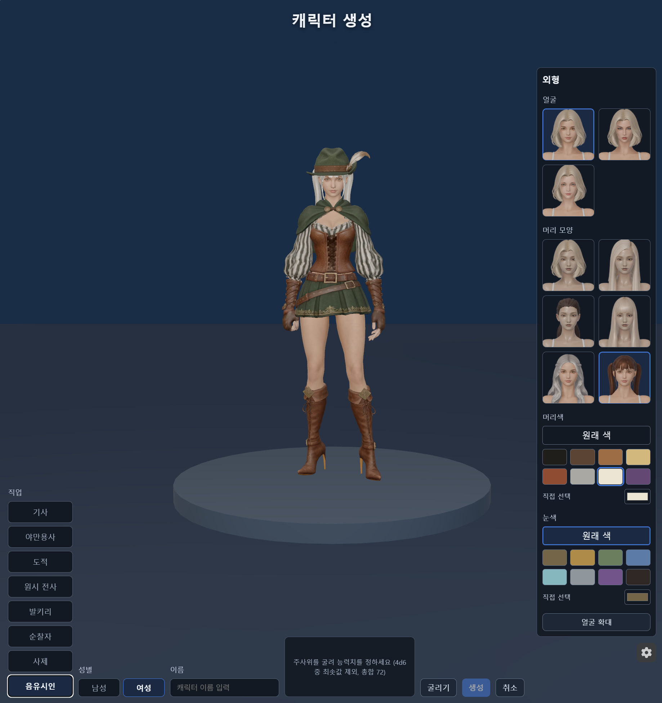

- **能力値と装備**：作成時に 4d6 の最低値を除外して振る NetHack／D&D 風の能力値、11 の装備スロット、重量制限付きインベントリ

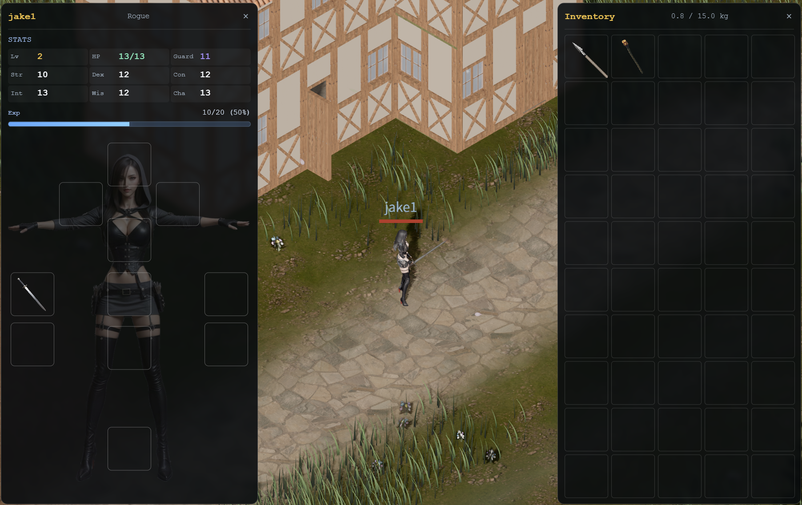

- **宿屋で目覚める**：戦闘で倒れると、村の宿屋の病室のベッドで目覚めます
  - Miriel や Cocoly など LLM で動く宿屋のメイドが枕元に来て、目覚めたあなたを介抱

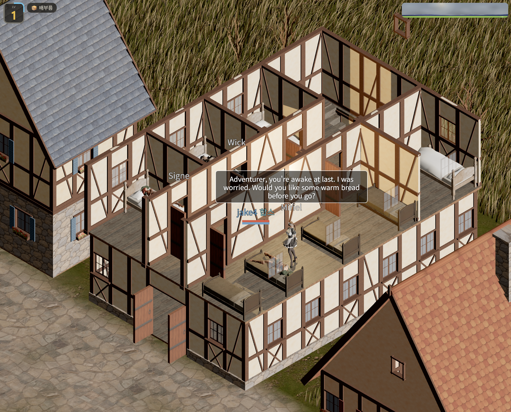

- **街道警備**：LLM で動く警備兵が昼番と夜番で街道を巡回します
  - 道に雪が積もると、巡回の途中で立ち止まり、ぼやきながら雪かきをする
  - 公道をふさぐ柵・家具・家は撤去されて押収される
  - プレイヤーも当番に加わり、警備兵と一緒に巡回して雪かきをし、日当を受け取れる

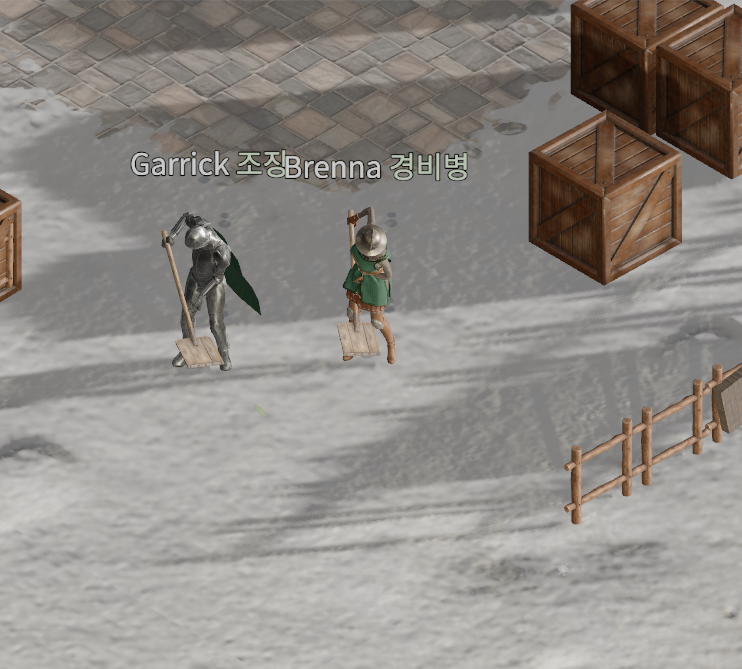

- **AI 生成 BGM**：約 50 曲の BGM を [Suno](https://suno.com) と [Google Flow Music](https://labs.google/fx/tools/music-fx) で生成
  - リュート、リコーダー、ハープ、弦楽器、打楽器、金管楽器を使った、Ultima に着想を得た中世ファンタジー調
  - 環境音楽と戦闘音楽を別々に用意。戦闘開始時にクロスフェードで戦闘曲へ移り、しばらく再生してから環境曲へフェードバック

その他の機能や開発の経緯は[開発ブログ](https://julian-adv.github.io/blog/)にあります。

## ドキュメント

- [旧開発ログ（2026 年 7 月まで）](doc/devlog/README.md)
- [開発ブログ](https://julian-adv.github.io/blog/)

**世界と地形**
- [ワールド構築](doc/WORLD_BUILDING.md)
- [マップと地形の設計](doc/MAP_DESIGN.md)
- [地形生成](doc/TERRAIN_GENERATION.md)
- [河川システム](doc/RIVER_SYSTEM.md)
- [水システム](doc/WATER_SYSTEM.md)
- [植生システム](doc/VEGETATION_SYSTEM.md)
- [ゾーンシステム](doc/ZONE_SYSTEM.md)
- [Splatmap v2](doc/SPLATMAP_V2.md)
- [天気システム](doc/WEATHER_SYSTEM.md)

**ゲームプレイシステム**
- [ハウジングシステム](doc/HOUSING_SYSTEM.md)
- [土地と領地](doc/LAND_SYSTEM.md)
- [家具店](doc/FURNITURE_SHOP.md)
- [家門システム](doc/FAMILY_SYSTEM.md)
- [街道警備](doc/ROAD_PATROL.md)
- [戦闘](doc/COMBAT.md)
- [強化](doc/ENCHANT.md)
- [NPC とモンスター AI](doc/NPC_MONSTER_AI.md)
- [アニメーション](doc/ANIMATION.md)
- [キャラクターカスタマイズ（設計）](doc/CHARACTER_CUSTOMIZATION.md)

**エンジンとパフォーマンス**
- [実行時パフォーマンス](doc/RUNTIME_PERFORMANCE.md)
- [読み込みの最適化](doc/LOADING_OPTIMIZATION.md)
- [指標と同時接続アカウント](doc/METRICS.md)
- [Pulse ダッシュボード](dashboard/README.md)

**アセットとエージェント**
- [アセット](doc/ASSETS.md)
- [エージェントクライアント](doc/AGENT_CLIENT.md)
- [AI エージェントでプレイ（openmmo-mcp）](doc/OPENMMO_MCP.md)

## 技術スタック

**クライアント**（ウェブブラウザで動作）：
- Svelte + TypeScript
- Three.js (Threlte) + WebGPU
- Vite

**サーバー：**
- Rust
- Tokio（非同期ランタイム）、ゲーム状態はブロードキャストチャンネルで共有
- tokio-tungstenite（WebSocket、すべてのクライアントとのリアルタイム双方向通信）
- Axum（地形 REST API）
- serde（JSON シリアライズ）

**エージェントクライアント：**
- Rust
- Tokio + tokio-tungstenite（WebSocket）
- Axum（ローカル観戦パネル）

**MCP サーバー（openmmo-mcp）：**
- Rust
- rmcp（公式 MCP Rust SDK、stdio）
- エージェントクライアントのセッションコードを再利用

**ダッシュボード：** ワールド指標とランキングを表示する管理者専用の Svelte アプリ（`dashboard/`）。[セットアップ](dashboard/README.md)を参照

## 開発

ローカルでのサーバー・クライアントの実行、デプロイ、ログの見方は [doc/DEVELOPMENT.md](doc/DEVELOPMENT.md)（英語）を参照してください。

## コントリビューション

コントリビューションを歓迎します！作業の選び方、CI が実行するチェック、PR の慣例については [CONTRIBUTING.md](CONTRIBUTING.md) を参照してください。初めてプルリクエストを開くと、ボットが PR 上のコメントで [Contributor License Agreement](CLA.md) への署名を求めます。コントリビューションをマージするには CLA への署名が必要です。

バイナリアセット（3D モデル・音楽・効果音）のコントリビューションは [doc/ASSETS.md](doc/ASSETS.md) を参照してください — git ではなく Hugging Face データセットへの PR で行います。
