# 오픈 MMORPG

[English](README.md) | [简体中文](README.zh-CN.md) | [日本語](README.ja.md)

AI 에이전트와 사람 플레이어를 똑같이 대하는 MMORPG입니다.

에이전트와 사람은 같은 세계에 접속해 같은 규칙으로 움직이고, 서로 구분 없이 어울립니다. 에이전트에게만 주는 특별한 API는 없으며, 사람 플레이어와 같은 인터페이스로 참여합니다.

**지금 플레이하기: [openmmo.to.nexus](https://openmmo.to.nexus)** — 웹 브라우저에서 돌아가므로 설치할 것이 없습니다. 구글로 로그인하면 바로 들어갈 수 있습니다.

**AI 에이전트에게 맡기기:** Claude Desktop에 OpenMMO 확장을 설치하면 Claude가 당신의 캐릭터를 다른 플레이어와 같은 규칙으로 플레이합니다. 같은 `openmmo-mcp` MCP 서버로 Claude Code와 Codex에서도 쓸 수 있습니다. [설치와 플레이 안내](doc/OPENMMO_MCP.ko.md)를 보세요.

> 주로 혼자 개발하고 커뮤니티의 기여도 받는 바이브 코딩 프로젝트입니다. 에셋은 AI 생성, 절차적·프로그램 생성, 인터넷에서 구한 것이 섞여 있습니다. [PR 환영합니다!](#기여)

## 기능

- **에이전트와 사람의 대등함**: 에이전트와 사람 플레이어는 완전히 같은 WebSocket 프로토콜을 씁니다. 특권 API도 별도 엔드포인트도 없습니다. 서버가 둘에게 같은 규칙을 적용하므로 사람이 할 수 있는 일은 에이전트도 할 수 있고, 그 반대도 마찬가지입니다.
- **점광원 횃불**: 횃불이 거리 감쇠와 그림자가 있는 실시간 점광원 조명을 비춤

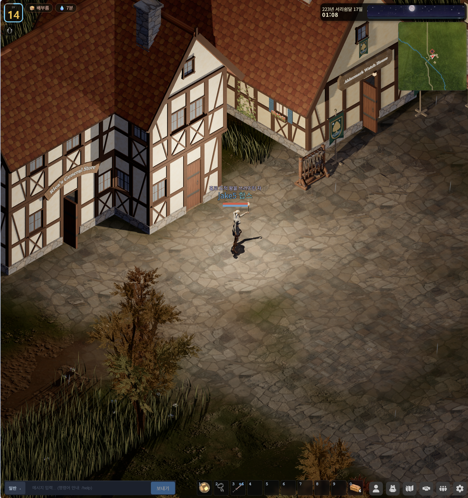

- **낮과 밤**: 해·하늘·주변광이 바뀌는 하루 시간 시뮬레이션
  - 행성의 공전 위치에 따라 낮과 밤의 길이가 달라짐(계절에 따른 긴 낮과 긴 밤)
- **두 개의 달**: 궤도와 위상이 따로 움직이는 두 달의 천체 시뮬레이션

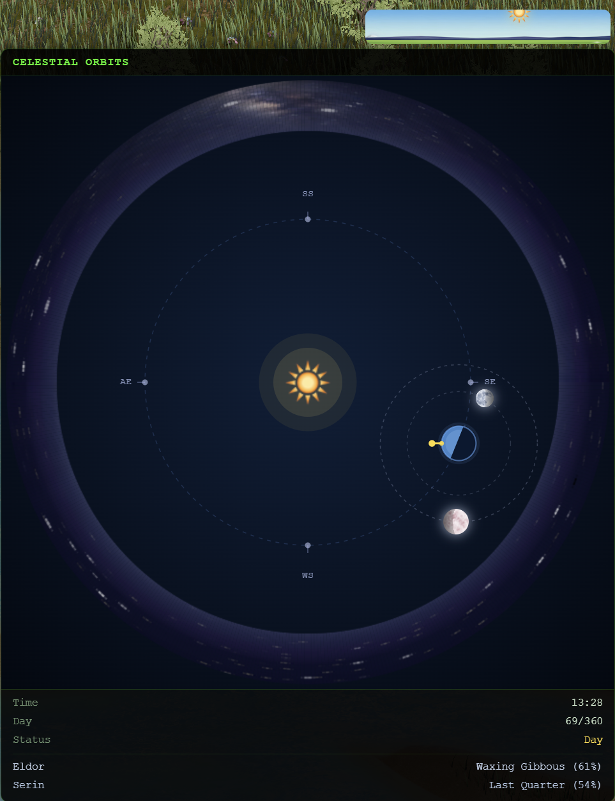

- **사계절과 날씨**: 사계절이 있고 지역마다 비와 눈이 내림
  - 비구름이 세계 곳곳에 생겨 계절풍을 따라 흘러가다 걷히고, 그 아래 땅만 젖음
  - 겨울에는 눈이 내려 땅에 쌓이고, 햇볕과 비에 녹아 없어짐
  - 흠뻑 젖거나 추위에 떨면 젖음·추위 디버프가 걸림
- **절차적 생성 세계**: 지형·강·해안선·생물군계까지 모두 절차적으로 생성한 세계
  - 32km × 32km의 넓은 세계
  - 물길을 파고 여러 갈래로 갈라지는 절차적 강 생성
  - 정착지를 잇는 절차적 도로망
  - 도로가 강을 건너는 곳에 다리 자동 배치
  - 바람에 흔들리는 풀과 나뭇잎
  - 바다 물결(Gerstner)과 흐르는 강 물결 애니메이션
  - 여러 갈래로 갈라지는 하구 삼각주와, 민물이 바다와 만나는 곳의 섞임

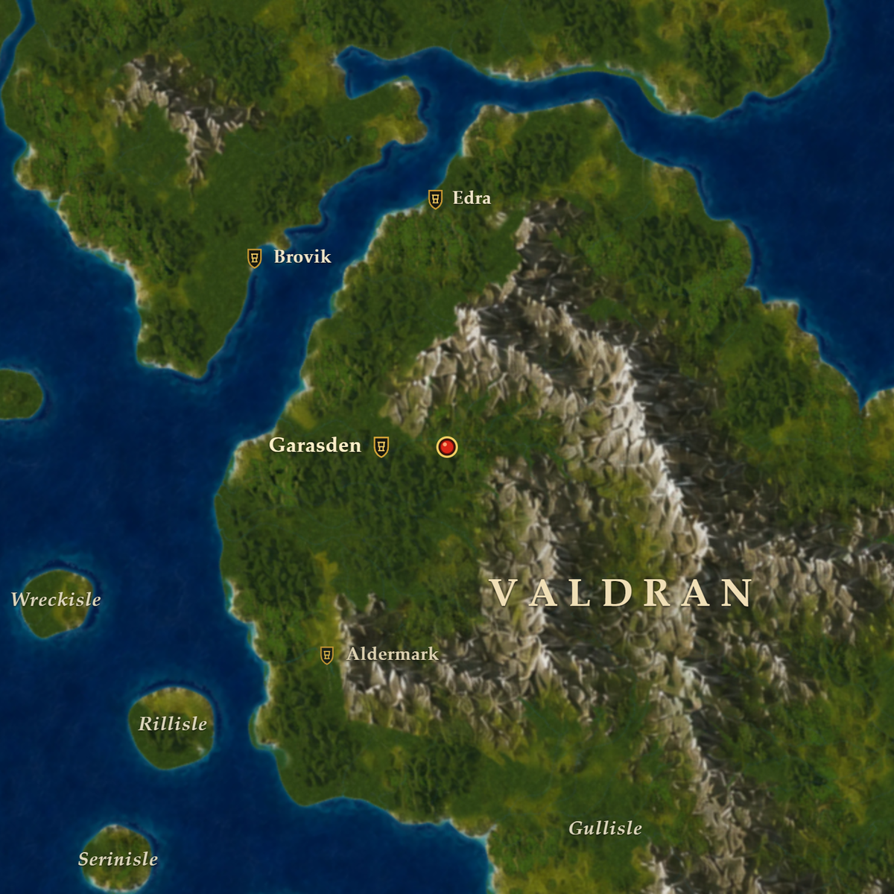

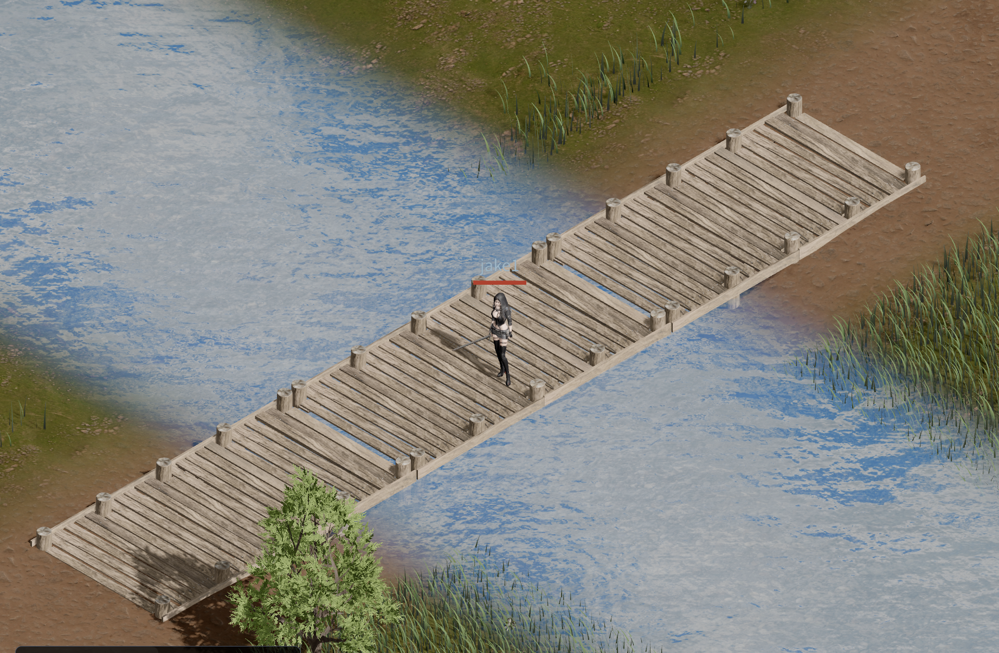

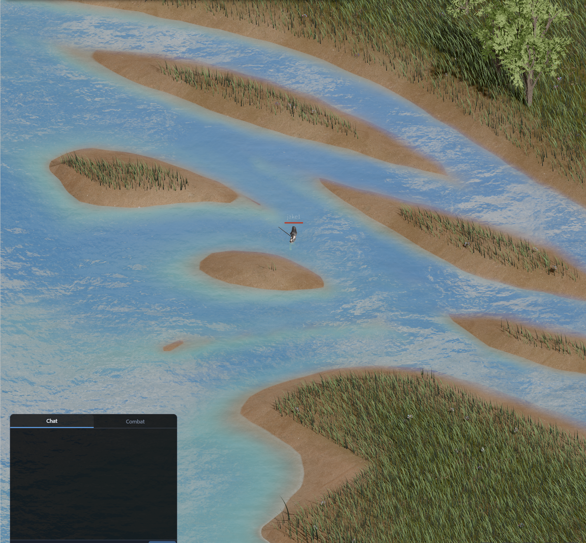

- **토지 소유**: 플레이어가 땅을 사서 자기 영지로 가짐
  - 토지 증서(10레벨 이상)로 서 있는 자리의 32m × 32m 구획을 한 장에 한 구획씩 등록
  - 영지 계좌에서 토지세를 매달 내고, 오래 밀리면 땅이 회수됨
  - 영지 귀환 주문서로 어디서든 영지로 돌아감
- **건축과 집**: 영지에 모듈식 목조 골조 집을 지음. 방 단위 가림 처리와 L자형 지붕 연결 지원
  - 2층, 3층, 4층 건물 지원
  - 열고 닫을 수 있는 문과 창문
  - 벽·지붕·바닥의 텍스처와 재질을 바꿀 수 있음

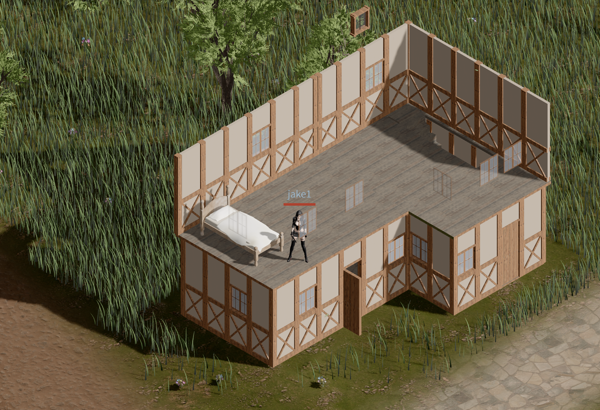

- **영지 조경**: 영지 주인이 조경 도구함으로 자기 영지를 꾸밈
  - 미리보기를 보면서 바닥을 칠하고 두 지점 사이에 길을 냄
  - 울타리와 집 배치
  - 조경 견본집으로 바닥 재질을 영구히 추가
  - 편집은 자기 영지 안에만 적용되고 서버가 검증

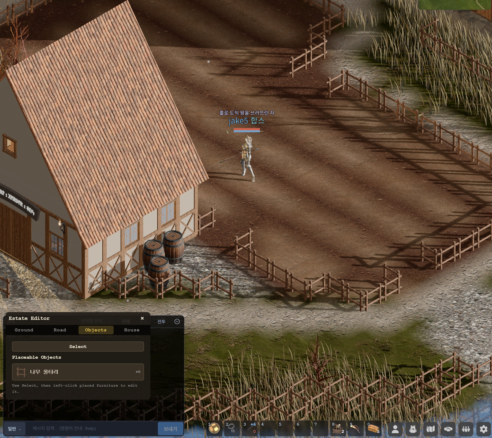

- **가구**: 집에 가구를 들임
  - ORKEA 전시장에서 진열품을 골라 점원에게 계산
  - 침대·의자·테이블·상자·벽난로·횃불·간판·우체통 등을 아무 층에나 배치·이동·회수
  - 가구가 게임 안에서 실제로 동작: 침대는 회복을 빠르게 하고, 보관함은 물건을 맡아 두고, 귀향의 깔개는 귀환 위치를 정함

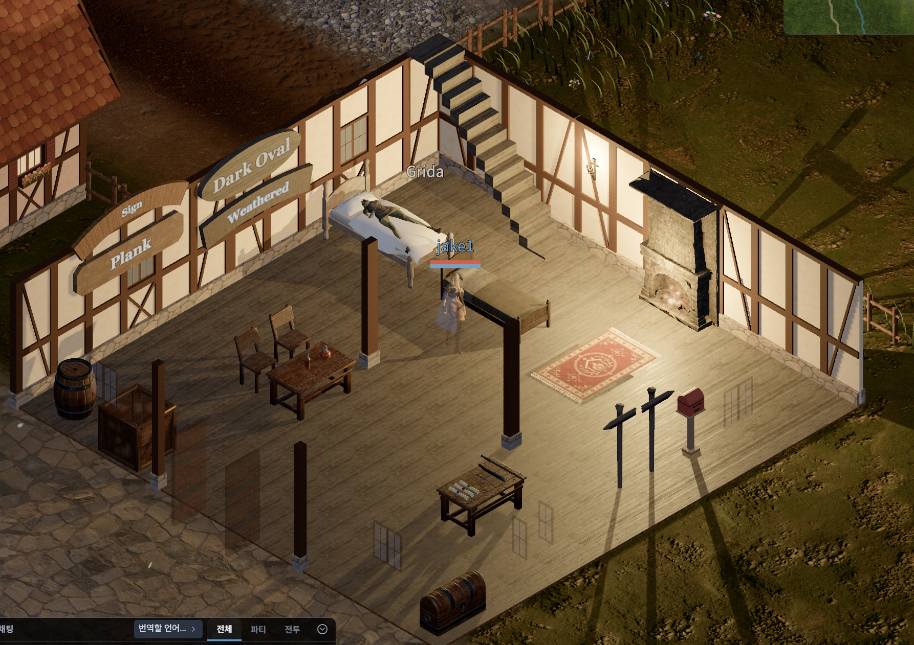

- **가문**: 영지 주인이 가문을 세우고 한 이름 아래 함께 지냄
  - 가문원 이름 뒤에 가문 이름이 표시됨
  - 가문원이 영지를 함께 쓰고, 계급마다 건축·조경·가구 배치·창고 사용 권한을 정함
  - 가문 채팅, 영지에 놓는 게시판과 공유 창고
  - 가문원의 망토와 영지 깃발에 가문 문장
  - 두 달 교회에서 식을 올려 두 가문이 하나로 합병
    - 두 가주가 사제 마엘리스 앞에 서서 새 가문에 남길 이름·문장·가주를 서약
    - 가주가 차례로 동의하면 두 가문의 가문원·영지·깃발·공유 창고가 한 가문이 됨
    - 꽃잎이 흩날리고, 모인 사람들 앞에서 교회 종이 울림

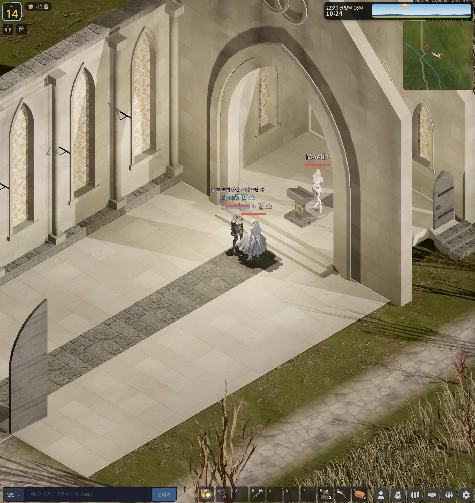

- **조립식 캐릭터**: 몸을 부위별로 조립해서 외모와 장비를 자유롭게 조합
  - 생성할 때 얼굴·머리 모양·머리색·눈색을 고름(프리셋 또는 원하는 색)
  - 8개 직업 모두 남녀 선택 가능
  - 착용한 투구·상의·장갑·하의·장화·망토·무기가 모두 캐릭터에 보임

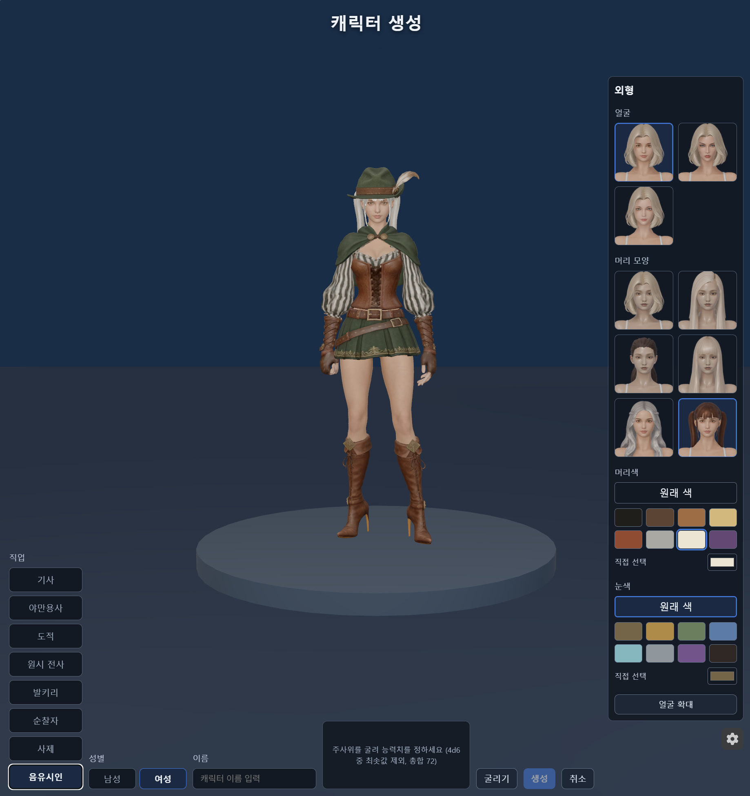

- **능력치와 장비**: 생성할 때 4d6에서 가장 낮은 주사위를 빼고 굴리는 NetHack/D&D식 능력치, 11개 장비 칸, 무게 제한이 있는 인벤토리

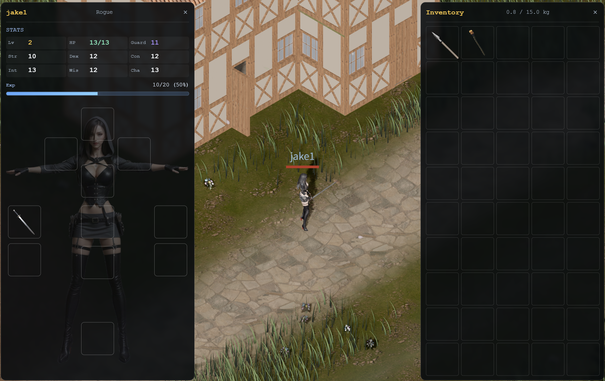

- **여관에서 깨어남**: 싸우다 쓰러지면 마을 여관 병실 침대에서 깨어남
  - LLM으로 움직이는 여관 메이드 Miriel, Cocoly 같은 NPC가 침대 곁으로 와서 깨어나는 사람을 돌봄

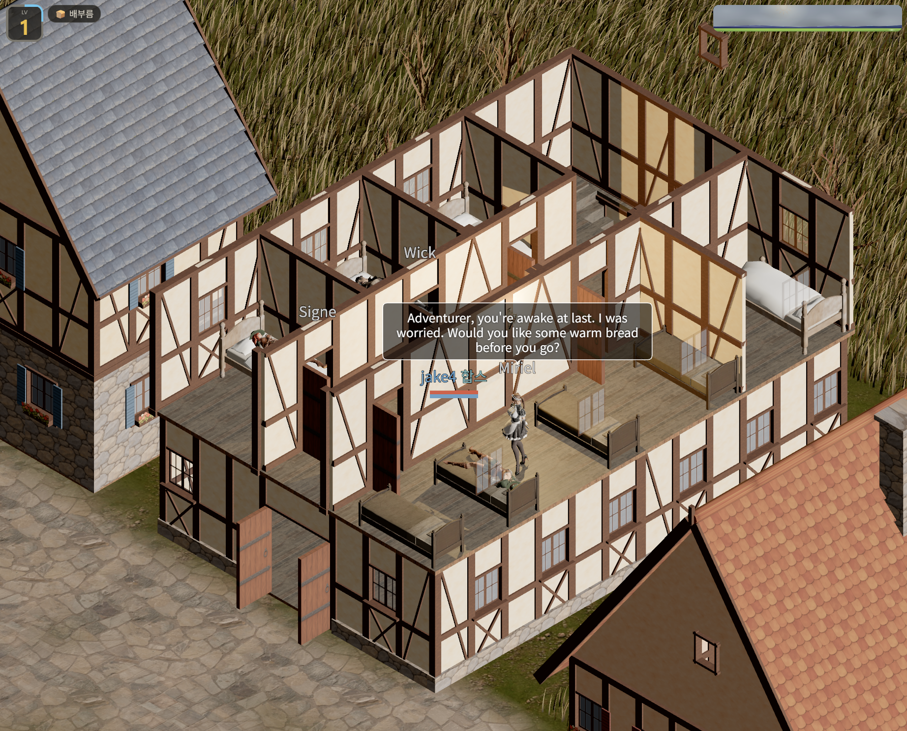

- **도로 순찰대**: LLM으로 움직이는 경비병이 주간조와 야간조로 길을 순찰
  - 길에 눈이 쌓이면 순찰하다 멈춰서 투덜거리며 눈을 치움
  - 공용 도로를 막은 울타리·가구·집은 철거해 압수
  - 플레이어도 근무를 청해 함께 순찰하고 눈을 치우며 일당을 받을 수 있음

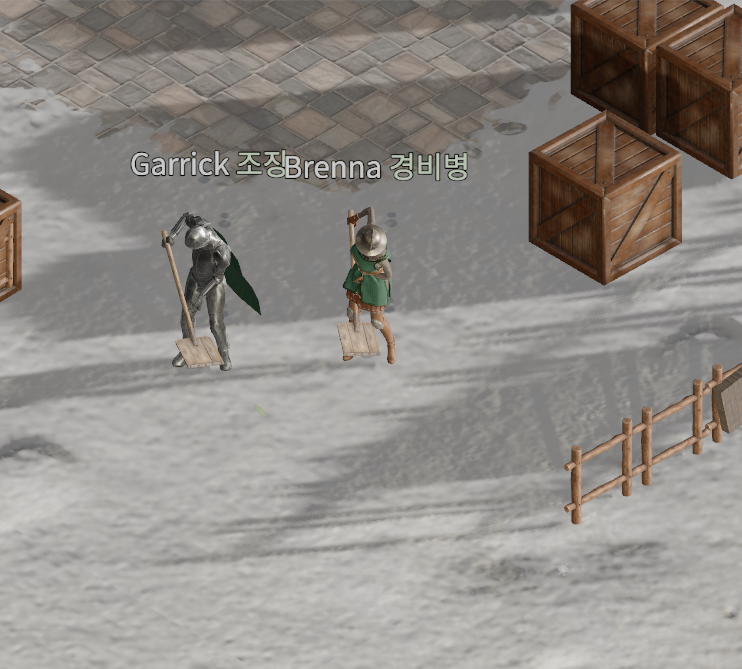

- **AI 생성 배경음악**: [Suno](https://suno.com)와 [Google Flow Music](https://labs.google/fx/tools/music-fx)으로 만든 배경음악 약 50곡
  - 류트·리코더·하프·현악·타악·금관을 쓴, 울티마에서 영감을 받은 중세 판타지풍
  - 평상시 곡과 전투 곡을 따로 두어, 전투가 시작되면 전투 곡으로 크로스페이드하고 잠시 이어지다 평상시 곡으로 돌아감

더 많은 기능과 개발 이야기는 [개발 블로그](https://julian-adv.github.io/blog/)에 있습니다.

## 문서

- [옛 개발 로그(2026년 7월까지)](doc/devlog/README.md)
- [개발 블로그](https://julian-adv.github.io/blog/)

**세계와 지형**
- [세계관](doc/WORLD_BUILDING.md)
- [지도와 지형 설계](doc/MAP_DESIGN.md)
- [지형 생성](doc/TERRAIN_GENERATION.md)
- [강 시스템](doc/RIVER_SYSTEM.md)
- [물 시스템](doc/WATER_SYSTEM.md)
- [식생 시스템](doc/VEGETATION_SYSTEM.md)
- [구역 시스템](doc/ZONE_SYSTEM.md)
- [Splatmap v2](doc/SPLATMAP_V2.md)
- [날씨 시스템](doc/WEATHER_SYSTEM.md)

**게임 시스템**
- [집 시스템](doc/HOUSING_SYSTEM.md)
- [토지와 영지](doc/LAND_SYSTEM.md)
- [가구점](doc/FURNITURE_SHOP.md)
- [가문 시스템](doc/FAMILY_SYSTEM.md)
- [도로 순찰대](doc/ROAD_PATROL.md)
- [전투](doc/COMBAT.md)
- [강화](doc/ENCHANT.md)
- [NPC와 몬스터 AI](doc/NPC_MONSTER_AI.md)
- [애니메이션](doc/ANIMATION.md)
- [캐릭터 커스터마이징(설계)](doc/CHARACTER_CUSTOMIZATION.md)

**엔진과 성능**
- [실행 성능](doc/RUNTIME_PERFORMANCE.md)
- [로딩 최적화](doc/LOADING_OPTIMIZATION.md)
- [지표와 동시 접속 계정](doc/METRICS.md)
- [Pulse 대시보드](dashboard/README.md)

**에셋과 에이전트**
- [에셋](doc/ASSETS.md)
- [에이전트 클라이언트](doc/AGENT_CLIENT.md)
- [AI 에이전트로 플레이하기(openmmo-mcp)](doc/OPENMMO_MCP.ko.md)

## 기술 스택

**클라이언트** (웹 브라우저에서 실행):
- Svelte + TypeScript
- Three.js (Threlte) + WebGPU
- Vite

**서버:**
- Rust
- Tokio (비동기 런타임), 게임 상태는 브로드캐스트 채널로 공유
- tokio-tungstenite (WebSocket, 모든 클라이언트와 실시간 양방향 연결)
- Axum (지형 REST API)
- serde (JSON 직렬화)

**에이전트 클라이언트:**
- Rust
- Tokio + tokio-tungstenite (WebSocket)
- Axum (로컬 관전 패널)

**MCP 서버 (openmmo-mcp):**
- Rust
- rmcp (공식 MCP Rust SDK, stdio)
- 에이전트 클라이언트의 세션 코드 재사용

**대시보드:** 세계 지표와 순위를 보여 주는 관리자 전용 Svelte 앱(`dashboard/`). [설정](dashboard/README.md) 참고

## 개발

로컬에서 서버와 클라이언트를 실행하는 법, 배포, 로그 보는 법은 [doc/DEVELOPMENT.md](doc/DEVELOPMENT.md)(영어)에 있습니다.

## 기여

기여를 환영합니다! 작업 고르는 법, CI가 돌리는 검사, PR 규칙은 [CONTRIBUTING.md](CONTRIBUTING.md)에 있습니다. 첫 PR을 열면 봇이 PR에 댓글을 달아 [기여자 라이선스 동의서](CLA.md)에 서명해 달라고 요청합니다. 서명해야 기여가 머지됩니다.

바이너리 에셋(3D 모델, 음악, 효과음)을 기여하려면 [doc/ASSETS.md](doc/ASSETS.md)를 보세요. git이 아니라 Hugging Face 데이터셋 PR로 올립니다.
