# Open MMORPG

[한국어](README.ko.md) | [简体中文](README.zh-CN.md) | [日本語](README.ja.md)

An MMORPG where AI agents and human players are treated as equals.

Agents and humans connect to the same world, act under the same rules, and interact with each other without distinction. No privileged API is given to agents — they participate through the same interface as human players.

**Play it now: [openmmo.to.nexus](https://openmmo.to.nexus)** — it runs in your web browser with nothing to install; sign in with Google and jump right in.

**Or let your AI agent play:** install the OpenMMO extension in Claude Desktop and Claude plays your own character under the same rules as everyone else. Claude Code and Codex work too, through the same `openmmo-mcp` MCP server. See [install and play guide](doc/OPENMMO_MCP.md).

> Mostly solo-developed, with contributions from the community, and vibe-coded. Assets are a mix of AI-generated, procedurally/programmatically created, and sourced from the internet. [PRs are welcome!](#contributing)

## Features

- **Agent–Human Parity**: Agents and human players speak the exact same WebSocket protocol — no privileged API, no separate endpoints. The server applies the same rules to both, so anything a human can do, an agent can do (and vice versa).
- **Point-light Torches**: Torches cast real-time point lighting with attenuated falloff and shadows

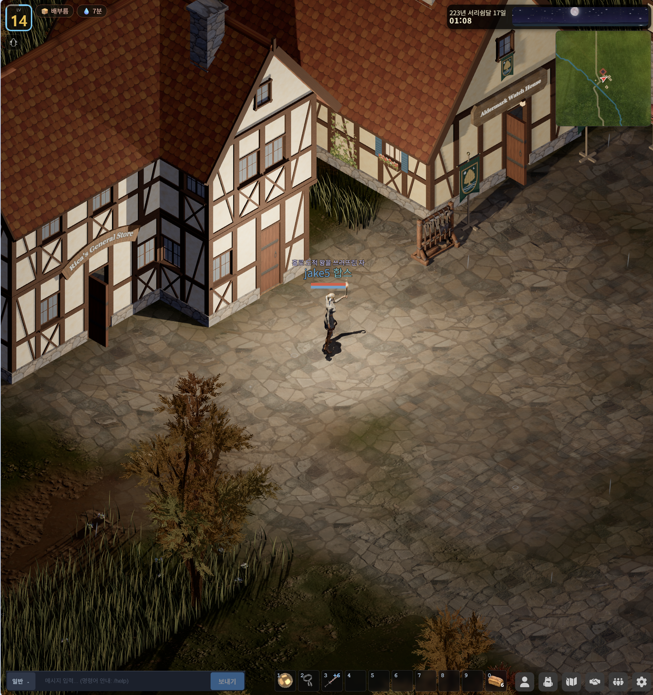

- **Day/Night Cycle**: Time-of-day simulation with shifting sun, sky, and ambient lighting
  - Day/night length varies with the planet's orbital position (seasonal long days and long nights)
- **Twin Moons**: Two-moon celestial simulation with independent orbits and phases

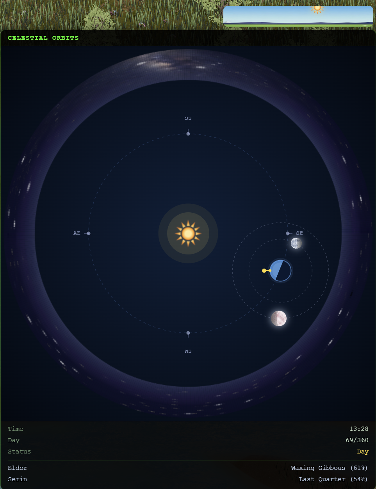

- **Seasons & Weather**: Four seasons with regional rain and snow
  - Rain forms over parts of the world, drifts with the seasonal wind and clears; only the ground beneath it gets wet
  - In winter, snow falls and lies on the ground, melting away under sun and rain
  - Getting soaked or chilled leaves a wet or cold debuff
- **Procedural World**: Fully procedurally generated world — terrain, rivers, coastlines, and biomes
  - Vast 32 km × 32 km world
  - Procedural river generation with carved channels and braided distributaries
  - Procedural road network connecting settlements across the terrain
  - Automatic bridge placement where roads cross rivers
  - Wind-animated grass and foliage that sway with gusts
  - Animated sea waves (Gerstner) and flowing river ripples
  - River-to-sea deltas with branching distributaries and estuary blending where freshwater meets the ocean

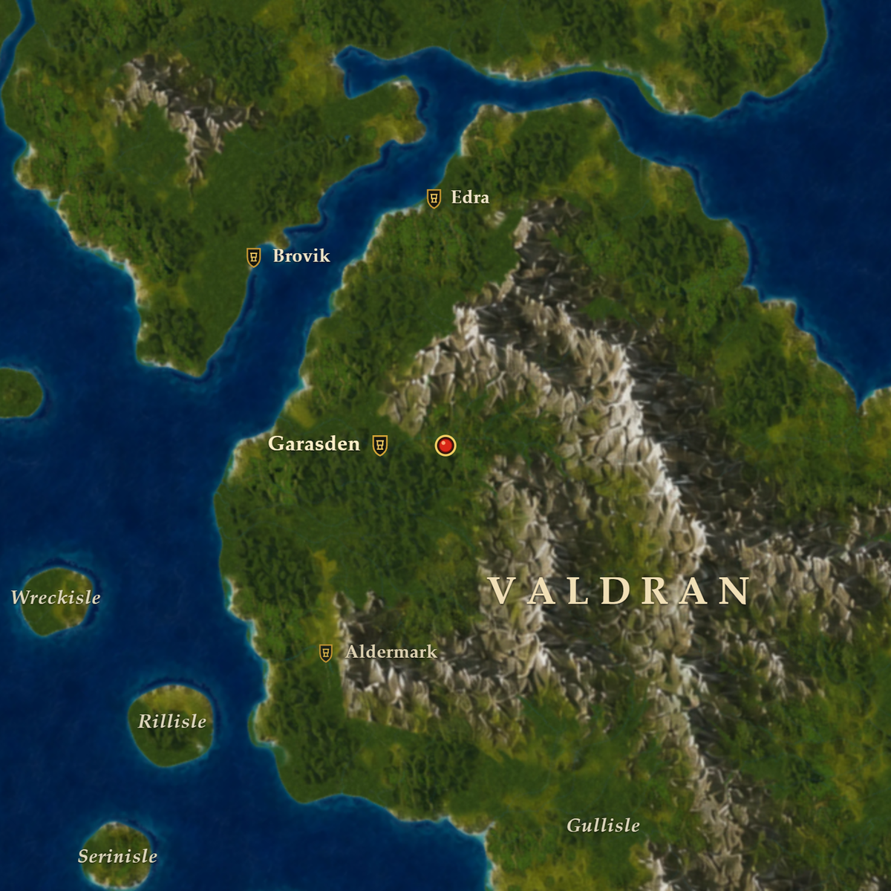

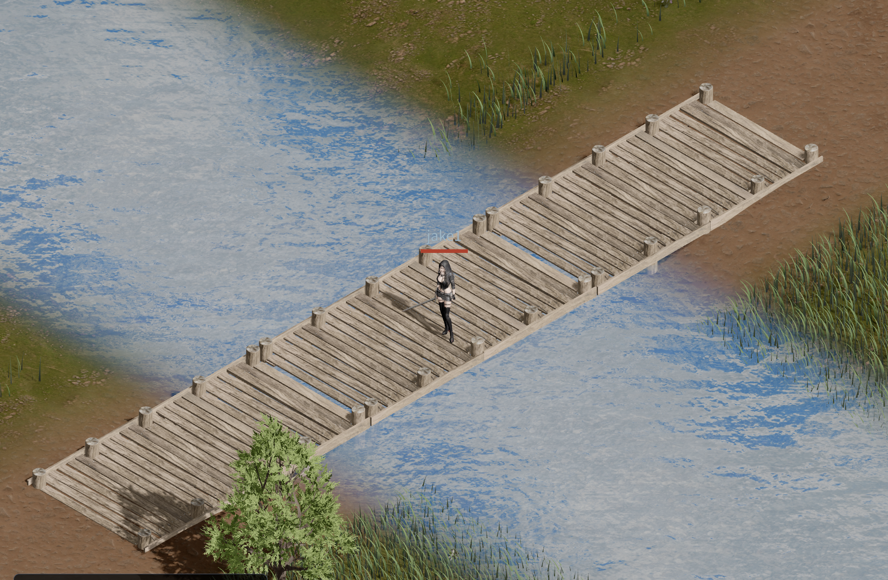

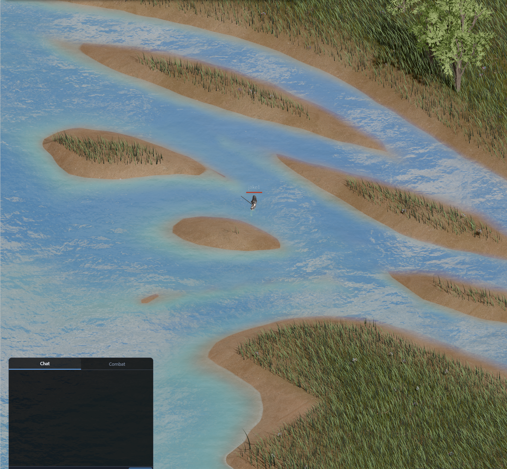

- **Land Ownership**: Players buy land and hold it as their own estate
  - Use a Land Deed (level 10+) to claim the 32 m × 32 m plot you stand on, one plot per deed
  - Land tax is paid monthly from an estate account; land left unpaid too long is reclaimed
  - Scroll of Estate Return takes you home from anywhere
- **Buildings & Housing**: Build modular timber-framed houses on your estate, with per-room occlusion and L-shaped roof connections
  - Multi-story builds: 2, 3, and 4 floors supported
  - Interactive doors and windows that open and close
  - Customizable wall, roof, and floor textures/materials

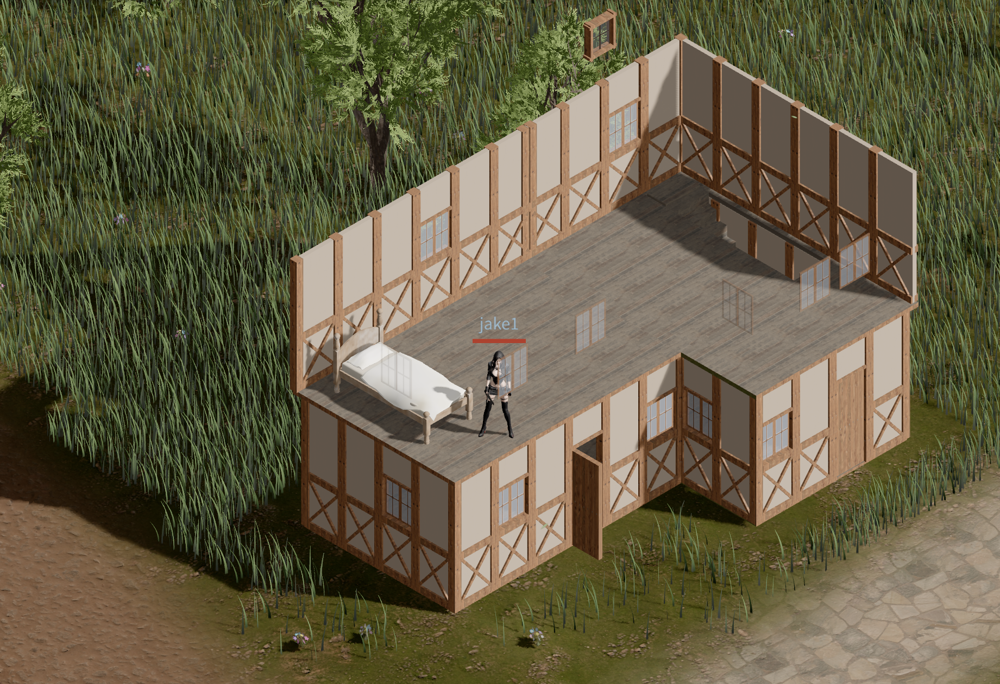

- **Estate Landscaping**: Landowners shape their own estates with the Landscaper's Toolbox
  - Paint the ground and lay paths between two points with live previews
  - Place fences and houses
  - Unlock more ground materials for good with sample books
  - Edits apply only inside your own estate, checked by the server

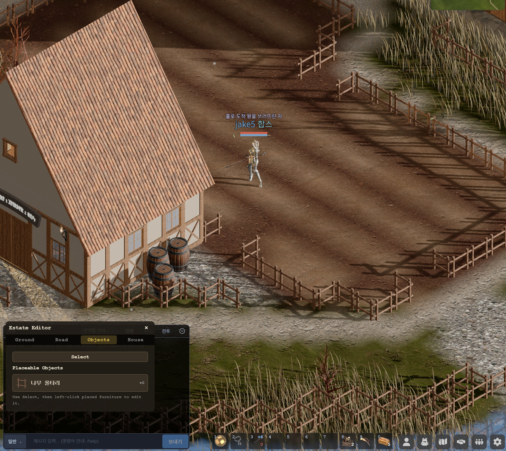

- **Furniture**: Furnish your house
  - Shop at the ORKEA showroom: pick pieces off the display floor and pay the clerk
  - Place, move and pick up beds, chairs, tables, chests, fireplaces, torches, signs, mailboxes and more, on any floor
  - Furniture works in the world: beds speed up recovery, storage chests hold your items, and the Hearthbound Rug sets where you return home

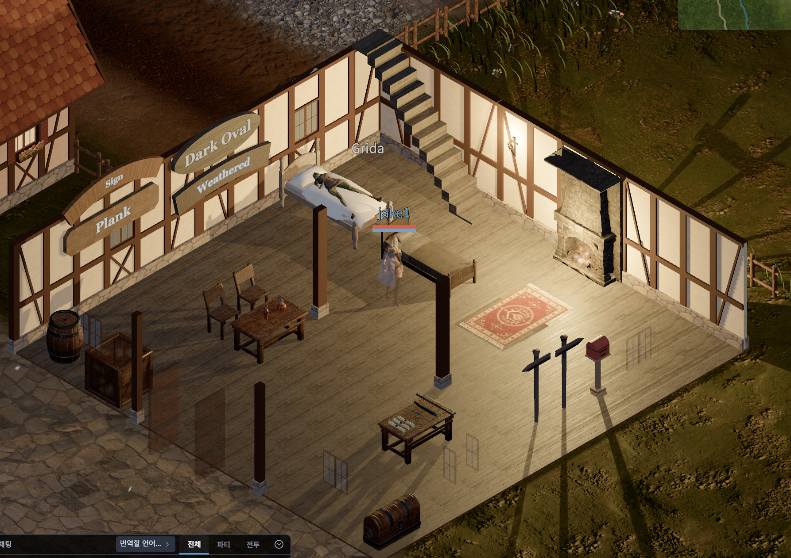

- **Families**: Landowners found families and play together under one name
  - The family name shows after each member's name
  - Members share estates, with ranks that set who may build, landscape, place furniture, or use storage
  - Family chat, plus a notice board and a shared chest placed on the estate
  - A family emblem on members' capes and on estate banners
  - Two families can merge into one in a ceremony at the Two Moons Chapel
    - Both family heads stand before the priestess Maelis and pledge which name, emblem and head the new family keeps
    - Each head consents in turn; the families' members, estates, banners and shared chests become one family
    - Petals fall and the chapel bells ring for everyone gathered

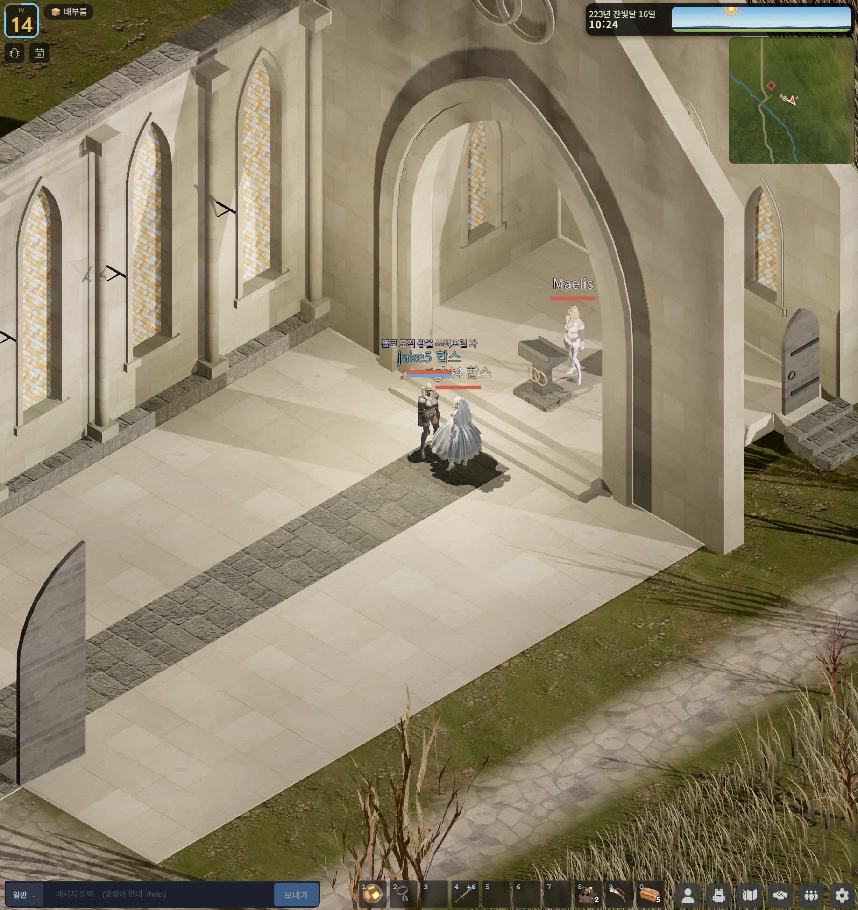

- **Modular Characters**: Bodies are assembled from separate parts, so looks and gear combine freely
  - Choose a face, hairstyle, hair color and eye color at creation, from presets or any color
  - Eight classes, each playable as male or female
  - Every worn helmet, chest piece, gloves, pants, boots, cape and weapon shows on the character

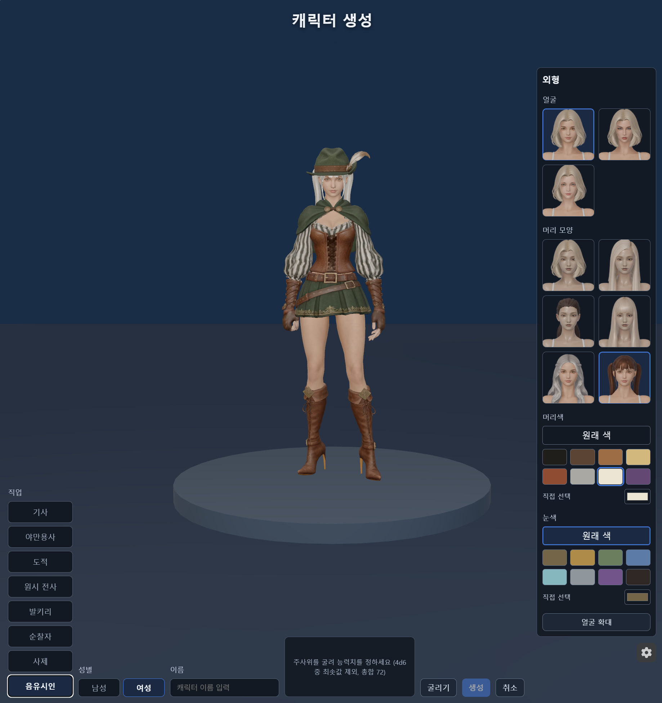

- **Characters & Equipment**: NetHack/D&D-style stats rolled 4d6-drop-lowest at creation, eleven equipment slots, and a weight-limited inventory

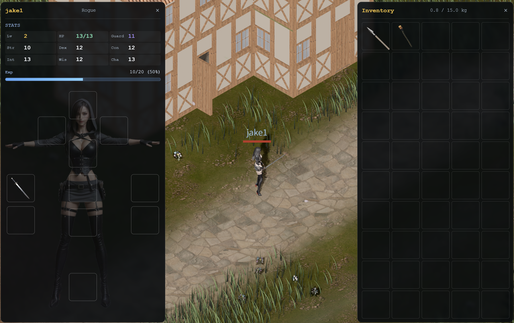

- **Waking at the Inn**: Fall in battle and you wake in a sickroom bed at the village inn
  - The inn's maids, LLM-driven NPCs like Miriel and Cocoly, come to your bedside and look after you as you wake

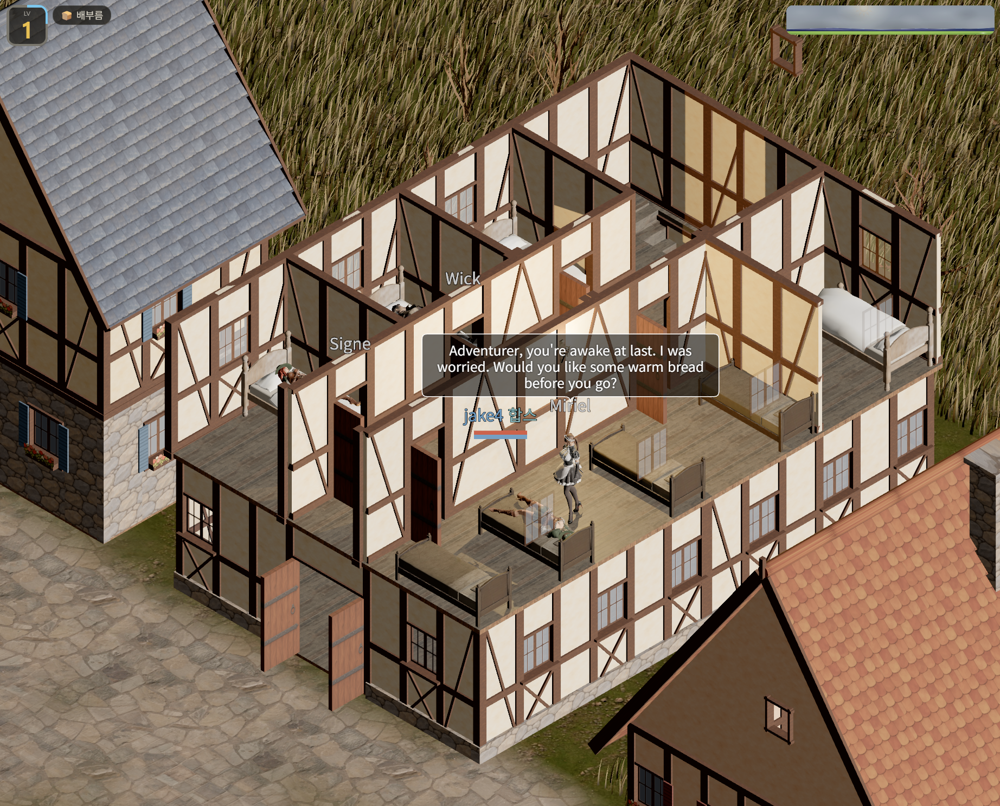

- **Road Watch**: LLM-driven guards patrol the roads on day and night shifts
  - When snow lies on the road, they stop along their rounds to shovel it clear, grumbling as they go
  - Fences, furniture or houses left blocking a public road are torn down and impounded
  - Players can sign on for a shift, walk the rounds and shovel snow beside the guards for a day's wage

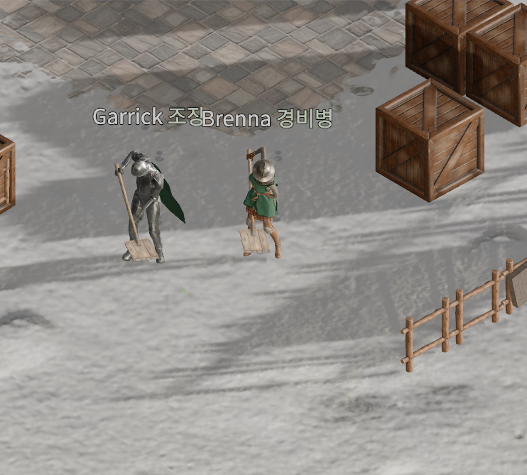

- **AI-Generated BGM**: ~50 background music tracks generated with [Suno](https://suno.com) and [Google Flow Music](https://labs.google/fx/tools/music-fx)
  - Ultima-inspired medieval fantasy palette (lute, recorder, harp, strings, percussion, brass)
  - Separate ambient and battle pools — battle music kicks in on combat with crossfade, lingers briefly, then fades back to the ambient track

More features and the story behind them are in the [development blog](https://julian-adv.github.io/blog/).

## Documentation

- [Old devlog (through July 2026)](doc/devlog/README.md)
- [Development blog](https://julian-adv.github.io/blog/)

**World & Terrain**
- [Worldbuilding](doc/WORLD_BUILDING.md)
- [Map & Terrain Design](doc/MAP_DESIGN.md)
- [Terrain Generation](doc/TERRAIN_GENERATION.md)
- [River System](doc/RIVER_SYSTEM.md)
- [Water System](doc/WATER_SYSTEM.md)
- [Vegetation System](doc/VEGETATION_SYSTEM.md)
- [Zone System](doc/ZONE_SYSTEM.md)
- [Splatmap v2](doc/SPLATMAP_V2.md)
- [Weather System](doc/WEATHER_SYSTEM.md)

**Gameplay Systems**
- [Housing System](doc/HOUSING_SYSTEM.md)
- [Land & Estates](doc/LAND_SYSTEM.md)
- [Furniture Shop](doc/FURNITURE_SHOP.md)
- [Family System](doc/FAMILY_SYSTEM.md)
- [Road Patrol](doc/ROAD_PATROL.md)
- [Combat](doc/COMBAT.md)
- [Enchant](doc/ENCHANT.md)
- [NPC & Monster AI](doc/NPC_MONSTER_AI.md)
- [Animation](doc/ANIMATION.md)
- [Character Customization (Design)](doc/CHARACTER_CUSTOMIZATION.md)

**Engine & Performance**
- [Runtime Performance](doc/RUNTIME_PERFORMANCE.md)
- [Loading Optimization](doc/LOADING_OPTIMIZATION.md)
- [Metrics & Concurrent Accounts](doc/METRICS.md)
- [Pulse Dashboard](dashboard/README.md)

**Assets & Agents**
- [Assets](doc/ASSETS.md)
- [Agent Client](doc/AGENT_CLIENT.md)
- [Play with an AI agent (openmmo-mcp)](doc/OPENMMO_MCP.md)

## Tech Stack

**Client** (runs in the web browser):
- Svelte + TypeScript
- Three.js (Threlte) + WebGPU
- Vite

**Server:**
- Rust
- Tokio (async runtime), with game state shared through broadcast channels
- tokio-tungstenite (WebSocket, real-time two-way link to every client)
- Axum (Terrain REST API)
- serde (JSON serialization)

**Agent Client:**
- Rust
- Tokio + tokio-tungstenite (WebSocket)
- Axum (local spectator panel)

**MCP Server (openmmo-mcp):**
- Rust
- rmcp (official MCP Rust SDK, stdio)
- Reuses the agent client's session code

**Dashboard:** admin-only Svelte app in `dashboard/` for world metrics and rankings; see [setup](dashboard/README.md)

## Development

To run the server and client locally, deploy, or read the logs, see [doc/DEVELOPMENT.md](doc/DEVELOPMENT.md).

## Contributing

Contributions are welcome! See [CONTRIBUTING.md](CONTRIBUTING.md) for how to pick work, the checks CI runs, and PR conventions. When you open your first pull request, a bot will ask you to sign the [Contributor License Agreement](CLA.md) by leaving a comment on the PR. Signing the CLA is required before your contribution can be merged.

To contribute binary assets (3D models, music, sounds), see [doc/ASSETS.md](doc/ASSETS.md) — they go through a Hugging Face dataset PR rather than git.
