# 开放式 MMORPG

[English](README.md) | [한국어](README.ko.md) | [日本語](README.ja.md)

一个平等对待 AI 智能体和人类玩家的 MMORPG。

智能体与人类连接到同一个世界，遵循相同规则行动，并且彼此互动时不作区分。智能体不会获得特权 API，而是通过与人类玩家相同的接口参与游戏。

**立即游玩：[openmmo.to.nexus](https://openmmo.to.nexus)** — 在网页浏览器中运行，无需安装；使用 Google 登录，即刻进入游戏。

**让你的 AI 智能体来玩：** 通过 MCP 服务器 `openmmo-mcp` 作为 Claude Desktop 扩展安装（也支持 Claude Code 和 Codex），模型会以与其他玩家相同的规则操作你自己的角色。请参阅[安装与游玩指南](doc/OPENMMO_MCP.md)。

> 本项目主要由个人开发，也有来自社区的贡献，并采用氛围编程（vibe coding）。素材由 AI 生成、程序化创建和从互联网获取的内容混合组成。[欢迎提交 PR！](#贡献)

## 功能

- **智能体与人类平等**：智能体和人类玩家使用完全相同的 WebSocket 协议，不存在特权 API 或独立端点。服务器对二者适用相同的规则，因此人类能做的任何行为，智能体也能做（反之亦然）。
- **点光源火把**：火把投射具有衰减效果和阴影的实时点光源

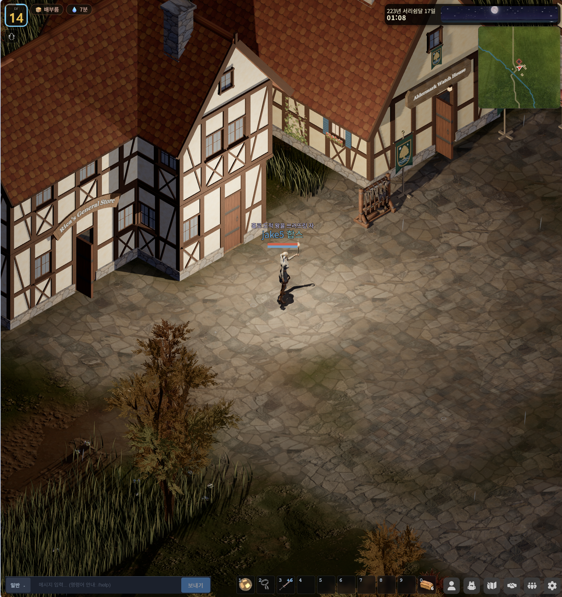

- **昼夜循环**：模拟日照时间变化，包括太阳、天空和环境光照的动态变化
  - 昼夜长度随行星轨道位置变化（季节性的长昼与长夜）
- **双月系统**：两个卫星拥有各自独立的轨道和月相模拟

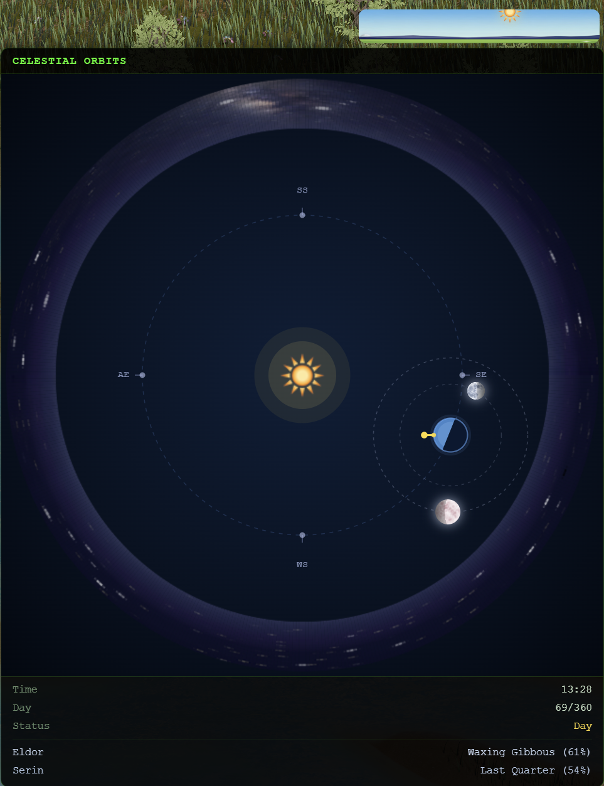

- **四季与天气**：拥有四季，各地区会下雨和下雪
  - 雨云在世界各处形成，随季风飘移并消散，只有其下方的地面会被淋湿
  - 冬季会下雪并在地面积雪，在阳光和雨水中渐渐融化
  - 被淋透或受冻会获得潮湿或寒冷减益
- **程序化世界**：地形、河流、海岸线和生物群系均完全由程序生成
  - 广阔的 32 公里 × 32 公里世界
  - 程序化生成河流，包含冲刷形成的河道与辫状分流
  - 连接各地聚落的程序化道路网络
  - 道路跨越河流时自动放置桥梁
  - 随阵风摇曳的动态草地和植被
  - 带动画效果的海浪（Gerstner）与流动河面波纹
  - 河流入海处形成具有分支分流和河口淡咸水交融效果的三角洲

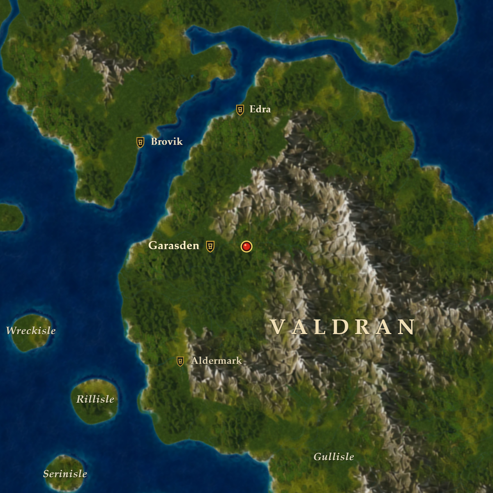

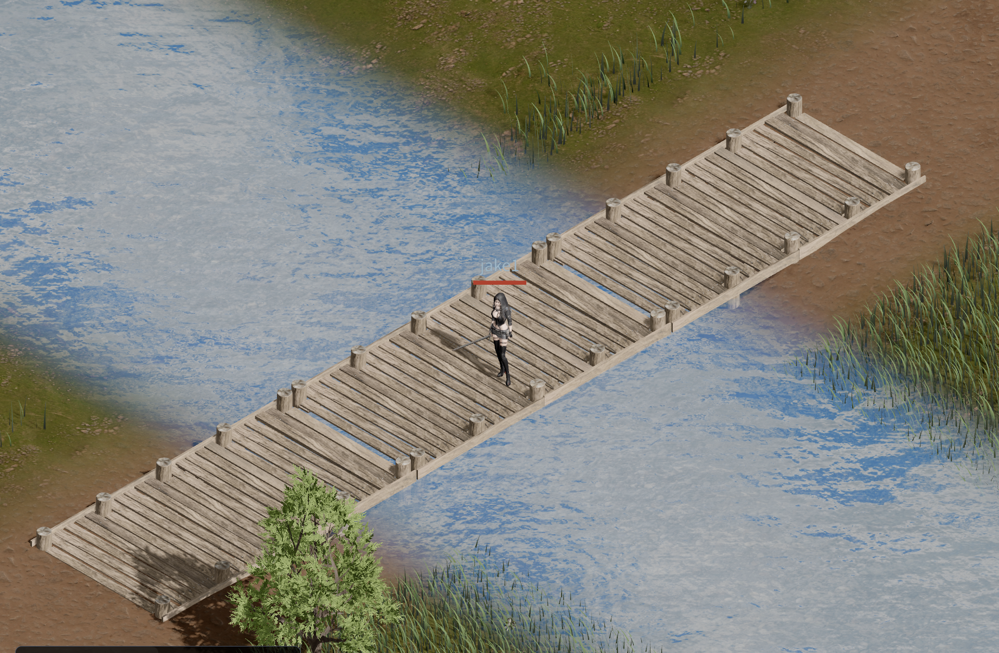

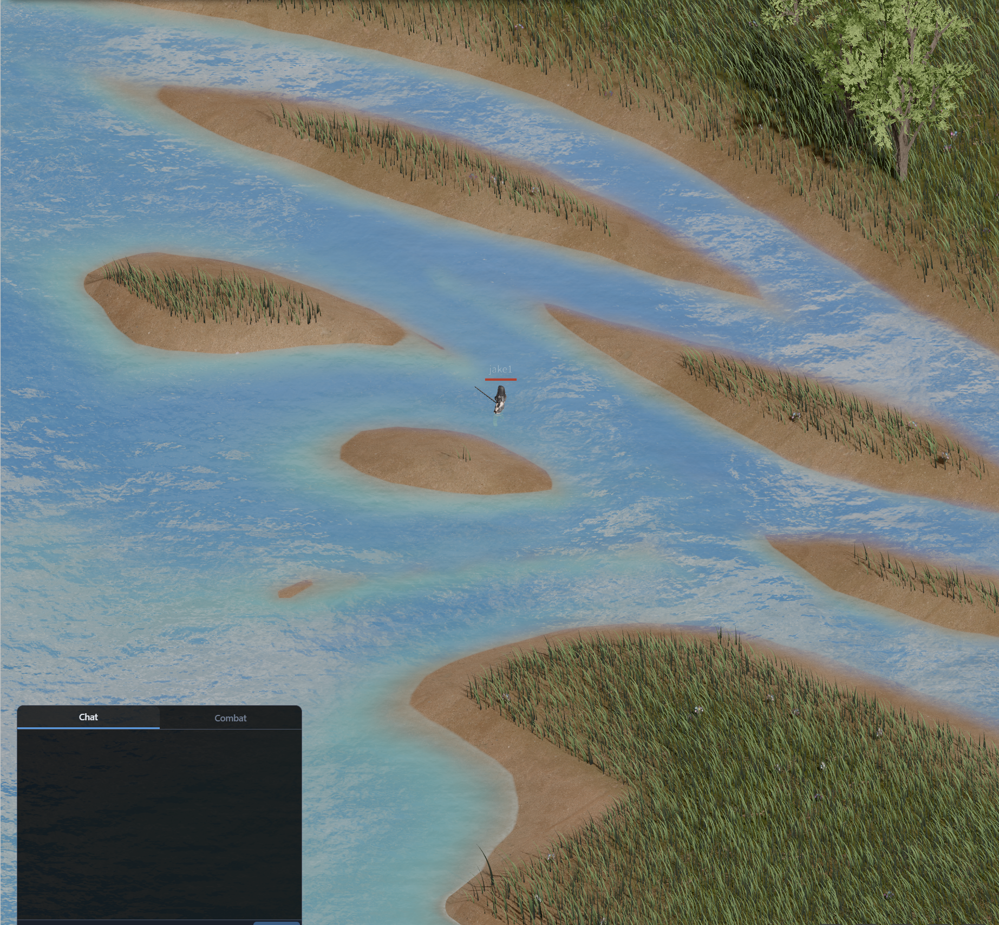

- **土地所有**：玩家可以购买土地，作为自己的领地
  - 使用地契（10 级以上）登记脚下 32 m × 32 m 的地块，每张地契一块
  - 土地税每月从领地账户缴纳，长期欠缴的土地会被收回
  - 领地传送卷轴可从任何地方回到领地
- **建筑与住宅**：在领地上建造模块化木框架房屋，支持逐房间遮挡和 L 形屋顶连接
  - 支持 2 层、3 层和 4 层的多层建筑
  - 可交互开关的门窗
  - 可自定义墙壁、屋顶和地板的纹理/材质

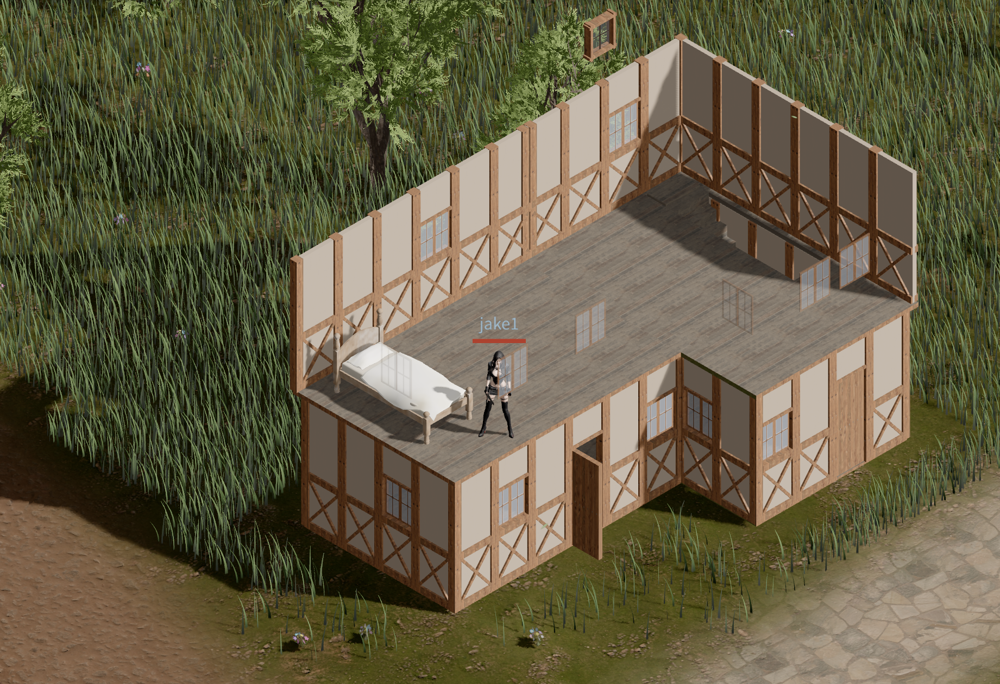

- **领地造景**：领主可以用园艺工具箱打理自己的领地
  - 一边预览一边铺设地面，并在两点之间铺路
  - 放置栅栏和房屋
  - 用园艺样本册永久解锁更多地面材质
  - 编辑只作用于自己的领地内，并由服务器校验

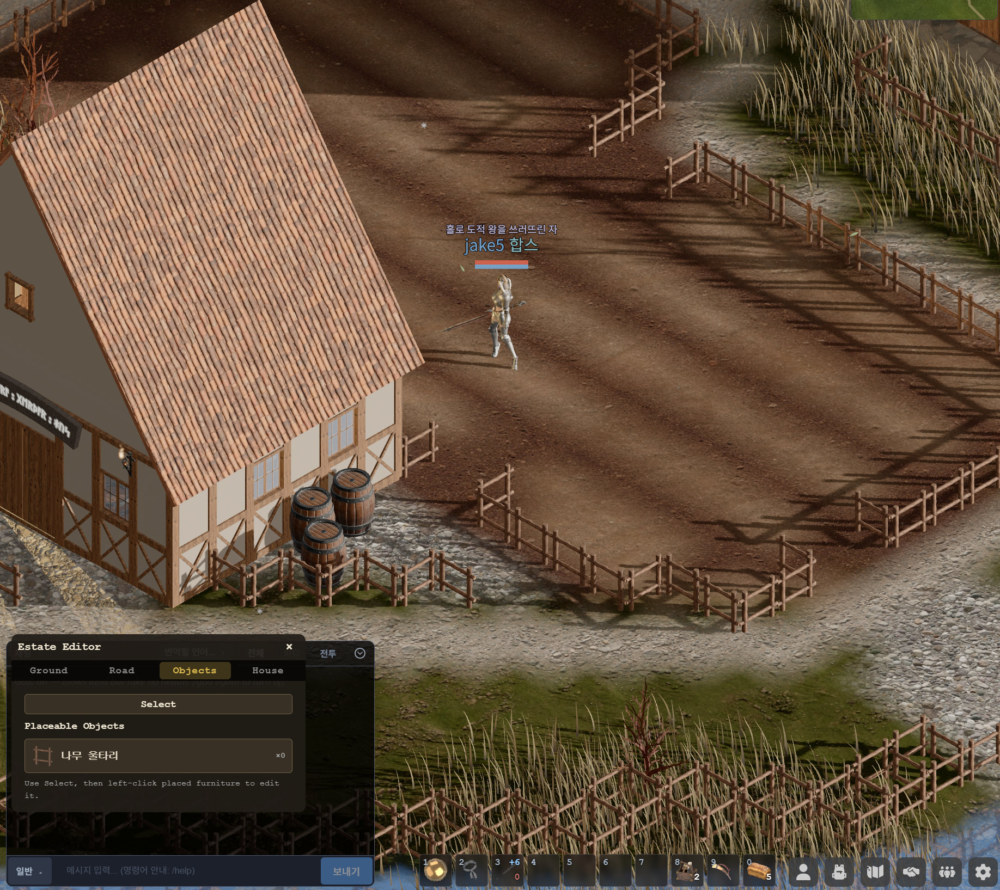

- **家具**：为你的房屋摆放家具
  - 在 ORKEA 展厅挑选展品，向店员结账
  - 床、椅子、桌子、箱子、壁炉、火把、招牌、信箱等，可在任意楼层摆放、移动和收回
  - 家具在游戏中真正起作用：床加快恢复，储物箱保管物品，归乡地毯决定回家的落脚点

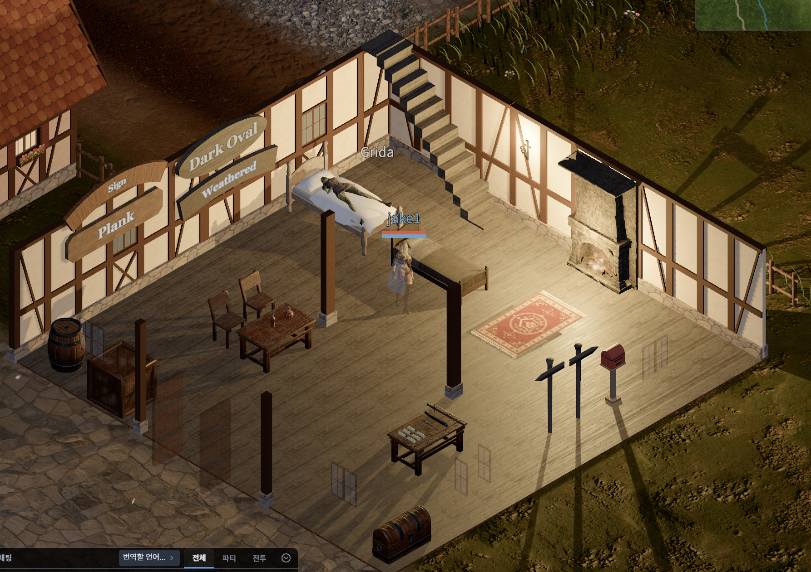

- **家族**：领主可以创立家族，在同一个名号下一起游玩
  - 家族名显示在成员名字之后
  - 成员共享领地，按阶级设定建造、造景、摆放家具和使用仓库的权限
  - 家族聊天，以及放在领地上的公告板和共享仓库
  - 成员披风和领地旗帜上的家族纹章
  - 两个家族可在双月教堂举行仪式合并为一
    - 两位族长站在祭司梅莉丝面前，誓约新家族保留的名号、纹章和族长
    - 族长依次同意后，两家的成员、领地、旗帜和共享仓库合为一个家族
    - 花瓣飘落，教堂钟声为在场的所有人响起

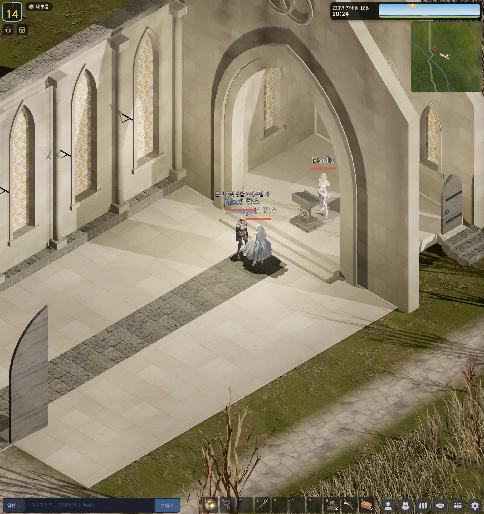

- **组装式角色**：身体由各个部件组装而成，外观和装备可以自由搭配
  - 创建时选择脸型、发型、发色和瞳色（预设或任意颜色）
  - 八个职业都可选择男性或女性
  - 穿戴的头盔、胸甲、手套、裤子、靴子、披风和武器都会显示在角色身上

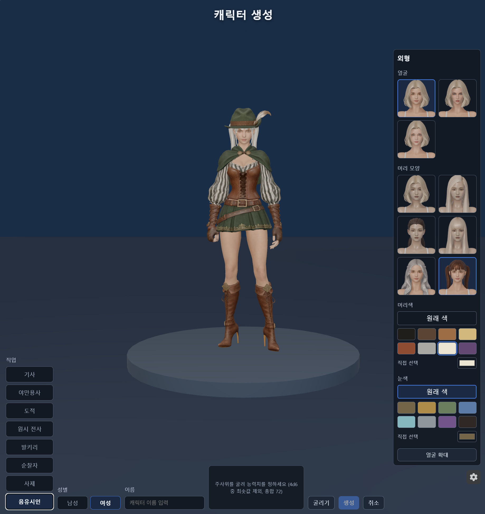

- **属性与装备**：创建时以 4d6 去掉最低值掷出的 NetHack/D&D 风格属性、十一个装备槽和受负重限制的物品栏

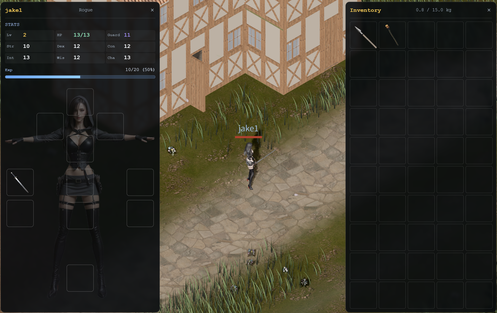

- **在旅店醒来**：在战斗中倒下后，你会在村庄旅店病房的床上醒来
  - Miriel、Cocoly 等由 LLM 驱动的旅店女仆会来到床边，照顾刚醒来的你

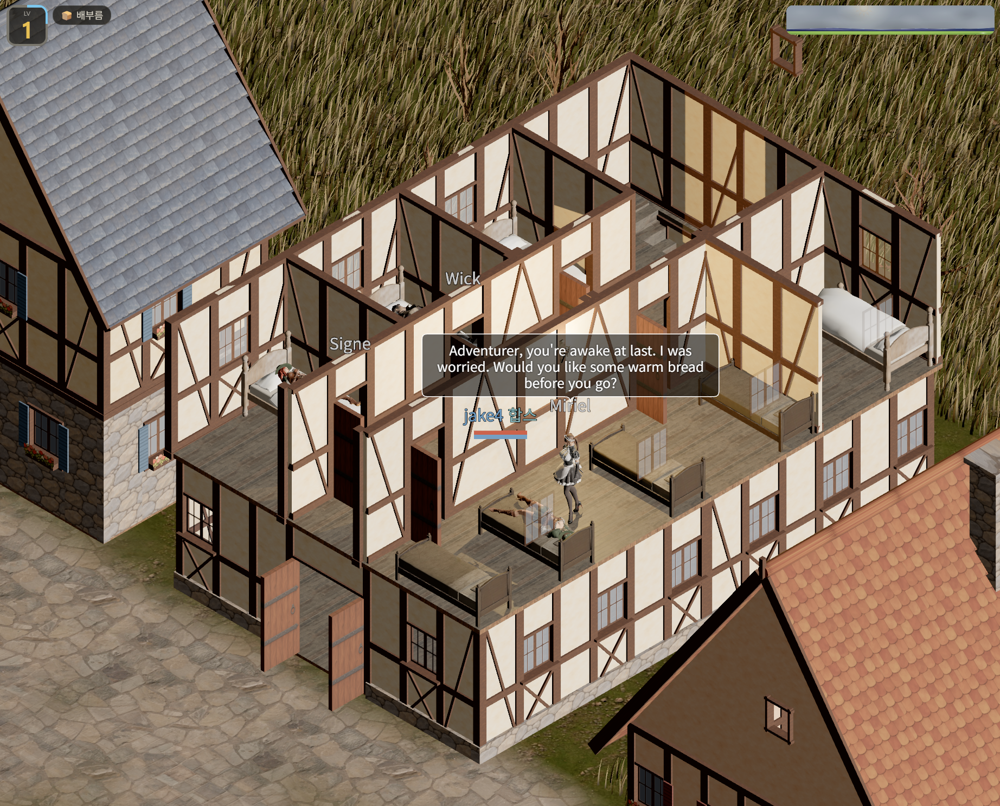

- **道路巡逻**：由 LLM 驱动的卫兵分日班和夜班巡逻道路
  - 路上积雪时，他们会在巡逻途中停下铲雪，一边铲一边抱怨
  - 堵住公共道路的栅栏、家具或房屋会被拆除并扣押
  - 玩家也可以报名当班，跟着卫兵巡逻、一起铲雪，领取日薪

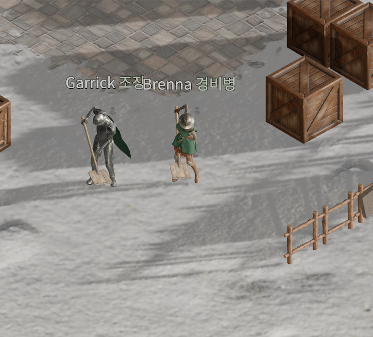

- **AI 生成的背景音乐**：约 50 首背景音乐由 [Suno](https://suno.com) 和 [Google Flow Music](https://labs.google/fx/tools/music-fx) 生成
  - 采用受 Ultima 启发的中世纪奇幻配器，包括鲁特琴、竖笛、竖琴、弦乐、打击乐和铜管乐
  - 环境音乐与战斗音乐分别组成曲库；进入战斗时交叉淡入战斗音乐，短暂延续后再淡回环境音乐

更多功能与开发历程请见[开发博客](https://julian-adv.github.io/blog/)。

## 文档

- [旧开发日志（截至 2026 年 7 月）](doc/devlog/README.md)
- [开发博客](https://julian-adv.github.io/blog/)

**世界与地形**
- [世界构建](doc/WORLD_BUILDING.md)
- [地图与地形设计](doc/MAP_DESIGN.md)
- [地形生成](doc/TERRAIN_GENERATION.md)
- [河流系统](doc/RIVER_SYSTEM.md)
- [水体系统](doc/WATER_SYSTEM.md)
- [植被系统](doc/VEGETATION_SYSTEM.md)
- [区域系统](doc/ZONE_SYSTEM.md)
- [Splatmap v2](doc/SPLATMAP_V2.md)
- [天气系统](doc/WEATHER_SYSTEM.md)

**游戏系统**
- [住宅系统](doc/HOUSING_SYSTEM.md)
- [土地与领地](doc/LAND_SYSTEM.md)
- [家具店](doc/FURNITURE_SHOP.md)
- [家族系统](doc/FAMILY_SYSTEM.md)
- [道路巡逻](doc/ROAD_PATROL.md)
- [战斗](doc/COMBAT.md)
- [强化](doc/ENCHANT.md)
- [NPC 与怪物 AI](doc/NPC_MONSTER_AI.md)
- [动画](doc/ANIMATION.md)
- [角色自定义（设计）](doc/CHARACTER_CUSTOMIZATION.md)

**引擎与性能**
- [运行时性能](doc/RUNTIME_PERFORMANCE.md)
- [加载优化](doc/LOADING_OPTIMIZATION.md)
- [指标与同时在线账号](doc/METRICS.md)
- [Pulse 仪表盘](dashboard/README.md)

**素材与智能体**
- [素材](doc/ASSETS.md)
- [智能体客户端](doc/AGENT_CLIENT.md)
- [用 AI 智能体游玩（openmmo-mcp）](doc/OPENMMO_MCP.md)

## 技术栈

**客户端**（在网页浏览器中运行）：
- Svelte + TypeScript
- Three.js (Threlte) + WebGPU
- Vite

**服务器：**
- Rust
- Tokio（异步运行时），游戏状态通过广播通道共享
- tokio-tungstenite（WebSocket，与所有客户端实时双向连接）
- Axum（地形 REST API）
- serde（JSON 序列化）

**智能体客户端：**
- Rust
- Tokio + tokio-tungstenite（WebSocket）
- Axum（本地观战面板）

**MCP 服务器（openmmo-mcp）：**
- Rust
- rmcp（官方 MCP Rust SDK，stdio）
- 复用智能体客户端的会话代码

**仪表盘：** 位于 `dashboard/` 的仅限管理员使用的 Svelte 应用，展示世界指标和排行榜；参见[设置说明](dashboard/README.md)

## 开发

在本地运行服务器和客户端、部署以及查看日志，请参阅 [doc/DEVELOPMENT.md](doc/DEVELOPMENT.md)（英文）。

## 贡献

欢迎贡献！关于如何选择任务、CI 运行的检查项以及 PR 约定，请参阅 [CONTRIBUTING.md](CONTRIBUTING.md)。当你首次提交 Pull Request 时，机器人会要求你在 PR 中留言签署[贡献者许可协议](CLA.md)。签署 CLA 后你的贡献才能被合并。

如需贡献二进制资产（3D 模型、音乐、音效），请参阅 [doc/ASSETS.md](doc/ASSETS.md) — 它们通过 Hugging Face 数据集 PR 提交，而不是 git。
