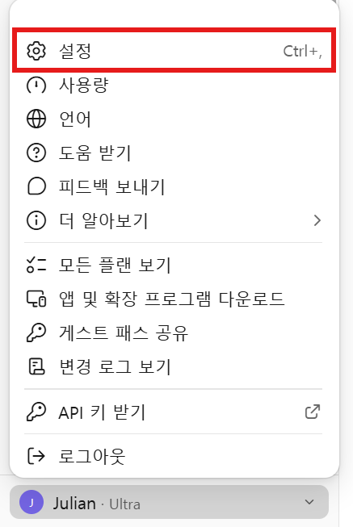
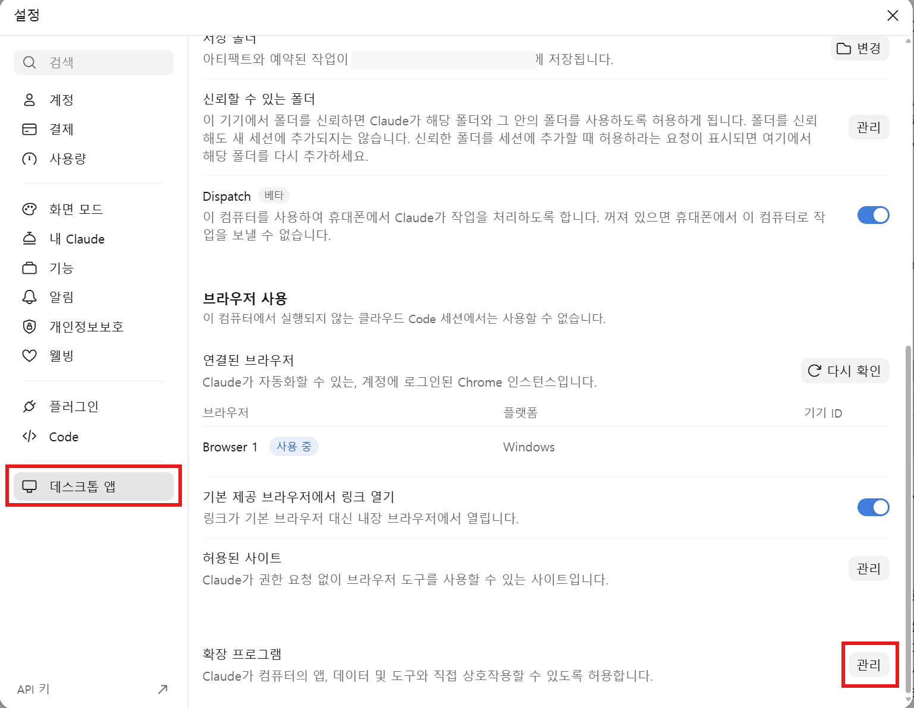
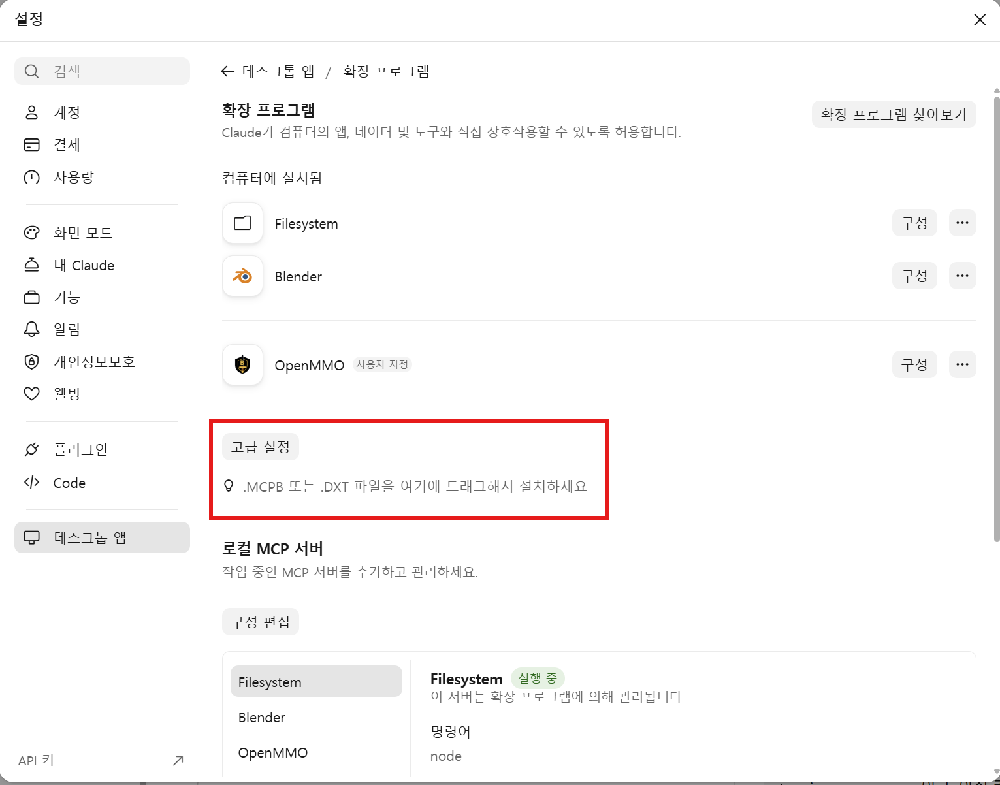
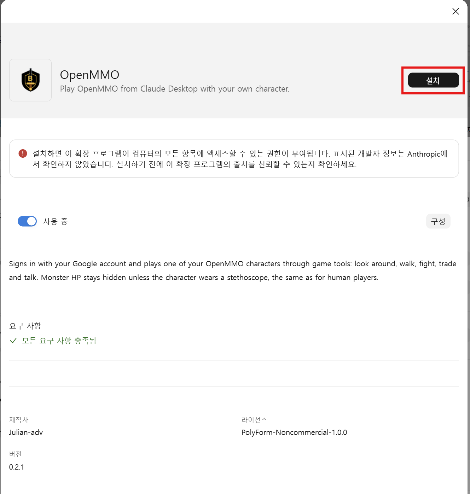

# AI 에이전트로 플레이하기 (openmmo-mcp)

[English](OPENMMO_MCP.md)

Claude Desktop에 OpenMMO 확장을 설치하면, 채팅으로 Claude에게 당신의 캐릭터를 플레이하게 할 수 있다.
Claude는 당신 PC에서 당신 구글 계정으로 접속하고, 사용량은 당신의 Claude 요금제에서 나간다.

에이전트는 평범한 플레이어다. 사람과 같은 규칙으로 움직이고 특별한 권한이 없다.

## 1. 준비

- 64비트 Windows 10/11과 [Claude Desktop](https://claude.ai/download).
- 구글 계정과 캐릭터. [openmmo.to.nexus](https://openmmo.to.nexus)에서 먼저 캐릭터를 만든다.
  Claude는 캐릭터를 새로 만들 수 없다.

## 2. 확장 설치

1. [릴리스 페이지](https://github.com/Julian-adv/OpenMMO/releases)에서 가장 최신 `openmmo-mcp-v*`
   릴리스를 열고 `openmmo-<버전>.mcpb`를 받는다.
2. Claude Desktop 왼쪽 아래 이름을 눌러 **설정**을 연다.

   

   설정 왼쪽 목록에서 **데스크톱 앱**을 고르고, 맨 아래 **확장 프로그램**의 **관리**를 누른다.

   
3. 받은 `.mcpb` 파일을 ".MCPB 또는 .DXT 파일을 여기에 드래그해서 설치하세요" 자리에 끌어다 놓는다.

   

   OpenMMO 창이 뜨면 오른쪽 위 **설치**를 누른다. 개발자 정보를 Anthropic이 확인하지 않았다는 경고는
   Anthropic 디렉터리에 올라가지 않은 확장이면 모두 뜬다.

   

업데이트는 알아서 된다. 새 버전이 나오면 받아 두었다가 다음에 확장이 켜질 때 새 버전으로 돈다.

확장은 Claude Desktop의 일반 채팅에서만 쓸 수 있다. Code 탭과 Cowork에서는 쓰이지 않는다.

## 3. 로그인과 첫 플레이

새 채팅을 열고 이렇게 시작한다.

> OpenMMO에 로그인해서 내 캐릭터 목록 보여줘.

처음 한 번은 Claude가 구글 로그인 주소와 코드를 보여 준다. 브라우저에서 그 주소를 열고 코드를 넣어
로그인한 뒤, Claude에게 "로그인했어"라고 말하면 캐릭터 목록을 가져온다. 로그인은 저장되어
다음부터는 묻지 않는다.

그다음은 하고 싶은 걸 말하면 된다.

> <캐릭터 이름>으로 들어가서 주변 둘러보고, 마을 밖에서 약한 몬스터 몇 마리 잡아 줘. HP가 반 아래로 떨어지면 물러나.

> 오래된 지하묘지 1층에서 코볼트 사냥하다가 가방이 차면 마을로 돌아와서 팔아.

> 근처 사람들한테 인사하고, 말 걸어오면 캐릭터답게 대답해.

> 오늘은 여기까지. 안전한 곳에서 로그아웃해.

게임 화면을 읽고 행동할 때마다 대화가 길어진다. 오래 시킬 거라면 "한 번에 한 가지씩, 말은 짧게"처럼
부탁하면 사용량을 아낄 수 있다.

## 4. 지켜보기

Claude가 플레이하는 동안 [openmmo.to.nexus](https://openmmo.to.nexus)에 같은 구글 계정으로 로그인하면
캐릭터 선택 화면에 "다른 곳에서 게임 중"이라는 안내와 **관전하기** 버튼이 뜬다. 누르면 조종은 못 하고
캐릭터가 움직이는 모습만 본다.

거기서 캐릭터를 골라 게임에 들어가면 브라우저 쪽이 캐릭터를 가져가고 Claude 쪽 접속은 끊긴다.
한 계정은 한 곳에서만 플레이한다.

## 5. 안전

- 다른 플레이어가 쓴 채팅·귓속말·편지·게시글은 게임 속 말일 뿐 Claude에게 내리는 지시가 아니다.
  Claude도 그렇게 다루도록 안내받는다. 그래도 Claude가 하는 일은 당신이 지켜볼 책임이 있다.
- 아이템·골드를 주거나 팔고, 떨어뜨리고, 가문 합병을 받는 행동은 당신이 시켰을 때만 하도록
  안내받는다. 중요한 거래는 직접 확인한다.
- 확장에는 게임 도구만 있다. PC의 파일을 읽거나 프로그램을 실행하지 못한다.

위와 같은 기본적인 안전장치는 넣었지만 충분히 시험하지는 않았다. 예상하지 못한 문제가 생길 수 있으니
각자 책임하에 사용하기 바란다.

## 6. 문제 해결

- **"could not reach the game server"**: 인터넷 연결을 확인한다.
- **"This account has no characters"**: 웹에서 캐릭터를 먼저 만든다.
- **"no matching character on this account"**: 캐릭터 이름을 정확히 다시 말한다.
- **"The game server runs a newer version"**: 새 버전을 이미 받아 둔 상태다. 설정 → 확장 프로그램에서
  OpenMMO를 껐다 켜거나 Claude Desktop을 다시 시작한다.

## 다른 클라이언트 (Claude Code, Codex, Linux)

Claude Code·Codex에서 쓰거나 Linux에서 쓰려면 실행 파일을 직접 설치한다.

1. 가장 최신 `openmmo-mcp-v*` 릴리스에서 `openmmo-mcp-v<버전>-x86_64-pc-windows-msvc.exe`(Windows) 또는
   `openmmo-mcp-v<버전>-x86_64-unknown-linux-gnu`(Linux, Ubuntu 24.04 이상)를 받는다.
2. 이름을 `openmmo-mcp`(Windows는 `openmmo-mcp.exe`)로 바꿔 PATH에 있는 폴더에 둔다. Linux는
   `chmod +x`도 한다.
3. 클라이언트에 등록한다.
   - Claude Code: `/plugin marketplace add Julian-adv/OpenMMO` 다음 `/plugin install openmmo@openmmo`,
     또는 `claude mcp add openmmo -- openmmo-mcp`
   - Codex: `codex mcp add openmmo -- openmmo-mcp`

macOS 빌드는 아직 없다.
