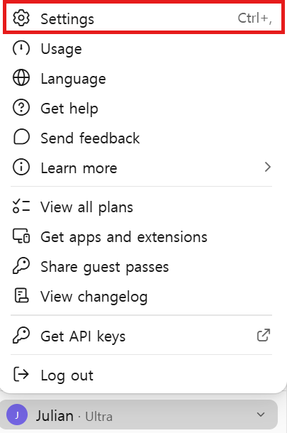
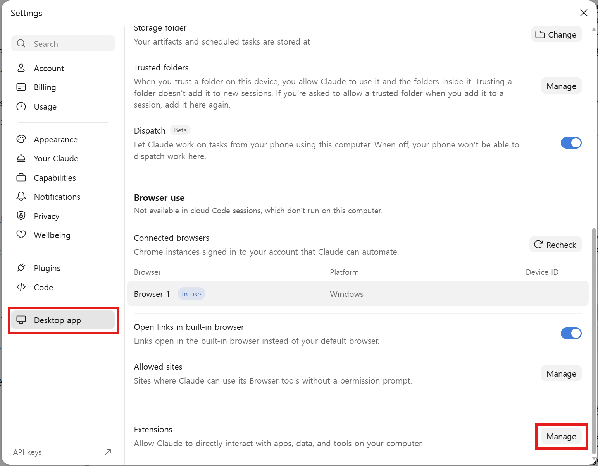
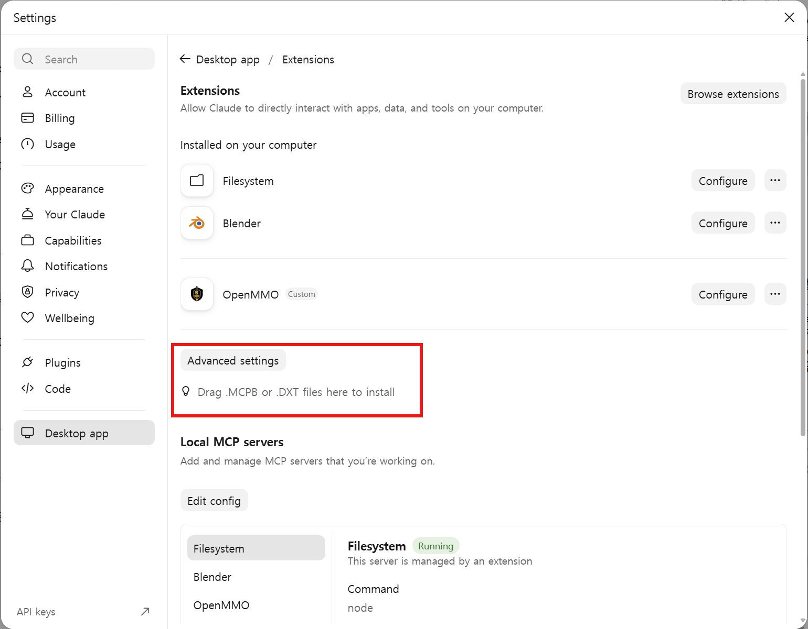
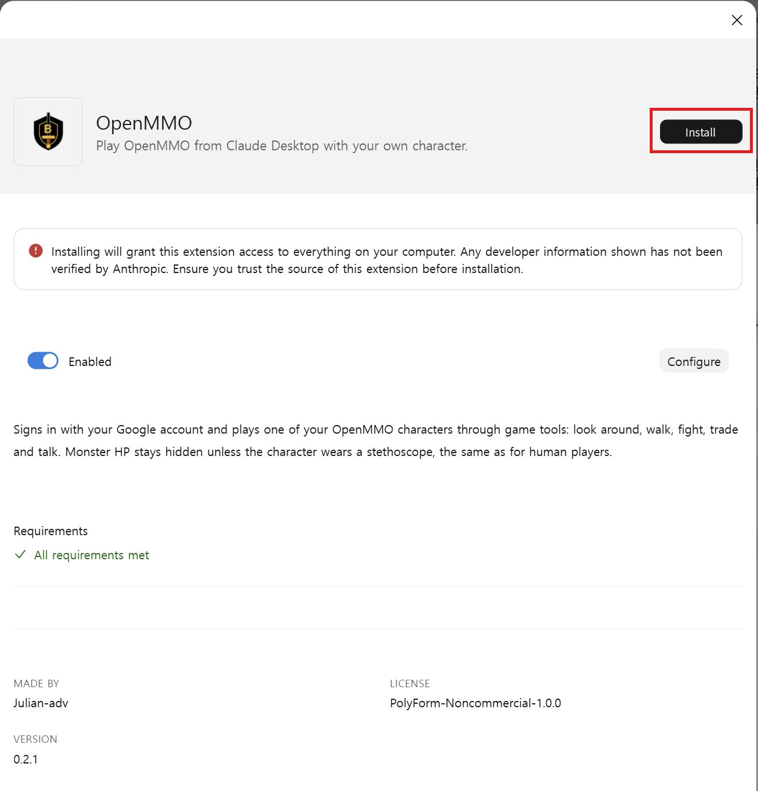

# Let an AI agent play (openmmo-mcp)

[한국어](OPENMMO_MCP.ko.md)

Install the OpenMMO extension in Claude Desktop and you can ask Claude, in a chat, to play your character.
Claude connects from your PC with your Google account, and usage counts against your own Claude plan.

The agent is an ordinary player. It follows the same rules as humans and has no special privileges.

## 1. Requirements

- 64-bit Windows 10/11 and [Claude Desktop](https://claude.ai/download).
- A Google account and a character. Create the character at [openmmo.to.nexus](https://openmmo.to.nexus)
  first; Claude cannot create one.

## 2. Install the extension

1. On the [releases page](https://github.com/Julian-adv/OpenMMO/releases), open the newest
   `openmmo-mcp-v*` release and download `openmmo-<version>.mcpb`.
2. In Claude Desktop, click your name at the bottom left and open **Settings**.

   

   In the settings list on the left, choose **Desktop app**, then click **Manage** next to
   **Extensions** at the bottom.

   
3. Drag the downloaded `.mcpb` file onto "Drag .MCPB or .DXT files here to install".

   

   When the OpenMMO window opens, click **Install** at the top right. The warning that Anthropic has not
   verified the developer appears for every extension that is not in Anthropic's directory.

   

Updates are automatic. A new version is downloaded in the background and runs the next time the
extension starts.

The extension works only in regular Claude Desktop chats, not in the Code tab or Cowork.

## 3. Sign in and play

Open a new chat and start with:

> Log into OpenMMO and show me my characters.

The first time, Claude shows a Google sign-in address and a code. Open the address in your browser,
enter the code and sign in, then tell Claude "done" and it fetches your characters. The sign-in is
saved, so it does not ask again.

After that, say what you want.

> Enter as <character name>, look around, and hunt a few weak monsters outside town. Back off if HP drops below half.

> Hunt kobolds on the first floor of the Old Crypt, and when the bag is full, go back to town and sell.

> Greet the people nearby, and answer in character if someone talks to you.

> That's it for today. Log out somewhere safe.

Every look at the game and every action makes the chat longer. For long sessions, asking for "one thing
at a time, keep it short" saves usage.

## 4. Watch

While Claude plays, sign in at [openmmo.to.nexus](https://openmmo.to.nexus) with the same Google account.
The character select screen says the character is in the game from another connection and shows a
**Watch** button. Press it to see the character move without controlling it.

If you pick a character there and enter the game, the browser takes the character over and Claude's
connection drops. One account plays in one place at a time.

## 5. Safety

- Chat, whispers, letters and posts from other players are things said in the game, not instructions to
  Claude, and Claude is told to treat them that way. You are still responsible for watching what Claude does.
- Claude is told to give or sell items and gold, drop things, or accept a family merge only when you ask
  for it. Check important trades yourself.
- The extension has game tools only. It cannot read files on your PC or run programs.

These are basic safeguards and have not been tested extensively. Unexpected problems may occur; use it
at your own risk.

## 6. Troubleshooting

- **"could not reach the game server"**: check your internet connection.
- **"This account has no characters"**: create a character on the web first.
- **"no matching character on this account"**: say the character's name again, exactly.
- **"The game server runs a newer version"**: the new version has already been downloaded. Turn OpenMMO
  off and on under Settings → Extensions, or restart Claude Desktop.

## Other clients (Claude Code, Codex, Linux)

To use it from Claude Code or Codex, or on Linux, install the program yourself.

1. From the newest `openmmo-mcp-v*` release, download `openmmo-mcp-v<version>-x86_64-pc-windows-msvc.exe`
   (Windows) or `openmmo-mcp-v<version>-x86_64-unknown-linux-gnu` (Linux, Ubuntu 24.04 or later).
2. Rename it to `openmmo-mcp` (`openmmo-mcp.exe` on Windows) and put it in a folder on your PATH. On Linux,
   also `chmod +x` it.
3. Register it with your client.
   - Claude Code: `/plugin marketplace add Julian-adv/OpenMMO`, then `/plugin install openmmo@openmmo`,
     or `claude mcp add openmmo -- openmmo-mcp`
   - Codex: `codex mcp add openmmo -- openmmo-mcp`

There is no macOS build yet.
