# Item Assets

## Rift Ring — 균열의 반지 (2026-10-25)

- 게임 아이템 `rift_ring`: 반지 슬롯, 무게 **0.1**, 기준가 **30,000**, 치명타 확률 **+5%p**. 기본 5%에서 착용 시 총 10%이며 같은 반지 두 개의 효과는 중복되지 않는다. 이졸데에게 테라클래시 파편 **30개**로 교환한다. [치명타·강화 비교](../CRITICAL_HITS.md).
- [원화](../../assets/items/rift_ring/concept_v1/concept.png): 프로젝트 자체 디자인을 Codex 내장 ImageGen으로 생성했다. **ChatGPT Pro 20x**, 생성일 **2026-10-25**, 1254² PNG. 대지의 방패와 이어지는 그을린 철 고리·금이 간 암석·주황빛 균열·봉인 문양이다. [프롬프트](../../assets/items/rift_ring/concept_v1/prompt.txt)와 [생성·출처 기록](../../assets/items/rift_ring/concept_v1/generation.json)을 보존한다. 이용 조건: [OpenAI Terms of Use](https://openai.com/policies/terms-of-use/).
- 3D 원본은 위 원화 한 장을 **Tripo API 유료 크레딧**으로 변환했다. `P2-20260801`, 목표 4,000폴리곤, PBR·detailed 텍스처 `v3.5-20260815`. 생성일 **2026-10-25**, 태스크 `952fe81b-d5f8-4e04-a24d-fd1bc03d081a`, 실제 **120크레딧**. 결과 **4,132삼각형**, base color·normal·ORM 각 4096². 원본 형상은 단순화하지 않고 보존했다. Tripo가 별도 발광 맵을 주지 않아 주황빛 균열은 base color에 포함된다. 이용 조건: [Tripo Terms of Service](https://developers.tripo3d.ai/en/terms).
- [Tripo 원본 GLB](../../assets/items/rift_ring/tripo_v1/source/model_url.glb), [4K Blender 원본](../../assets/items/rift_ring/tripo_v1/rift_ring.blend), 원본 PNG 텍스처를 보존한다. [요청·태스크·비용 기록](../../assets/items/rift_ring/tripo_v1/generation.json), [준비 스크립트](../../assets/items/rift_ring/tripo_v1/prepare.py), [처리 기록](../../assets/items/rift_ring/tripo_v1/preparation.json).
- 게임 바닥 모델: [rift_ring.glb](../../client/public/models/accessory/rift_ring.glb), **925,372바이트**, Meshopt + 512² KTX2 UASTC. 기존 금반지와 같은 긴 변 **0.15m**, Blender 기준 크기 약 **0.150 × 0.135 × 0.085m**, 원점은 바닥 중심, 회전 0·스케일 1. 고리 면을 바닥 쪽으로 눕혀 배치한다. [런타임 검사](../../assets/items/rift_ring/tripo_v1/runtime-checks.json): KTX2 세 장 개별 검증, Meshopt·KTX2 디코딩 후 glTF Validator 오류·경고 0개. 압축본 자체의 Validator 경고 6개는 도구의 KTX2 미지원에 따른 것이다.
- 인벤토리 [아이콘](../../client/public/items/accessory/rift_ring.png): 동일 모델을 공용 Cycles 레시피로 512² 렌더 후 **128² 투명 PNG**로 축소했다. 정면의 균열·문양과 고리 구멍을 함께 보여준다. [Blender 아이콘 작업 파일](../../assets/items/rift_ring/rift_ring.blend).
- 정리(2026-10-25): 미리보기 PNG 3개·상세 검증 보고서 3개·재생성 가능한 중간 4K GLB·Blender 백업을 삭제했다. 최종 모델·아이콘, 원화·Tripo 원본·현재 Blender 파일·원본 텍스처와 간결한 검증·출처 기록은 보존했다.
- 재현: `blender -b --python-exit-code 1 -P assets/items/rift_ring/tripo_v1/prepare.py`로 4K 원본과 임시 GLB를 생성한다. `tools/blender-scripts/export_item_asset.py`에 `--source assets/items/rift_ring/tripo_v1/rift_ring.glb --name rift_ring --size 0.15 --category accessory --icon-rotation 28 -8 -102`를 주어 바닥 모델·아이콘·Blender 작업 파일을 출력하고, `tools/optimize-modular-part.mjs`에 `--ktx2 --size=512`를 주어 원본 GLB에서 런타임 모델을 압축한다.

## Shield of the Earth — 대지의 방패

- [concept_v1](../../assets/items/earth_shield/concept_v1/concept.png) — 이졸데의 테라클래시 파편 교환 장비 원화. 거친 화강암 돌판을 검게 그을린 철제 테두리와 십자 띠로 고정하고, 중앙 봉인 문양·주황빛 균열·소량의 이끼로 테라클래시와 대지의 아뮬렛의 외형을 잇는다. [설계](../TIER5_FIELD_RAID.md#증표-교환과-장비-공급량).
  - OpenAI Codex built-in ImageGen, **ChatGPT Pro 20x**, 2026-10-24. OpenAI 출력물 이용 조건 적용, 별도 CC 라이선스 없음.
  - [프롬프트](../../assets/items/earth_shield/concept_v1/prompt.txt) · [생성 기록](../../assets/items/earth_shield/concept_v1/generation.json). 원화 초안 단계의 기록이다.

- **현재 Tripo v1**(2026-10-24). 위 원화 한 장을 Tripo API로 변환했다. 실사풍 화강암·금속 프레임·봉인 문양·주황색 균열·이끼와 후면 가로 손잡이 두 개를 포함한다. `pc4090`의 Blender MCP로 앞·뒤·측면을 검수하고 크기·축·원점만 정리했다. 생성된 형상은 단순화하거나 다시 그리지 않았다.
  - **3,505 triangles**, 메시·재질 각 1개, 높이 **0.80m**, 폭 **0.533m**, 손잡이 포함 깊이 **0.159m**. 원점은 후면 위쪽 가로 손잡이 중심. Blender 정면 **+Y**·위 **+Z**, glTF 정면 **−Z**·위 **+Y**. 위치·회전 0, scale 1인 장착용 원본이다.
  - 원본 PBR 텍스처는 **4096²** base color·ORM·normal, 현재 런타임은 **512² KTX2 UASTC·10단계 밉맵·Meshopt**다. **869,564 bytes**, 텍스처 GPU 메모리는 BC7/ASTC 지원 장치에서 약 1MiB(이전 2K WebP는 약 64MiB)다. Tripo가 별도 발광 맵을 제공하지 않아 주황색 균열은 base color로 표현된다.
  - Tripo API **유료 크레딧**, 모델 `P2-20260801`, 텍스처 `v3.5-20260815`, detailed PBR, `delight=true`, seed `102424`, 목표 4,000 triangles. **120크레딧**, 추가 유료 생성 없음. [Tripo 이용 조건](https://developers.tripo3d.ai/en/terms) 적용. 입력 원화의 출처·조건은 위 ImageGen 기록과 같다.
  - 게임 등록(2026-10-24): `earth_shield`, 왼손 방패, 방어 **+3**, 무게 **5**, 기준가 **30,000**. 일반 거래 가능, 상자·직접 드롭 없음. 이졸데에게 파편 **30개**로 교환하고 CHA 흥정도 적용한다. 128² 투명 아이콘을 기존 Cycles 레시피로 렌더했다. `handProps.ts`에서 방패가 세워지고 돌판이 바깥을 향하도록 파지 회전을 맞췄다.
  - [Blender](../../assets/items/earth_shield/tripo_v1/earth_shield.blend) · [Tripo 원본 GLB](../../assets/items/earth_shield/tripo_v1/source/model_url.glb) · [정리한 4K GLB](../../assets/items/earth_shield/tripo_v1/earth_shield.glb) · [현재 런타임 GLB](../../client/public/models/armor/earth_shield.glb).
  - [생성 명세](../../assets/items/earth_shield/tripo_v1/build.json) · [요청·비용 기록](../../assets/items/earth_shield/tripo_v1/generation.json) · [정리 스크립트](../../assets/items/earth_shield/tripo_v1/prepare.py) · [최적화·게임 등록·검증 기록](../../assets/items/earth_shield/tripo_v1/integration.json). 중간 압축본·검수 렌더·임시 페이지는 사용자 요청으로 2026-10-25 정리했다. 현재 게임은 위 512² 런타임을 사용한다.

- **[미사용: Blender v2, Tripo v1로 대체]** 실사풍 수정(2026-10-24). 원화의 주요 돌조각 11개를 따라 메시를 재구성하고 `ReferenceUV`로 전면 암석 질감을 투영했다. 철·청동·가죽은 별도 PBR 재질로 만들고, 산화·미세 요철·모서리 반사를 추가했다. 균열 발광은 원화의 주황색 영역에 한정한다. Blender MCP로 `pc4090`에서 모델링·렌더 비교·베이크·GLB 재임포트를 수행했다.
  - **4,854 triangles**, 메시·재질 각 1개, 높이 **0.80m**, 폭 **0.543m**, 손잡이 포함 깊이 **0.173m**. 원점·축·장착용 원본 규약은 v1과 같다. 원본 v1은 별도 폴더에 보존했다.
  - 원화의 이미지 질감을 사용하므로 그 방향성 명암 일부가 base color에 남는다. 금속 반사·거칠기·법선·발광은 독립된 PBR 채널이다. 텍스처는 2048²로 베이크하고, 런타임 GLB에는 WebP q90으로 넣었다. 임시 투영 UV는 최종 베이크 후 제거했다.
  - [Blender](../../assets/items/earth_shield/blender_v2_realistic/earth_shield.blend) · [베이크 전 원본](../../assets/items/earth_shield/blender_v2_realistic/earth_shield_realistic_procedural.blend) · [제작 스크립트](../../tools/blender-scripts/build_earth_shield_realistic.py).
  - [제작·출처·검증 기록](../../assets/items/earth_shield/blender_v2_realistic/generation.json). 미사용 GLB·비교 렌더·개별 검사 파일은 2026-10-25 정리하고 Blender 원본·텍스처를 보존했다.
  - 원화에서 파생한 텍스처의 출처·조건은 위 ImageGen 기록과 같다(**ChatGPT Pro 20x**, 2026-10-24). 새 이미지 생성·외부 3D 생성 서비스는 사용하지 않았다. 직접 제작한 메시·절차적 재질은 저장소 라이선스를 따른다.

- **[미사용: v1, v2로 대체]** 3D 모델(2026-10-24): 위 원화를 바탕으로 Blender에서 직접 메시·절차적 재질을 제작했다. `pc4090`의 Blender 5.2.3 LTS에 Blender MCP로 연결해 원화와 뷰포트를 비교하고 재질을 수정·베이크했다. 외부 3D 모델이나 유료 3D 생성 서비스는 사용하지 않았다. 메시·재질 제작물은 저장소 라이선스를 따르며 원화의 출처·조건은 위와 같다.
  - 높이 **0.80m**, 폭 **0.54m**, 본체 두께 약 **0.06m**. 손잡이·장식 포함 깊이 0.173m. **4,870 triangles**, 메시 1개·재질 1개. 돌판·철제 테두리·보강대·피라미드 리벳·중앙 봉인 문양과 후면 가죽 손잡이·팔 끈을 포함한다.
  - 원점은 후면 손잡이 중심, Blender 정면 **+Y**·위 **+Z**, 위치·회전 0, scale 1. glTF 표준 변환 후 정면은 **−Z**, 위는 **+Y**다. 바닥 원점 모델과는 다른 장착용 원본이며, 아이템 등록·착용 피팅·교환 연결은 후속 작업이다.
  - 2048² base color·roughness·metallic·normal·emission을 베이크했다. 금속의 색이 어두워지는 diffuse 베이크를 입력 색상의 emission 베이크로 수정했다. GLB에는 roughness·metallic을 합쳐 텍스처 4장을 넣는다.
  - [작업 파일](../../assets/items/earth_shield/blender_v1/earth_shield.blend) · [절차적 재질 원본](../../assets/items/earth_shield/blender_v1/earth_shield_procedural.blend).
  - [제작 스크립트](../../tools/blender-scripts/build_earth_shield.py) · [제작·검증 기록](../../assets/items/earth_shield/blender_v1/generation.json).
  - 미사용 GLB·미리보기 Blender·비교 렌더·개별 검사 파일은 2026-10-25 정리하고 Blender 원본·텍스처를 보존했다.

## Helm of Brilliance — 광휘의 투구

- 게임 등록(2026-10-17): `helm_of_brilliance` 머리 장비, 지능 +1(`int+1`), 조명(`light`), 방어 2, 무게 3, 기준가 30000. 상자·드롭 목록에 넣지 않았다. 테라클래시 토벌 시 소환자에게 지급한다(2026-10-21, [설계](../TIER5_FIELD_RAID.md)).
  - 조명: 착용자 머리 위 3m에 Radiance와 같은 흔들림 없는 광원을 켠다. 횃불·Radiance·투구는 하나의 통합 광원을 공유해 밝기가 합산되지 않는다. 다른 플레이어에게는 방송되는 머리 장비로 판정한다.
  - 남성 착용: `client/public/models/characters/modular_male/helmet_brilliance.glb` — 남성 v3 피팅을 `tools/prepare-modular-character.mjs --part helmet_brilliance`로 KTX2 512²·meshopt 압축, 귀 보정(`body-occlusion.json`)을 scene extras `body_mask`로 넣었다. 기준 얼굴에만 적용한다. 착용 시에만 받는다.
  - 여성 착용: `client/public/models/characters/modular_female/brilliance_helmet.glb` — 여성 v3 피팅을 `tools/prepare-female-knight.mjs --part brilliance_helmet`로 WebP 2048²·귀 보정 포함 변환. 착용 시에만 받으며 머리카락을 숨긴다.
  - 바닥 모델 `client/public/models/armor/helm_of_brilliance.glb` — Tripo 원본(`tripo_v2/source/model_url.glb`)을 Blender로 +X 정면을 +Z로 돌리고 높이 0.30m로 균일 축소(0.21 × 0.30 × 0.26, plate_helmet 높이 기준), 원점=바닥 중심, 텍스처 512² WebP q90. 아이콘 `client/public/items/armor/helm_of_brilliance.png`은 Cycles 직교 측면·위 각도 512²→128². 추가 유료 생성 없음.

- 피팅·원화·Tripo 원본 출처와 라이선스: [광휘의 투구](helm-of-brilliance.md).

## Amulet of the Earth — 대지의 아뮬렛 (가칭)

- [concept_v1](../../assets/items/earth_amulet/concept_v1/concept.png) — v2의 편집 원본. 바르칸이 봉인한 대지 수호자의 돌 심장 목걸이 원화. 철 띠·청동 사슬로 묶인 화강암 심장, 균열 속 용암빛, 앞 띠의 봉인 룬(제단과 같은 문양). [설계](../TIER5_FIELD_RAID.md).
  - OpenAI Codex built-in ImageGen(`codex exec`, codex-cli 0.162.1), **ChatGPT Pro 20x**, 2026-10-19. OpenAI 출력물 이용 조건 적용, 별도 CC 라이선스 없음.
  - [프롬프트](../../assets/items/earth_amulet/concept_v1/prompt.txt) · [생성 기록](../../assets/items/earth_amulet/concept_v1/generation.json).
- **확정** [concept_v2_chain](../../assets/items/earth_amulet/concept_v2_chain/concept.png) — v1을 편집 원본으로 화면을 넓혀 고리·잠금쇠까지 목걸이 체인 전체를 보이게 했다. 펜던트는 그대로. 도구·등급·조건은 v1과 같다.
  - [프롬프트](../../assets/items/earth_amulet/concept_v2_chain/prompt.txt) · [생성 기록](../../assets/items/earth_amulet/concept_v2_chain/generation.json).
- 바닥 모델 `client/public/models/accessory/earth_amulet.glb` — concept_v2_chain 한 장으로 Tripo에서 생성했다. 체인 고리가 펜던트 면 뒤로 45° 젖혀져 있어, 고리 부분을 축으로 체인을 펴서 바닥에 닿게 했다. 이어 정면이 위를 보도록 눕히고 펜던트를 -Y로 돌렸다. 최장축 0.40m(0.18×0.40×0.075, silver_necklace 0.35m보다 약간 크게), 원점=바닥 중심, 텍스처 512² WebP q90, 4,019 triangles. 용암 균열은 base color만 쓰고 발광은 넣지 않았다.
  - 게임 등록(2026-10-19): `earth_amulet` 목 장비, 레벨당 최대 HP +1(`maxhp+1/lv`), 무게 0.5, 기준가 30000, 티어 5 상자 10%. 아이콘 `client/public/items/accessory/earth_amulet.png`은 Cycles 직교 측면·위 각도 렌더 512²→128².
  - 3D: Tripo API 유료 크레딧, 모델 `P2-20260801`, 텍스처 `v3.5-20260815`, detailed PBR, seed `102019`, 목표 4,000 triangles, 2026-10-19, **120크레딧**. [이용 조건](https://developers.tripo3d.ai/en/terms).
  - [제작 명세](../../assets/items/earth_amulet/tripo_v1/build.json) · [요청·작업·비용 기록](../../assets/items/earth_amulet/tripo_v1/generation.json) · [Tripo GLB](../../assets/items/earth_amulet/tripo_v1/source/model_url.glb) · [바닥 모델 스크립트](../../assets/items/earth_amulet/tripo_v1/floor/build_floor.py) · [Blender](../../assets/items/earth_amulet/tripo_v1/floor/earth_amulet.blend) · [검수 렌더](../../assets/items/earth_amulet/tripo_v1/floor/review.png).

## Terraclash Shard — 테라클래시 파편

- 모델 `client/public/models/objects/terraclash_token.glb`·아이콘 `client/public/items/objects/terraclash_token.png` — Blender에서 절차적으로 자체 제작, 2026-10-22. 외부 모델·텍스처·AI 생성물 없음. 프로젝트 자체 에셋으로 저장소 라이선스를 따른다. 레이드 증표(`terraclash_token`)이며 게임 이름은 Terraclash Shard다.
  - 상자를 평면 6개로 깎아 부서진 윤곽을 만들고, 세분화한 뒤 Voronoi·Clouds 변위로 거친 면을 내고 1,074 triangles로 줄였다. 0.218×0.177×0.072m(첫 판의 약 3배), 원점=바닥 중심.
  - 재질은 절차적 화강암(얼룩·미세 입자), Voronoi 경계의 용암 균열과 그을린 가장자리, 윗면의 봉인 룬(원과 사선)이다. Cycles로 base color·roughness·normal·emission을 512²에 구워 WebP q90으로 넣었다. GLB 210,420 bytes.
  - 아이콘은 Cycles 투명 직교 렌더 512²→128² RGBA, Euler (-38°, 0°, -8°). packed 작업 파일 `assets/items/terraclash_token/terraclash_token.blend`.
  - 재현: `blender -b --python-exit-code 1 -P tools/blender-scripts/build_terraclash_token.py`.
  - **[미사용]** 첫 판(2026-10-22, 0.069m 9각 돌판에 단색 재질)은 같은 경로에 덮어썼다.

## Cloak of Invisibility — 투명 망토 (가칭)

- **확정** [concept_v1](../../assets/items/invisibility_cloak/concept_v1/concept.png) — 입으면 투명해지고 공격하면 풀리는 운영자용 망토 원화. 후드 없는 테이퍼 시트(입은 망토 프로시저럴 시트와 같은 형태), 진줏빛 은회색 천·짙은 청회색 안감, 밑단 은사 자수, 감은 눈 모양 은 브로치. 상자·드롭 목록에 넣지 않는다.
  - OpenAI Codex built-in ImageGen(`codex exec`, codex-cli 0.162.1), **ChatGPT Pro 20x**, 2026-10-19. OpenAI 출력물 이용 조건 적용, 별도 CC 라이선스 없음.
  - [프롬프트](../../assets/items/invisibility_cloak/concept_v1/prompt.txt) · [생성 기록](../../assets/items/invisibility_cloak/concept_v1/generation.json).
- 바닥 모델 `client/public/models/armor/invisibility_cloak.glb` — concept_v1 한 장으로 Tripo에서 생성했다. Tripo 정면 +X를 위로 눕히고(칼라 +Y) 칼라~밑단 0.70m로 균일 축소한 뒤, 속이 빈 껍데기를 높이 0.16m로 눌러 떨어진 망토처럼 만들었다(0.49×0.70×0.16m), 원점=바닥 중심, 텍스처 512² WebP q90, 3,622 triangles, emissive 없음.
  - 투명감: Tripo는 불투명 PBR만 내므로 서 있는 자세의 높이로 알파를 구워 base color 알파 채널에 넣었다(칼라 0.60 → 밑단 0.30, 브로치 반경 3.5cm는 불투명). glTF `alphaMode: BLEND`, 단면.
  - 아이콘 `client/public/items/armor/invisibility_cloak.png` — 바닥 GLB를 `tools/blender-scripts/rerender_item_icon.py --name invisibility_cloak --category armor` 기본 각도로 Cycles 512²→128² 렌더. 투명 배경이라 천이 반투명하게 보인다.
  - 3D: Tripo API 유료 크레딧, 모델 `P2-20260801`, 텍스처 `v3.5-20260815`, detailed PBR, seed `102020`, 목표 4,000 triangles, 2026-10-19, **120크레딧**. [이용 조건](https://developers.tripo3d.ai/en/terms).
  - [제작 명세](../../assets/items/invisibility_cloak/tripo_v1/build.json) · [요청·작업·비용 기록](../../assets/items/invisibility_cloak/tripo_v1/generation.json) · [Tripo GLB](../../assets/items/invisibility_cloak/tripo_v1/source/model_url.glb) · [바닥 모델 스크립트](../../assets/items/invisibility_cloak/tripo_v1/floor/build_floor.py) · [Blender](../../assets/items/invisibility_cloak/tripo_v1/floor/invisibility_cloak.blend) · [검수 렌더](../../assets/items/invisibility_cloak/tripo_v1/floor/review.png).

## Stethoscope

- `doc/images/items/stethoscope.png` — 플레이어·몬스터 조사용 청진기의 3D 제작 원화. 낡은 황동 귀관·흉부 접촉부, 짙은 갈색 가죽 피복관, 밝은 뿔 재질 이어팁으로 구성한 단독 소품 이미지.
  - `doc/images/items/stethoscope-reference-sheet.png` — 위 원화를 참조한 정면·후면 사선·접촉부·이어팁 제작 참고 시트.
  - `doc/images/items/stethoscope-meshy-input.png` — 같은 디자인에서 관과 접촉판 사이 간격을 벌린 Meshy 입력용 원화. 첫 생성에서 관이 접촉판으로 잘못 연결되어 배치를 정리했다.
  - 출처: OpenAI Codex built-in ImageGen. 요금제: ChatGPT Pro 20x(사용자 확인). 생성일: 2026-09-20.
  - 라이선스: OpenAI 출력물 이용 조건 적용, 별도 CC 라이선스 지정 없음. NetHack의 아이템 용도에서 착안한 새 디자인이며 원작 이미지·모델은 사용하지 않았다.
  - [이미지 생성 프롬프트](stethoscope-prompts.json).
  - 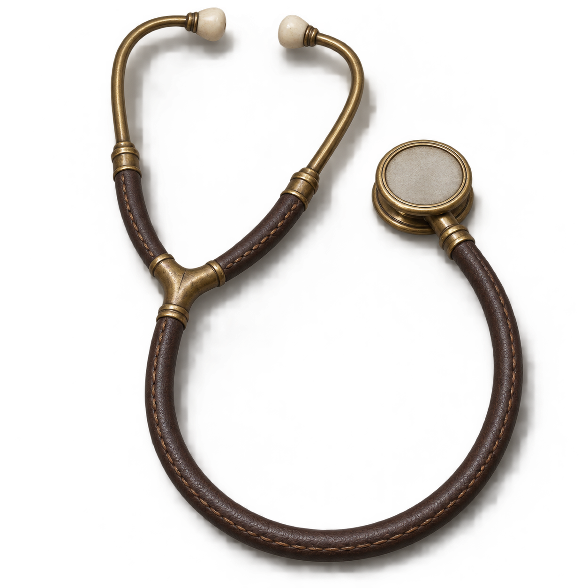
  - 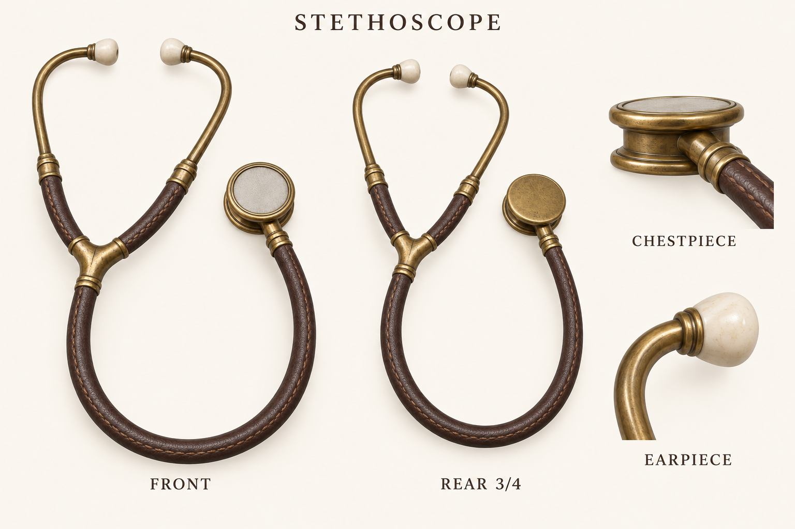

- `client/public/models/objects/stethoscope.glb` / `client/public/items/objects/stethoscope.png` — Meshy.ai **Premium** 등급(프로젝트의 사용자 확인 기록), Image to 3D API, 2026-09-20. [Meshy 유료 생성물 이용 조건](https://help.meshy.ai/en/articles/10137554-what-is-the-ownership-of-the-generated-models) 적용.
  - 위 `stethoscope-meshy-input.png`로 `meshy-7.1`, triangle, **4,000 폴리곤 목표**, PBR 2048², `image_enhancement=false`로 생성. 결과 **4,057 triangles**를 Blender에서 감량 없이 보존했다. 작업 ID `01a0bec3-d0aa-7536-ac71-74632ebcfe9f`.
  - 원본: `assets/items/stethoscope/meshy-4000-v2/stethoscope_meshy.glb`. 작업 파일: `assets/items/stethoscope/stethoscope.blend`. 상세 [생성·가공·검증 기록](https://huggingface.co/datasets/jake-song-openmmo/onlinerpg-assets/blob/6d4e586983cb6c74953276a3975799d856807a8a/assets/stethoscope/meshy-4000-v2/generation.json)은 원본과 함께 Hugging Face에서 관리한다.
  - Blender 5.2.0 LTS에서 X −90°로 눕혀 긴 변 0.45m, **0.396×0.035×0.450m (W×H×D)**로 맞췄다. 기존 단검(0.42m)·벨트(0.40m)와 비교한 바닥 소지품 크기다. 원점은 바닥 중심, 회전·스케일 적용, emissive 제거, base color·normal·metallic/roughness 3장 **512² WebP q90**, GLB **407,804 bytes**.
  - 아이콘은 같은 메시를 Cycles 직교 사선 구도로 512² 렌더한 뒤 **128² RGBA**로 축소했다. 아이콘 회전 `(24, −8, −18)°`, 노출 `−0.5`. 중간 렌더·검토 이미지와 로그는 정리했으며, 원본 GLB·PBR 텍스처·Blender 파일과 생성·검증 기록을 보존한다.
  - 재생성: 저장소 루트에서 `blender -b --python-exit-code 1 -P tools/blender-scripts/export_item_asset.py -- --source assets/items/stethoscope/meshy-4000-v2/stethoscope_meshy.glb --name stethoscope --size 0.45 --rotation -90 0 0 --icon-rotation 24 -8 -18 --exposure -0.5`를 실행한다. 폴더의 중복 README는 2026-10-09 이 항목으로 통합했다.
  - **[미사용]** 첫 6,000 목표 생성 원본과 관 연결 오류가 있는 첫 4,000 목표 생성 원본·Blender 검토본은 2026-09-21에 삭제했다. 생성 3회 각 30크레딧, 총 90크레딧; 작업 ID와 생성 이력은 위 JSON에 보존한다.
  - `data-src/items.csv`에 `stethoscope` / `Stethoscope`로 등록했다(2026-09-20). category `tool`, material `metal`, 무게 0.5kg, 기준 가격 1,000 copper, 목 슬롯(`neck`) 장착·중첩 불가·비소모성(`consumable=false`). 가방에서 더블클릭하면 장착하며, [청진 스킬](../abilities/AUSCULTATION.md)을 퀵슬롯에서 실행한 뒤 대상을 좌클릭해 조사한다. 스킬 아이콘도 같은 청진기 아이콘을 사용한다.

## Item models

- sword.glb https://www.fab.com/listings/5fe82d66-eaac-48e0-899d-1fedacdf409a — 텍스처를 1024²→512² WebP q90으로 재인코딩(형상·노드 그대로, 2026-10-14). 원본: `assets/items/sword/sword_1024.glb`
- spear.glb https://sketchfab.com/3d-models/spear-f13ddd24e2fe47aa8aca23487afd893e — 텍스처를 1024²→512² WebP q90으로 재인코딩(형상·노드 그대로, 2026-10-14). 원본: `assets/items/spear/spear_1024.glb`
- torch.glb https://sketchfab.com/3d-models/torch-stick-d8eadee1a5c14483aade99b1fe5bc150 — 텍스처를 1024²→512² WebP q90으로 재인코딩(형상·노드 그대로, 2026-10-14). 원본: `assets/items/torch/torch_1024.glb`
- goblin_sword.glb https://sketchfab.com/3d-models/goblin-sword-5717ea55e34341b79efa692517e8598b
- shield_wooden.glb, shield_raven.glb https://sketchfab.com/3d-models/shield-323dfe4dbb764c439bcc6b0469f812eb
- leather_armor.glb — Meshy.ai (유료 생성, 2026-07-24, "Shadowbound Leather A"). 완전 소유권·상업 OK (characters.md License 참조)
    - 원화는 ChatGPT 이미지 생성 (ChatGPT Pro 20x, 2026-07-24 커밋) 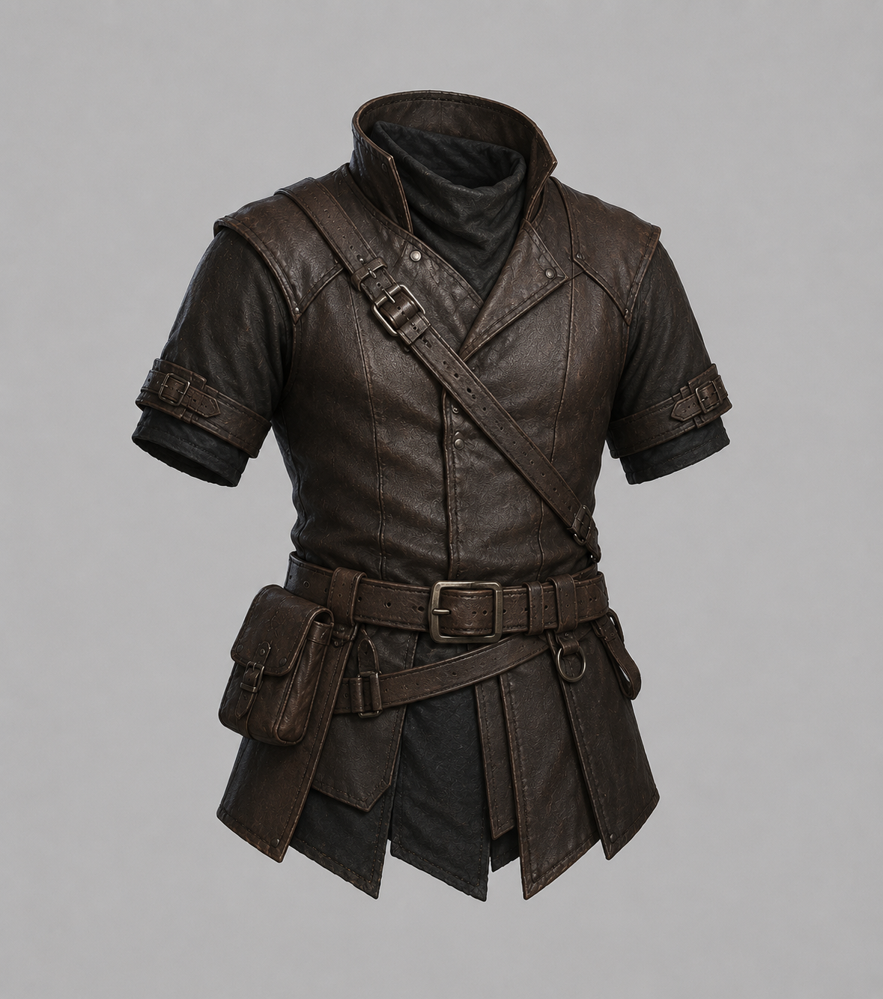
- leather_pants.glb — Meshy.ai (유료 생성, 2026-07-24, "Leather Combat Pants"). 완전 소유권·상업 OK (characters.md License 참조)
    - 원화는 ChatGPT 이미지 생성 (ChatGPT Pro 20x, 2026-07-24 커밋) 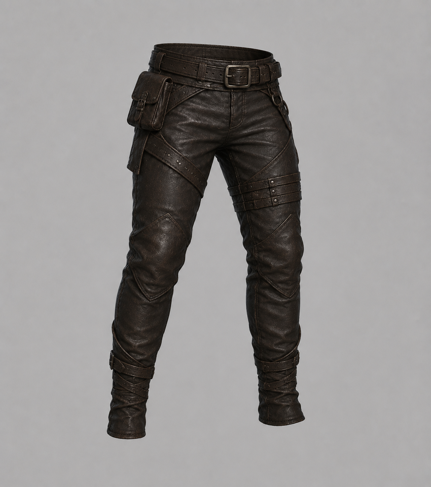
- leather_helmet.glb — Meshy.ai (유료 생성, 2026-07-28, "Leather War Helmet"). 완전 소유권·상업 OK (characters.md License 참조). FBX를 Blender로 임포트해 0.36배 스케일 적용(폭 0.24m), 원점=바닥 중심, 텍스처 512²로 축소, 검은 emissive 제거 (2026-07-29)
    - 원화는 ChatGPT 이미지 생성 (ChatGPT Pro 20x, 2026-07-29 커밋) 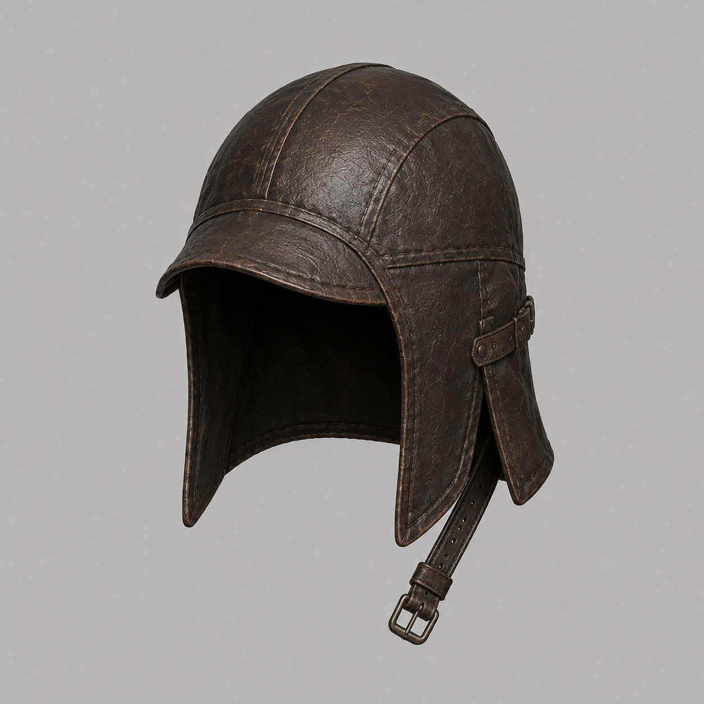
- plate_armor.glb — Meshy.ai (유료 생성, 2026-07-29, "Steelbound Plate Armor"). 완전 소유권·상업 OK (characters.md License 참조). FBX를 Blender로 임포트해 0.6배 스케일 적용(높이 0.6m, leather_armor와 동일), 원점=바닥 중심, 텍스처 512²로 축소, 검은 emissive 제거. 아이콘은 Cycles 직교 렌더(약간 측면·위) 512²→128² (2026-07-31 재렌더)
    - Breastplate 원화는 ChatGPT 이미지 생성 (ChatGPT Pro 20x, 2026-07-29) 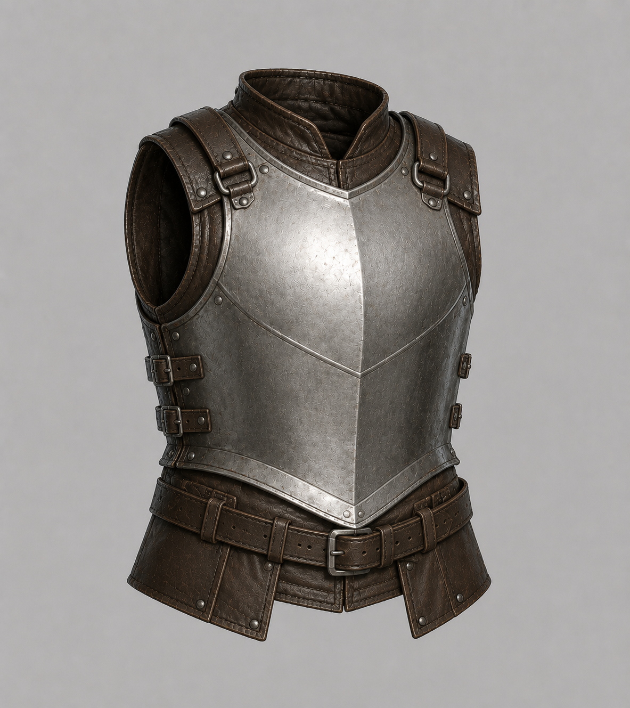
- iron_boots.glb — Meshy.ai (유료 생성, 2026-07-30, "Medieval Sabatons"). 완전 소유권·상업 OK (characters.md License 참조). FBX를 Blender로 임포트해 0.35배 스케일 적용(한 쌍 폭 0.35m, 높이 0.28m), 원점=바닥 중심, 텍스처 512²로 축소, 검은 emissive 제거 (2026-07-30)
    - 원화는 ChatGPT 이미지 생성 (ChatGPT Pro 20x, 2026-07-31 커밋) 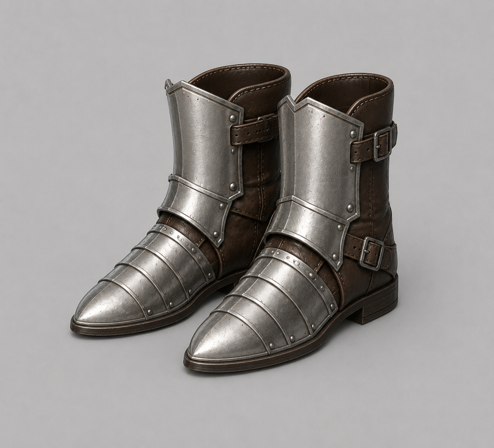
- leather_gloves.glb — Meshy.ai (유료 생성, 2026-07-31, "Dark Brown Leather Fingerless Gloves"). 완전 소유권·상업 OK (characters.md License 참조). FBX를 Blender로 임포트해 0.35배 스케일 적용(한 쌍 폭 0.35m, 높이 0.21m), 원점=바닥 중심, 텍스처 512²로 축소, 검은 emissive 제거. 아이콘은 Cycles 직교 렌더(약간 측면·위) 512²→128² (2026-07-31)
    - 원화는 ChatGPT 이미지 생성 (ChatGPT Pro 20x, 2026-07-31 커밋) 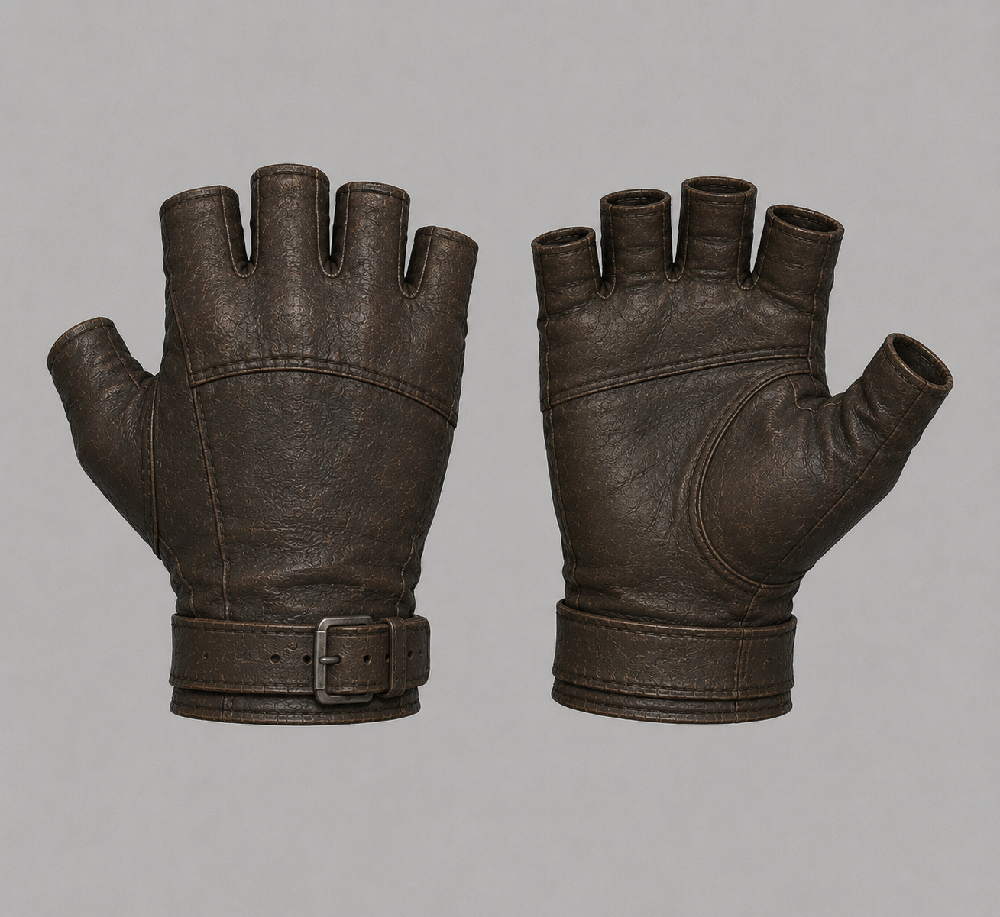
- leather_boots.glb — Meshy.ai (유료 생성, 2026-07-31, "Crisscrossed Leather"). 완전 소유권·상업 OK (characters.md License 참조). FBX를 Blender로 임포트해 0.42배 스케일 적용(한 쌍 폭 0.35m, 높이 0.42m), 원점=바닥 중심, 텍스처 512²로 축소, 검은 emissive 제거. 아이콘은 Cycles 직교 측면·위 각도 렌더 512²→128² (2026-07-31)
    - 원화는 ChatGPT 이미지 생성 (ChatGPT Pro 20x, 2026-07-31 커밋) 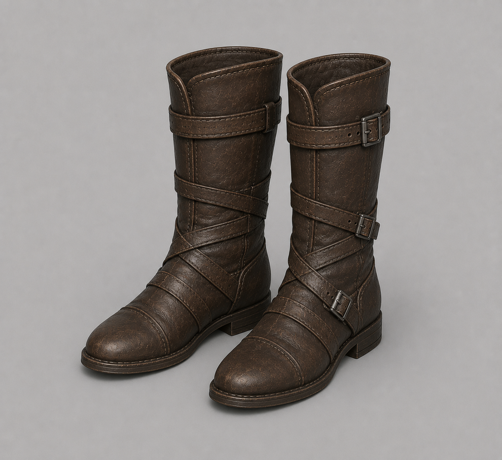
- iron_helmet.glb — Meshy.ai (유료 생성, 2026-07-31, "Medieval Great Helmet"). 완전 소유권·상업 OK (characters.md License 참조). FBX를 Blender로 임포트해 0.3배 스케일 적용(폭 0.25m, 높이 0.29m), 원점=바닥 중심, 텍스처 512²로 축소, 검은 emissive 제거. 아이콘은 Cycles 직교 측면·위 각도 렌더 512²→128² (2026-07-31)
    - 원화는 ChatGPT 이미지 생성 (ChatGPT Pro 20x, 2026-07-31 커밋) 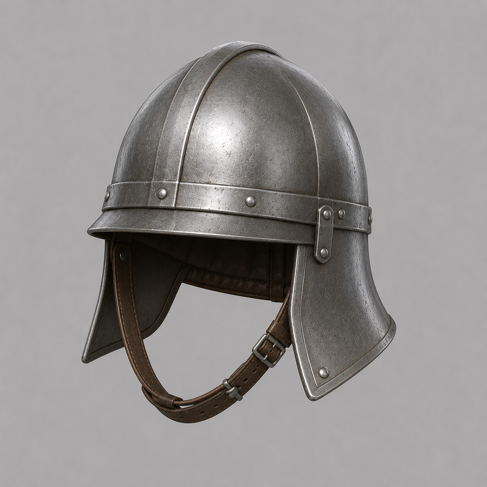
- iron_gauntlets.glb — Meshy.ai (유료 생성, 2026-07-31, "Twin Iron Gauntlets"). 완전 소유권·상업 OK (characters.md License 참조). FBX를 Blender로 임포트해 0.35배 스케일 적용(한 쌍 폭 0.35m, 높이 0.30m), 원점=바닥 중심, 텍스처 512²로 축소, 검은 emissive 제거. 아이콘은 Cycles 측면·위 직교 렌더 512²→128² (2026-07-31)
    - 원화는 ChatGPT 이미지 생성 (ChatGPT Pro 20x, 2026-07-31 커밋) 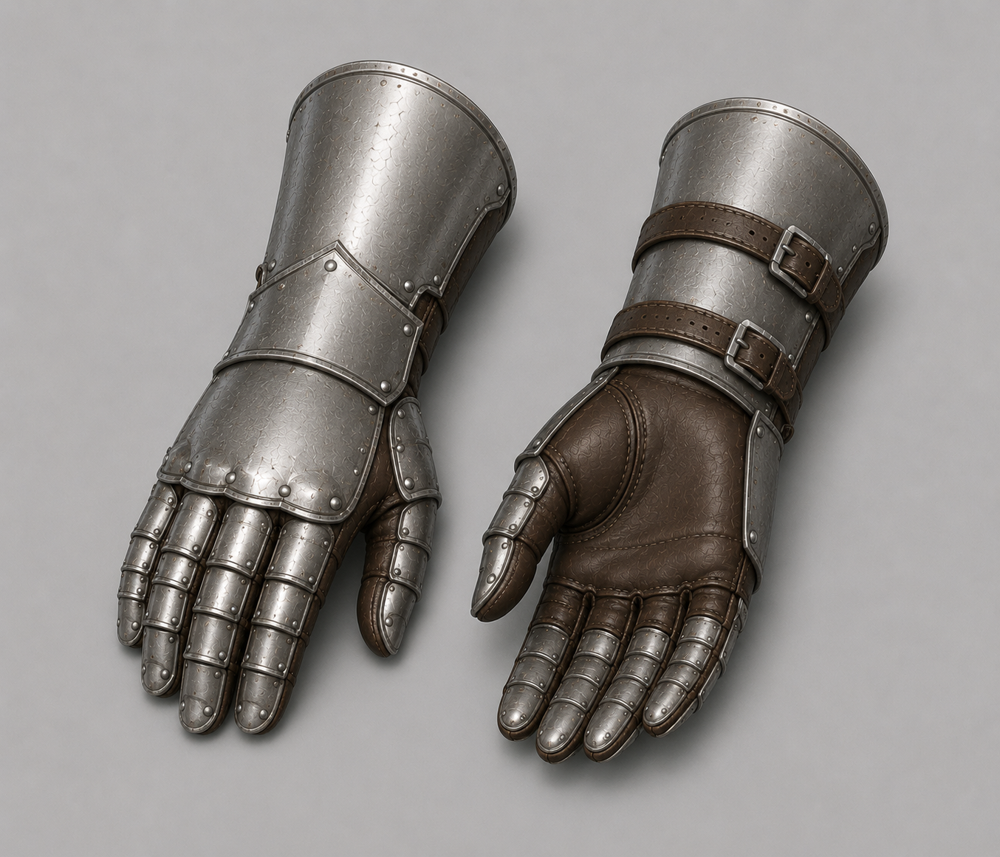
- chain_mail.glb — Meshy.ai (유료 생성, 2026-08-01, "Leather Trimmed Chain"). 완전 소유권·상업 OK (characters.md License 참조). FBX를 Blender로 임포트해 0.6배 스케일 적용(높이 0.6m), X축 −90° 회전으로 눕힌 자세(가슴이 위, 바닥면 0.53×0.6m), 원점=바닥 중심, 텍스처 512²로 축소, 검은 emissive 제거. 아이콘은 Cycles 직교 측면·위 각도 렌더 512²→128² (2026-08-01)
    - 원화는 ChatGPT 이미지 생성 (ChatGPT Pro 20x, 2026-08-01 커밋) 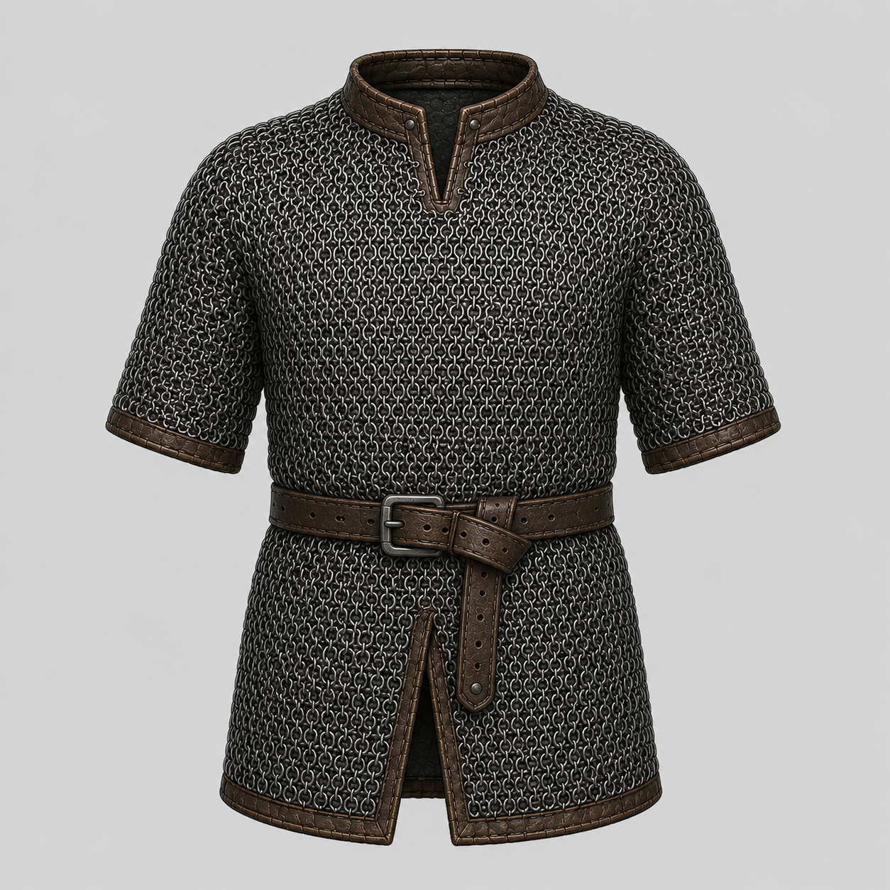
- iron_leggings.glb — Meshy.ai (유료 생성, 2026-08-01, "Knight's Leg Armor"). 완전 소유권·상업 OK (characters.md License 참조). FBX를 Blender로 임포트해 높이 0.7m로 스케일, X축 −90° 회전으로 등을 바닥에 대고 눕힘(0.33×0.70×0.36m), 원점=바닥 중심, 텍스처 512²로 축소, 검은 emissive 제거. 아이콘은 Cycles 직교 측면·위 각도 렌더(서 있는 자세) 512²→128² (2026-08-01)
    - 원화는 ChatGPT 이미지 생성 (ChatGPT Pro 20x, 2026-08-01 커밋) 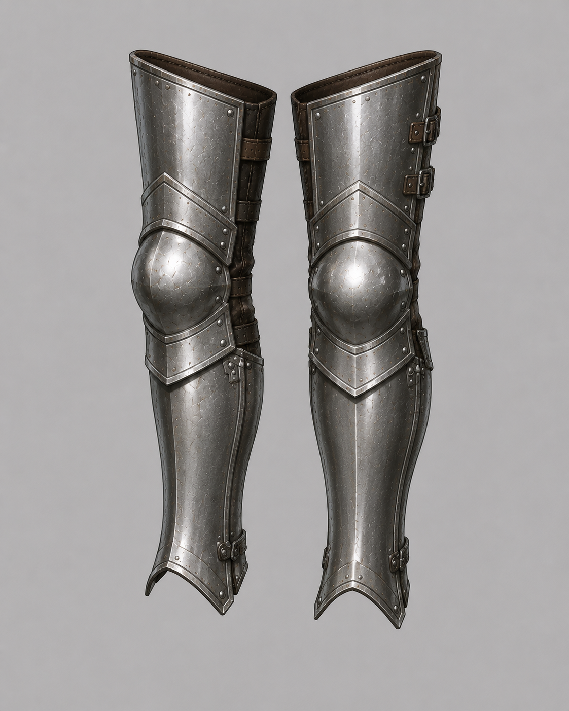
- plate_greaves.glb — Meshy.ai (유료 생성, 2026-08-01, "Twin Steel Greaves"). 완전 소유권·상업 OK (characters.md License 참조). FBX를 Blender로 임포트해 높이 0.45m로 스케일 적용(한 쌍 0.37×0.36×0.45m, 발 포함 서 있는 자세), 원점=바닥 중심, 텍스처 512²로 축소, 검은 emissive 제거. 아이콘은 Cycles 직교 측면·위 각도 렌더 512²→128² (2026-08-01)
    - 원화는 ChatGPT 이미지 생성 (ChatGPT Pro 20x, 2026-08-02 커밋) 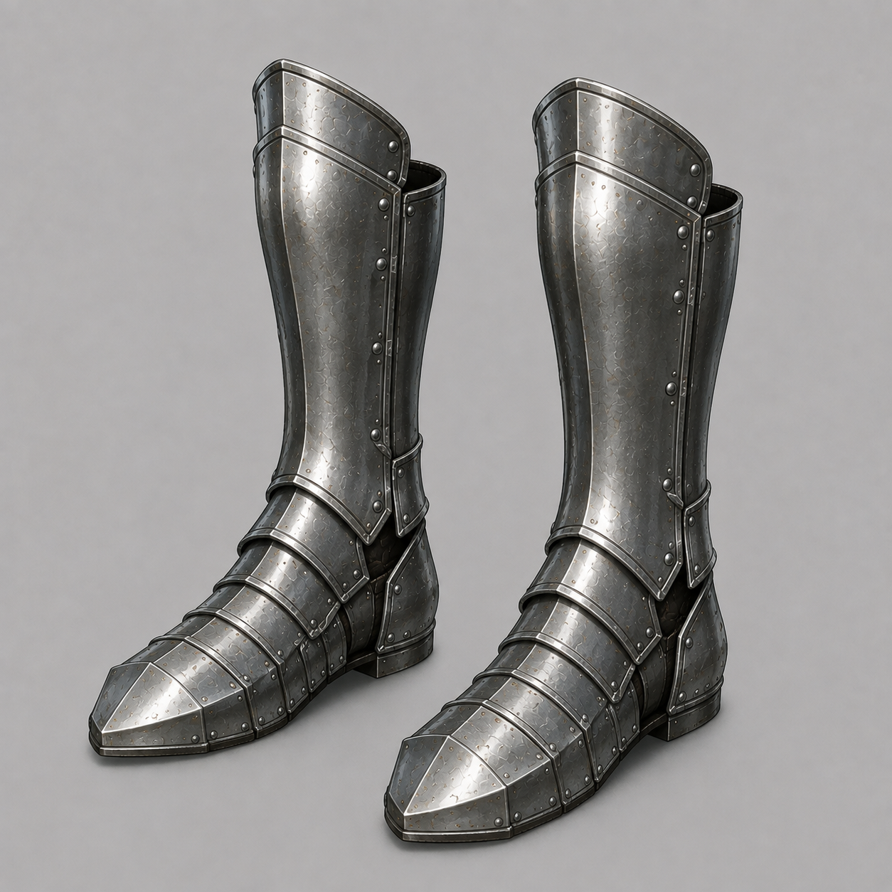
- plate_helmet.glb — Meshy.ai (유료 생성, 2026-08-01, "Iron Sentinel" 클로즈 헬름). 완전 소유권·상업 OK (characters.md License 참조). FBX를 Blender로 임포트해 높이 0.3m로 스케일 적용(0.20×0.29×0.30m), 원점=바닥 중심, 텍스처 512²로 축소, 검은 emissive 제거. 아이콘은 Cycles 직교 측면·위 각도 렌더 512²→128² (2026-08-02)
    - 원화는 ChatGPT 이미지 생성 (ChatGPT Pro 20x, 2026-08-02 커밋) 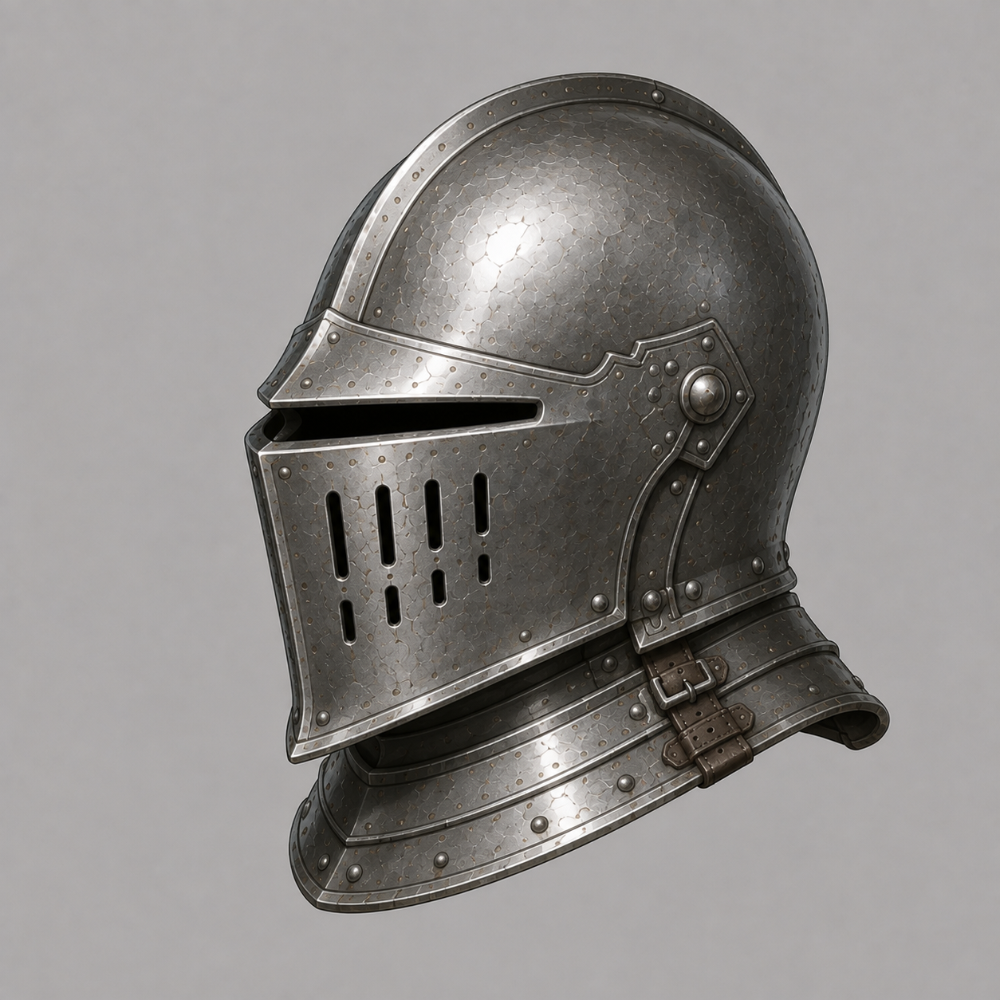
- plate_gauntlets.glb — Meshy.ai (유료 생성, 2026-08-01, "Ironclad Gauntlets"). 완전 소유권·상업 OK (characters.md License 참조). FBX를 Blender로 임포트해 한 쌍 폭 0.35m로 스케일 적용, X축 −70° 회전으로 손등 갑주가 위를 향하게 눕힘(커프 20° 들림, 0.35×0.32×0.15m), 원점=바닥 중심, 텍스처 512²로 축소, 검은 emissive 제거. 아이콘은 Cycles 직교 측면·위 각도 렌더(서 있는 자세) 512²→128² (2026-08-02)
    - 원화는 ChatGPT 이미지 생성 (ChatGPT Pro 20x, 2026-08-02 커밋) 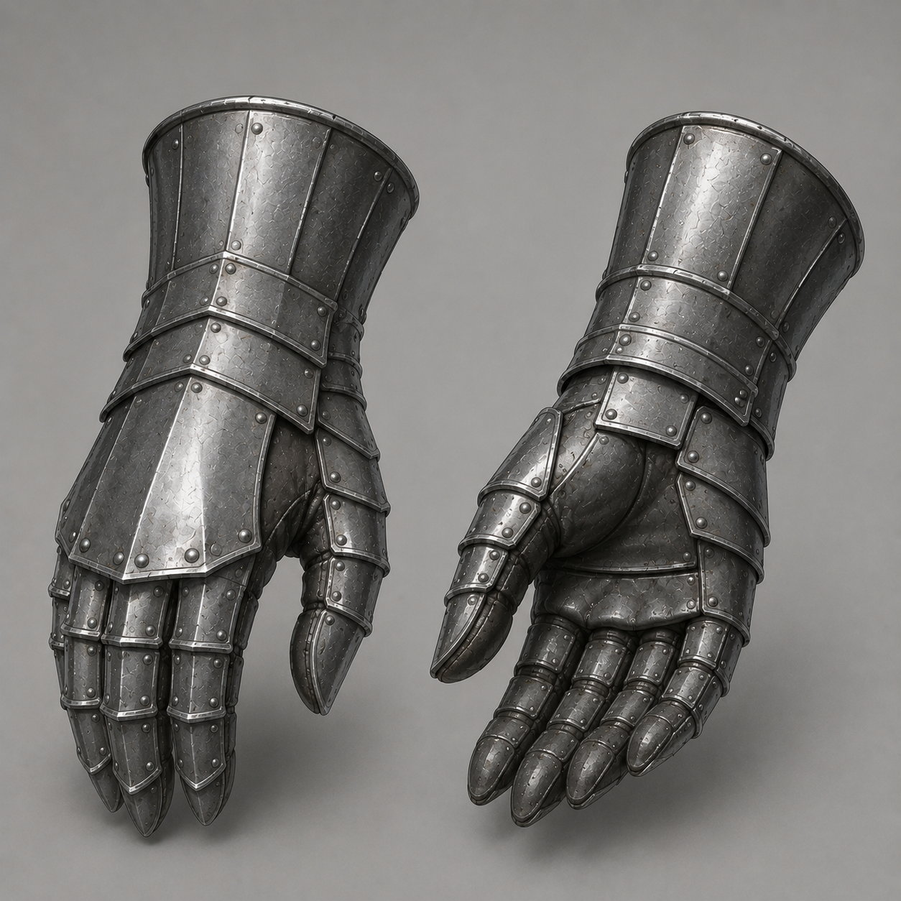
- cross_shield_ring.glb — Meshy.ai (유료 생성, 2026-08-01, "Medieval Cross Shield" — 실제로는 방패 문양 반지). 완전 소유권·상업 OK (characters.md License 참조). FBX를 Blender로 임포트해 0.3배 스케일 적용(외경 0.3m, 높이 0.14m — 실물 반지는 너무 작아 보이지 않아 확대), 원점=바닥 중심, 텍스처 512²로 축소, 검은 emissive 제거. 아이콘은 Cycles 직교 측면·위 각도 렌더 512²→128² (2026-08-02)
    - 원화는 ChatGPT 이미지 생성 (ChatGPT Pro 20x, 2026-08-02 커밋) 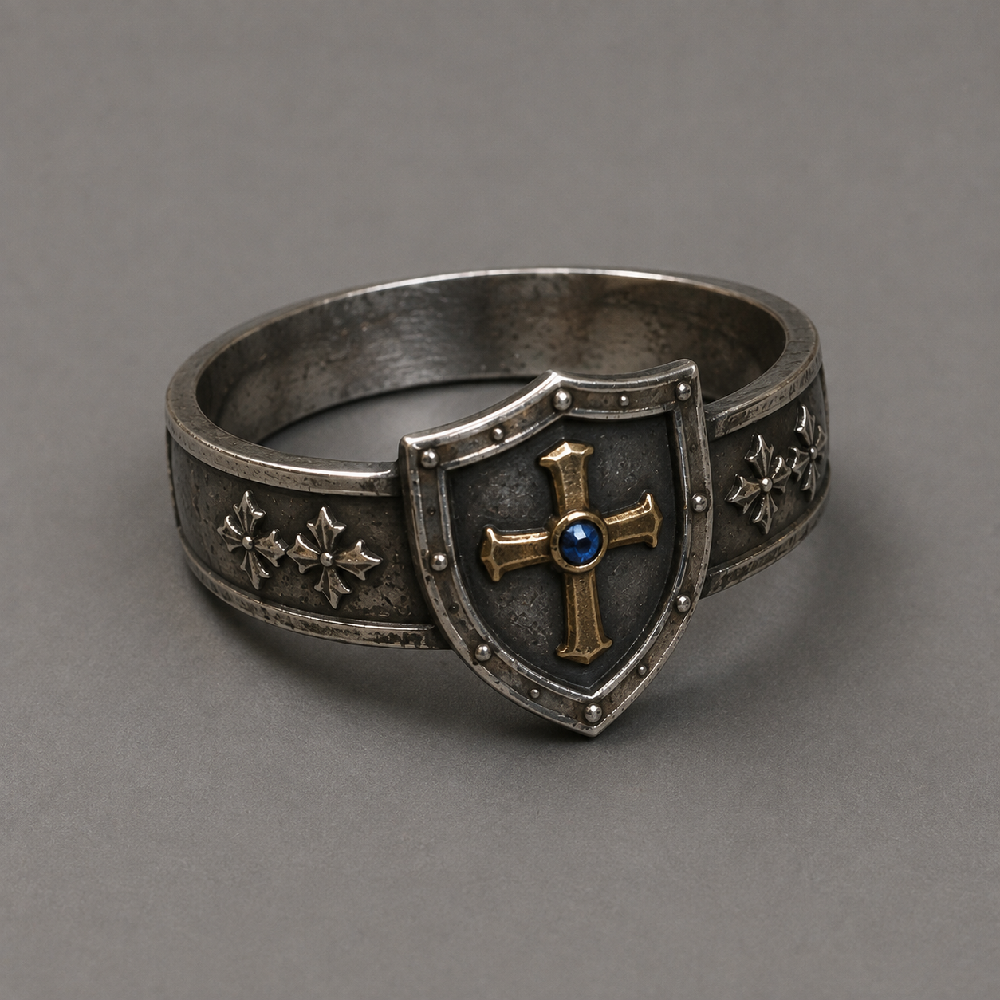
- gold_ring.glb — Meshy.ai (유료 생성, 2026-08-12, "Sapphire Crusader Bra…" — 다운로드 파일명 기준, 제목 잘림). 완전 소유권·상업 OK (characters.md License 참조). GLB를 Blender로 임포트해 외경 0.15m로 스케일 적용(0.15×0.15×0.05m, cross_shield_ring 실측과 동일 외경), 원점=바닥 중심, 텍스처 512²로 축소, emissive 텍스처 없음 확인. 아이콘은 Cycles 직교 측면·위 각도 렌더 512²→128² (2026-08-12) 원본: `assets/items/gold_ring/Meshy_AI_Sapphire_Crusader_Bra_0812120734_texture.glb`.
    - 원화는 ChatGPT 이미지 생성 (ChatGPT Pro 20x, 2026-08-12) 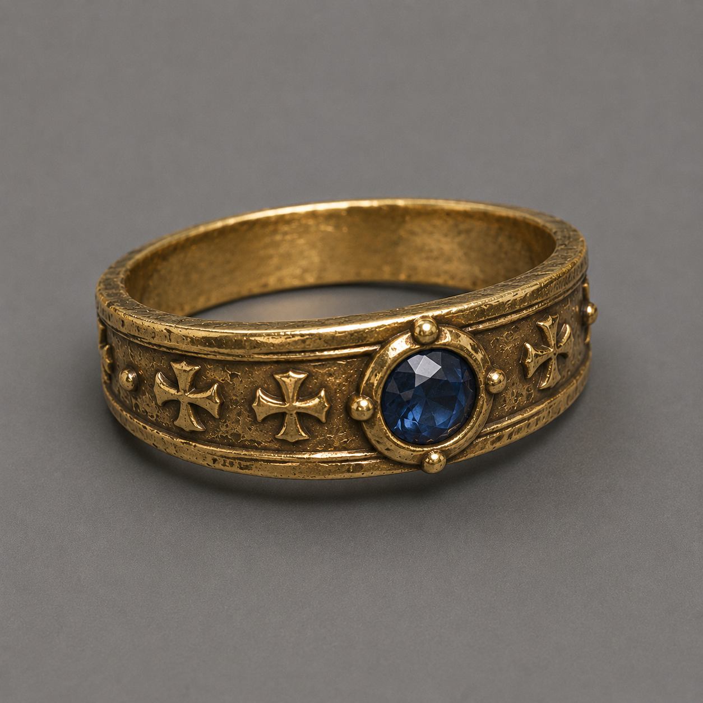
- silver_necklace.glb — Meshy.ai (유료 생성, 2026-08-13, "Harvest Medallion Nec…" — 다운로드 파일명 기준, 제목 잘림). 완전 소유권·상업 OK (characters.md License 참조). GLB를 Blender로 임포트해 최장축 0.35m로 스케일 적용(0.237×0.35×0.104m, gold_ring 0.15m와 ornate_cross_belt 0.40m 사이), 주성분 분석으로 목걸이 평면을 눕히고 펜던트를 -Y로 돌림, 원점=바닥 중심, 텍스처 512²로 축소, emissive 텍스처는 없으나 Emission Color가 화이트로 남아 있어 0으로 (export 후 emissiveFactor 없음 확인). 아이콘은 Cycles 직교 측면·위 각도 렌더 512²→128² (2026-08-13) 원본: `assets/items/silver_necklace/Meshy_AI_Harvest_Medallion_Nec_0812153406_texture.glb`.
    - 원화는 ChatGPT 이미지 생성 (ChatGPT Pro 20x, 2026-08-13) 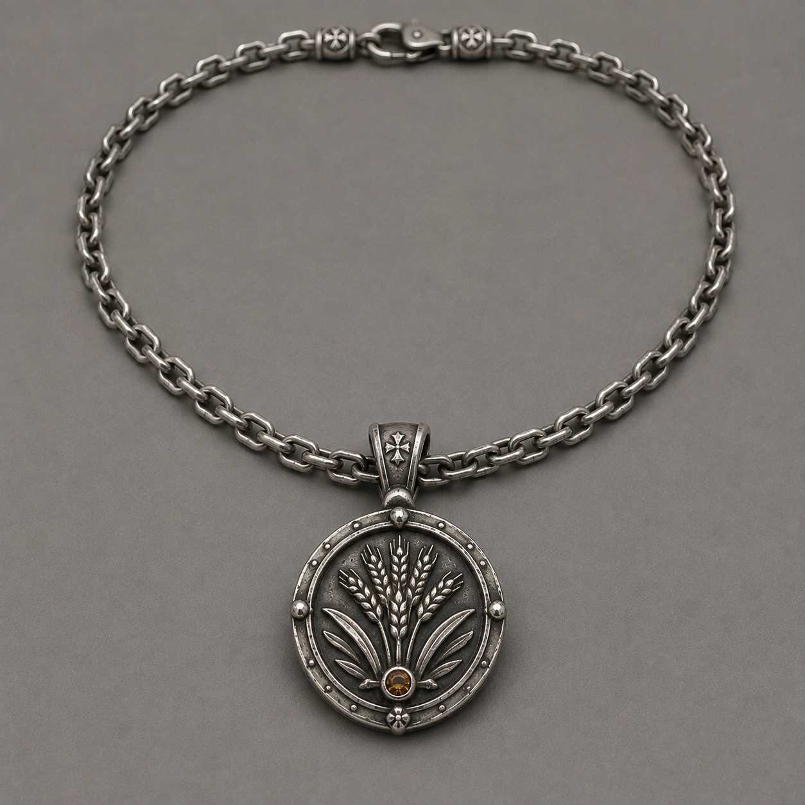
- dagger.glb — Meshy.ai (유료 생성, 2026-08-02, "Crusader's Dagger"). 완전 소유권·상업 OK (characters.md License 참조). FBX를 Blender로 임포트해 0.42배 스케일 적용(전장 0.42m, small_sword 0.54m보다 작게), sword.glb 규약에 맞춰 칼날 +X·칼날 평면 XZ·원점=그립, 텍스처 512²로 축소, 검은 emissive 제거. 아이콘은 Cycles 직교 측면·위 각도 렌더(대각선 구도) 512²→128² (2026-08-02)
    - 원화는 ChatGPT 이미지 생성 (ChatGPT Pro 20x, 2026-08-02 커밋) 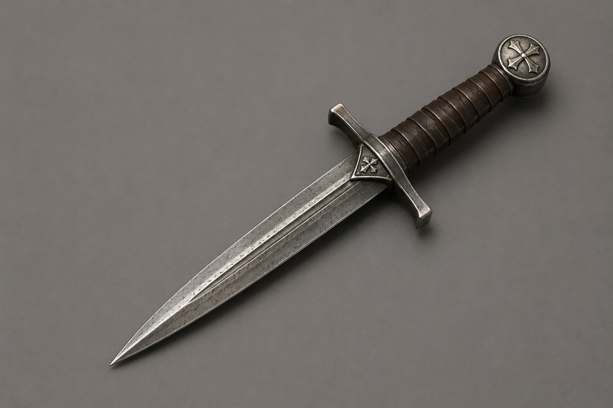
- morningstar.glb — Meshy.ai (유료 생성, 2026-08-16, "Iron Warlord's Mace"). 완전 소유권·상업 OK (characters.md License 참조). OBJ를 Blender로 임포트해 전장 0.95m로 스케일 적용(0.95×0.317×0.351m, goblin_sword 0.80m와 sword 1.20m 사이), sword.glb 손 소켓 규약에 맞춰 자루 +X·가시 머리 +X 끝·원점=그립(자루 중심선, 손잡이 끝에서 전장의 13.6% — sword.glb 비율과 동일), 텍스처 512²로 축소, emissive 텍스처 없음(Emission 0 확인, export 후 emissiveFactor 없음). OBJ에 metallic/roughness 맵이 없어 Principled metallic 0·roughness 0.55로 지정. 아이콘은 Cycles 직교 측면·위 각도 렌더(대각선 구도) 512²→128² (2026-08-16). items.csv 등록(1d8·무게 5·basePrice 6000 — D&D 5e/3.5의 모닝스타가 롱소드와 같은 1d8이면서 더 무겁고 싼 둔기인 데 맞춤). 벅베어(Lv7)가 iron_sword 대신 오른손에 드는 무기이며 10% 확률로 떨군다 — 몬스터 피해는 레벨 기반(2d6)이라 무기 교체는 외형·드롭에만 영향 원본: `assets/items/morningstar/Meshy_AI_Iron_Warlord_s_Mace_0816070254_texture_obj.zip`.
    - 원화는 ChatGPT 이미지 생성 (ChatGPT Pro 20x, 2026-08-16) 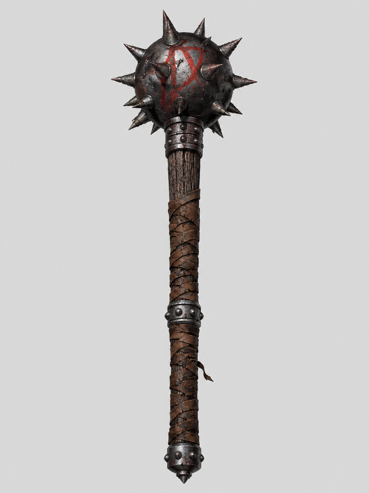
- notched_iron_sword — 신규 애셋 없음. iron_sword의 `weapons/sword.glb`와 `weapons/iron_sword.png`를 그대로 재사용한다(worn_iron_sword와 같은 방식). 홉고블린(Lv5)이 iron_sword 대신 떨구는 무기로 성능은 동일(1d8)하고 basePrice만 10000 → 2500이다 — iron_sword 매각이 NPC 골드 유입의 43%(30일 48.2M)를 차지해 수도꼭지를 좁혔다. 몬스터 피해는 레벨 기반이라 무기 교체는 외형·드롭 가치에만 영향한다 (2026-08-20)

- greatclub.glb — Meshy.ai (유료 생성, 2026-08-16, "Ironthorn Crusher"). 완전 소유권·상업 OK (characters.md License 참조). **GLB로 다시 받아 2026-08-22에 교체** — 처음엔 OBJ 패키지로 받아 `map_Kd`만 있었고 가시·테두리 쇠붙이가 금속으로 반사하지 않았다. GLB에는 base_color·metallic_roughness·normal 3장이 다 들어 있고 emissive는 없다. Blender로 임포트해 전장 1.5m로 스케일 적용(1.50×0.464×0.457m — 오거(2.4m)가 드는 무기라 사람용 sword 1.20m보다 길게, 사람 키 대비 무기 길이 비율을 오거 키에 맞춘 값), sword.glb 손 소켓 규약에 맞춰 자루 +X·가시 머리 +X 끝·원점=그립(자루 중심선, 손잡이 끝에서 전장의 13.6% — 가죽을 감은 그립 구간 안), 텍스처 3장 모두 2048²→512²로 축소(JPEG 유지). 아이콘은 Cycles 직교 측면·위 각도 렌더 512²→128², 긴 무기라 카메라를 시선축으로 -65° 롤시켜 대각선 구도를 만든다(GLB는 소켓 자세 그대로 — 아이콘용 사본만 회전, 20° 간격 + 55~75° 미세 스윕으로 종전 구도에 맞춤), 금속이 반사할 대상이 있어야 해서 회색 월드(0.55/0.57/0.62, strength 1.2) (2026-08-22). items.csv 등록(1d8·무게 10·나무·basePrice 600 — D&D 그레이트클럽은 롱소드와 같은 1d8이면서 통나무라 값이 거의 없다). 오거(Lv8)가 오른손에 드는 무기이며 10% 확률로 떨군다 — 몬스터 피해는 레벨 기반(2d8)이라 무기는 외형·드롭에만 영향 원본: `assets/items/greatclub/Meshy_AI_Ironthorn_Crusher_0822110427_texture.glb`.
    - 원화는 ChatGPT 이미지 생성 (ChatGPT Pro 20x, 2026-08-16) 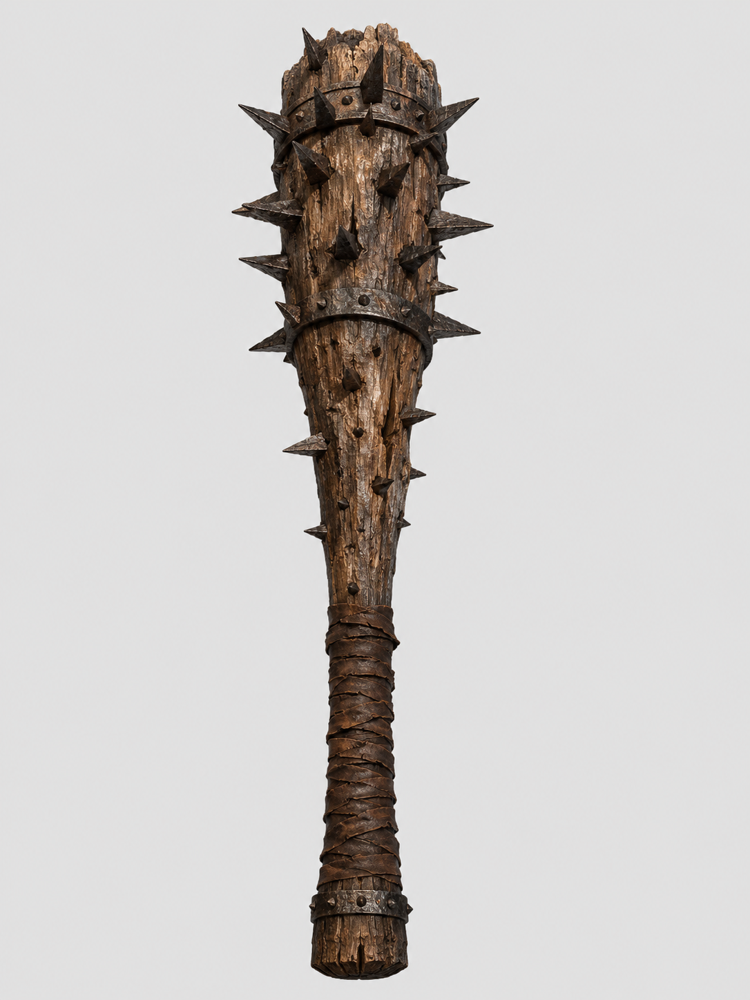
- steel_longsword.glb — Meshy.ai (유료 생성, 2026-08-17, "Silent Oath"). 완전 소유권·상업 OK (characters.md License 참조). OBJ를 Blender로 임포트해 전장 1.30m로 스케일 적용(1.300×0.126×0.045m — 티어 3 무기라 sword 1.20m보다 길게, 오거용 greatclub 1.50m보다는 짧게), sword.glb 손 소켓 규약에 맞춰 칼날 +X·칼날 평면 XZ·원점=그립(손잡이 끝에서 전장의 13.6% — sword.glb 비율과 동일, 크로스가드 바로 아래), 텍스처 2048²→512²로 축소, emissive 텍스처 없음(Emission 0 확인, export 후 emissiveFactor 없음). OBJ에 metallic/roughness 맵이 없어 Principled metallic 0·roughness 0.45로 지정(강철 날). 아이콘은 Cycles 직교 측면·위 각도 렌더(대각선 구도, 칼날이 프레임 대각선에 오도록 카메라 롤 적용 — 가늘고 길어 기본 리그로는 여백이 크다) 512²→128² (2026-08-17). items.csv 등록(1d10·무게 4·metal·basePrice 16,000 — ITEM_TIERS.md의 티어 3 무기). ogre_boss(Ogre Warlord)가 오른손에 드는 무기이며 확정 드랍으로, 임시로 쓰던 greatclub을 대체한다 원본: `assets/items/steel_longsword/Meshy_AI_Silent_Oath_0817092607_texture_obj.zip`.
    - 원화는 ChatGPT 이미지 생성 (ChatGPT Pro 20x, 2026-08-17) 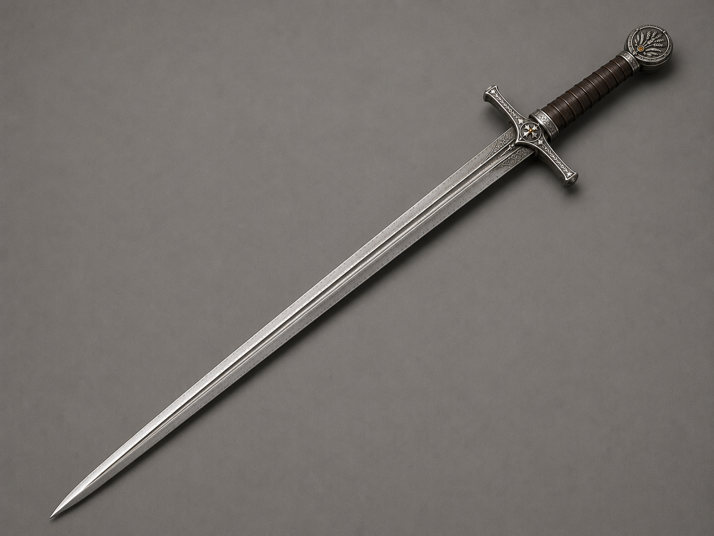
- ornate_cross_belt.glb — Meshy.ai (유료 생성, 2026-08-02, "Ornate Cross Belt"). 완전 소유권·상업 OK (characters.md License 참조). FBX를 Blender로 임포트해 0.4배 스케일 적용(직경 0.4m, 높이 0.15m), 원점=바닥 중심, 텍스처 512²로 축소, 검은 emissive 제거. 아이콘은 Cycles 직교 측면·위 각도 렌더 512²→128² (2026-08-02)
    - 원화는 ChatGPT 이미지 생성 (ChatGPT Pro 20x, 2026-08-02 커밋) 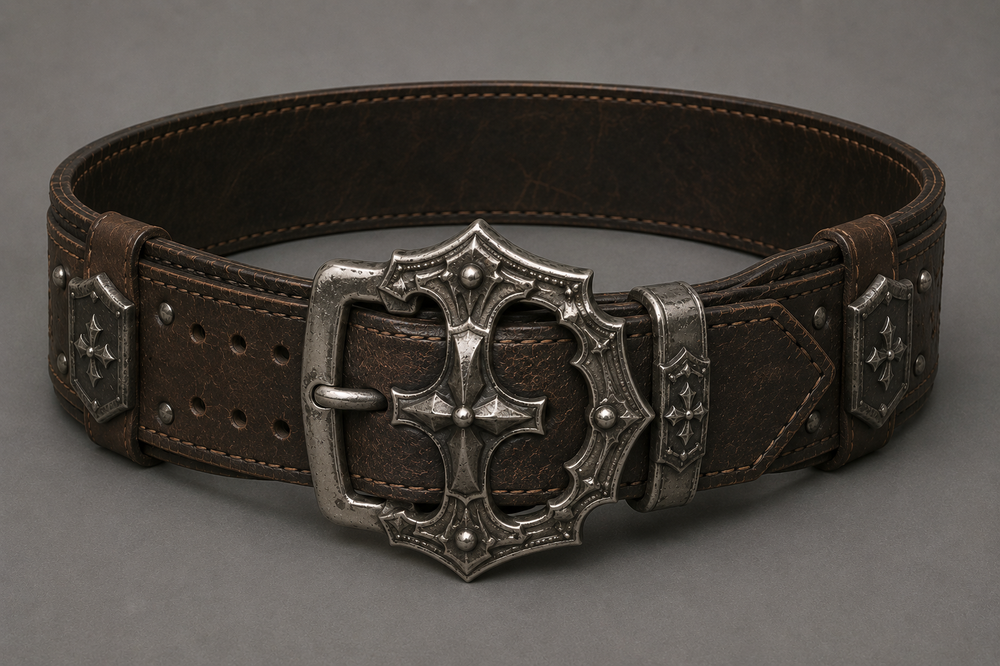
- apple.glb — Meshy AI "Crimson Apple with Leaf" (Pro 요금제, 2026-08-03 생성). 지름 0.15m로 스케일 적용, 원점을 바닥 중앙으로 이동. 텍스처 2048→512 축소, metallic/emissive 맵은 값이 거의 0이라 제거하고 metallicFactor=0. `client/public/items/objects/apple.png` 아이콘은 이 모델을 128x128로 렌더링한 것
    - 원화는 ChatGPT 이미지 생성 (ChatGPT Pro 20x, 2026-08-03) 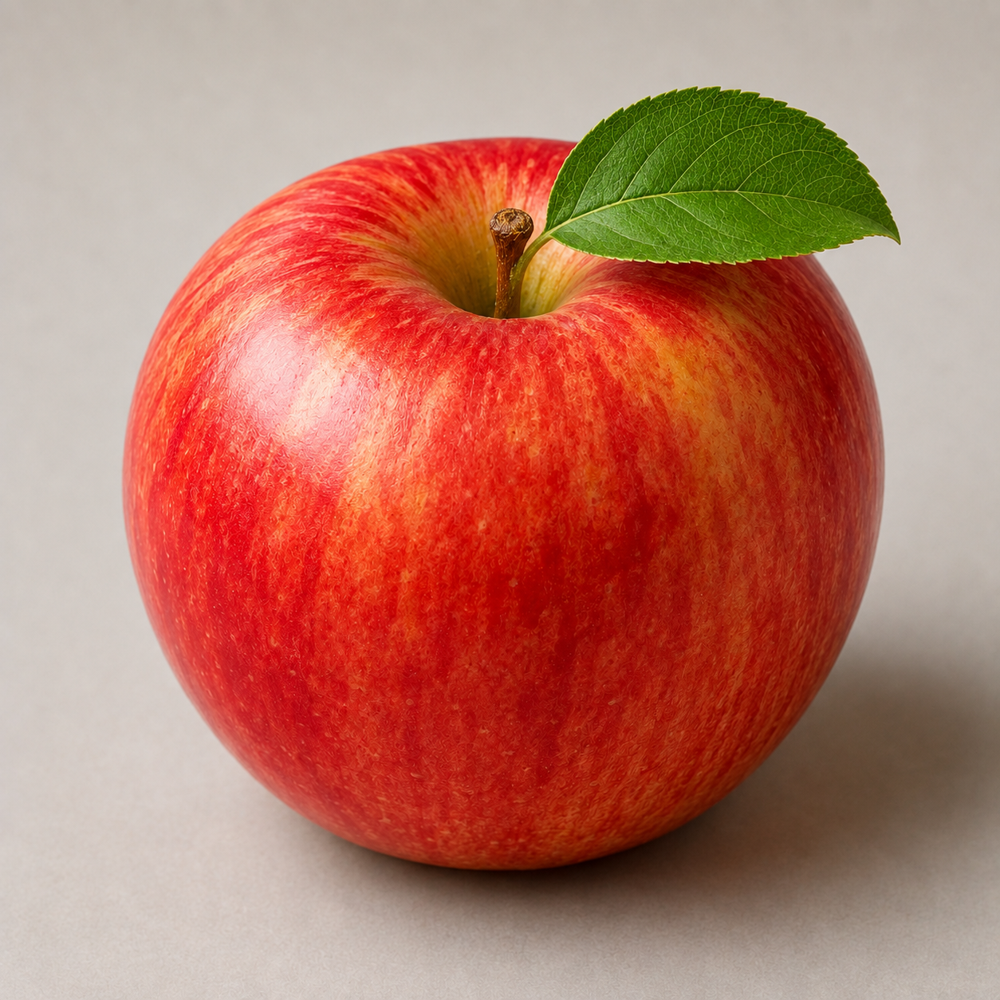
- bread.glb — Meshy.ai (유료 생성, 2026-08-03, "Crusty Loaf of Bread"). 완전 소유권·상업 OK (characters.md License 참조). FBX를 Blender로 임포트해 길이 0.28m로 스케일 적용(0.28×0.14×0.14m, 사과보다 크게), 원점=바닥 중심, 텍스처 512²로 축소, 검은 emissive 제거. 아이콘은 Cycles 직교 측면·위 각도 렌더 512²→128² (2026-08-04)
    - 원화는 ChatGPT 이미지 생성 (ChatGPT Pro 20x, 2026-08-04) 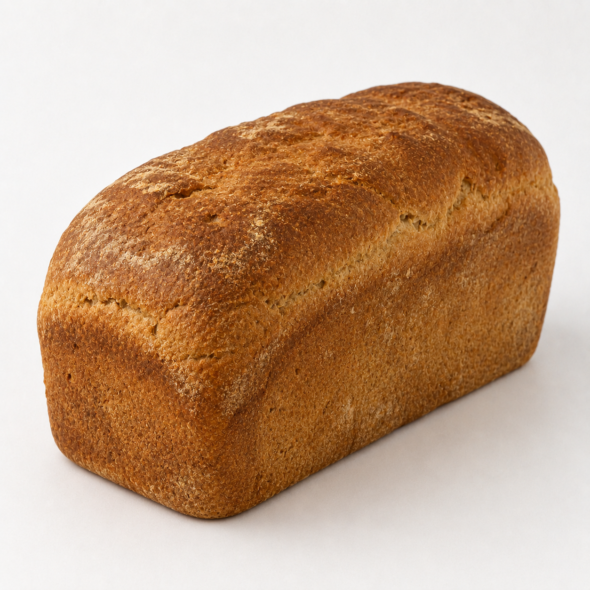
- cheese_wedge.glb — Meshy.ai (유료 생성, 2026-08-03, "Swiss cheese wedge"). 완전 소유권·상업 OK (characters.md License 참조). GLB를 Blender로 임포트해 밑면 0.15m로 스케일 적용(0.15×0.15×0.08m, bread.glb의 절반 길이), 원점=바닥 중심, 텍스처 512²로 축소, 검은 emissive 제거. 아이콘은 Cycles 직교 측면·위 각도 렌더 512²→128² (2026-08-04)
    - 원화는 ChatGPT 이미지 생성 (ChatGPT Pro 20x, 2026-08-04) 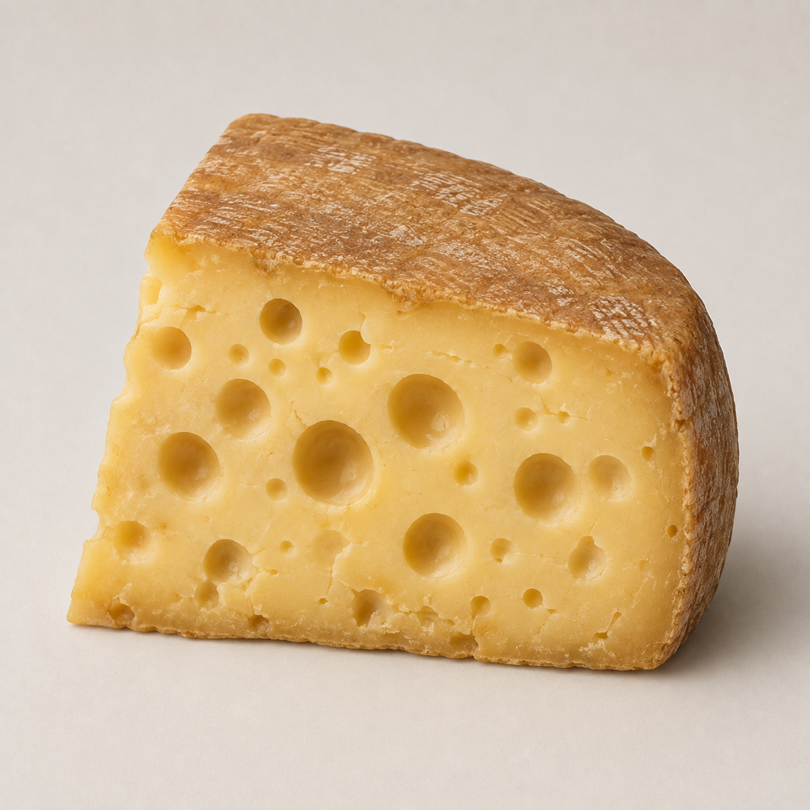
- chicken_rice.glb — Meshy.ai (유료 생성, 2026-09-02, "Sunlit Chicken Rice B", 소스 `assets/items/chicken_rice/Meshy_AI_Sunlit_Chicken_Rice_B_0902151512_texture.glb`). 완전 소유권·상업 OK (characters.md License 참조). GLB를 Blender로 임포트해 접시 지름 0.35m로 스케일 적용(0.35×0.10×0.35m, bread.glb 0.28m보다 크게 — 한 끼 접시), 원점=바닥 중심, 텍스처 2048²→512²로 축소, 검은 emissive 제거. 테이블 상판 높이는 모델이 아니라 서버가 더한다(HUNGER.md "여관 식사"). 아이콘은 Cycles 직교 측면·위 각도 렌더 512²→128² (2026-09-03). items.csv 등록(food·nutrition 700·basePrice 80, 상점 판매 없음 — 여관 메이드의 `serve`로만 테이블에 오른다). chicken_curry·fried_rice·vegetable_rice는 요리별 모델을 따로 만들지 않고 이 GLB와 아이콘을 공용으로 쓴다
    - 원화는 ComfyUI 생성 (체크포인트·생성일 미기록, Meshy 생성 2026-09-02 이전) 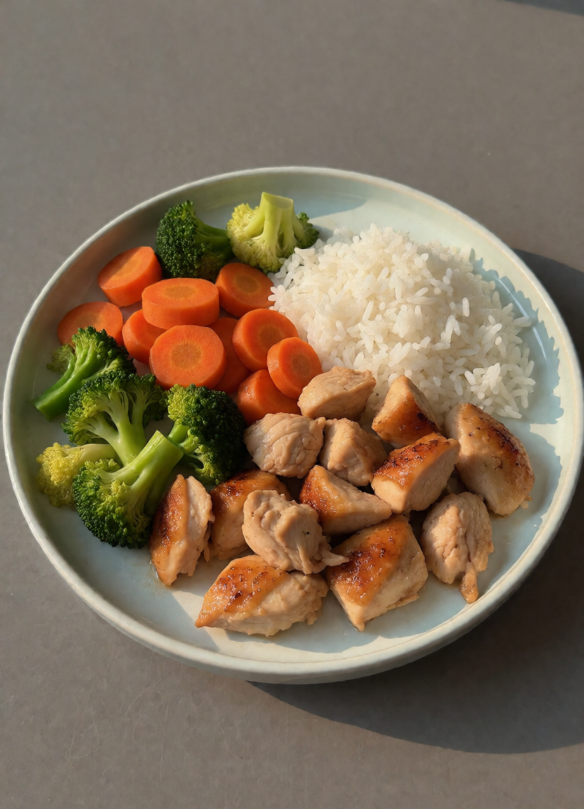
- beer.glb — Meshy.ai (유료 생성, 2026-09-02, "Foamforge Tankard", 소스 `assets/items/beer/Meshy_AI_Foamforge_Tankard_0902170009_texture.glb`). 완전 소유권·상업 OK (characters.md License 참조). GLB를 Blender로 임포트해 높이 0.24m로 스케일 적용(0.28×0.24×0.21m, greater_healing_potion 0.30m보다 조금 낮게), 원점=바닥 중심, 텍스처 2048²→512²로 축소, 검은 emissive 제거. 아이콘은 Cycles 직교 측면·위 각도 렌더 512²→128² (2026-09-03). items.csv 등록(drink·nutrition 100·basePrice 20, 여관 메이드의 `serve` 전용)
    - 원화는 ChatGPT 이미지 생성 (ChatGPT Pro 20x, 2026-09-03) 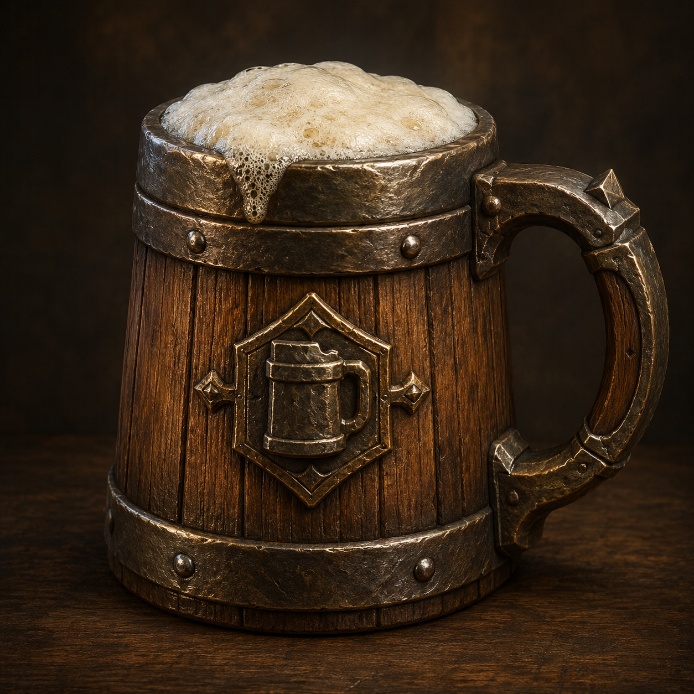
- wine.glb — Meshy.ai (유료 생성, 2026-09-02, "Crimson Chalice", 소스 `assets/items/wine/Meshy_AI_Crimson_Chalice_0902170706_texture.glb`). 완전 소유권·상업 OK (characters.md License 참조). GLB를 Blender로 임포트해 높이 0.26m로 스케일 적용(0.16×0.26×0.16m), 원점=바닥 중심, 텍스처 2048²→512²로 축소, 검은 emissive 제거. 아이콘은 Cycles 직교 측면·위 각도 렌더 512²→128² (2026-09-03). items.csv 등록(drink·nutrition 120·basePrice 60, 여관 메이드의 `serve` 전용)
    - 원화는 ChatGPT 이미지 생성 (ChatGPT Pro 20x, 2026-09-03) 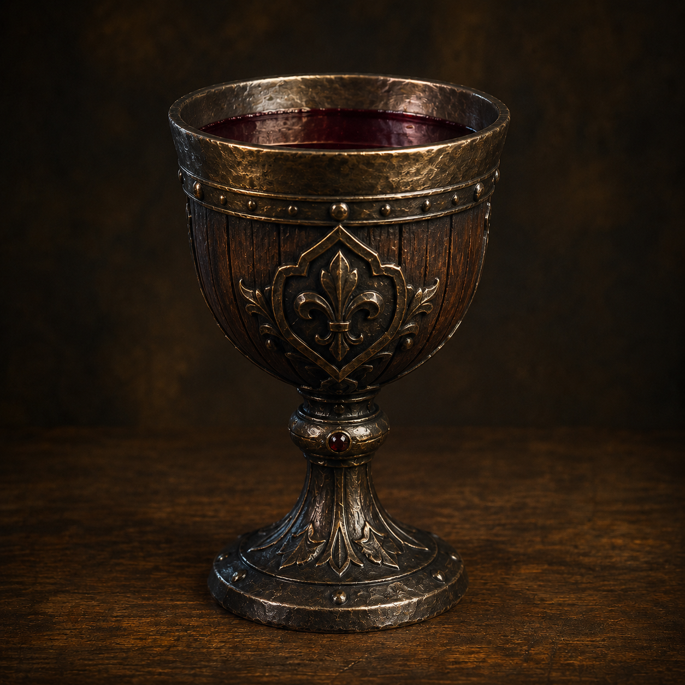
- jerky.glb — Meshy.ai (유료 생성, 2026-08-03, "Beef Jerky Strips"). 완전 소유권·상업 OK (characters.md License 참조). GLB를 Blender로 임포트해 바닥 면적 0.16m로 스케일 적용(0.16×0.16×0.05m, 사과와 같은 급이지만 납작한 무더기), 원점=바닥 중심, 텍스처 512²로 축소, 검은 emissive 제거. 아이콘은 Cycles 직교 측면·위 각도 렌더 512²→128², 2026-08-02 프로시저럴 플레이스홀더를 교체 (2026-08-04)
    - 원화는 ChatGPT 이미지 생성 (ChatGPT Pro 20x, 2026-08-04) 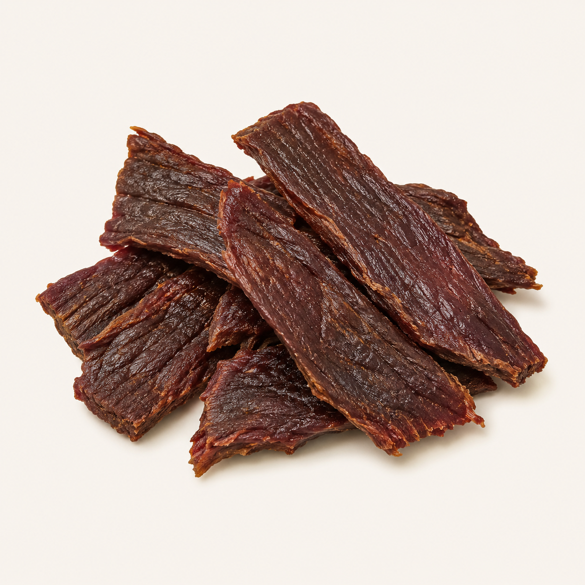
- lembas_wafer.glb (람바스 와퍼) — Meshy.ai (유료 생성, 2026-08-04, "Banana Leaf Wrapped T…" — 파일명에서 잘림). 완전 소유권·상업 OK (characters.md License 참조). GLB를 Blender로 임포트해 긴 축 0.28m로 스케일 적용(0.28×0.07×0.26m, bread.glb와 같은 길이의 납작한 꾸러미 — 잎으로 싸 끈으로 묶은 한 덩이 + 낱개 웨이퍼 한 장 구성), 원점=바닥 중심, 텍스처 512²로 축소, 검은 emissive 제거. 아이콘은 Cycles 직교 측면·위 각도 렌더 512²→128² (2026-08-04). items.csv 등록 + Rica 카탈로그 판매
    - 원화는 ChatGPT 이미지 생성 (ChatGPT Pro 20x, 2026-08-04) 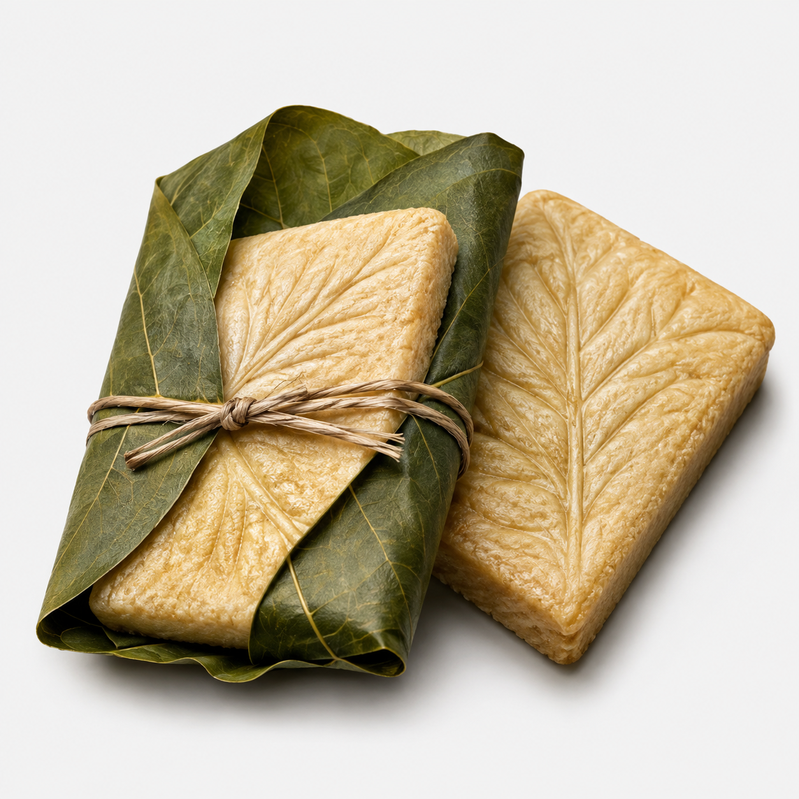
- mandolin.glb — Meshy.ai (유료 생성, 2026-08-05, "Golden Mandolin"). 완전 소유권·상업 OK (characters.md License 참조). FBX를 Blender로 임포트해 전장 0.95m로 스케일 적용(0.95×0.325×0.10m — Mixamo "Guitar Playing" 클립의 양손 간격 0.365m(리그 1.675m)를 1.91m 캐릭터 기준으로 환산하면 약 0.42m라, 그 간격이 스트럼 지점~넥 중단에 맞도록 잡은 길이). sword.glb 손 소켓 규약에 맞춰 넥 +X·사운드보드 법선 +Z, **원점=오른손 스트럼 지점**(사운드홀과 브리지 사이, 사운드보드 표면) — RightHand에 붙었을 때 넥이 왼손 쪽으로 뻗는다. 텍스처 512²로 축소, 검은 emissive 제거. 아이콘은 Cycles 직교 측면·위 각도 렌더 512²→128² (2026-08-06). items.csv 등록(`instrument` 카테고리, main_hand). `/play_music` 이모트가 오른손에 붙이는 프롭이며, 손 기준 회전·위치는 `tools/fit-hand-prop.mjs --tilt 15 --push 0.06 --lift 0.04`가 guitar_playing 클립에 맞춰 산출(둘 다 왼손 그립을 축으로 회전해 넥은 왼손에 유지 — 15°는 소리통을 가슴에서 허리로 내리고, push는 클립상 소리통에 파묻히는 오른손목이 앞으로 나오도록 소리통을 몸에 살짝 묻음). 양손 모두 손목 본이 아니라 주먹이 쥐어지는 지점 기준(오른손은 손바닥 오프셋, 왼손은 검지·엄지 본 중점). 장착해 들고 다닐 때(연주 중이 아닐 때)는 넥을 쥐고 소리통이 손가락 쪽(아래)으로 늘어지게 든다. 쥐는 위치·기울기·이동값은 [instrumentCarry.json](../../client/src/lib/data/instrumentCarry.json)에 있고, 여성 미리보기 `장착 상태: 만돌린 (들고 다니기)`의 슬라이더로 조절·저장한다(사용자 요청)(`poseMainHandProp`, 2026-11-06). 예전에는 회전 없이 소리통을 쥐어 넥이 칼날처럼 아래·앞으로 뻗었다
    - 원화는 ChatGPT 이미지 생성 (ChatGPT Pro 20x, 2026-08-06) 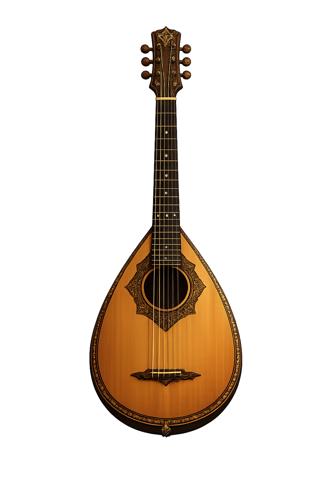
    - `worn_mandolin`(바드 시작 장비, basePrice 없음)은 같은 mandolin.glb·mandolin.png을 재사용 (2026-08-07)
- fishing_rod.glb / fishing_rod.png — Blender 5.1.0 자체 모델링·렌더 (2026-09-21). [build_fishing_rod.py](../../tools/blender-scripts/build_fishing_rod.py)로 나무 몸체, 가죽 그립, 황동·철제 릴과 회전 손잡이, 줄 감개, 안내 고리 7개를 제작했다. 모델의 줄은 릴에서 끝 고리까지만 팽팽하게 이어지며 늘어진 줄·바늘·찌는 포함하지 않는다. 캐스팅 시 끝 고리 중앙의 `rod_tip`에서 찌까지는 기존 `FishingBobber.svelte`가 그린다. 기존 손잡이 위치·축 방향·전장 약 3.28m를 유지하고 `rod_tip`을 끝 고리 중심으로 1cm 옮겼다. 4,338폴리곤(9,268삼각형), 몸체·회전 릴 메시 2개·재질 6개, 나무·가죽 baseColor 각 512² WebP q90, 약 318KB. 아이콘은 동일 모델의 투명 Cycles 렌더 512²→128². 작업 파일·제작 기록은 `assets/items/fishing_rod/`. 외부 원본·유료 생성 서비스 사용 없음, 자체 제작 지오메트리와 절차적 텍스처에 저장소 [LICENSE](../../LICENSE)(PolyForm Noncommercial 1.0.0) 적용.
    - 릴 애니메이션 리깅 (2026-09-21): 회전 부품을 `reel_rotor` 아래 `reel_spool` 메시로 분리하고 `reel_axis`, `reel_handle`, `rod_grip` 연결점을 추가했다. 폴리곤 수와 외형은 유지하며 런타임에서 오른손·릴을 함께 회전한다.
    - 릴 위치 보정 (2026-09-21): 사용자 참고 이미지에 맞춰 릴을 손잡이 뒤에서 앞쪽으로 42cm 이동했다. 릴 중심은 그립에서 낚싯대 끝 방향으로 22.1cm 앞에 있다. 지지대·고정 링·줄 시작점도 함께 옮기고, 기존 그립 위치와 끝 고리 연결점은 유지했다.
    - 편집 원본: `assets/items/fishing_rod/fishing_rod.blend` (텍스처 포함). 제작 도구·출처·라이선스·형상 및 연결점 수치는 같은 폴더의 `generation.json`에 기록한다. 게임 모델은 `client/public/models/weapons/fishing_rod.glb`, 아이콘은 `client/public/items/weapons/fishing_rod.png`다.
    - 재생성: 저장소 루트에서 `/home/jake/opt/blender-5.1.0-linux-x64/blender -b --python-exit-code 1 -P tools/blender-scripts/build_fishing_rod.py`를 실행한다. `-- --output-root /tmp/fishing-rod-preview`로 별도 경로에 시안을 만들 수 있다.
    - 검수 (2026-09-21): Blender GLB 재임포트와 Three.js `fishing_cast`·`fishing_idle` 전 구간의 0.1초 간격 샘플링으로 연결점의 유효 좌표를 확인했다. 인덱스 범위, 유한한 정점·UV·법선, 단위 법선과 메시 2개·재질 6개·텍스처 2개를 검사했다. 손목 정렬을 보정한 실제 런타임 포즈로 감기 → 정지 → 풀기 → 정지 동작도 검수했다. 양손 IK와 낚시 성공 연출은 [애니메이션 기록](animation.md)에 남겼다.
    - **[미사용]** 작업용 PNG·GIF 검수 자료는 2026-10-09 정리했다. 같은 날 폴더의 README 내용을 이 문서로 통합했다.
- **[미사용]** 기존 fishing_rod.glb — Meshy.ai (유료 생성, 2026-07-26, image-to-3D from the archived concept render). 완전 소유권·상업 OK (characters.md License 참조). Textures downscaled to 512², transform matched to spear.glb's hand-socket convention, `rod_tip` empty baked at the tip (script, 2026-07-28). 고정된 늘어진 줄이 포함되어 2026-09-21 자체 제작 모델로 교체했다. 이전 게임 모델 `legacy-meshy.glb`와 아이콘 `legacy-icon.png`는 2026-10-09 정리했다.
    - 원화는 아래 낚시 아이콘 세트와 같은 출처 (2026-07-25, contributor-owned account, tier 불명) 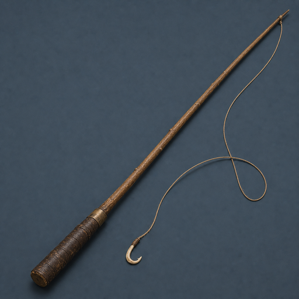
- Fishing icons (10): **[미사용]** 기존 fishing_rod.png (2026-09-21 모델 렌더로 교체), raw_minnow.png, raw_perch.png, raw_trout.png, river_salmon.png, golden_sturgeon.png, old_boot.png, clump_of_kelp.png, message_in_a_bottle.png, sunken_coin_pouch.png — ChatGPT image generation (2026-07-25, contributor adamxgsb-hub 개인 계정, PR #53 / 커밋 5fdaf514). tier는 PR 본문·커밋·리뷰 어디에도 기록이 없어 확인 불가 — 기여자가 CLA.md에 서명해 권리는 확보됨. concept renders cut to 128×128 transparent icons
    - 원화: [rod](../images/items/fishing_rod.png) · [minnow](../images/items/raw_minnow.png) · [perch](../images/items/raw_perch.png) · [trout](../images/items/raw_trout.png) · [salmon](../images/items/river_salmon.png) · [sturgeon](../images/items/golden_sturgeon.png) · [boot](../images/items/old_boot.png) · [kelp](../images/items/clump_of_kelp.png) · [bottle](../images/items/message_in_a_bottle.png) · [pouch](../images/items/sunken_coin_pouch.png)
- land_deed.glb / land_deed.png — Meshy.ai Image to 3D (2026-09-05, "Blackridge Estate Dee…" — 다운로드 파일명 기준). 원본은 `assets/items/land_deed/Meshy_AI_Blackridge_Estate_Dee_0905071232_texture.glb`, 작업 파일은 `assets/items/land_deed/land_deed.blend`. [export_item_asset.py](../../tools/blender-scripts/export_item_asset.py)를 Blender 5.2.0 LTS에서 실행해 문양이 위를 향하도록 눕히고 긴 변을 기존 scroll.glb와 같은 0.50m로 스케일 적용했다. 최종 W×H×D는 0.325×0.104×0.500m, 원점=바닥 중심, 회전 0·스케일 1, 텍스처 3장(baseColor·metallicRoughness·normal) 512² WebP q90, emissive 0, GLB 약 177KB. 아이콘은 Cycles 직교 사선 렌더 512²→128², 투명 배경(2026-09-05); **[미사용]** 512² 작업용 렌더는 2026-10-09 정리했다. Land Deed의 공용 두루마리 표현을 교체하며 기존 scroll.glb·scroll_of_return.png는 다른 주문서에서 계속 사용한다. 라이선스: Meshy 생성물 약관 적용, 이번 생성의 요금제·권리 조건은 미확인.
    - 원화는 사용자가 제공한 ChatGPT 생성 이미지(2026-09-05, 요금제 미확인, ChatGPT 생성물 약관 적용). `assets/ChatGPT Image 2026년 9월 5일 오후 03_10_38.png`를 원본 해상도 그대로 이동했다. 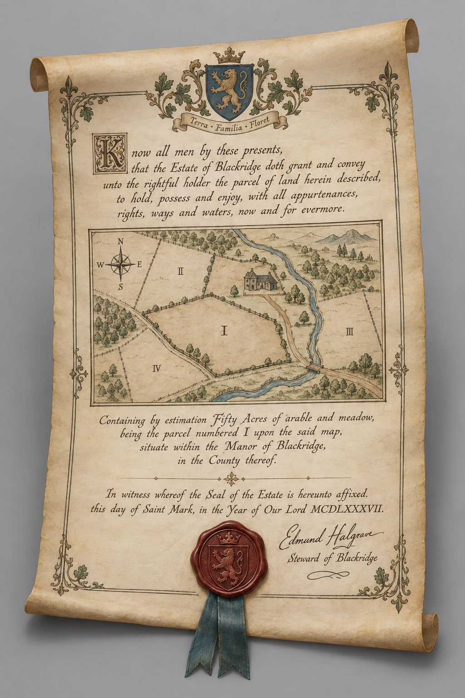
- scroll_of_party_summon.png — scroll_of_return.png의 hue-rotation 파생 (스크립트, 2026-07-31): 붉은 봉인·장식 → 보라. 3D는 기존 scroll.glb 재사용
- scroll_of_estate_return — 기존 `scroll_of_return.png`·`scroll.glb` 재사용 (2026-09-08). 새로 생성한 에셋은 없으며 출처·라이선스는 기존 스크롤 항목을 따른다.
- scroll_of_teleportation — 기존 `scroll_of_return.png`·`scroll.glb` 재사용 (2026-09-21). 출처·라이선스는 기존 스크롤과 [props.md](props.md)의 `scroll.glb` 항목을 따른다. 새 에셋 생성 없음.
- scroll_of_enchant_armor.png — scroll_of_enchant_weapon.png의 hue-rotation 파생 (스크립트, 2026-08-15): 파란 봉인 → 초록. 3D는 같은 색 변환을 적용한 scroll_enchant_armor.glb (doc/assets/props.md의 scroll 항목 참조)
- Hunger icons — 자체 제작 프로시저럴 플레이스홀더 (PIL 스크립트, 2026-08-02, 512² 드로잉→128² 다운스케일, 라이선스 문제 없음). 처음 9개를 만들었고, 남은 플레이스홀더는 grilled_minnow.png, grilled_perch.png, grilled_trout.png, grilled_salmon.png, grilled_sturgeon.png 5개다. 기존 ChatGPT 아이콘 스타일과 다르므로 추후 AI 아이콘으로 교체 예정
    - 교체 완료: apple.png(2026-08-03), bread.png·jerky.png(2026-08-04) — 각 모델의 Cycles 렌더. cheese.png는 cheese_wedge.png로 대체되고 삭제됨
- campfire_kit.glb — Meshy.ai (유료 생성, 2026-08-03, "Firewood Bundle"). 완전 소유권·상업 OK (characters.md License 참조). FBX를 Blender로 임포트해 0.45배 스케일 적용(장작 길이 0.45m, 0.45×0.45×0.30m 눕힌 자세), 원점=바닥 중심, 텍스처 512²로 축소, 검은 emissive 제거. 아이콘 campfire_kit.png는 Cycles 직교 측면·위 각도 렌더 512²→128², 2026-08-02 프로시저럴 플레이스홀더를 교체 (2026-08-03)
    - 원화는 ChatGPT 이미지 생성 (ChatGPT Pro 20x, 2026-08-03) 
- tip_hat.glb — Meshy.ai (유료 생성, 2026-08-13, "Feathered Coin Pouch"). 완전 소유권·상업 OK (characters.md License 참조). GLB를 Blender로 임포트해 폭 0.45m로 스케일 적용(0.45×0.20×0.45m, campfire_kit과 같은 폭), 원점=바닥 중심, 텍스처 2048²→512² 축소, emissive 없음 확인. 아이콘 tip_hat.png는 Cycles 직교 측면·위 각도 렌더 512²→128² (2026-08-13). 바닥에 놓는 팁 모자(`tip_hat` 아이템, doc/ECONOMY.md) 원본: `assets/items/tip_hat/Meshy_AI_Feathered_Coin_Pouch_0813074816_texture.glb`.
    - 원화는 ChatGPT 이미지 생성 (ChatGPT Pro 20x, 2026-08-13) 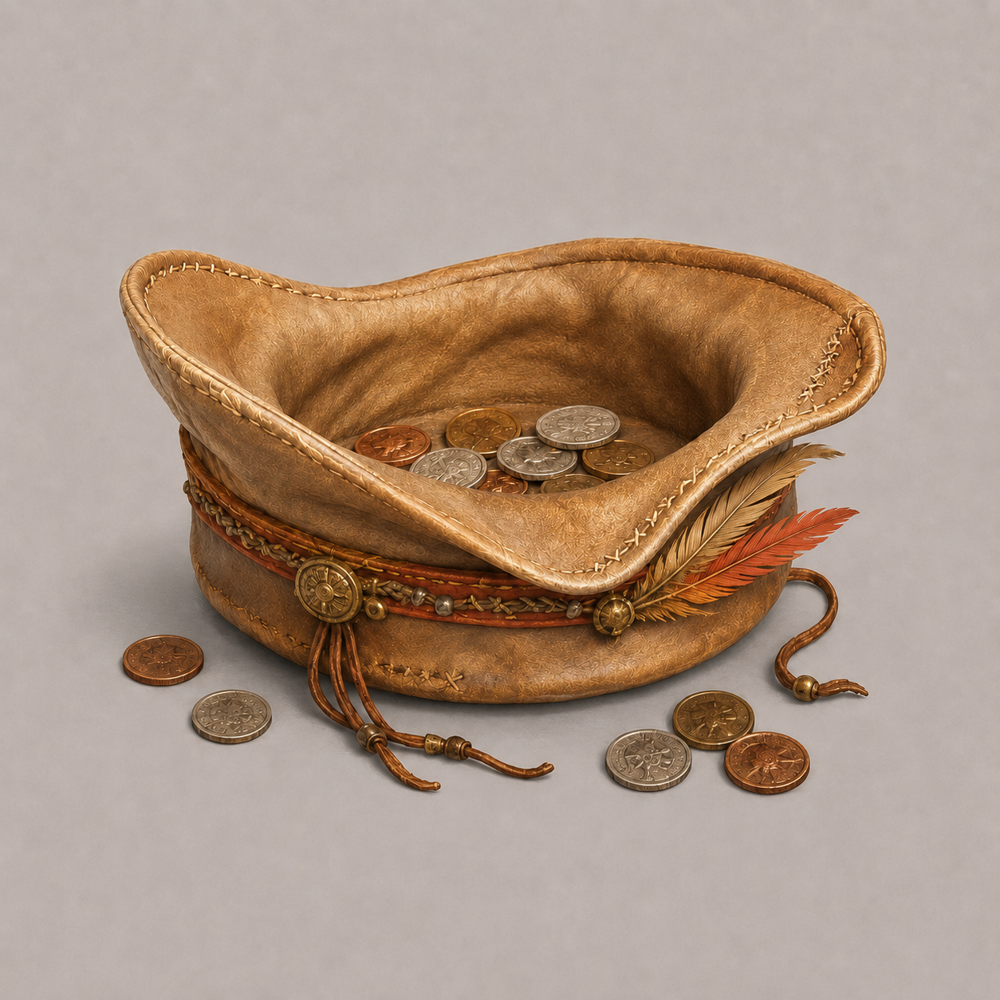
- phoenix_talisman.glb (불사조의 부적 — 죽은 자리에서 부활하는 소모품용) — Meshy.ai (유료 생성, 2026-08-19, "Sunfire Phoenix Table…" — 다운로드 파일명 기준, 제목 잘림). 완전 소유권·상업 OK (characters.md License 참조). OBJ를 Blender로 임포트해 높이 0.30m로 스케일 적용(0.129×0.30×0.029m, health_potion 0.30m와 같은 높이), X축 +90° 회전으로 석판을 세우고 문양 면을 -Y로(Meshy 산출물은 눕힌 자세), 원점=바닥 중심, 텍스처 2048²→512²로 축소, emissive 텍스처 없음(MTL `Ke 0`, Emission 0 확인, export 후 emissiveFactor 없음). OBJ에 metallic/roughness 맵이 없어 Principled metallic 0·roughness 0.5 기본값. 아이콘은 Cycles 직교 측면·위 각도 렌더 512²→128² — 가늘고 긴 석판이라 렌더용으로만 25° 뒤로 눕히고 30° 롤을 줘 대각선 구도로 문양이 보이게 함, GLB는 세운 자세 그대로 (2026-08-20). items.csv 등록(소모품·무게 0.3·basePrice 5000 — 던전을 다시 와야 하는 수고를 아끼는 값이라 티어 2 무기의 절반·회복 물약 8개 값, 사망 대화상자에서 사용하면 제자리 부활 — doc/COMBAT.md). Rica 카탈로그 판매 + 월드 드랍 0.2% 원본: `assets/items/phoenix_talisman/Meshy_AI_Sunfire_Phoenix_Table_0819150715_texture_obj.zip`.
    - 원화는 ChatGPT 이미지 생성 (ChatGPT Pro 20x, 2026-08-20) 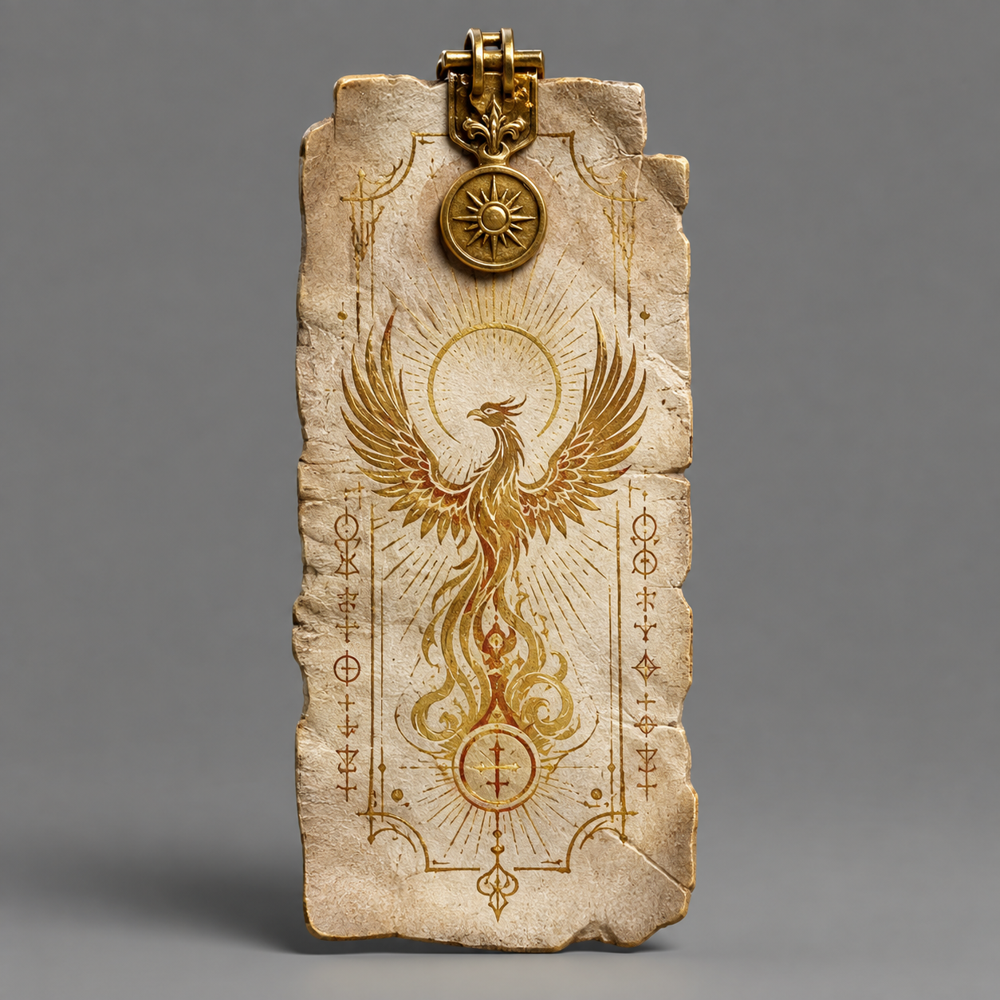
- celestial_timekeeper.glb (천체 시계 — 소지하면 해·달 위젯 옆에 시각·날짜 표시) — Meshy.ai (유료 생성, 2026-08-27, "Celestial Timekeeper"). 완전 소유권·상업 OK (characters.md License 참조). GLB를 Blender로 임포트해 높이 0.30m로 스케일 적용(0.269×0.30×0.079m, phoenix_talisman·health_potion과 같은 높이), 원점=바닥 중심, 텍스처 2048²→512²로 축소, emissive 제거. 아이콘은 Cycles 직교 측면·위 각도 렌더 512²→128² (2026-08-27). items.csv 등록(category timekeeper·무게 0.5·basePrice 8000, Rica 카탈로그 판매) 원본: `assets/items/celestial_timekeeper/Meshy_AI_Celestial_Timekeeper_0827125612_texture.glb`.
    - 원화는 ChatGPT 이미지 생성 (ChatGPT Pro 20x, 2026-08-27) 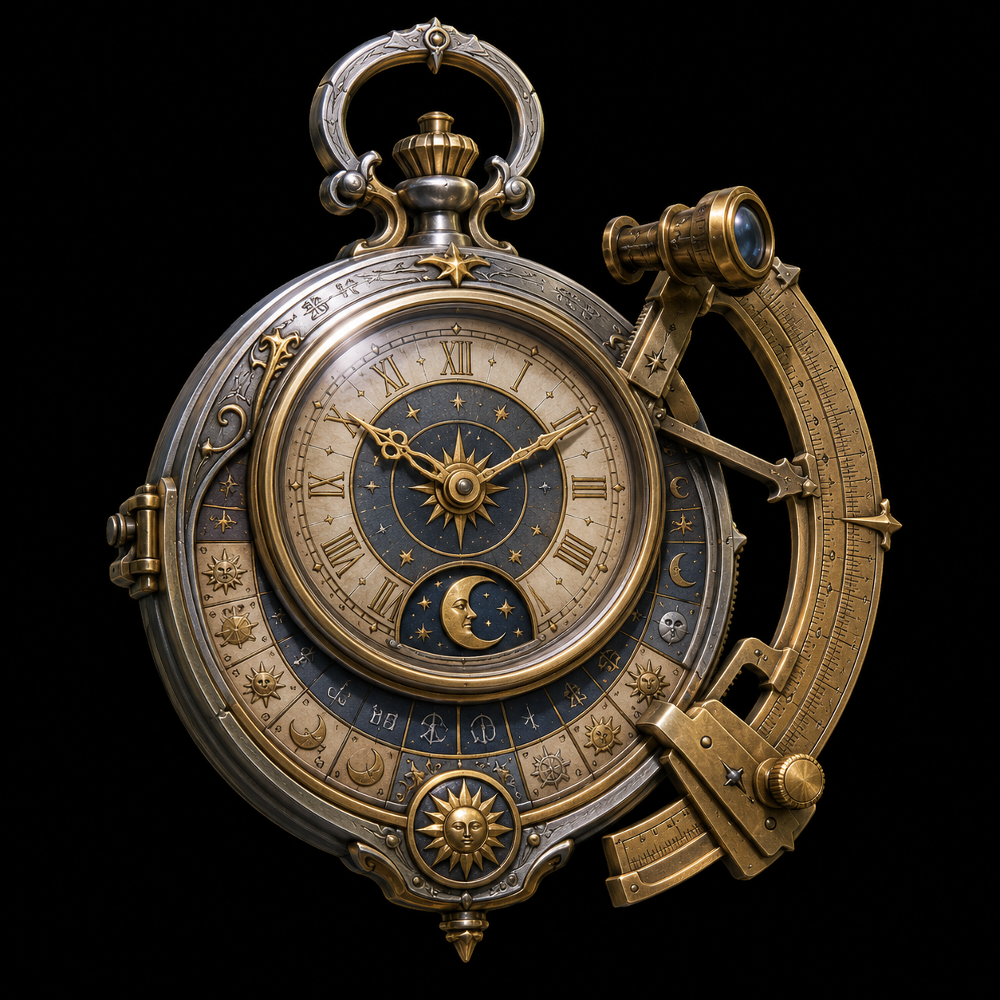
- whetstone_oil.glb / whetstone_oil.png — Meshy.ai (유료 생성, 2026-08-20, "Knight's Elixir" — 다운로드 파일명 기준). 완전 소유권·상업 OK (characters.md License 참조). **GLB로 다시 받아 2026-08-22에 교체** — 처음엔 OBJ 패키지로 받아 `map_Kd`만 있었고 은장식·유리가 금속으로 반사하지 않았다. GLB에는 base_color·metallic_roughness·normal 3장이 다 들어 있고 emissive는 없다. Blender로 임포트해 높이 0.28m로 스케일 적용(0.154×0.280×0.159m, cape_dye 병 0.265m와 healing_potion 0.30m 사이), 소스가 자체 Y축으로 누워 있어 세운 자세로 회전 적용하고 Z축 40°를 먹여 검·방패 문양이 아이콘 카메라를 보게 함(45° 간격 전방위 + 35~50° 미세 스윕으로 결정), 원점=바닥 중심, 텍스처 3장 모두 2048²→512²로 축소(JPEG 유지). 아이콘은 Cycles 직교 측면·위 각도 렌더 512²→128², 금속이 반사할 대상이 있어야 해서 회색 월드(0.55/0.57/0.62, strength 1.2) — `film_transparent`라 배경은 투명 (2026-08-22). items.csv 등록(reagent·무게 0.2·basePrice 10000 — 인챈트 주문서를 읽을 때마다 1병 소모, doc/ENCHANT.md). Rica 카탈로그 판매 원본: `assets/items/whetstone_oil/Meshy_AI_Knight_s_Elixir_0822105132_texture.glb`.
    - 원화는 ChatGPT 이미지 생성 (ChatGPT Pro 20x, 2026-08-20) 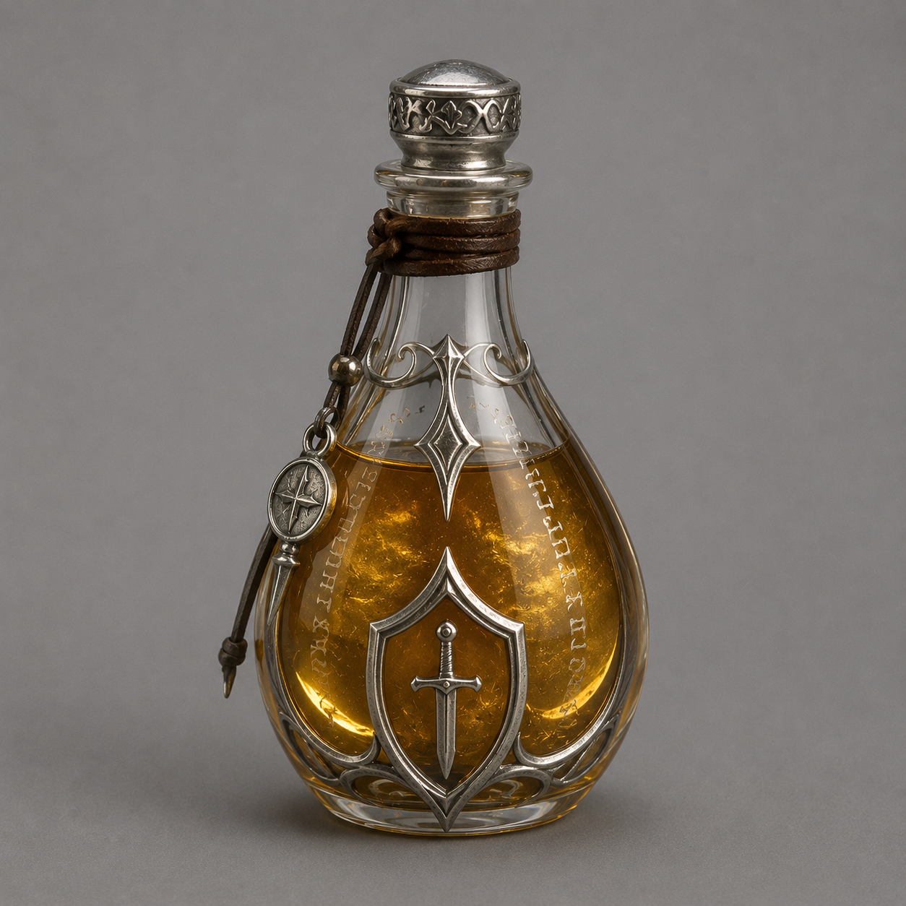
- healing_potion.glb / healing_potion.png (회복 물약) — Meshy.ai (유료 생성, 2026-08-22, "Crimson Elixir Bottle" — 다운로드 파일명 기준). 완전 소유권·상업 OK (characters.md License 참조). **GLB로 받았다** — OBJ 패키지는 포맷상 `map_Kd`만 담아 나오므로 metallic/roughness·normal 맵이 빠진다(금테가 금속으로 안 보인다). GLB에는 base_color·metallic_roughness·normal 3장이 다 들어 있고 emissive는 없다. Blender로 임포트해 높이 0.30m로 스케일 적용(0.081×0.300×0.072m, greater_healing_potion과 같은 높이), 소스가 X축 -90°로 누워 있어 세운 자세로 회전 적용, 원점=바닥 중심, 텍스처 3장 모두 2048²→512²로 축소(JPEG 유지). 아이콘은 Cycles 직교 측면·위 각도 렌더 512²→128², 금속 재질이 반사할 대상이 있어야 해서 회색 월드(0.55/0.57/0.62, strength 1.2)를 깔았다 — `film_transparent`라 배경은 그대로 투명하다 (2026-08-22). 유래 기록이 없던 Sketchfab 출처 구 애셋(`health_potion.glb` / `healing_potion.png`)을 상급 물약과 한 쌍으로 대체했다 — 구 애셋은 트리에서 제거. 2026-08-24 바닥에서 너무 작아 클릭이 어려워 루트 노드 scale 1.5(높이 0.45m)로 키움 — GLB JSON의 node scale만 바꿨고 메시·텍스처는 그대로 원본: `assets/items/healing_potion/Meshy_AI_Crimson_Elixir_Bottle_0822104934_texture.glb`.
    - 원화는 ChatGPT 이미지 생성 (ChatGPT Pro 20x, 2026-08-22) 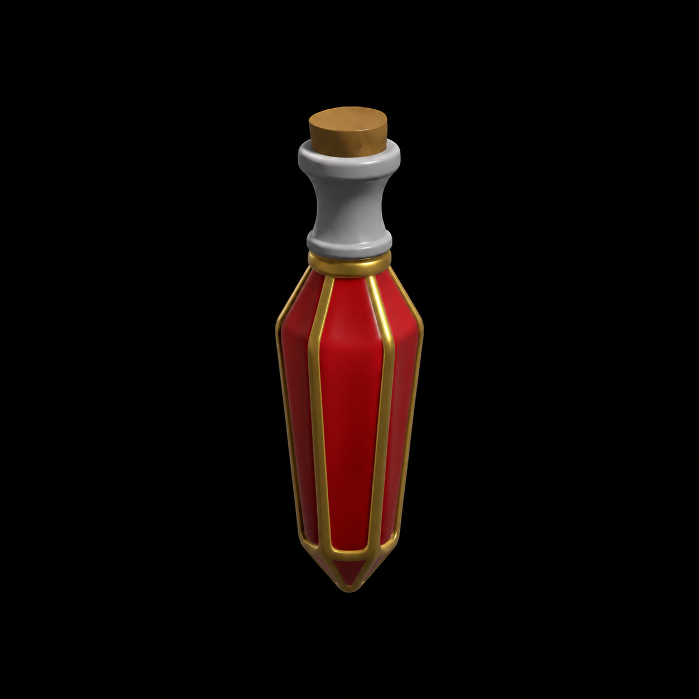
- greater_healing_potion.glb / greater_healing_potion.png (상급 회복 물약) — Meshy.ai (유료 생성, 2026-08-22, "Regal Crimson Flask" — 다운로드 파일명 기준). 완전 소유권·상업 OK (characters.md License 참조). **GLB로 받았다** — OBJ 패키지는 포맷상 `map_Kd`만 담아 나오므로 metallic/roughness·normal 맵이 빠진다(금테가 금속으로 안 보인다). GLB에는 base_color·metallic_roughness·normal 3장이 다 들어 있고 emissive는 없다. Blender로 임포트해 높이 0.30m로 스케일 적용(0.226×0.300×0.218m, healing_potion과 같은 높이 — 폭이 3배라 통이 커 보이는 것으로 등급 차를 낸다), 소스가 X축 -90°로 누워 있어 세운 자세로 회전 적용, 원점=바닥 중심, 텍스처 3장 모두 2048²→512²로 축소(JPEG 유지). 아이콘은 Cycles 직교 측면·위 각도 렌더 512²→128², 금속 재질이 반사할 대상이 있어야 해서 회색 월드(0.55/0.57/0.62, strength 1.2)를 깔았다 — `film_transparent`라 배경은 그대로 투명하다 (2026-08-22). 같은 날 healing_potion과 한 쌍으로 새로 만들어, 유래 기록이 없던 Sketchfab 출처 구 애셋(`health_potion.glb`)을 대체했다 — 지형에 이미 놓인 프롭이 참조하는 catalog id `health_potion`은 그대로 두고 모델 경로만 이 파일로 옮겼다. items.csv 등록(회복 12d4·무게 0.85·basePrice 1500 — 일반 물약의 회복량 2배, 가격 2.5배. 2026-10-18 무게를 1.25에서 0.85로 줄여 무게당 회복량을 일반 30보다 높은 35 HP/kg으로 맞췄다). Rica 카탈로그 판매 원본: `assets/items/greater_healing_potion/Meshy_AI_Regal_Crimson_Flask_0822104611_texture.glb`.
    - 원화는 ChatGPT 이미지 생성 (ChatGPT Pro 20x, 2026-08-22) 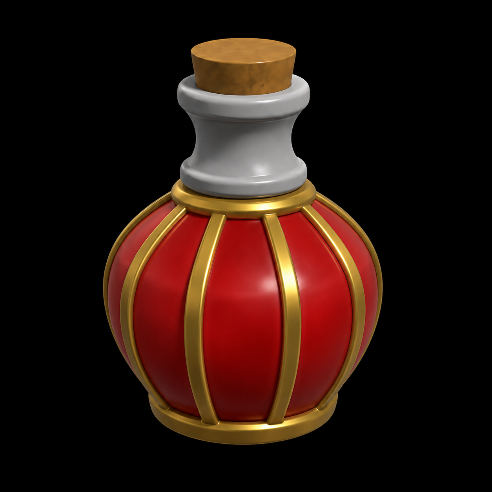
- `supreme_healing_potion`(최상급 회복 물약) 원화, 2026-10-18 — OpenAI Codex built-in ImageGen, **ChatGPT Pro 20x**. OpenAI 생성 출력물 이용 조건 적용.
  회복 물약·상급 회복 물약 원화를 참고 이미지로 넣었다. 원화 `assets/items/supreme_healing_potion/concepts/supreme-healing-potion.png`, 1254×1254,
  [프롬프트·해시](../../assets/items/supreme_healing_potion/concepts/generation.json).
  - 3D 모델: Tripo API 유료 크레딧, 2026-10-18. Tripo 서비스 이용 조건 적용. 기존 구매분에서 120 credits를 사용했다(잔액 480).
    P2 단일 이미지·PBR·상세 텍스처·목표 4,000 faces로 생성했고 결과 3,670 triangles를 유지했다.
    원본·요청·task ID는 `assets/items/supreme_healing_potion/tripo_v1/`에 보관한다.
  - `export_item_asset.py --size 0.33 --size-axis z --rotation 0 0 90 --icon-rotation -70 0 0`으로
    `client/public/models/objects/supreme_healing_potion.glb`(0.25×0.24×0.33m, 원점=바닥 중심, 하트 보석이 정면, 512² WebP)와
    투명 128² 아이콘 `client/public/items/objects/supreme_healing_potion.png`를 만들었다. 상급 물약(0.30m)보다 조금 크다.
    items.csv 등록(회복 24d4·무게 1.5·basePrice 4500 — 상급의 회복량 2배, 가격 3배, 40 HP/kg). Rica와 야간 상인 Wick이 판다.
- wool_cape.png — 자체 제작. 입은 망토는 런타임에 만드는 버텍스 시트(client/src/lib/effects/cape-rig.ts)라, 아이콘용 메시를 Blender 스크립트로 따로 모델링했다: 같은 테이퍼 시트에 주름·말린 칼라·놋쇠 클래스프. Cycles 직교 측면·위 각도 렌더 512²→128² (`tools/blender-scripts/render_cape_icon.py wool_cape`, 2026-08-17). 천 색은 items.csv `capeColor`에서 읽으므로 새 망토도 같은 스크립트로 렌더한다. 외부 애셋 없음 — 라이선스 문제 없음
- cape_dye.glb / cape_dye.png — 자체 제작(절차적). [tools/blender-scripts/render_dye_icon.py](../../tools/blender-scripts/render_dye_icon.py)가 프로파일을 회전시켜 병을 만들고 GLB(0.16×0.27×0.16m, 원점=바닥 중심)와 아이콘 Cycles 렌더 512²→128²를 함께 쓴다. 외부 애셋 없음 (2026-08-18)
- cape_transfer_kit.glb / cape_transfer_kit.png — 자체 제작(절차적). [tools/blender-scripts/render_transfer_kit_icon.py](../../tools/blender-scripts/render_transfer_kit_icon.py)가 프리미티브(말린 밀랍 시트 + 끈 2줄 + 고착제 단지)로 만들고 GLB(0.24×0.09×0.07m, 눕힌 자세)와 아이콘 Cycles 렌더 512²→128²를 함께 쓴다. 외부 애셋 없음 (2026-08-18)
- wool_cape.glb — Meshy.ai (유료 생성, 2026-08-17, "Crimson Cloak with Go…" — 다운로드 파일명 기준, 제목 잘림). 완전 소유권·상업 OK (characters.md License 참조). OBJ를 Blender로 임포트해 칼라~밑단 0.60m로 스케일 적용(chain_mail의 긴 변과 같은 길이), X축 −90° 회전으로 눕힌 자세(겉면·클래스프가 위, 바닥 면적 0.414×0.600m·높이 0.215m — 세워 두면 다른 지면 아이템 사이에서 우뚝 선다), 원점=바닥 중심에서 0.1m 위(속이 빈 껍데기라 주름 골만 바닥에 닿아 — 버텍스의 0.9%만 아래 2cm 안에 있다 — 규약대로 바닥에 맞추면 클라이언트의 지면 아이템 리프트 0.05m와 겹쳐 떠 보인다. 파묻히는 0.1m는 어차피 안 보이는 안쪽 면), 텍스처 2048²→512²로 축소, emissive 없음 확인(MTL `Ke 0`, export 후 emissiveFactor 없음). OBJ에 metallic/roughness 맵이 없어 Principled metallic 0·roughness 0.85로 지정(모직). **바닥에 떨어진 망토 전용** — 입은 망토는 여전히 프로시저럴 시트이고 아이콘도 위 스크립트 렌더라, 이 GLB는 지면 아이템 렌더에만 쓰인다. 텍스처에 크림슨이 구워져 있어 `capeColor`가 다른 새 망토는 이 GLB를 재사용할 수 없다 (2026-08-18) 원본: `assets/items/wool_cape/Meshy_AI_Crimson_Cloak_with_Go_0817144434_texture_obj.zip`.
    - 원화는 ChatGPT 이미지 생성 (ChatGPT Pro 20x, 2026-08-17) 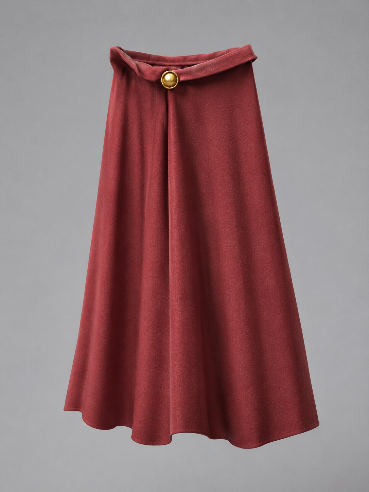
- **[미사용]** Skeleton Crypt 전용 열쇠 아이콘 4종 (`skeleton_key_5.png`, `skeleton_key_10.png`, `skeleton_key_15.png`, `skeleton_key_20.png`) — 자체 제작(절차적), 2026-09-13. 라이선스: 저장소 [PolyForm Noncommercial 1.0.0](../../LICENSE). Blender 5.2에서 밝은 강철색 열쇠를 투명 128² PNG로 렌더링했다. 외부·AI 생성 애셋 없음. 같은 날 기존 아이콘을 재사용하도록 변경하여 이미지와 전용 생성 코드를 제거했다.
- Skeleton Crypt 열쇠 아이콘 재사용(2026-09-13): 5·10·15층은 `ogre_key_5.png`·`ogre_key_10.png`·`ogre_key_15.png`, 20층은 `orc_key_10.png`. 출처는 아래 기존 절차 생성 아이콘이며 라이선스는 저장소 [PolyForm Noncommercial 1.0.0](../../LICENSE)을 따른다. 층과 던전은 아이템 이름으로 구분한다. 바닥 모델은 기존 `dungeon_key_silver.glb`(5·10·15층)와 `dungeon_key_gold.glb`(20층)를 재사용한다.
- Dungeon floor-key icons (6): crypt_key_5.png, orc_key_5.png, orc_key_10.png, ogre_key_5.png, ogre_key_10.png, ogre_key_15.png — 자체 제작(절차적). [tools/blender-scripts/render_key_icons.py](../../tools/blender-scripts/render_key_icons.py)가 프리미티브(토러스 손잡이 + 원기둥 축 + 5층당 이빨 1개: 5F 1개·10F 2개·15F 3개)로 열쇠를 만들고 던전별 금속색(크립트 무쇠·오크 청동·오거 흑철)으로 Cycles 렌더 512²→128² (2026-08-29). 외부 애셋 없음. doc/DUNGEON_REWARD.md의 잠긴 문·상자 열쇠. 바닥 드랍 모델은 아래 두 GLB를 나눠 쓴다
- dungeon_key_gold.glb / dungeon_key_silver.glb — Meshy.ai (유료 생성, 2026-08-29, "Golden Key" / "Skeleton Key"). 완전 소유권·상업 OK (characters.md License 참조). GLB를 Blender로 임포트해 눕힌 자세(긴 축 +X)로 회전, 전장 0.35m로 스케일 적용(gold 0.35×0.064×0.325m, silver 0.35×0.061×0.279m — dagger 0.42m보다 조금 짧게), 원점=바닥 중심, 텍스처 3장(base_color·metallic_roughness·normal) 2048²→512² 축소, emissive 제거. 원본은 assets/items/dungeon_key_gold/Meshy_AI_Golden_Key_0829144943_texture.glb·assets/items/dungeon_key_silver/Meshy_AI_Skeleton_Key_0829144810_texture.glb. gold는 상자를 여는 마지막 잠긴 층 열쇠(crypt_key_5·orc_key_10·ogre_key_15), silver는 그 앞 구간 열쇠(orc_key_5·ogre_key_5·ogre_key_10)에 매핑. 아이콘은 위 절차 생성 6장을 그대로 쓴다(인벤토리에서 층을 구분해야 하므로 모델 렌더로 바꾸지 않음); Meshy 입력 원화도 그 아이콘이다
- bow.glb — Meshy.ai (유료 생성, 2026-09-03, "Recurve Bow"). 완전 소유권·상업 OK (characters.md License 참조). FBX를 Blender로 임포트해 긴 축(Z)을 +X로 돌리고 전장 1.4m로 스케일 적용(1.40×0.27×0.045m — sword 1.20m와 greatclub 1.50m 사이), 원점=활 중앙 그립(다른 무기의 13.6% 규약과 달리 활은 한가운데를 쥔다), 텍스처 4장 2048²→512² 축소, emissive 제거. 아이콘은 Cycles 직교 렌더에 카메라 롤 −65°로 대각 구도, 512²→128² (2026-09-04). 원본은 `assets/items/bow/`. 손에 쥐는 자세(`poseMainHandProp`)는 아직 기본 그립이다 — `combat_ranged.glb`가 들어오면 `tools/fit-hand-prop.mjs`로 맞춘다. 원화 없음
- iron_arrow.glb / steel_arrow.glb — Meshy.ai (유료 생성, 2026-09-04, 두 번 모두 프롬프트명 "Rustic Spear on Stone" — 실제 산출물은 화살이다). 완전 소유권·상업 OK (characters.md License 참조). 활이 소비하는 탄약이자 날아가는 화살 ([COMBAT.md](../COMBAT.md) 원거리 전투). 두 생성물은 **형상이 같고 텍스처만 다르다** — iron은 어두운 갈색(평균 RGB 94,83,75), steel은 밝은 황동색(164,129,94). FBX를 Blender로 임포트해 비스듬히 누워 있던 축을 정점 주축으로 찾아 +X로 회전(화살촉이 +X, 다른 무기와 같은 방향), 전장 0.8m로 스케일 적용(0.80×0.07×0.06 W×H×D — 원본 1.22m는 활 1.4m 대비 너무 길어 2m 근거리 사격에서 사람과 몬스터 사이를 다리처럼 이었다), 원점=자루 중앙(비행 중 중심을 축으로 방향을 맞추므로), 텍스처 4장 2048²→512² 축소, emissive 제거. 아이콘은 Cycles 직교 렌더에 카메라 롤 −65°로 대각 구도 512²→128². 원본은 `assets/items/iron_arrow/`(iron)와 `assets/items/steel_arrow/`(steel). 원화 없음
- wooden_fence.glb / wooden_fence.png (목책) — Meshy.ai Image to 3D, Premium 등급, 2026-09-05 생성(사용자 확인). 원본 `assets/items/wooden_fence/Meshy_AI_Rustic_Wooden_Fence_F_0905115448_texture.glb`. 라이선스: 저장소 [characters.md의 License](characters.md#license-ai-제작-캐릭터)에 기록된 유료 생성물 소유권·상업 이용 조건을 따름.
    - 원화: ChatGPT 이미지 생성, ChatGPT Pro 20x, 2026-09-05. 라이선스: 사용자 소유 생성물(기존 ChatGPT 원화 출처 기준). 원래 파일명 `ChatGPT Image 2026년 9월 5일 오후 08_51_36.png`에서 내용 변경 없이 이동. 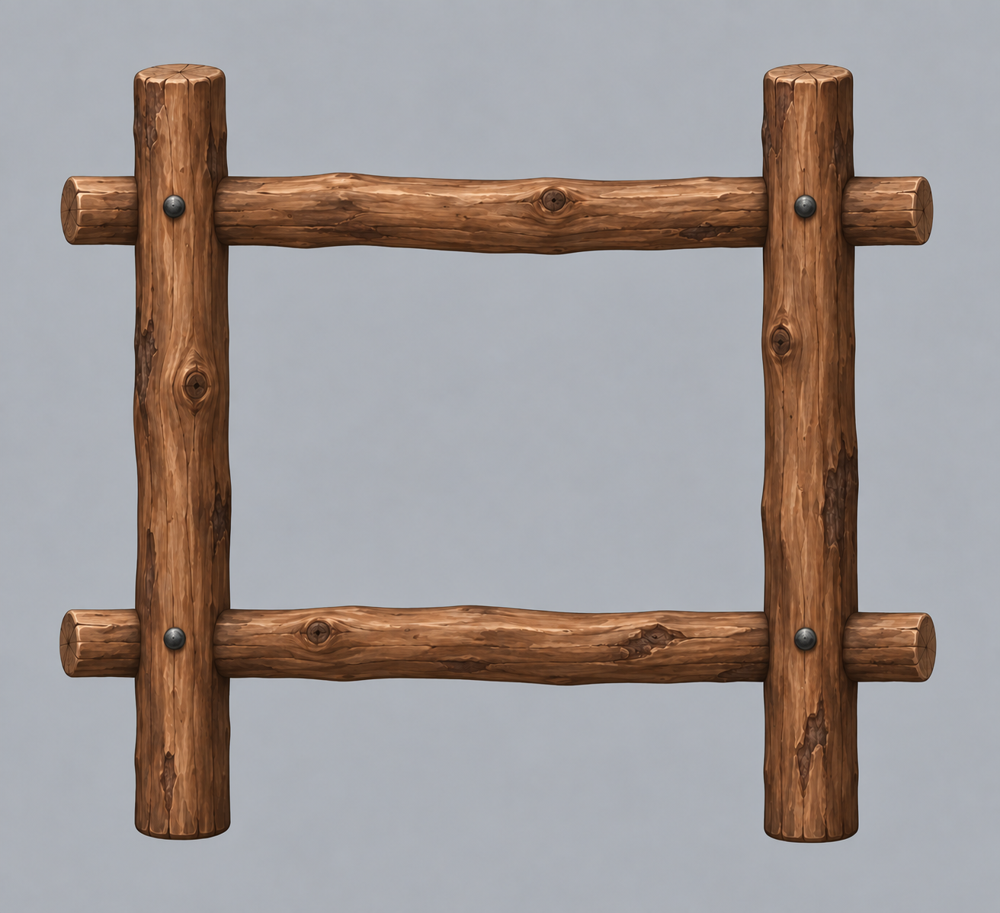
    - Blender 5.2.0 LTS에서 X축 가로폭 1m로 균등 스케일 적용. 원본도 폭 1m여서 배율은 1.0이며, 최종 크기는 1.000 × 0.914 × 0.124m (W×H×D). 세운 자세 유지, 회전 0·스케일 1 적용, 원점은 바닥 중앙. 사용자 지정 1m 구간을 기준으로 하며 높이·두께는 원본 비율 유지.
    - 게임 모델 `client/public/models/objects/wooden_fence.glb`: 메시 1개, 삼각형 2,179개, base color·metallic/roughness·normal 2048²→512², WebP q90 내장, 발광 제거, 219,424 bytes. Blender 재임포트로 크기·원점·스케일·텍스처 확인.
    - 아이콘 `client/public/items/objects/wooden_fence.png`: Cycles 투명 직교 렌더 512²→128² RGBA. 2026-09-07 Blender 5.2.0 LTS에서 세로 기둥이 화면 수직축과 일치하도록 아이콘 회전을 조정해 재렌더링했다. 가로대의 원근 기울기는 유지한다. packed 작업 파일은 `assets/items/wooden_fence/wooden_fence.blend`. **[미사용]** 큰 미리보기 PNG는 2026-10-09 정리했다.
    - `items.csv`의 `wooden_fence`, `category=furniture`, material wood, 무게 0.01, basePrice 100(1실버), 중첩·사용 가능. 2026-09-06부터 [목책 배치 모드](../FENCE_PLACEMENT.md)에서 1m 셀의 변에 설치·회수하며 해당 변만 통행을 차단한다. 카탈로그 `solid=true`의 일반 가구 풋프린트는 맵 에디터 배치용이고 플레이어 목책에는 별도 변 충돌을 적용한다.
    - 재현 명령: `blender -b --python-exit-code 1 -P tools/blender-scripts/export_item_asset.py -- --source assets/items/wooden_fence/Meshy_AI_Rustic_Wooden_Fence_F_0905115448_texture.glb --name wooden_fence --size 1 --size-axis x --icon-rotation -75 -25 -6.460664 --exposure -1.2`
- Landscaping Sample Book 아이콘 6종 — 기존 Poly Haven 지형 재질(CC0, [원본 출처](environment.md#terrain-textures))을 자체 정사각형 평면에 적용해 Blender 5.2.0 LTS에서 렌더링(2026-09-07). `shared/palette.json`의 판매 재질을 사용하며 base color·normal·roughness를 유지한다. 아이콘용 평면 0.5m, UV 0–1, 회전 (25°, −8°, −12°), 노출 −1.2, Cycles 투명 직교 렌더 512²→128² RGBA.
    - `client/public/items/objects/landscaping_palette_sand.png` ← `client/public/textures/sandy_gravel_02_1k.glb`
    - `client/public/items/objects/landscaping_palette_red_soil.png` ← `client/public/textures/red_laterite_soil_stones_1k.glb`
    - `client/public/items/objects/landscaping_palette_gravel.png` ← `client/public/textures/gravel_road_1k.glb`
    - `client/public/items/objects/landscaping_palette_pebbles.png` ← `client/public/textures/ganges_river_pebbles_1k.glb`
    - `client/public/items/objects/landscaping_palette_stone_path.png` ← `client/public/textures/stone_pathway_1k.glb`
    - `client/public/items/objects/landscaping_palette_paving.png` ← `client/public/textures/patterned_paving_02_1k.glb`
    - **[미사용]** 재생성 가능한 큰 미리보기 PNG 6개와 Blender 작업 파일 6개는 2026-10-09 정리했다. 게임용 아이콘과 원본 지형 재질은 보존한다. 재현: `blender -b --python-exit-code 1 -P tools/blender-scripts/render_landscaping_icons.py`. 공용 `scroll_of_return.png`는 다른 아이템에서 계속 사용한다.
- landscaping_toolbox.glb / landscaping_toolbox.png (조경사의 도구함) — 사용자 제공 Meshy.ai 생성 모델, Premium 등급(사용자 확인), 2026-09-06(제공 파일명·작업일 기준). 원본 `assets/items/landscaping_toolbox/Meshy_AI__0906115517_texture.glb`. 라이선스: Meshy 생성물 약관 적용.
    - 원화: 사용자 제공 ChatGPT 생성 이미지, ChatGPT Pro 20x(사용자 확인), 2026-09-06(파일명 기준). 라이선스: ChatGPT 생성물 약관 적용. `assets/ChatGPT Image 2026년 9월 6일 오후 08_23_49.png`를 변경 없이 이동했다. 원화와 원본 GLB는 이동 전후 SHA-256 일치를 확인했다. 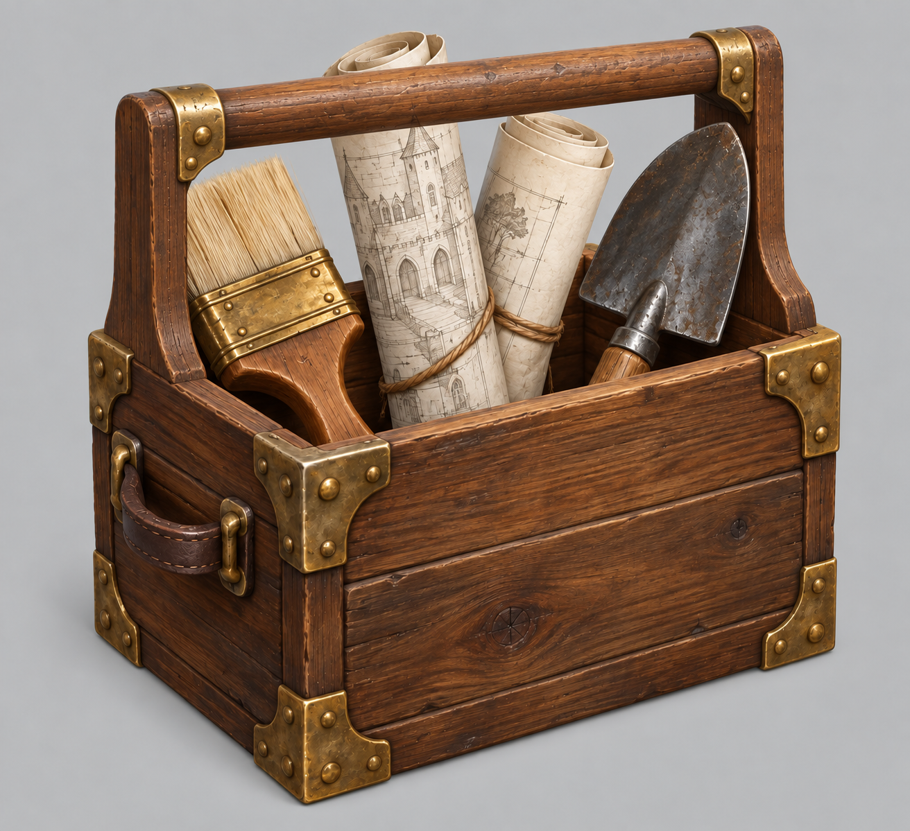
    - Blender 5.2.0 LTS에서 원본의 세운 자세를 유지하고 X축 가로폭 0.65m로 균등 스케일 적용(원본 폭 1m, 배율 0.65). 최종 크기 0.650 × 0.514 × 0.485m (W×H×D), 원점=바닥 중앙, 회전 0·스케일 1. 실측 비교: 기존 chest.glb 폭 1.476m, crate.glb 폭 1.128m, campfire_kit.glb 폭 0.450m. 휴대 도구함으로 상자 가구보다 작게 하되 바닥에서 붓·삽·손잡이가 식별되도록 모닥불 키트보다 크게 잡았다.
    - 게임 모델 `client/public/models/objects/landscaping_toolbox.glb`: 메시·머티리얼 각 1개, 삼각형 3,825개, base color·metallic/roughness·normal 2048²→512², WebP q90 내장, 발광 제거, 애니메이션 없음, 304,736 bytes.
    - 아이콘 `client/public/items/objects/landscaping_toolbox.png`: Cycles 128 samples, 투명 직교 사선 렌더 512²→128² RGBA. 정면·옆면과 붓·삽·도면이 보이도록 아이콘 복사본만 Euler (-62°, -25°, -8°) 회전, exposure -0.5, margin 1.10. 원본 자세의 게임 모델은 별도로 보존한다. packed 작업 파일은 `assets/items/landscaping_toolbox/landscaping_toolbox.blend`. **[미사용]** 큰 미리보기 PNG는 2026-10-09 정리했다.
    - `items.csv`의 `landscaping_toolbox`에 `Landscaper's Toolbox`로 연결하고 `tools/convert.mjs`로 `data/items.json`을 재생성했다. category tool, material wood, 임시 무게 2, 중첩 불가. Rowan 판매가 50 silver, 드롭 없음. `consumable=true`로 사용 가능하며 전용 처리에서 소모하지 않는다. 반복 사용·영지 편집은 [영지 설계 §4](../LAND_SYSTEM.md#4-영지-꾸미기-조경사의-도구함)에 구현했다.
    - 추가 조경 견본집 7종은 기존 `scroll.glb`와 `scroll_of_return.png`를 재사용한다 (2026-09-06). 원본 출처·라이선스는 이 문서의 해당 스크롤 항목을 따른다. 새로 생성한 에셋은 없다.
    - Blender 재임포트로 크기·바닥 중앙 원점·스케일·삼각형 수·512² 텍스처 3장·발광 없음 확인. 128² 아이콘의 알파·테두리 여백과 두 크기 렌더를 확인했다. 로컬 게임 서버의 모델·아이콘 URL 응답은 각각 파일과 SHA-256이 일치한다. 원본 GLB·작업 blend·큰 렌더·게임 GLB를 Hugging Face에 업로드하고 원격 파일 해시 검증 후 assets.lock에 revision `47b18253aee7daaccd8efb10df8829b02ac8b006`을 기록했다 (2026-09-06).
    - 재현 명령: `blender -b --python-exit-code 1 -P tools/blender-scripts/export_item_asset.py -- --source assets/items/landscaping_toolbox/Meshy_AI__0906115517_texture.glb --name landscaping_toolbox --size 0.65 --size-axis x --icon-rotation -62 -25 -8 --exposure -0.5`
- horse_reins.glb / horse_reins.png (고삐) — Blender에서 절차적으로 자체 제작, 2026-09-08.
  외부 모델·텍스처·AI 생성물 없음. 프로젝트 자체 에셋으로 저장소 라이선스를 따른다.
  가죽 고리 2개와 황동 링 2개, 폭 0.234 × 길이 0.307 × 높이 0.018m의 바닥에 놓인 자세.
  텍스처 없는 PBR 재질, 스케일 1, 발광·애니메이션 없음.
    - 모델 `client/public/models/objects/horse_reins.glb`, packed 작업 파일
      `assets/items/horse_reins/horse_reins.blend`. Cycles 투명 직교 렌더 512²→128² RGBA 아이콘
      `client/public/items/objects/horse_reins.png`. Blender 재임포트·아이콘 육안·로컬 URL 바이트 일치 확인.
    - 재현: `blender -b --python-exit-code 1 -P tools/blender-scripts/build_horse_reins.py`.
      무게 0.5, 중첩 불가, 기본가 15000(1골드 50실버), Rica 판매. 사용 시 소모 없이 탑승·하차한다.
      말 모델은 [MAXDESIGN-3D의 Horse, CC BY 4.0](animals.md), 규칙은 [MOUNTS.md](../MOUNTS.md).

- 대물 물고기 5종(`trophy_*`)은 위 Fishing icons의 같은 어종 아이콘을 재사용한다. 새 이미지 생성 없음 (2026-09-09).
- peddler_stall.png (Peddler's Stall 아이콘) — 새 에셋 없음. `client/public/models/objects/black_market_table.glb`를 그대로 렌더한 것이며, 원본 출처·라이선스는 [props.md](props.md)의 `black_market_table.glb` 항목을 따른다 (Meshy AI "Bottles and Scrolls", Pro 요금제, 2026-08-09 생성, 완전 소유권·상업 OK).
    - 가방 아이콘과 땅에 펼쳐지는 탁자가 같은 모델이다 — 아이콘이 곧 설명이 된다. `items.csv`의 `worldModel`도 같은 GLB를 가리킨다.
    - 아이콘 `client/public/items/objects/peddler_stall.png`: Cycles 128 samples, 투명 직교 렌더 512²→128² RGBA, Euler (-62°, 0°, 0°) — 카메라 쪽으로 눕혀 탁자 위의 물건이 판자가 아니라 상품으로 읽히게 하되, 롤은 주지 않아 가방 칸에서 수평으로 놓인다. 2026-09-09 생성.
    - 재현 명령: `/Applications/Blender.app/Contents/MacOS/Blender -b -P tools/blender-scripts/render_peddler_stall_icon.py`

## 낚시 성공 생선

- `client/src/lib/utils/fishingCatch.ts` — Three.js 절차적 메시 자체 제작 (2026-09-21).
  낚시 성공 연출에만 쓰는 생선으로 몸통·지느러미·꼬리·눈·아가미·입을 코드로 생성한다.
  어종에 따라 은색·농어 줄무늬·송어 반점·철갑상어 금색을 적용하고, 잡은 크기를
  화면 표시용 18–120cm 범위로 제한한다. 별도 텍스처·외부 원본·유료 생성 서비스 사용 없음.
  저장소 LICENSE(PolyForm Noncommercial 1.0.0) 적용. 원본은 해당 TypeScript 코드이며
  **[미사용]** 검증용 GIF와 정지 화면 PNG는 2026-10-09 정리했다.

## Skeleton Knight Greatsword

- `skeleton_greatsword.glb` — 사용자 제공 Tripo Pro 유료 생성 모델, 2026-09-12 생성(사용자 확인).
  Tripo 서비스 이용 조건 적용. 원본 `fantasy+sword+3d+model.glb`는
  `assets/items/skeleton_greatsword/source.glb`에 보관한다.
  - 4,552 triangles, 1024² base color·normal·metallic/roughness 텍스처를 유지한다.
    전장 1.85m, 칼날 방향 +X, 원점은 자루의 오른손 그립(손잡이 끝에서 전장의 20%).
  - `tools/blender-scripts/build_skeleton_greatsword.py`로 재생성한다.
    게임 모델 `client/public/models/weapons/skeleton_greatsword.glb`, 편집본
    `assets/items/skeleton_greatsword/skeleton_greatsword.blend`.
    스켈레톤 기사 전용 장착 외형이며 플레이어 아이템·드롭·판매 항목은 추가하지 않았다.

## Great Sword

- great_sword.glb — Tripo Pro 유료 생성 모델, 2026-09-12. Tripo 서비스 이용 조건 적용. [PR #178의 기여자 확인](https://github.com/Julian-adv/OpenMMO/pull/178#issuecomment-5638085991)에 따라 Skeleton Knight의 대검을 플레이어 아이템으로 분리했다. 원본 `fantasy+sword+3d+model.glb`는 `assets/items/skeleton_greatsword/source.glb`와 SHA-256이 동일하다(`04a73e744dfe381abc5bdd2fdd7444332afded3a9a4ec2ec223ba0c50be0b3a2`). 원본은 `assets/items/great_sword/source.glb`에 보존. 전장 1.8m, 칼날 +X, 칼날 평면 XZ(Blender), 원점은 손잡이 끝에서 전장의 19%. 텍스처 3장 512², emissive 제거. `export_item_asset.py --rotation 0 90 0 --grip-fraction 0.19 --icon-rotation 90 0 40`으로 GLB 및 투명 128² 아이콘 생성. `great_sword`: great_sword 타입·2d8·무게 6·28,000·티어 4·hands=2. 전용 Idle·Walk·Run·Slash 팩 사용. 기준 손 로컬 회전(-1.907 / -0.475 / 0.139 rad)은 타입별 weapon_animations.csv에서 읽는다. `offHandGripReach=0.3m`로 대기·걷기·달리기·공격의 매 프레임 왼손 그립에 손잡이 축(-X)을 맞추며, 원래 칼날의 롤과 오른손 위치를 유지한다. 대기 중 손을 떼면 기준 파지로 부드럽게 돌아간다. 애니메이션 출처는 animation.md 참조.
    - 컨셉아트: Google AI 생성, 사용자 제공 `image.png`(Pro 요금제, 2026-09-12 제공 기록). PNG의 XMP 크레딧은 `Made with Google AI`이며 내장 C2PA에도 Google Media Processing Services가 기록되어 있다. Google 서비스 이용 조건 적용. 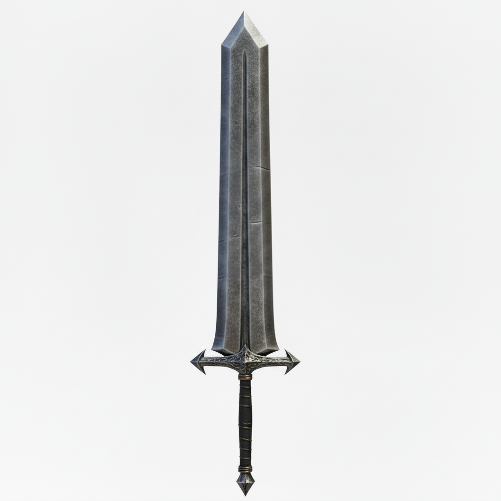

## Rune Blade

- `rune_blade` 원화, 2026-10-18. 바르칸의 양손 대검이자 티어 5 드롭 무기다([아이템 티어](../ITEM_TIERS.md)).
  `rune_blade`: great_sword 타입·2d10·무게 7·50,000·티어 5 상자 20%·hands=2.
  - 원화 `assets/items/rune_blade/concepts/rune-blade.png`, 1536×1024: OpenAI Codex built-in ImageGen,
    **ChatGPT Pro 20x**, 2026-10-18. OpenAI 생성 출력물 이용 조건 적용.
    [프롬프트·해시](../../assets/items/rune_blade/concepts/generation.json).
  - 손잡이 굵기는 칼날 폭의 약 0.37이다. [Great Sword](#great-sword)는 0.27이다.
  - 3D 모델: Tripo API 유료 크레딧, 2026-10-18. Tripo 서비스 이용 조건 적용.
    기존 구매분에서 120 credits를 사용했다. P2 단일 이미지·PBR·상세 텍스처·목표 4,000 faces로 생성했고
    결과 4,518 triangles를 유지했다. 원본·요청·task ID는 `assets/items/rune_blade/tripo_v1/`에 보관한다.
  - 전장 2.1m, 칼날 +X, 칼날 평면 XY(glTF)·XZ(Blender), 손잡이 끝에서 전장의 23% 지점이 그립 원점이다.
    실제 미터 크기를 메시 좌표에 굽고 object/runtime scale은 1이다. 1024² PBR 텍스처를 WebP로 내보냈다.
    원본 색상맵의 밝은 주황색 부분에서 발광 맵을 만들고 강도 1.6을 적용했다.
  - 게임 모델 `client/public/models/weapons/rune_blade.glb`(700,624 bytes),
    투명 128² 아이콘 `client/public/items/weapons/rune_blade.png`,
    패킹한 Blender 편집본 `assets/items/rune_blade/rune_blade.blend`.
    [제작 기록](rune-blade-model.json). 재현: `blender -b -t 6 --python-exit-code 1 --python tools/blender-scripts/build_rune_blade.py`.
  - 바르칸의 `RightHand`에 로컬 위치 `(0.019808135, 0.082672966, 0.04)m`, 회전 `0|0|-3°`으로 장착한다.
    **[미사용]** 이전 위치 `(0.02, 0.17, 0.07)m`는 대기 중 손잡이가 주먹 밖으로 벗어나 폐기했다.
    검지·중지와의 겹침을 줄이기 위해 기존 피팅에서 손목·엄지 쪽으로 총 1.5cm 더 옮겼다.
    새끼손가락 쪽 손잡이 축의 점 `(-0.12, 0.09, 0.04)m`를 고정하고 로컬 Z축으로 -3° 돌렸다.
    검지 쪽만 손목 방향으로 약 1cm 움직이며, 위치 보정으로 새끼 쪽 회전 중심을 유지한다.
    대기·걷기의 전체 프레임에서 회전 중심과 손가락 관절 윤곽 주변의 파지를 검사한다. [파지 확대](../images/monsters/barkan-rune-grip.png).
    장착 시 오른손 네 손가락의 각 관절을 로컬 X축으로 30°·60°·35° 더 굽힌 클립을 사용한다.
    대기·걷기는 양쪽 위팔도 각각 로컬 X축으로 -22° 회전해 양손을 허벅지 바깥으로 대칭으로 벌린다.
    각 손과 같은 높이에 있는 같은 쪽 허벅지 표면을 기준으로, 전체 프레임에서 손의 안쪽 끝과
    허벅지 바깥쪽 끝 사이에 5mm 이상 간격이 남는지 검증한다.
    원본 클립을 보존하며 프리뷰에서 장착을 끄면 원래 손 자세를 재생한다. 캐릭터와 검 합계 16,604 triangles다.
  - [장착 미리보기](../images/monsters/barkan-rune-blade.png).
    대기·걷기·공격·사망의 검 정점이 바닥 위에 있고 길이와 장착 위치를 유지함을 24fps로 검증했다.
    파지 위치 수정으로 기존 임시 사망 동작의 검 바닥 간섭도 해소했다. 양손 전용 동작과 플레이어 아이템·드롭 데이터는 후속 작업이다.
    검증: `node tools/validate-rune-blade.mjs`.

## Mace

- `worn_mace`(낡은 철퇴): 사제 시작 무기. 가시 없는 둥근 철구 철퇴로, 가시 철퇴(`morningstar`)보다 수수한 초보 무기다.
  mace 타입·1d6·무게 4·basePrice 없음·거래 불가. 기존 사제는 서버 시작 마이그레이션
  `priest_starter_mace_20261031`로 철퇴를 가방에 받는다. 낡은 철검과 장착 상태는 그대로 둔다.
  새 사제만 낡은 철검 대신 철퇴를 들고 시작한다.
  - 원화 `assets/items/mace/concepts/mace.png`(`doc/images/items/mace.png`), 1536×1024: OpenAI Codex built-in ImageGen
    (`codex exec`, codex-cli 0.162.1), **ChatGPT Pro 20x**, 2026-10-31. OpenAI 생성 출력물 이용 조건 적용.
    가시 철퇴 원화를 스타일 참조로 넣었다. [프롬프트·해시](../../assets/items/mace/concepts/generation.json).
    
  - 3D 모델: Tripo API 유료 크레딧, 2026-10-31. Tripo 서비스 이용 조건 적용. 기존 구매분에서 120 credits를 사용했다(잔액 800→680).
    P2 단일 이미지·PBR·상세 텍스처·목표 4,000 faces로 생성했고 결과 2,972 triangles를 유지했다.
    원본·요청·task ID `9acbb6f6-3bf4-4e04-b1d7-8f9eed846a69`는 `assets/items/mace/tripo_v1/`에 보관한다.
  - 전장 0.8m(0.800×0.156×0.156m — goblin_sword와 같은 길이, morningstar 0.95m보다 짧다), 머리 +X,
    손잡이 끝에서 전장의 13.6% 지점이 그립 원점이다(sword.glb 비율). 실제 미터 크기를 메시 좌표에 굽고 object/runtime scale은 1이다.
    PBR 텍스처 4096²→512² WebP, 발광 없음.
  - 게임 모델 `client/public/models/weapons/mace.glb`(388,484 bytes),
    투명 128² 아이콘 `client/public/items/weapons/mace.png`,
    패킹한 Blender 편집본 `assets/items/mace/mace.blend`.
    [제작 기록](mace-model.json). 재현: `blender -b -t 6 --python-exit-code 1 --python tools/blender-scripts/build_mace.py`.
  - 손 장착: 손잡이 중심이 원점이고 지름이 약 5cm로 두 사제의 주먹 구멍(약 2~2.6cm)보다 굵다.
    기본 위치 `(0, 0.08, 0)`에서는 손등으로 나와서, `client/src/lib/utils/handProps.ts`의 모델별 보정으로 손바닥 앞에 둔다.
    모듈형 남자 `(0.02, 0.12, 0.05)`, `female_priest.glb` `(0.03, 0.07, 0.03)`.
    여자 사제의 대기·걷기·달리기 클립은 손을 편 채라 주먹을 쥐지 않는다.

## Cutthroat Dirk — 칼잡이의 단검 (2026-11-01)

- `cutthroat_dirk`: 도적 소굴(T4) 상자의 확정 보상인 단검. dagger 타입·1d6·한손·기준가 11,000.
- 원화 `assets/items/cutthroat_dirk/concepts/cutthroat_dirk.png`(`doc/images/items/cutthroat_dirk.png`), 1536×1024:
  OpenAI Codex built-in ImageGen(`codex exec`, codex-cli 0.164.0), **ChatGPT Pro 20x**, 2026-11-01. OpenAI 생성 출력물 이용 조건 적용.
  기존 단검 원화를 스타일 참조로 넣었다. [프롬프트·해시](../../assets/items/cutthroat_dirk/concepts/generation.json).
  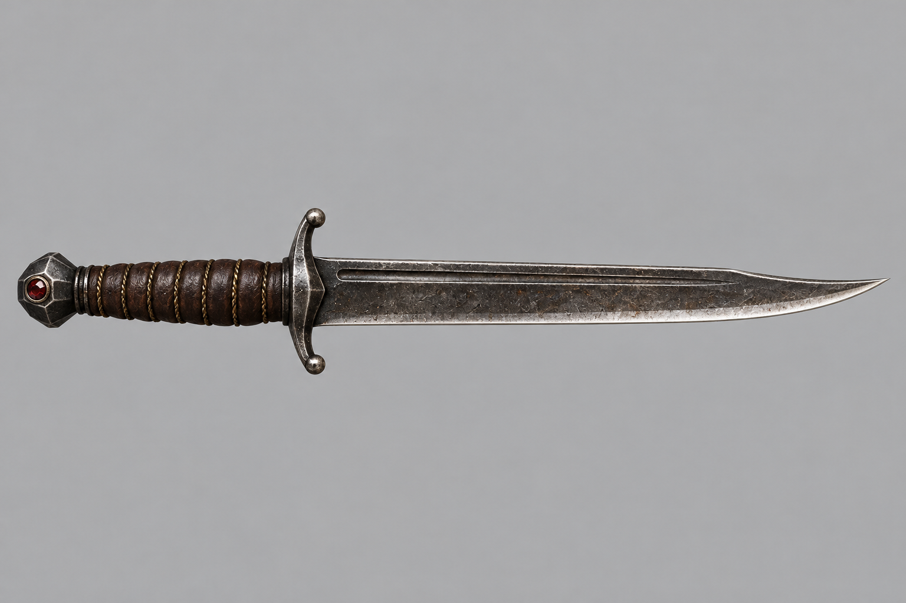
- 3D 모델: 사용자가 위 원화로 **Tripo 웹 앱(Max 등급)**에서 생성, 2026-11-01. Tripo 서비스 이용 조건 적용.
  결과 2,545 triangles를 유지했다. PBR로 생성해 base color·roughness-metallic·normal 각 2048²를 받았다.
  처음 받은 base color 단독본은 같은 메시라 PBR본으로 교체했다.
  원본 `assets/items/cutthroat_dirk/tripo_v1/source.glb`, [생성 기록](../../assets/items/cutthroat_dirk/tripo_v1/generation.json).
- 칼날 평면이 길이 축 기준으로 약 52° 기울어져 있어 X축으로 38° 굴려 Blender XZ에 맞췄다. 칼등(홈)이 위, 날이 아래다.
  전장 0.42m(0.420×0.040×0.088m), 칼날 +X. 그립 원점은 포멜에서 전장의 15%로, `dagger.glb`처럼 가드 6.3cm 뒤다.
  그래서 기존 단검의 손 파지와 Double Slash 칼날 궤적(0.19–0.42m)을 그대로 쓴다. PBR 텍스처 3장 512² WebP, 발광 없음.
- 게임 모델 `client/public/models/weapons/cutthroat_dirk.glb`(226,144 bytes),
  투명 128² 아이콘 `client/public/items/weapons/cutthroat_dirk.png`,
  패킹한 Blender 편집본 `assets/items/cutthroat_dirk/cutthroat_dirk.blend`.
  [제작 기록](cutthroat_dirk-model.json). 재현: `blender -b -t 6 --python-exit-code 1 --python tools/blender-scripts/build_cutthroat_dirk.py`.
- 손 장착: 여성은 `handProps.ts`에서 `weaponType=dagger` 공용 파지를 쓰므로 단검 모델마다 항목을 더할 필요가 없다. 남성은 기본 파지를 쓴다.

## Shadowfang — 그림자 송곳니 (2026-11-01)

- `shadowfang`: 그림자 길드(T5) 상자 전용 롤 20%로 나오는 단검. dagger 타입·1d8·한손·기준가 20,000.
- 원화 `assets/items/shadowfang/concepts/shadowfang.png`(`doc/images/items/shadowfang.png`), 1536×1024:
  OpenAI Codex built-in ImageGen(`codex exec`, codex-cli 0.164.0), **ChatGPT Pro 20x**, 2026-11-01. OpenAI 생성 출력물 이용 조건 적용.
  기존 단검 원화를 스타일 참조로 넣었다. [프롬프트·해시](../../assets/items/shadowfang/concepts/generation.json).
  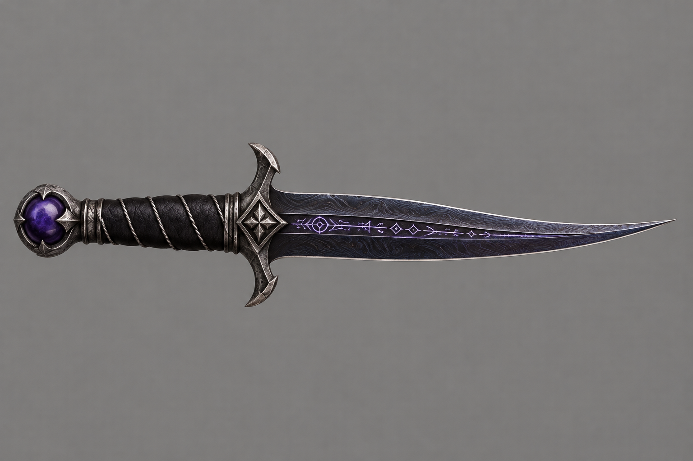
- 3D 모델: 사용자가 위 원화로 **Tripo 웹 앱(Max 등급)**에서 PBR로 생성, 2026-11-01. Tripo 서비스 이용 조건 적용.
  결과 2,985 triangles를 유지했다. base color·roughness-metallic·normal 각 2048². 먼저 받은 base color 단독본은 같은 메시라 PBR본으로 교체했다.
  원본 `assets/items/shadowfang/tripo_v1/source.glb`, [생성 기록](../../assets/items/shadowfang/tripo_v1/generation.json).
- 칼날 평면이 이미 Blender XZ라 회전 없이 썼다. 전장 0.42m(0.420×0.049×0.108m), 칼날 +X.
  그립 원점은 포멜에서 전장의 18%로, `dagger.glb`처럼 가드 6.3cm 뒤다. 기존 단검 손 파지와 칼날 궤적을 그대로 쓴다.
- 룬 발광: Tripo가 발광 맵을 주지 않아, base color에서 밝은 보라색 텍셀만 골라 발광 맵을 만들었다.
  가드 앞쪽 칼날 면의 UV 영역 안으로 한정해 자수정 포멜은 빛나지 않는다. 색 (0.55, 0.3, 1.0), 강도 1.5.
  PBR 텍스처 3장과 발광 맵 모두 512² WebP라, 가드 가까운 룬 문양만 또렷하고 칼날 중간의 룬은 은은한 보랏빛으로 번진다.
- 게임 모델 `client/public/models/weapons/shadowfang.glb`(253,020 bytes),
  투명 128² 아이콘 `client/public/items/weapons/shadowfang.png`,
  패킹한 Blender 편집본 `assets/items/shadowfang/shadowfang.blend`.
  [제작 기록](shadowfang-model.json). 재현: `blender -b -t 6 --python-exit-code 1 --python tools/blender-scripts/build_shadowfang.py`.
- 손 장착: 칼잡이의 단검과 같다.

## 로그 기본 장비 — 2026-10-02

새 로그 캐릭터는 `worn_rogue_top`, `worn_rogue_pants`, `worn_rogue_gloves`,
`worn_rogue_boots`를 각 1개 착용하고 시작한다. 머리 슬롯은 비워둔다.
각 부위는 guard 1이며 판매 가격·상자 드롭 없이 거래 불가다. 기존 기본 검·횃불은 함께 지급한다.

착용 모델은 [현재 선택 명세](modular-rogue-source-selection.json)의 Tripo 상의·바지·
오른손 반장갑과 새 왼손 천띠 통합 장갑, v8 부츠다. 각 원본의 출처·생성 날짜·구독·라이선스는
[상의](modular-rogue-tripo.md), [바지](modular-rogue-tripo-pants.md),
[오른손 장갑](modular-rogue-tripo-glove.md), [왼손 천띠](modular-rogue-tripo-wrap.md),
[부츠 제작 기록](modular-rogue-parts.md)을 따른다. 새 AI 생성이나 유료 호출은 없다.

`node tools/prepare-modular-character.mjs --rogue-only`로 게임용 스킨 GLB를
`client/public/models/characters/modular_male/`에 내보낸다. 원본 메시·리깅·UV를 유지하고
기존 텍스처 압축 도구를 적용한다. 일반 재생성 및 `--parts-only`에도 로그 파츠가 포함된다.
남성 모듈형 캐릭터의 게임·생성 미리보기는 작업실과 같은 가림·허리 절단·복원 규칙을 사용한다.
여성 로그에게도 아이템을 지급하지만 외형은 기존 일체형 여성 모델을 사용한다.

`blender -b -t 6 --python-exit-code 1 --python tools/blender-scripts/export_rogue_items.py`로
선택된 네 파츠에서 정적 아이템 모델과 아이콘을 추출한다. Blender 5.2.0 LTS,
512px 텍스처·바닥 중앙 원점, Cycles 512² 렌더를 128² 투명 PNG로 축소했다.
출력은 `client/public/models/armor/rogue_{top,pants,gloves,boots}.glb` 및
`client/public/items/armor/rogue_{top,pants,gloves,boots}.png`이며, 편집본은
`assets/items/rogue_{top,pants,gloves,boots}/`에 보관한다.

[런타임 출력·검증 기록](modular-rogue-runtime.json).

2026-10-02 후속 수정: 바닥용 `rogue_pants.glb`는 Blender X축 −90° 회전을 적용해
땅과 평행하게 눕혔다. 바지 아이콘은 X축 +25°로 보정해 기존 서 있는 표시 방향을 유지한다.
바닥용 `rogue_gloves.glb`와 인벤토리 아이콘은 승인된
`rogue/tripo_glove_v1/glove_rogue_right.glb`의 오른손 반장갑만 사용한다(1,591삼각형).
착용 장갑은 오른손 반장갑과 왼손 천띠를 함께 사용하는 기존 통합 파츠다.
**[미사용]** 서 있는 바지 바닥 모델과 양손을 함께 표시하던 장갑 아이콘·바닥 모델은 교체했다.
변경 전후 해시는 위 런타임 기록에 보존한다. 같은 Blender 추출·렌더 도구와 원본 라이선스를 따른다.
두 부위만 재생성하려면 내보내기 명령 뒤에 `-- --parts pants gloves`를 추가한다.

장갑 방향 후속 수정: 피팅 기록의 손등 법선과 실제 `RightHand`·`RightHandMiddle1` 본 방향으로
정적 오른손 장갑을 정렬했다. 게임 좌표에서 손등은 +Y, 손바닥은 −Y를 향하므로 바닥에
손바닥 면이 닿는다. 아이콘은 정렬된 손등을 정면으로 보고 화면에서 Z축 −35°만 회전해
손가락 부분을 각각 구분할 수 있게 렌더한다. **[미사용]** 직전 옆면 아이콘과 서 있는
오른손 바닥 모델은 이 출력으로 교체했다. 메시·텍스처·라이선스는 같은 승인 원본을 따른다.

최종 정리: 정적 아이템의 최신 `.blend` 편집본과 게임용 GLB·128² 아이콘을 보관한다.
중간 512² 렌더, `.blend1` 백업, 임시 브라우저·바닥 검수 파일은 삭제했다.
로그 내보내기 도구도 중간 렌더를 제거하고 편집본 백업을 만들지 않는다.

## 원시전사 기본 복장 — 2026-10-04

- miner_pickaxe.png — 검은맥 광산 채굴용 광부의 곡괭이 아이콘 (2026-11-04). OpenAI Codex built-in ImageGen(`codex exec`, codex-cli 0.164.0), **ChatGPT Pro 20x**. OpenAI 출력물 이용 조건 적용. 흰 배경 원화를 모서리 flood fill로 따내 128² 투명 PNG로 줄였다. 원화·프롬프트는 `assets/items/miner_pickaxe/`. 가방에 있으면 채굴할 수 있는 도구(items.csv tool·무게 3·basePrice 250), Tobin 카탈로그 판매.
- miner_pickaxe.glb — 채굴하는 동안 손에 드는 광부의 곡괭이 (2026-11-05). 정면 원화(아이콘 원화를 참조로 Codex ImageGen, ChatGPT Pro 20x, 2026-11-04)를 Tripo API로 생성했다(사용자 구매 API 크레딧 120, Tripo 이용 약관 적용, 모델 P2-20260801·PBR·detailed 텍스처, face_limit 4000). 원본과 작업 기록은 `assets/items/miner_pickaxe/tripo_v1/`(4049 triangles, 4096² PBR 3장), 원화는 `assets/items/miner_pickaxe/concept/`. Blender 5.2.0 LTS로 자루 길이 0.85m에 맞춰 균일 스케일하고, sword.glb 손 소켓 규약대로 자루 +X·곡괭이 머리 +X 끝·날 끝 ±Y(게임에서 날로 내리치도록 ±Z에서 90° 돌리고, 대검 베기 동작에서 날이 휘두르는 방향을 보게 손잡이 쪽에서 봐서 반시계로 25° 더 돌림), 원점=그립(자루 중심선, 자루 끝에서 길이의 13.6%)으로 맞췄다(0.85×0.11×0.55m). 텍스처 512² WebP q90. items.csv `worldModel`.
- blackvein_ore.png / blackvein_crystal_shard.png — 채굴로 얻는 검은맥 광석·수정 조각 아이콘 (2026-11-04). 광산 소품 `mine_ore_heap.glb`·`mine_crystal_cluster.glb`(출처는 [props.md](props.md))를 Blender 5.2.0 LTS EEVEE로 투명 배경 직교 렌더해 128²로 줄였다. 둘 다 상점에 파는 잡동사니(basePrice 8·30).

신규 남성 원시전사에 낡은 어깨 덮개·모피 하의·모피 부츠·손목 보호대를 지급하고 자동 장착한다.
각 부위는 방어 1이며 상점 판매와 플레이어 거래를 차단한다. 승인된 Tripo 피팅 모델을
재사용해 게임용 착용 파츠와 바닥 모델·인벤토리 아이콘을 만들었다.
[등록·출처·재생성·검증 기록](modular-caveman-runtime.md).
