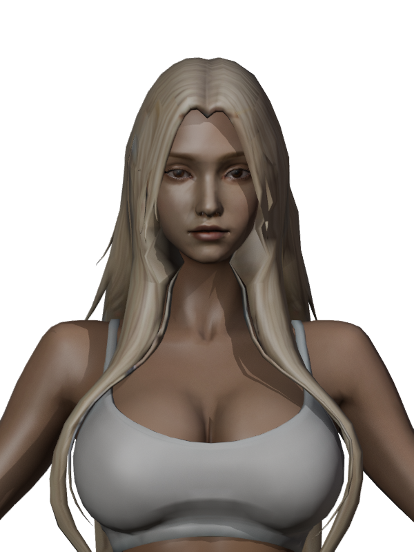
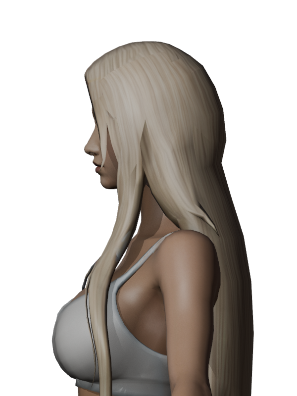
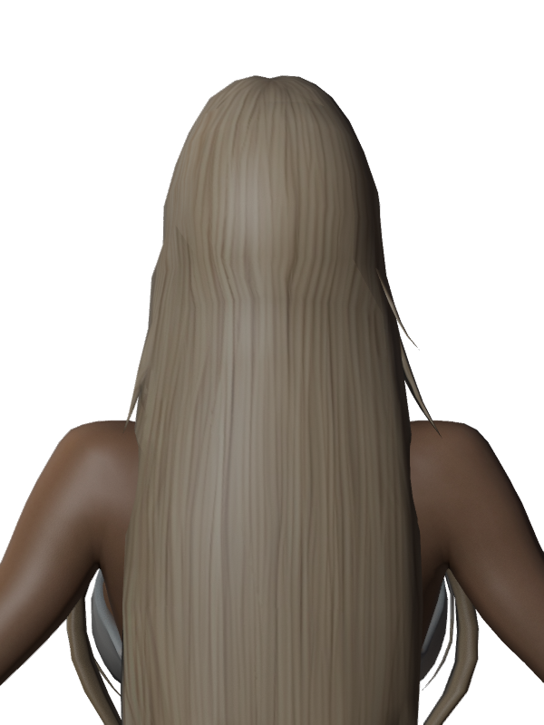
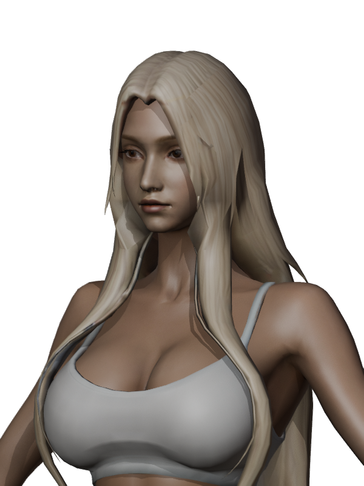

# 여성 전사 긴 헤어 제작·미리보기 도구

사용자가 제공한 `assets/fantasy warrior 3d model (1).glb`의 `tripo_part_1`을
여성 공통 몸체 `rig_v1/female-base.glb`에 맞춘 긴 헤어다. 완성본은 게임에서 발키리의
고정 기본 헤어로 사용한다. 이 문서는 제작 도구와 미리보기 피팅 기능을 기록한다.
여성 캐릭터 미리보기의 `전사 긴 헤어 (피팅 검수 중)`에서 선택할 수 있다.
발키리 날개관과 함께 표시하며 다른 투구를 선택하면 헤어를 숨긴다.
미리보기에서 최초 피팅 기준의 전체 크기·높이·수직 위치를 조절할 수 있다. 조정은 미리보기에만
적용하며 파일이나 리그 가중치를 바꾸지 않는다. 초기 설정은 115%, 118%, -5.1cm다.

- [피팅·리깅 GLB](../../assets/modular_human_female_01/hair/tripo_warrior_v1/fitted_v1/hair_female_warrior.glb)
- [리깅 전 피팅 GLB](../../assets/modular_human_female_01/hair/tripo_warrior_v1/fitted_v1/hair-fitted-unskinned.glb)
- [몸체와 동작을 포함한 Blender 편집본](../../assets/modular_human_female_01/hair/tripo_warrior_v1/fitted_v1/female-warrior-hair-fitted.blend)
- [피팅·출력 해시](modular-female-warrior-hair-fitting-v1.json), [애니메이션 검사](modular-female-warrior-hair-animation-v1.json)






머리 크기와 위치를 맞추고 두피 관통이 보인 머리 위·뒤쪽을 몸체 표면을 기준으로 밀어냈다.
사용자가 선택한 최초 피팅 대비 전체 115%, 높이 118%, 수직 위치 -5.1cm를 적용했다.
두 스케일은 머리 중심을 기준으로 한다. 뒤통수 관통을 줄이기 위해 뒤쪽 머리카락 정점 32개를
몸체 표면 바깥으로 최대 약 8.2mm 이동했다.
앞머리 끝은 몸체의 가슴 옆면을 표본 추출한 뒤 높이에 따른 부드러운 이동으로 양쪽 가닥을
바깥에 배치했다. 기본 자세에서 양쪽 앞머리 표면 4,358개 표본의 수평 여유는 최소 약 5.1mm다.
가슴에 닿는 부분은 몸통에 더 가까운 가중치를 써서 움직임을 따라가게 했다.
원본 UV와 재질을 사용한다. 관자놀이 부근의 흐린 피부색·장식 흔적은 이미지 생성 보정본을
해당 UV 영역에만 부드럽게 합성해 주변 머리결과 이어지게 했다. 다른 작은 조각은 남아 있다.
두 번째 보정으로 양쪽 노란 장식 흔적과 표시된 갈색 삼각형의 색상을 바꾸고 회색 얼룩이 있던
노멀 맵 부분을 평탄화했다. 오른쪽 관자놀이 아래 각진 음영은 해당 메시의 코너 노멀 101개를
주변 바깥쪽 머리카락 면에 맞춰 부드럽게 보정했다. 정점 위치와 삼각형은 유지했다.
여성 공통 리그 65본과 정확한 bind 행렬을 쓰고, 머리 윗부분은 Head에 고정하며 긴 아래쪽은
목·몸통 가중치와 부드럽게 섞는다. 보조 머리카락 물리는 없다.

메시 1개, 1,871삼각형이다. 기본 몸체 22,175와 합계 24,046삼각형이며 장비·무기 제외,
몸체 가림을 적용하지 않은 수치다. 현재 표시 삼각형과 얼굴만의 배분은 별도 측정하지 않았다.
15,000–20,000의 조립 목표보다 크며 숫자를 맞추기 위한 감소는 하지 않았다.

공통 몸체의 9개 동작을 각각 61시점에서 검사했다. 기본 자세 일치, 가중치 합계,
머리 상단의 본 추종과 유한 좌표를 확인했다. 검사한 3mm 이상 변 중 최대 신장률은
쓰러짐에서 약 2.71배이므로 추가 시각 검토가 필요하다. 각 동작의 일부 정면·후면을
편집본 옆 `motion-*.png`로 렌더할 수 있다. 임시 동작 렌더는 정리했으며 검수 스크립트로
다시 만든다. `animation-snapshots.json`은 검수 렌더의 입력으로 보관한다.
로컬 브라우저 미리보기에서 헤어 로딩과 뿔 투구
착탈 후 선택 복원을 확인했다. 전 프레임 신체 충돌, 다른 장비·투구와의 간섭,
모든 게임 동작에서의 외형은 이 제작 단계 검사에 포함하지 않았다.
발키리 조립과 게임 적용 기록은 [발키리 파츠 기록](modular-valkyrie-parts.md)을 따른다.

앞머리 관통은 [별도 검사](modular-female-warrior-hair-clearance-v1.json)에서 기본 자세 표면과
9개 동작의 각 13시점·정점 411개를 표본 확인했다. 대기·걷기·달리기·전투 대기·앉기에서는
1mm 이상의 관통 표본이 없었다. 점프·베기·쓰러짐에는 남아 있으며, 베기에서 가장 깊은
표본은 팔과 겹친다. 근접 표면의 노멀에 따른 추정이므로 모든 충돌을 보장하지 않는다.

## 출처

- 메시: 사용자가 제공한 Tripo 분할 GLB. 원본 해시는 피팅 기록에 있다.
- 원본의 생성 날짜, Tripo 구독 등급, 생성 작업 ID, 입력 원화와 구체적인 이용 조건은 확인되지 않았다.
  2026-11-02는 이 피팅 작업일이며 원본 생성일로 추정하지 않는다.
- 피팅과 리깅은 로컬 Blender·Python 작업이다.
- 텍스처 보정: 2026-11-02 OpenAI Codex built-in ImageGen, **ChatGPT Pro 20x**. 사용자 표시 이미지와
  Tripo 원본 색상 맵을 입력으로 사용했다. 이미지 생성 결과의 해당 영역만 원본 색상 맵에 합성했다.
  [원본 색상 맵](../../assets/modular_human_female_01/hair/tripo_warrior_v1/texture_v1/basecolor-original.jpg),
  [이미지 생성 결과](../../assets/modular_human_female_01/hair/tripo_warrior_v1/texture_v1/basecolor-imagegen.png),
  [최종 색상 맵](../../assets/modular_human_female_01/hair/tripo_warrior_v1/texture_v1/basecolor-repaired.png).
  원본·생성·최종 SHA-256은 각각 `258699a705df8b8f189be68222fdb42c5538814dc32cc3ee866343acde315016`,
  `34ff5978796e4e524098940dba56e589da8f2997e24af95ccfed19f92f286abb`,
  `52306380bd000fd4214ad7785c834e26298b5ae8164d9e0eddbaed90d7b7fabc`다.
- 텍스처 보정 프롬프트: `Replace blotchy skin-colored, grey, and golden accessory contamination in the large central upper hair patch around x=305–495, y=205–365 (pixel coordinates in image 1, origin upper left) with realistic fine pale champagne-blonde hair strands flowing in the same direction as the immediately neighboring hair. Match the surrounding color and hair strand texture closely, subtly blending the repaired area at its edges. Preserve the original UV atlas structure, every UV island outline and placement, pixel alignment, background, colors and all other areas; do not add a head, face, eyes, scalp, labels, red markings, jewelry, or objects. Output only the UV texture image, not a character render. Do not transform, crop, rotate or rescale the atlas.`
- 두 번째 텍스처 보정: 2026-11-02 OpenAI Codex built-in ImageGen, **ChatGPT Pro 20x**. 사용자 표시 이미지와 첫 보정 색상 맵을 입력으로 사용했다. [생성 결과](../../assets/modular_human_female_01/hair/tripo_warrior_v1/texture_v1/basecolor-imagegen-v2.png), [최종 색상 맵](../../assets/modular_human_female_01/hair/tripo_warrior_v1/texture_v1/basecolor-repaired-v2.png)의 SHA-256은 각각 `4888973ea7fb87d6e11e8e5f274366627fd2511b7e887c4b77a45c3158cb9548`, `9d6a909c5d92c62c2993c701b162ff568c96ba6ea306b5bf2738709bdce2b0e2`다. [노멀 맵 원본](../../assets/modular_human_female_01/hair/tripo_warrior_v1/texture_v1/normal-original.jpg)과 [노멀 맵 보정본](../../assets/modular_human_female_01/hair/tripo_warrior_v1/texture_v1/normal-repaired-v2.png)의 SHA-256은 각각 `5089a54d3718ce0ab22d6a599e340f6dd3a41586b2623b1aebecae3b94f78ae3`, `5f22bd64ba9e81ed778d2ff9cc8fba958ea2e864d33da5e0bccd65a5719ff09e`다.
- 두 번째 보정 프롬프트: `Repair only residual discolored spots or ornaments in the hair UV patches of image 1, especially the yellow-gold marks on the pale hair islands near the upper center (x=260–380, y=0–110 and x=200–310, y=210–320, coordinates in original 1024 square), and nearby small brown / grey marks. Replace them with natural pale blonde strands that follow surrounding local hair direction, color and shading. Preserve every UV island's shape, location and pixel alignment, preserve all other regions, background and original textures; do not add text, markings, red annotations, jewelry, or characters. Output the texture atlas only, not a character image.`
- **[미사용]** 갈색 조각만 지정한 [추가 이미지 생성 시도](../../assets/modular_human_female_01/hair/tripo_warrior_v1/texture_v1/basecolor-imagegen-brown-attempt.png)는 해당 영역이 갈색으로 남아 사용하지 않았다(SHA-256 `dbbd952e1b3aaffdf50378489af92c96772712c9282e4a037f7fa2cb5da44480`). 대신 두 번째 생성 결과의 깨끗한 머리결을 해당 UV에 합성했다. 프롬프트: `That brown triangle's exact UV colors come from the very small brown patch centered at x=834, y=169 in the 1024-square atlas coordinate system (equivalently x=1021, y=207 in a 1254-square image). Change only this small brown patch, approximately x=818–852, y=151–190 in 1024 coordinates, to a pale neutral champagne blonde matching nearby hair. Blend the edges naturally. Preserve the rest of the atlas including all island shapes and placement, textures, black background, image framing and dimensions. Output the texture atlas only, no screenshot, no red marks, no text.`
- 여성 몸체는 [여성 베이스 기록](modular-human-female-01.md)을 따른다.

## 재현

```bash
node tools/repair-female-warrior-hair-texture.mjs
node tools/repair-female-warrior-hair-texture-v2.mjs
blender -b -t 2 --python-exit-code 1 --python tools/blender-scripts/fit_female_warrior_hair.py
.venv/bin/python tools/rig-female-warrior-hair.py
node tools/validate-female-warrior-hair.mjs
blender -b -t 2 --python-exit-code 1 --python tools/blender-scripts/review_female_warrior_hair.py
blender -b -t 4 --python-exit-code 1 --python tools/blender-scripts/validate_female_warrior_hair_clearance.py
```
