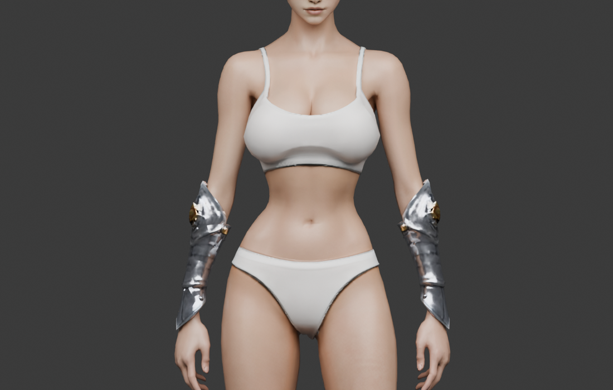

# 발키리 모듈 복장

2026-11-01. 기존 발키리 원화를 바탕으로 만든 복장 정면 시안과 날개 피팅 후보의 기록이다. 복장의 3D 제작과 날개의 게임 적용은 진행하지 않았다.


- 참조: `client/public/character_concepts/valkyrie.webp`. 출처는 [캐릭터 기록](characters.md)을 따른다.
- 시안: `assets/items/valkyrie_starter/concepts/front-v1.png`, 1024×1536 RGB PNG.
- 제작: OpenAI Codex built-in ImageGen, **ChatGPT Pro 20x**, 2026-11-01. OpenAI 생성 출력물 이용 조건 및 참조 에셋의 기존 이용 조건을 따른다.
- 참조 SHA-256: `dbbbd830209b0db4990424dbe0ad3021ed369d42a4f61faf31b20df0e38aabda`.
- 시안 SHA-256: `6dd4b9621682a602081c0254f9828c5450fdb55ffe15246723efd6789d2e12fb`.

은색 갑옷, 금색 장식, 견갑, 팔 보호대, 허리 판금과 긴 부츠를 참조했다. 복장의 형태를 보기 위해 시안에서 큰 등 날개를 숨겼다. 사용자는 발키리에 날개가 필요하다고 정했다. 팔의 검은 무늬와 인물의 얼굴·머리카락은 복장 파츠로 확정하지 않았다. 손가락과 손바닥 방향, 가슴과 허리 연결, 뒤쪽 구조는 실제 몸체 및 후속 부위 원화와 대조해야 한다.

## 제작 기준과 남은 작업

- 여성 공통 몸체: `assets/modular_human_female_01/rig_v1/female-base.glb`, 리그 `human_female_01_local_v1`, 약 1.8m. 피팅에 사용한 몸체의 SHA-256은 `3eb7c0a5f3c6b30aec0fbae0b70c8fd925e4cb91772647420007eee795a1e0a5`다.
- 상의·하의·손목 보호대·부츠·머리 장식의 슬롯 소속과 안팎 순서는 미정이다. 견갑은 상의에 포함한다. 허리 판금의 소속, 가림과 속옷 노출을 정해야 한다.
- 날개, 헤어 및 머리 장식의 착탈 관계와 다른 장비와의 호환은 미정이다.
- 여성 몸체의 실제 연결부를 확인한다. 남성용 테두리와 수치를 그대로 사용하지 않는다.
- 앞·옆·뒤와 파츠별 원화를 검토한 뒤 생성, 피팅 및 게임 동작을 각각 검증한다. 동작과 혼합 장비 검증 전에는 런타임 호환을 선언하지 않는다.
- 여성 기사 세트는 기존에 삼각형 예산을 초과한다. 발키리는 몸체·얼굴·헤어·무기와 선택한 부속을 포함한 전체 예산을 먼저 배분하고 실제 표시 수와 숨김 포함 수를 기록한다.

## 생성 프롬프트

```text
Use case: stylized-concept. Asset type: front-view outfit design reference for modular 3D game character. Input image is the existing OpenMMO Valkyrie and is the authoritative design reference. Create one full-body, straight-on front view of the same Valkyrie costume, clearly showing the entire costume from head to toes. Preserve the reference design: silvery sculpted breastplate with subtle gold central ornament, layered shoulder plates, forearm bracers, silver armored hip panels and central tabard, bare upper arms and thighs, silver knee-high armored boots with knee guards, white-blonde long hair, and small winged head ornaments. Do not invent new clothing or change the color palette. Natural relaxed A-pose suitable for the existing modular rig, hands slightly away from hips with palms facing inward toward body and fingers straight and individually separated, no twisting wrists to face camera. Keep legs comfortably separated with feet forward. For clarity, remove the large back wings from this garment reference only; do not add a weapon. Neutral light gray plain background, even studio lighting and realistic fantasy game concept rendering. Make armor contours, attachments and skin openings clearly legible for later part design. No text, labels, collage, inset, side view, watermark, or cropped limbs. This is a preliminary visual concept, not a fitted 3D model.
```

## 날개 원화 — 2026-11-01

발키리의 날개를 복장과 별도로 제작하기 위한 후면 원화다. 기존 원화의 흰 깃털 날개를 기준으로 한 쌍을 펼친 모습을 그렸다. 게임 내 장비 슬롯과 독립적인 날개 애니메이션은 아직 정하지 않았다.


- 이미지: `assets/items/valkyrie_starter/concepts/wings-back-v1.png`, 1536×1024 RGBA PNG, SHA-256 `5300828da0981cd7a65ca737a3a22d910a95e0a83be58cf51afb528e903202ef`.
- 참조: 위의 기존 발키리 원화. 생성: OpenAI Codex built-in ImageGen, **ChatGPT Pro 20x**, 2026-11-01. OpenAI 생성 출력물 이용 조건 및 참조 에셋의 기존 이용 조건을 따른다.
- 투명 알파 범위는 0–254다. 날개 주변에 반투명한 밝은 영역이 있어 이 이미지를 그대로 3D 텍스처로 쓰기 전 별도 정리가 필요하다.
- 양쪽 날개 안쪽이 가까이 모여 있지만 실제 등 부착점과 관절 구조를 보여 주는 제작 도면은 아니다. 몸체와 갑옷·머리카락, 날개 접힘과 동작 중 충돌은 후속 검토 사항이다.

### 날개 생성 프롬프트

```text
Use case: stylized-concept. Asset type: isolated wing-pair concept art for a modular 3D fantasy game character. Image 1 is the existing OpenMMO Valkyrie; use her large white feathered wings as the authoritative design reference. Depict ONLY one complete matching pair of large angelic wings as a single wearable back attachment, seen straight from behind, symmetrically spread upward and outward in the same broad, graceful silhouette as the reference. Bright natural white feathers with subtle warm ivory and pale gray shading, layered small coverts and individually readable broad flight feathers, polished realistic fantasy game style. Inner wing roots converge naturally at the center to show a small plausible attachment area for a character's upper back. Keep feathers substantial and connected, with a clear hierarchy and no detached pieces, so the shape can guide subsequent 3D modeling. No body, human, mannequin, head, hair, armor, harness, weapon, halo, text, labels, multiple views, inset, ground or shadow. Frame the entire pair with generous margins, front-facing camera aligned to the back of the wings, no perspective or cropping. Soft neutral lighting; truly transparent background and transparent spaces between feathers, no checkerboard.
```

## 한쪽 날개 원화 — 2026-11-01

양쪽 날개 원화의 이미지 오른쪽 날개를 기준으로 한쪽만 다시 그렸다. Tripo에서 한쪽을 생성한 뒤 반대쪽을 대칭 복제하는 작업의 후보 원화다. 제작 목표는 한쪽 약 1,500삼각형이었다.


- 이미지: `assets/items/valkyrie_starter/concepts/wing-right-back-v1.png`, 1536×1024 RGBA PNG, SHA-256 `b515b137b1ab6e892cb2cc9b5e6c40bbf48e4f4b877a98496fc44fd389419cdb`.
- 참조: 위의 `wings-back-v1.png`. 제작: OpenAI Codex built-in ImageGen, **ChatGPT Pro 20x**, 2026-11-01. OpenAI 생성 출력물 이용 조건 및 참조 에셋의 기존 이용 조건을 따른다.
- 알파 범위는 0–254이며 모서리는 투명하다. 날개 주변에 반투명한 밝은 영역이 남아 있으므로 Tripo 입력에서 배경으로 해석되는지 확인해야 한다. 사용자 제공 Tripo 결과를 아래에 기록했다.

### 한쪽 날개 생성 프롬프트

```text
Use case: precise-object-edit. Asset type: one isolated wing concept for image-to-3D reconstruction in a fantasy game. Input image: Valkyrie wing-pair reference, seen from behind. Depict exactly ONE wing: the wing on the RIGHT side of the reference image, with its root at the lower LEFT and its long outer feathers rising and spreading to the upper RIGHT. Preserve that wing's broad silhouette, size proportions, natural white and ivory color, curved leading edge, dense overlapping coverts and long broad flight feathers. It is a single connected physical feathered wing with a compact clear inner root for attaching to a character's back; reconstruct its root cleanly where the other wing is removed. Entire wing and all feather tips visible with generous transparent margins, centered in a landscape or square frame, straight rear view, no perspective distortion. Maintain restrained realistic fantasy game concept lighting and crisp feather edges; no glow, aura, cast shadow or gradient. Remove the other wing completely. No body, mannequin, armor, harness, extra wings, text, labels, or background. Truly transparent RGBA background including clear empty spaces between separated flight feathers; no checkerboard.
```

## Tripo 원본과 날개 피팅 — 2026-11-01

사용자가 Tripo에서 생성한 `angel wing 3d model.glb`를 제공했다. [원본 GLB](../../assets/items/valkyrie_starter/tripo_wing_v1/source.glb)의 SHA-256은 `1c4068664f8849c77bd6e1d3f39a06d745d1415e1337781013aade6c90fc8839`이다. 생성 설정·작업 ID·비용·요금제·이용 조건과 실제 입력 이미지는 미확인이다. 원본은 한쪽 2,629삼각형이며 리그가 없다. 1,500개는 제작 목표였고 실제 Tripo 설정값은 확인되지 않았다.

[여성 공통 몸체](modular-human-female-01.md)의 `human_female_01_local_v1` 리그와 [긴 헤어](modular-female-knight-hair.md)를 사용했다. 미러 복제 후 사용자의 요청에 따라 폭을 원래의 60%로 줄였다. 현재 전체 폭은 약 1.445m다. 원본 GLB는 각 날개가 `Spine2`에 100%로 고정돼 있다. 2026-11-03에 아래의 런타임 접기 동작을 추가했다.

- [수정 원본 Blender](../../assets/items/valkyrie_starter/tripo_wing_v1/source-patch-v1.blend)와 [수정 원본 GLB](../../assets/items/valkyrie_starter/tripo_wing_v1/source-patch-v1.glb) (`d1320d7d36c3f8dac6a5d2aac95fc472de7fe56e6cc76164ba39a6c9d33ce891`).
- [피팅 Blender 장면](../../assets/items/valkyrie_starter/tripo_wing_v1/fitted_patch_v1/wings-final.blend): 몸체·긴 헤어·노멀 보정된 날개. 몸체와 헤어는 각 원본 기록의 출처와 이용 조건을 따른다.
- [미리보기 GLB](../../assets/items/valkyrie_starter/tripo_wing_v1/fitted_patch_v1/wings-front-normals-preview.glb) (`a56bb925f7cc1edca6bbb5ed7be9f3e9cec33a65c2760d036447e77e63ae33d4`): 좌우 각 3,636, 총 7,272삼각형.
- [원본 진단](../../assets/items/valkyrie_starter/tripo_wing_v1/review.json), [겹침 보정 기록](../../assets/items/valkyrie_starter/tripo_wing_v1/fitted_patch_v1/clean-overlap-report.json), [노멀 보정 기록](../../assets/items/valkyrie_starter/tripo_wing_v1/fitted_patch_v1/front-normals-report.json).
- 여성 캐릭터 미리보기의 `발키리 날개 (피팅 시안)`에서 확인할 수 있다. URL의 `wings=1`로 처음부터 켠다.

### 수정 이력과 남은 검증

- 원본에서 같은 깊이의 겹친 면 때문에 뒷면이 깜박였다. 같은 방향의 면을 분할해 안쪽 면을 제거하고 미리보기 카메라의 깊이 정밀도를 높였다. 보정 전 양쪽 5,258삼각형에서 분할 후 7,316개였다. 이 이전 후보는 정리했으며 이후 사각형 보정으로 면 수가 달라졌다.
- 바깥쪽 사각형은 원본의 긴 삼각형과 주변 끝면이 만든 형상이었다. 삼각형만 제거한 시도는 아래 경계가 드러나 채택하지 않았다. 원본의 6개 면을 제거하고 같은 날개에서 복제한 13개 삼각형의 깃털을 변형해 주변 깃털 아래로 넣었다.
- 앞면의 어두운 선은 원본 정점 노멀이 주변과 달라 생겼다. 처음에는 다른 선을 보정해 효과가 없었고, 미리보기 화면에서 실제 면을 다시 찾아 좌우 각 4개 삼각형의 노멀을 보정했다. 위치·UV·가중치·삼각형 수는 유지했다.
- 브라우저 정면·후면·걷기, 여성 몸체 리그 연결, 유한 좌표와 퇴화 면, 타입·린트를 확인했다. 머리·갑옷과의 충돌, 게임 동작·장비 조합 및 성능은 아직 검증하지 않았다. 현재 GLB는 게임 출시용이 아니라 피팅 후보이며 면 수가 캐릭터 전체 예산에 미치는 영향도 검토해야 한다.

### 재현

저장소 루트에서 다음 순서로 실행한다. 정리한 중간 산출물은 각 명령이 다시 만든다. `wings-clean-preview.glb`는 노멀 보정 스크립트의 해시 검증 입력으로 보관한다.

```sh
blender -b --python-exit-code 1 --python assets/items/valkyrie_starter/tripo_wing_v1/repair-source.py
blender -b --python-exit-code 1 --python assets/items/valkyrie_starter/tripo_wing_v1/mirror-patch.py
blender -b --python-exit-code 1 --python assets/items/valkyrie_starter/tripo_wing_v1/fit-patch-preview.py
PYTHONPATH=tools .venv/bin/python assets/items/valkyrie_starter/tripo_wing_v1/fitted_patch_v1/prepare-preview.py
PYTHONPATH=tools .venv/bin/python assets/items/valkyrie_starter/tripo_wing_v1/fitted_patch_v1/clean-overlap-preview.py
PYTHONPATH=tools .venv/bin/python assets/items/valkyrie_starter/tripo_wing_v1/fitted_patch_v1/repair-front-normals.py
blender -b --python-exit-code 1 --python assets/items/valkyrie_starter/tripo_wing_v1/fitted_patch_v1/save-final-scene.py
```

## 상의 정면 원화 — 2026-11-01


- 이미지: `assets/items/valkyrie_starter/concepts/upper-front-v1.png`, 1024×1536 RGB PNG, SHA-256 `beb13f965b3b26f079c8ffc44bfced3ebefd23b13a03415e69ebf7ba8b324cf0`.
- 참조: 위 복장 정면 시안 `front-v1.png` 및 기존 `client/public/character_concepts/valkyrie.webp`.
- 생성: OpenAI Codex built-in ImageGen, **ChatGPT Pro 20x**, 2026-11-01. OpenAI 생성 출력물 이용 조건 및 참조 에셋의 기존 이용 조건을 따른다.
- 은색 흉갑, 금색 장식, 견갑을 포함한 정면 디자인 후보다. 견갑은 사용자의 결정에 따라 상의에 포함한다. 하의와의 연결, 목 장식과 날개의 간섭은 아직 정하지 않았다. 후면·측면 구조와 실제 몸체 피팅을 검증하지 않았다.

### 상의 생성 프롬프트

```text
Use case: stylized-concept. Asset type: front-view concept for a modular 3D game character's Valkyrie upper-body armor. Image 1 is the existing full-body front outfit concept and primary authoritative design reference; image 2 is the original Valkyrie for consistency. Draw ONLY the upper-body armor as a single isolated wearable object, straight-on front view, centered and large, like a clean 3D reconstruction reference. Preserve the specific design and proportions of image 1: polished silver sculpted breastplate with two rounded plates, crossing silver trim below the bust, the restrained gold central branching motif, the smooth fitted silver waist and pointed lower hem, and matching layered silver shoulder pauldrons with small gold fasteners. Include the small silver neckline connector only where necessary to match the reference. Shape it as a plausible hollow wearable piece with clearly defined arm openings, neckline and lower edge; show open empty space where the body would go. The bottom ends around the waist/upper hip; do not include the reference's long front tabard, hip flaps or skirt panels. Shoulder pieces are shown as part of this preliminary concept; do not invent complex straps or new decoration. Bright neutral matte light-gray background, even soft studio lighting with controlled reflections to make silhouette and panel seams legible, polished realistic fantasy game concept render matching the reference. One view of exactly one object, symmetric and untwisted, no perspective distortion, full object visible with margin. No character, face, skin, mannequin, arms, hands, hair, wings, skirt, bracers, weapon, text, diagrams, inset, labels, watermark, or extra views. This is a design candidate, not a verified 3D fitting.
```

## 상의 후면 원화 — 2026-11-01


- 이미지: `assets/items/valkyrie_starter/concepts/upper-back-v1.png`, 1024×1536 RGB PNG, SHA-256 `537dbada8c76a43d91d66b03f68021bbbec90f9013be13fcdb06f237334453ad`.
- 참조: 상의 정면 원화 `upper-front-v1.png`, SHA-256 `beb13f965b3b26f079c8ffc44bfced3ebefd23b13a03415e69ebf7ba8b324cf0`.
- 생성: OpenAI Codex built-in ImageGen, **ChatGPT Pro 20x**, 2026-11-01. OpenAI 생성 출력물 이용 조건 및 참조 에셋의 기존 이용 조건을 따른다.
- 사용자의 결정에 따라 견갑을 상의에 포함한다. 날개는 그리지 않았으며 등판과 날개 연결 위치·간섭은 실제 피팅에서 확인한다. 후면은 새로 제안한 디자인으로 정면·측면의 연결과 몸체 착용 상태는 아직 검증하지 않았다.

### 상의 후면 생성 프롬프트

```text
Use case: stylized-concept. Asset type: rear-view concept for the same modular Valkyrie upper-body armor. Input image is the authoritative FRONT view of this exact armor, including the shoulder pauldrons, which are part of the upper-body piece. Draw a single straight-on BACK view of the same wearable object in isolation, as if it were turned 180 degrees vertically; this is not another front view. Match the front image's exact outer silhouette, waist height, width, proportions, pointed lower hem, layered silver pauldrons with small gold fasteners, restrained gold accents, bright polished silver material and scale. The rear chest must be a plausible smooth contoured back plate, with coherent panel seams continuing from the sides of the front armor and shoulder attachments; do not repeat the breastplate cups or gold front chest ornament. Leave the upper back clean and readable for later fitting of a separate pair of wings; do not invent mounting holes, sockets, straps, or wing fixtures. Show neckline and arm openings and a plausible wearable construction. Symmetrical, no distortion, centered and fully visible with generous margins. Match the neutral light-gray background, controlled studio lighting and realistic fantasy game concept rendering of the reference. Show exactly one rear view of one object only. No person, mannequin, body, skin, hair, wings, skirt, tabard, forearm armor, diagram, labels, text or watermark. This is a preliminary rear design candidate and not an established fitted 3D model.
```

## Tripo 상의 원본 검토 — 2026-11-01

사용자가 전달한 `fantasy armor 3d model.glb`를 [원본 GLB](../../assets/items/valkyrie_starter/tripo_top_v1/source.glb)로 보관했다. SHA-256은 `73114c6ca023eccc4f785a1d34688fc29845c6782baa9ca41284ded5eaa1e9ea`다. Tripo 생성 날짜·설정·입력 이미지·작업 ID·요금제·이용 조건은 확인되지 않았다.

- 원본은 2,836삼각형, 정점 2,082개, 메시와 재질 각 1개이며 리그가 없다. 목표 3,000삼각형은 생성 전 제안값이고 실제 설정은 확인되지 않았다.
- [원본 정면](../../assets/items/valkyrie_starter/tripo_top_v1/source-front.png), [원본 후면](../../assets/items/valkyrie_starter/tripo_top_v1/source-back.png): Blender에서 원본을 불러와 렌더한 검사 이미지다.
- 정면의 흉갑·견갑은 원화와 유사하지만 후면 상부 등판은 넓게 비어 앞쪽 갑옷의 안쪽이 보인다. 후면 원화의 완전한 등판과 다르므로 생성 입력 및 보정 방법을 검토해야 한다.
- 여성 몸체에 원본을 단순 배치해 크기와 형태만 임시 확인했다. 피부·속옷과 관통하며 등판과 가림 처리, 몸체 곡면 보정 및 리깅은 하지 않았다. 피팅이나 게임 호환으로 간주하지 않는다.

### 열린 등 상의 피팅 — 2026-11-01

사용자는 원본처럼 등이 열린 형태를 선택했다. 여성 몸체와 기사 상의를 참고해 흉갑과 허리 간격을 조정하고 견갑을 상의에 포함했다. 가슴 중앙 피부를 보존하고 갑옷에 가려지는 부분은 숨긴다. 대기 동작에서 흉갑 옆이 접히지 않도록 흉갑은 몸통 본을, 분리된 견갑은 어깨 본을 따르게 했다.

- [피팅 GLB](../../assets/items/valkyrie_starter/tripo_top_v1/fitted_v7/top_female_valkyrie.glb), SHA-256 `0601e4f460d94152dd700b2df09599930706040862d16681b0db856cd97da465`, 2,836삼각형. [Blender 장면](../../assets/items/valkyrie_starter/tripo_top_v1/fitted_v7/fitting.blend), [피팅 스크립트](../../assets/items/valkyrie_starter/tripo_top_v1/fit-v7.py), [몸체 가림 정보](../../assets/items/valkyrie_starter/tripo_top_v1/fitted_v7/body-occlusion.json). 원본·몸체 및 기사 갑옷의 기존 출처와 이용 조건을 따른다.
- 여성 리그 `human_female_01_local_v1`, 몸체 SHA-256 `3eb7c0a5f3c6b30aec0fbae0b70c8fd925e4cb91772647420007eee795a1e0a5`. 기사 상의 GLB SHA-256 `410e32a90e4a1216cb7634329e907883d6879aaa2b91f31fe50170573fb824a7`.
- 대기 동작의 61개 시점에서 옆가슴 메시의 변형을 측정하고 미리보기에서 여러 시점과 좌우 단면을 확인했다. 본 이름과 역바인드 행렬, 정규화된 가중치와 퇴화 삼각형이 없음을 검사했다. 다른 동작의 전 구간과 장비 조합은 검증하지 않았다.

재생성: `blender -b --python-exit-code 1 --python assets/items/valkyrie_starter/tripo_top_v1/fit-v7.py`. 최종 가림 정보와 원본 GLB가 필요하다.

### 대기 자세 가슴 피부 복원 v8 — 2026-11-01

대기 자세에서 상의 안쪽의 몸체가 잘려 갑옷 내부가 드러나는 부위에 피부 삼각형 18개를 복원했다. 속옷과 나머지 몸체 가림은 유지하며 상의 GLB는 v7을 사용한다.

- [가림 정보](../../assets/items/valkyrie_starter/tripo_top_v1/fitted_v8/body-occlusion.json), SHA-256 `162927bc7b7732fa3611322f2c967448c149a285d7d9e47c59736ed13b7245ac`. [복원 스크립트](../../assets/items/valkyrie_starter/tripo_top_v1/restore-idle-chest.py)는 기존 가림과 몸체 해시를 확인한다.
- 대기 동작의 정면·양옆·위쪽 미리보기를 확인했다. 다른 동작의 전체 구간과 장비 조합은 검증하지 않았다.

재생성: `PYTHONPATH=tools .venv/bin/python assets/items/valkyrie_starter/tripo_top_v1/restore-idle-chest.py`.

### 등 쪽 갑옷·날개 간격 보정 v11 — 2026-11-01

가슴 앞쪽 갑옷을 몸 방향으로 최대 8mm 옮기고 흉갑 밑의 각진 정면 윤곽을 둥글게 보정했다. 이어 견갑과 등 쪽 갑옷을 몸 방향으로 최대 26mm 당겼으며, 팔과 목 주변에서는 이동량을 점진적으로 줄였다. 날개가 갑옷과 겹쳐 후면에 장식이 드러나 한때 뒤로 15mm 옮겼으나, 등 쪽 갑옷을 조정한 후 이전 날개 피팅보다 몸 쪽으로 5mm 옮긴 최종 위치에서 함께 확인했다.

- [상의 GLB](../../assets/items/valkyrie_starter/tripo_top_v1/fitted_v11/top_female_valkyrie.glb), SHA-256 `ab61e50c9c539efb053da7f5813aabbf30433ea84a8efc8d30c387811874a6d8`. [상의 Blender 장면](../../assets/items/valkyrie_starter/tripo_top_v1/fitted_v11/fitting.blend), [피팅 스크립트](../../assets/items/valkyrie_starter/tripo_top_v1/fit-v11.py).
- [날개 GLB](../../assets/items/valkyrie_starter/tripo_wing_v1/fitted_patch_v3/wings-armor-fit.glb), SHA-256 `00c720ec208607ad618abab5001b33957d657ba2c643662f4001fa1b48ebb940`. [날개 Blender 장면](../../assets/items/valkyrie_starter/tripo_wing_v1/fitted_patch_v3/wings-armor-fit.blend), [피팅 스크립트](../../assets/items/valkyrie_starter/tripo_wing_v1/fit-armor-clearance-v3.py). 출처와 이용 조건은 위 원본 기록을 따른다.
- 실제 `idle1`의 7개 시점에서 선택한 등·견갑 뒤쪽 정점과 몸체의 최근접 법선 방향 간격을 측정했다. 중앙값은 보정 전 39.7mm→보정 후 26.5mm, 90백분위는 60.4mm→37.7mm다. 선택 조건에 들어온 표본은 각각 2,662개와 2,561개이므로 같은 점의 쌍별 비교나 모든 부위의 최소 간격 보장은 아니다. [측정 스크립트](../../assets/items/valkyrie_starter/tripo_top_v1/measure-idle-back-gap.py).
- 같은 7개 시점의 이동된 갑옷 정점에서 새 피부 관통을 검사하고, 후면의 대기 동작 다섯 시점 및 머리 두 종류를 시각 확인했다. 상의 4,028삼각형과 날개 7,272삼각형, UV·리깅 및 가중치를 유지한다. 다른 동작 전 구간과 장비 조합은 미검증이다.

재생성 및 측정:

```sh
blender -b --python-exit-code 1 --python assets/items/valkyrie_starter/tripo_top_v1/fit-v11.py
blender -b --python-exit-code 1 --python assets/items/valkyrie_starter/tripo_wing_v1/fit-armor-clearance-v3.py
node tools/export-female-rogue-seated-poses.mjs /tmp/valkyrie-gap-v9 idle1
blender -b --python-exit-code 1 --python assets/items/valkyrie_starter/tripo_top_v1/measure-idle-back-gap.py -- fitted_v11
```

## 하의 정면 원화 — 2026-11-01


- 이미지: `assets/items/valkyrie_starter/concepts/lower-front-v1.png`, 1145×1374 RGB PNG, SHA-256 `1496848ba5e34a523da5896db1bd8fda3e870ef6c86ac480fef5d63db0506270`.
- 참조: 위 발키리 전신 정면 원화 `front-v1.png`와 상의 정면 원화 `upper-front-v1.png`. 생성: OpenAI Codex built-in ImageGen, **ChatGPT Pro 20x**, 2026-11-01. OpenAI 생성 출력물 이용 조건 및 참조 에셋의 기존 이용 조건을 따른다.
- 층진 은색 옆 판금과 중앙 앞가리개를 포함하는 독립 하의의 정면 디자인 후보다. 상의 밑단과의 겹침, 후면 구조, 몸체·동작 및 속옷과의 실제 피팅은 검증하지 않았다.

### 하의 정면 생성 프롬프트

```text
Create a single front-view concept-art reference of the LOWER-BODY armor for the same Valkyrie costume shown in the supplied references. Image 1 is the authoritative full-body design: isolate and faithfully reinterpret its lower outfit at the waist and hips, including the layered flared polished-silver hip tassets, a long pointed central front tabard/armor panel with small gold rivets, subtle gold fasteners, and a plausible fitted high-cut silver lower garment beneath, connected as one wearable lower-body equipment piece. Image 2 is the matching upper armor: the lower piece's top edge must plausibly fit beneath its pointed waist hem without duplicating the upper armor. Match their bright silver, restrained gold accents, realistic fantasy game aesthetic, and clean shapes. Draw the lower armor OBJECT ONLY, isolated with no human or mannequin, centered on a plain light neutral gray background, straight-on front view, full silhouette visible with generous margin, clear left and right leg openings and a hollow waist opening; make the shorts/brief structure and connections of the side plates and central panel understandable as a single 3D wearable object. Preserve the high-cut open-thigh silhouette and balanced proportions from image 1. The front panel ends high on the thighs, with separate openings for both legs. No torso, breastplate, shoulders, arms, skin, legs, boots, hair, wings, weapon, character, body, mannequin, text, labels, extra views, inset images, or watermark. Even studio illumination with restrained highlights so the silhouette and seams are readable. One object, one front view. This is a preliminary concept for later 3D modeling, not a fitted model.
```

### 하의와 상의 연결 재검토 — 2026-11-02

기존 하의 정면의 큰 허리 V 판금이 피팅된 상의의 뾰족한 밑단과 겹칠 수 있다는 사용자의 지적에 따라 연결을 다시 그렸다. 실제 상의 착용 미리보기를 참조해 허리띠를 낮추고 상의의 V 끝 뒤로 넣으며 중앙 앞가리개는 그 아래에서 시작하도록 제안했다. 이 이미지는 착용 관계를 보여 주는 원화이며 실제 3D 간섭이나 연결을 검증한 결과가 아니다.

- [최종 착용 관계 원화](../../assets/items/valkyrie_starter/concepts/lower-fit-v2.png): 1144×1375 RGB PNG, SHA-256 `c7525fd5ce3111c7318ba8e17527c386d0c2de3c0cbfd09c7f3080ed983df290`.
- [실제 상의 참조 이미지](../../assets/items/valkyrie_starter/concepts/lower-fit-upper-reference.png), SHA-256 `55831180bb64ea560c4816f5d67299a0449f711c61754f9d6072a19cdfcf9193`: 여성 공통 몸체와 피팅 상의 v11의 대기 자세 미리보기다. 복장 정면 원화 `lower-front-v1.png`도 참조했다.
- [미사용: 파인 허리 하의 후보](../../assets/items/valkyrie_starter/concepts/lower-front-v2.png), SHA-256 `26c01d8ad94393029a02f91d213ea357a52a87952d6d40afbb70119b2b1b625e`: 허리 양쪽 연결 구조가 불명확했다. [미사용: 착용 관계 첫 후보](../../assets/items/valkyrie_starter/concepts/lower-fit-v1.png), SHA-256 `39cd26d40690237214c870565ad16a48d9795332fc30d35e9a07c77623f44a33`: 상의 밑에 V 판금이 중복되어 최종 후보에서 제거했다.
- 생성: OpenAI Codex built-in ImageGen, **ChatGPT Pro 20x**, 2026-11-02. OpenAI 생성 출력물 이용 조건 및 참조 에셋의 기존 이용 조건을 따른다. 독립 하의의 후면·허리띠 연결과 기존 상의·몸체의 동작 중 간섭은 후속 검토가 필요하다.

#### 파인 허리 하의 후보 생성 프롬프트

```text
Edit image 1, the isolated Valkyrie lower armor concept, to fix its WAIST CONNECTION for the actual already-fitted upper armor shown on the person in image 2. The lower edge of the actual upper armor is a downward-pointing V that reaches low at center and rises at both hips. The current lower image wrongly adds a large second central V-shaped waist plate, which would collide with the real upper armor. REDESIGN ONLY THE TOP CONNECTION AND UPPER CENTER OF THE LOWER ITEM: remove the large stacked V waist plate completely. Make the hollow upper opening of this lower garment have a clearly visible deep downward V-shaped FRONT NOTCH, with the two sides starting at hip height and the middle of the opening dipping down to the crotch-level base of the front tabard. This is a concave V cutout in the garment's upper edge: empty neutral-gray space inside/above the V so the existing upper armor's pointed hem can fit there in front of the body; it is NOT another large triangular plate, not a chevron overlay, and not an additional breastplate. Join the left and right sides only low below the notch by a short modest solid silver front core that supports the long pointed central front tabard. There must be a physically plausible continuous waistband in depth around the hips, but the front center must stay visibly open as the deep V notch. Keep the original silver layered tassets at both hips, the high-cut leg openings, the long central pointed tabard, small gold rivets, restrained fantasy style and studio gray background. The top side panels should sit on the hips, not extend up the torso. ONE complete lower-armor object alone, no body or upper armor in the image, straight-on front view with generous blank space ABOVE the V notch so the negative-space contour is unmistakable. Do not depict the existing upper armor, mannequin, skin, torso, legs, boots, wings, character, explanatory graphics, labels, or text. Image 2 is reference only and must not be reproduced. This is a concept for 3D modeling, not a proven fit.
```

#### 착용 관계 첫 후보 생성 프롬프트

```text
Create a precise FRONT-VIEW OUTFIT FITTING CONCEPT showing a female game character WEARING the exact existing Valkyrie upper armor from reference image 1 together with the proposed separate lower armor from reference image 2. The purpose is to verify their waist connection visually. Image 1 is a screenshot of the ACTUAL finished upper armor: faithfully preserve its silver bust, gold center ornament, tapered silver torso, and especially its LOW DOWNWARD-POINTING V-SHAPED LOWER HEM ending at the front of the pelvis. Do not redesign or duplicate this upper armor. Image 2 is the isolated lower outfit reference: preserve its layered silver hip tassets, two side flaps, central pointed front tabard, gold rivets, and high-cut thigh openings, but FIX ITS WAIST. The lower armor is worn below image 1's existing pointed hem, with a narrow, low-profile hip belt around the pelvis, the center belt and any attachments tucked behind the existing V-shaped upper hem. Keep the upper armor's V tip clearly outside/in front of that belt and fully visible, with no second overlapping V armor panel or doubled point. The lower piece starts at the hips and uppermost pelvis, not at the narrow waist or mid-abdomen; its side tassets descend naturally from the belt, and the centered long tabard begins BELOW the upper armor tip and hangs down between the thighs. Show a coherent wearable arrangement, no floating pieces. Distinguish the actual upper and new lower parts by their border, without labels. Crop a single front view of the character from base of neck to mid thigh, including shoulders, waist, pelvis and upper thighs; keep arms relaxed away from hips or outside crop so they do not obscure the fit. Natural realistic fantasy game rendering, polished silver and restrained gold, plain light neutral gray background and even soft lighting, geometrically clear waist shape and connection. No wings, hair obscuring torso, cape, hands covering the belt, weapon, text, arrows, labels, diagrams, insets, additional views or watermark. This is a proposed visual integration and not a verified 3D fit.
```

#### 최종 착용 관계 원화 수정 프롬프트

```text
Edit the supplied fitting concept. Preserve the existing upper armor, pointed V-shaped upper-armor hem with its gold tip stud, hip tassets, central hanging tabard, woman's body, camera angle, materials, lighting, and all other shapes. Change ONLY the overlapping waist connection immediately BELOW the upper armor's pointed tip. Remove the two extra stacked V-shaped silver chevron plates and every extra gold center stud under the existing upper armor tip. Replace that entire duplicated central V plate zone with a simple very narrow, unobtrusive low hip belt running behind the upper armor tip, partly hidden by the upper piece. Attach the existing long flat central tabard directly beneath that pointed upper tip, starting from the narrow belt; its upper edge must be short, low and simple with no large waist plate. Keep the center of the upper armor fully visible, covering the front of the belt. Preserve the flared side tassets and their small gold fittings. The real upper armor tip should visually be the one and only large downward V shape at the waist. Result: plausible assembly of separate upper and lower equipment, front view, no duplicated torso armor, no labels, arrows, insets or additional views.
```

#### 하의 단독 정면 재작성 — 2026-11-02

[하의 단독 원화](../../assets/items/valkyrie_starter/concepts/lower-front-v3.png): 1312×1199 RGB PNG, SHA-256 `103add667c4d17519100248948c28da8db450cd73f791db880ff47cf93316f5d`. 위 착용 관계 원화 `lower-fit-v2.png`를 참조해 낮은 허리띠와 앞가리개·옆 판금을 독립 하의로 다시 그렸다. 실제 상의·몸체와의 위치 및 후면 연결은 아직 검증하지 않았다. 생성: OpenAI Codex built-in ImageGen, **ChatGPT Pro 20x**, 2026-11-02. OpenAI 생성 출력물 이용 조건 및 참조 에셋의 기존 이용 조건을 따른다.

```text
Generate an isolated FRONT-VIEW 3D modeling reference for ONLY the lower-body armor visible in the attached fitting reference. The reference shows the intended lower part worn with a separate silver upper torso armor. Carefully isolate ONLY the lower equipment from the reference: a narrow low-rise silver hip waistband with a shallow center dip that can sit behind the separate upper armor's downward pointed hem; matching layered flared silver hip tassets with small gold rivets; a modest high-cut silver fitted lower brief with two clearly separated leg openings; and the long narrow pointed central silver tabard hanging from the waistband, with its small gold rivets. At the very top, show a plausible continuous hollow waist opening encircling a real body, with a thin low-profile rim, not two disconnected tubes and not a high triangular plate. The waistband is low, compact, and unobtrusive. The central tabard starts below the top rim of the waistband and is separate in form from any upper armor. Preserve proportions, materials, side shapes and gold details from the lower half of the reference. Entire isolated lower object centered with generous margins on a plain light-gray background, exact straight-on front view, even soft studio lighting, visually clear enough for image-to-3D reconstruction. No torso armor, upper body's V-shaped hem, chest, shoulders, arms, legs, skin, person, mannequin, boots, wings, hair, labels, text, arrows, diagrams, extra views or watermarks. Only one continuous wearable lower garment. This is a proposed standalone reference, actual fit remains to be checked in 3D.
```

## Tripo 하의 원본 검토 — 2026-11-02

사용자가 제공한 `ornate armor 3d model.glb`를 [원본 GLB](../../assets/items/valkyrie_starter/tripo_bottom_v1/source.glb)로 보관했다. SHA-256은 `5b7cb257a1d3607e53a7a1cb39909f297619d7f6116488bb8516f17b662495f9`이다. 메시 하나, 머티리얼 하나, 3,508개 정점과 2,805개 삼각형으로 구성되며 리그는 없다. 생성 설정·작업 ID·비용·요금제·이용 조건과 실제 입력 이미지는 미확인이다.

앞쪽 허리 중앙이 깊게 파여 있어 상의 끝과 하의 허리 연결을 피팅하면서 확인해야 한다. 몸체 피팅, 리깅, 가림 처리와 대기 동작 검증은 아직 하지 않았다.

## 하의 피팅 이력 — 2026-11-02

원본의 파인 중앙 실루엣을 유지해 골반에 피팅하고 공통 골격에 바인딩했다. 앞 허리와 중앙 연결부를 옮겨 속옷에 묻힌 앞판을 드러내고, 뒤쪽 허리 판금을 몸에 맞춘 뒤 앞판을 확장했다. 같은 뒤쪽 판금 정점 541개의 대기 동작 일곱 시점을 비교했을 때 몸체와의 중앙 간격은 50.8mm에서 19.7mm로 줄었다. 이후 앞가리개의 소재와 장식을 이용해 골반 뼈에 연결된 뒷가리개를 만들었다. 중간 피팅 파일은 정리했으며 아래 명령으로 재생성할 수 있다.

### 하의 후면 재피팅 v7 (2026-11-02)

- v5의 뒷가리개 윗부분을 좁히고 올렸다. 가리개와 겹치던 기존 중앙 뒷판은 경계를 잘라 정리하고, 양옆의 가늘고 밝은 중복 면 7개를 제거했다. 사용자가 Blender에서 보여준 배치를 참고했으며 모델은 v5에서 다시 생성했다.
- [피팅 GLB](../../assets/items/valkyrie_starter/tripo_bottom_v1/fitted_v7/bottom_female_valkyrie.glb), SHA-256 `8ea403f7956167d89c8c7bc57ef38d473870cf733bafde0fb42b06a9191fcf4d`, 3,477삼각형. [Blender 장면](../../assets/items/valkyrie_starter/tripo_bottom_v1/fitted_v7/fitting.blend), [피팅 스크립트](../../tools/outfits/refit_female_valkyrie_rear_panel.py), [몸체 가림 정보](../../assets/items/valkyrie_starter/tripo_bottom_v1/fitted_v7/body-occlusion.json). 출처와 이용 조건은 위의 Tripo 원본을 따른다.
- 뒤쪽 속옷 364면과 갑옷에 파고드는 몸체 58면을 하의 착용 시 가린다. 대기 자세의 정면·후면·양쪽에서 확인했고, 걷기와 달리기 각 다섯 시점의 후면 및 상의 없이 입은 대기 자세도 확인했다. 달리기 일부 시점에는 옆 판금 가장자리에 작은 흰 부분이 남는다. 다른 동작이나 모든 조합의 교차가 해결됐다는 뜻은 아니다.
- [리깅 검증](../../assets/items/valkyrie_starter/tripo_bottom_v1/fitted_v7/rig-validation.json)은 공통 골격, 정규화된 가중치와 대기·걷기·달리기 각 13개 시점의 좌표를 확인한다.

재생성 순서: `blender -b --python-exit-code 1 --python tools/blender-scripts/fit_female_valkyrie_bottom.py -- v4`, `PYTHONPATH=tools .venv/bin/python tools/outfits/build_female_valkyrie_rear_panel.py`, `PYTHONPATH=tools .venv/bin/python tools/outfits/refit_female_valkyrie_rear_panel.py`, `blender -b --python-exit-code 1 --python tools/blender-scripts/save_female_valkyrie_rear_fitting.py -- v7`, `node tools/validate-female-valkyrie-bottom.mjs assets/items/valkyrie_starter/tripo_bottom_v1/fitted_v7`. 앞의 두 명령이 중간 피팅 v4와 v5를 만든다.

### 하의 뒷가리개 윗부분 피팅 v8 (2026-11-02)

- [피팅 GLB](../../assets/items/valkyrie_starter/tripo_bottom_v1/fitted_v8/bottom_female_valkyrie.glb), SHA-256 `c3a58fa21fbfc7ce7242e0f6f3a0230821e9229ce55f15c8f0f6329bc4690752`, 3,477삼각형. [Blender 장면](../../assets/items/valkyrie_starter/tripo_bottom_v1/fitted_v8/fitting.blend), [피팅 스크립트](../../tools/outfits/fit_female_valkyrie_rear_panel_v8.py), [몸체 가림 정보](../../assets/items/valkyrie_starter/tripo_bottom_v1/fitted_v8/body-occlusion.json). 원본과 몸체의 기존 출처와 이용 조건을 따른다.
- v7 가리개의 윗부분을 몸쪽으로 최대 15mm 이동하고 아래로 갈수록 이동량이 줄어들게 했다. 노멀과 접선을 보정하고 장식의 형태는 유지했다.
- 대기 동작 일곱 시점의 윗부분 정점 262개를 같은 몸체 표면과 비교했다. 최근접 표면 방향 간격 중앙값은 26.72mm에서 15.35mm로 줄었고, 새로 몸 안으로 들어간 정점 표본은 없었다. [측정 결과](../../assets/items/valkyrie_starter/tripo_bottom_v1/fitted_v8/clearance-report.json)는 면 사이의 교차나 모든 동작을 보장하지 않는다. 정면·측면·후면의 대기 동작과 걷기·달리기 후면의 일부 시점을 별도로 확인했다.
- [리깅 검증](../../assets/items/valkyrie_starter/tripo_bottom_v1/fitted_v8/rig-validation.json)은 공통 골격, 가중치 정규화와 대기·걷기·달리기 각 13개 시점의 유한 좌표를 확인한다.

재생성: `PYTHONPATH=tools .venv/bin/python tools/outfits/fit_female_valkyrie_rear_panel_v8.py`, `node tools/export-female-rogue-seated-poses.mjs /tmp/valkyrie-bottom-waist-measure idle1`, `blender -b --python-exit-code 1 --python tools/blender-scripts/measure_female_valkyrie_rear_panel_v8.py`, `blender -b --python-exit-code 1 --python tools/blender-scripts/save_female_valkyrie_rear_fitting.py -- v8`, `node tools/validate-female-valkyrie-bottom.mjs`.

## 손목 보호대 — 2026-11-03

사용자 확인본은 `valkyrie_gloves/fitted_v3`다. 왼쪽 원본을 대칭 복제하고 각 팔뚝 본에 100% 연결했다. 피부색 원본 면 40개를 한쪽에서 제거한 뒤, 사용자가 맞춘 위치·각도·121% 크기·왼팔 추가 보정을 정점·노멀·탄젠트에 적용했다. 양쪽 총 1,702삼각형이다.



- [최종 GLB](../../assets/items/valkyrie_gloves/fitted_v3/bracers_female_valkyrie.glb), [Blender 편집본](../../assets/items/valkyrie_gloves/fitted_v3/fitting.blend), [피부 가림](../../assets/items/valkyrie_gloves/fitted_v3/body-occlusion.json), [적용한 피팅값](../../assets/items/valkyrie_gloves/fitted_v3/saved-fit.json), [검증 기록](../../assets/items/valkyrie_gloves/fitted_v3/baking.json).
- [사용자 제공 원본](../../assets/items/valkyrie_gloves/source/model.glb), [게이지 편집 입력 GLB](../../assets/items/valkyrie_gloves/fitted_v2/bracers_female_valkyrie.glb), [입력 피팅 기록](../../assets/items/valkyrie_gloves/fitted_v2/fitting.json), [삭제한 원본 면 번호](valkyrie-bracer-skin-faces-v1.json), [저장·복원용 피팅값](valkyrie-bracer-preview-fit.json).

기본 미리보기는 최종 GLB와 미리 계산한 314삼각형의 피부 가림 목록을 읽는다. `추가 피팅 조절`에서만 편집 입력과 게이지를 사용한다. 공통 축 이동·회전·크기와 왼팔 추가 보정을 제공하며 휠 이동은 1mm 단위다. 저장 버튼은 파일을 갱신하고 불러오기 버튼은 복원한다. 페이지 자동 캡처는 기존 저장본을 덮어쓰지 않는다.

처음에는 피부를 넓게 가려 손목에 구멍이 생겼다. 최종 판정은 피부 앞뒤 4cm 교차 검사에 축·둘레 방향 6mm 여유 검사를 더하고 손목 끝 8% 구간을 남긴다. 가림은 보호대를 벗거나 해제하면 복원된다.

65본 연결, UV·텍스처·가중치 보존, 미리보기와 내보낸 GLB의 일치, 가림 목록과 착탈 복원을 검사했다. 8개 동작 각각 9시점에서 두 결과의 최대 정점 위치 차이는 0m였다. 전체 연속 자세의 피부 관통과 다른 상의 조합은 미검증이며 게임에는 등록하지 않았다.

기준 몸체와 보호대만 조립하면 숨김 포함 23,877삼각형, 표시 23,563삼각형이다. 얼굴은 기준 몸체 그대로이며 별도 얼굴 삼각형 배분은 측정하지 않았다. 기존 조립 목표 15,000–20,000삼각형을 초과한다.

원본은 사용자 제공 Tripo GLB `fantasy warrior 3d model (1).glb`의 `tripo_part_8`이다. SHA-256은 `686212b78d9410619bbd9cf1a52e31bc7f27deb45654e8300bf8b9ecc19c2993`이며 제작자·생성 설정·요금제·생성일·라이선스는 미확인이다. 로컬 추출·피팅·리깅에는 추가 생성 비용이 없다. 몸체 출처는 [여성 기준 몸체](modular-human-female-01.md)를 따른다.

재현:

```sh
blender -b --python-exit-code 1 --python tools/blender-scripts/fit_female_valkyrie_bracers.py
node tools/bake-female-valkyrie-bracers.mjs
blender -b --python-exit-code 1 --python tools/blender-scripts/save_female_valkyrie_baked.py
```

원본과 편집 입력, 최종 GLB·Blender, 재현 스크립트와 최종 검증 기록을 보관한다. 초기 피팅본·중복 렌더·Blender 백업은 정리했다.

## 기존 전사 긴 헤어 연결 — 2026-11-03

기존 작업 공간의 `hair/tripo_warrior_v1/fitted_v1/hair_female_warrior.glb`를 헤어 목록에 연결했다. 1,871삼각형이며 115% 크기·118% 높이·-5.1cm 피팅이 이미 적용돼 있다. 발키리 투구와 함께 표시하고 다른 투구에서는 숨긴다. 여성 몸체·보호대와의 리그 연결을 검사했다. 동작 중 다른 장비와의 충돌은 미검증이다.

- [피팅 GLB](../../assets/modular_human_female_01/hair/tripo_warrior_v1/fitted_v1/hair_female_warrior.glb), [리깅 입력](../../assets/modular_human_female_01/hair/tripo_warrior_v1/fitted_v1/hair-fitted-unskinned.glb), [Blender](../../assets/modular_human_female_01/hair/tripo_warrior_v1/fitted_v1/female-warrior-hair-fitted.blend).
- 원본은 사용자 제공 Tripo `tripo_part_1`이며 [원본 GLB](../../assets/fantasy%20warrior%203d%20model%20%281%29.glb)의 SHA-256은 `261cf628275f6fd7844da9b132a93418024fea6fc8331863e37b7aac137bf27d`다. 생성일·구독 등급·작업 ID·이용 조건은 미확인이다.
- 2026-11-02 텍스처 보정은 OpenAI Codex built-in ImageGen, ChatGPT Pro 20x 작업이다. 기존 [원본 컬러](../../assets/modular_human_female_01/hair/tripo_warrior_v1/texture_v1/basecolor-original.jpg), [생성 결과 1](../../assets/modular_human_female_01/hair/tripo_warrior_v1/texture_v1/basecolor-imagegen.png)·[2](../../assets/modular_human_female_01/hair/tripo_warrior_v1/texture_v1/basecolor-imagegen-v2.png), [최종 컬러](../../assets/modular_human_female_01/hair/tripo_warrior_v1/texture_v1/basecolor-repaired-v2.png), [원본 노멀](../../assets/modular_human_female_01/hair/tripo_warrior_v1/texture_v1/normal-original.jpg)·[보정 노멀](../../assets/modular_human_female_01/hair/tripo_warrior_v1/texture_v1/normal-repaired-v2.png)을 보관한다. 이번 연결에서 새 생성은 하지 않았다.

## 날개 투구 — 2026-11-03

`fantasy warrior 3d model (2).glb`의 `tripo_part_6`을 추출한 1,343삼각형 장식이다. 사용자 확인본은 v2이며 사슬과 펜던트의 곡선을 유지한 채 이마 쪽으로 12mm 옮겼다. 양옆 날개는 고정했다. [파일·출처·피팅·검증 기록](valkyrie-helmet.md)을 참고한다.

## 게임 시작 외형 — 2026-11-03

여성 발키리 플레이어는 공통 여성 몸체 `modular_female/base.glb`를 사용한다. 코드가 고정 파츠를 붙이고 `female_class`를 지정한다.
긴 머리는 `tripo_warrior_v1/fitted_v1`, 등 날개는 `tripo_wing_v1/fitted_patch_v3`의 승인본을
그대로 사용하며 직업 기본 외형으로 고정한다. 아이템 정의·장착 슬롯·교체 UI를 만들지 않는다.
다른 투구를 쓰거나 모든 장비를 벗어도 머리와 날개는 유지한다. NPC의 기존 발키리 모델은 유지한다.
출처·라이선스는 이 문서의 기존 파츠 기록과 [투구 기록](valkyrie-helmet.md)을 따른다.
새 생성 요청은 없으며 승인된 피팅 형상과 리그를 재사용한다.

| 시작 아이템 | 슬롯 | 승인 원본 |
| --- | --- | --- |
| `worn_valkyrie_helmet` | head | `valkyrie_helmet/fitted_v2` |
| `worn_valkyrie_top` | chest | `valkyrie_starter/tripo_top_v1/fitted_v11` |
| `worn_valkyrie_pants` | pants | `valkyrie_starter/tripo_bottom_v1/fitted_v8` |
| `worn_valkyrie_gloves` | hands | `valkyrie_gloves/fitted_v3` |
| `worn_valkyrie_boots` | boots | `valkyrie_boots/fitted_v1` |

캐릭터 생성 미리보기와 서버 신규 생성이 같은 5종을 착용한다. 각 아이템은 가격 0원,
거래 불가이며 상점 단품·일괄 판매와 플레이어 간 거래 모두 거절한다. 기존 캐릭터의
인벤토리는 이 작업에서 자동 변경하지 않는다. 장비 자체는 일반 방어구 슬롯에서 교체·해제할 수 있다.

승인된 손목 보호대 위치와 피부 가림은 baked GLB/정적 마스크를 사용한다. 상의는 기존 미리보기와
동일하게 v11 형상과 v8 몸체 마스크를 조합한다. 장비는 최초 착용 시에만 로드하고 GLB 캐시를
공유한다. 하이힐 보정은 공통 여성 기본 동작과 10개 애니메이션 팩에 네 번째 부츠 변형으로 굽는다.
게임 프레임마다 피팅·발바닥 정점 검사를 실행하지 않는다.

생성 화면 조립은 숨김 전 46,554삼각형, 피부 가림 후 40,257삼각형이다. 얼굴은 공통 몸체를
유지하며 별도 얼굴 삼각형 배분은 미측정이다. 이 수치는 무기·망토가 없는 생성 화면 기준이며
기존 15,000–20,000삼각형 목표를 넘는다. 형상 축소는 수행하지 않았다. 5,000명 동시 접속의
부하 시험은 수행하지 않았다.

재현:

- `node tools/prepare-female-knight.mjs`: 전체 여성 런타임 파츠·기본 동작·팩 생성.
- `--part valkyrie_<부위>`: 승인 원본에서 특정 파츠만 생성. 부츠 변경 후에는 동작도 다시 굽는다.
- `--bake-existing`: 이미 배포된 여성 기본 동작·팩의 맨발 트랙을 유지하고 부츠 변형만 재생성.
- `blender -b --python-exit-code 1 --python tools/blender-scripts/export_valkyrie_items.py`:
  승인 원본에서 지면 배치용 모델과 128px 아이콘 생성. 리그 표시용 숨은 메시를 제외한다.
  `-- --icons-only`를 붙이면 모델은 그대로 두고 아이콘만 다시 렌더한다.

아이콘은 Breastplate(`armor/plate_armor.png`)처럼 약간 위·옆에서 보는 구도로 변경했다
(2026-11-03). 수직 축 회전 30°, 투영 회전 `(-65, 0, -8)°`, 노출 -0.6을 사용한다.
보호대와 부츠는 좌우 한 쌍의 긴 축을 수직으로 맞추고, 두 개를 가까이 나란히 배치한다.
지면 모델과 착용 모델은 기존 피팅 위치를 유지한다.
두 아이콘만 다시 만들 때는 `-- --icons-only --parts gloves boots`를 사용한다.

검증은 `femaleCharacter.test.ts`, `valkyrieCharacter.test.ts`에서 고정 외형·장비 변경·개체 간 가림
분리·비동기 선택 경쟁·전체 게임 동작의 유한 좌표와 날개 형태·부츠 접지를 확인한다.
서버 테스트는 신규 지급·장착 정보·단품/일괄 판매 거절·플레이어 거래 거절을 확인한다.

### 날개 대기·보행 동작 — 2026-11-03

`client/src/lib/effects/valkyrie-wings.ts`에서 좌우 날개를 등뼈의 회전축에 연결한다.
피팅 원본의 뿌리 위치는 미터 단위 `(±0.033, 1.4333, -0.129)`다. 기존 Spine2 스키닝의
기준 행렬을 사용하므로 펼친 상태의 형상과 몸통 동작을 유지한다. 깃털별 변형은 추가하지 않는다.

- 대기: 4.5초 주기로 뒤쪽으로 4–10° 접었다 편다.
- 걷기·조깅·달리기: 현재 동작의 실제 재생 시간에 맞춰 한 보행 주기당 두 번 8–40° 접었다 편다.
  보행 중에는 보간 응답을 높여 빠른 발걸음에도 접힘 폭이 줄어들지 않게 한다. 대기 동작은 유지한다.
- 동작 전환은 부드럽게 보간한다. 미리보기 일시정지 때 멈추며, 시간 슬라이더로 보행 자세를 고르면
  날개도 같은 보행 시점에 맞춘다. 기준 자세에서는 원래 펼친 상태로 돌아간다.
- 게임, 캐릭터 생성·선택 화면과 여성 몸체 미리보기에 같은 구현을 사용한다.

날개 두 개는 정적 메시로 그리며 원래 정점 버퍼와 재질을 공유한다. 프레임마다 두 회전축의
쿼터니언만 변경한다. 새 골격·정점 변형·정점 버퍼 업로드는 없으며, 게임에서는 기존 보조 동작
스케줄러를 따라 화면 밖에서 갱신을 멈추고 원격 캐릭터는 30Hz로 갱신한다.
형상과 텍스처는 앞서 승인된 GLB를 재사용하며 새 에셋 생성이나 라이선스 변경은 없다.

`valkyrie-wings.test.ts`는 기존 스키닝과 펼친 자세의 일치, 몸통 추적, 좌우 대칭, 대기 주기,
보행 동기화, 정지·전환, 캐릭터별 독립 상태와 정적 버퍼 공유를 확인한다.
