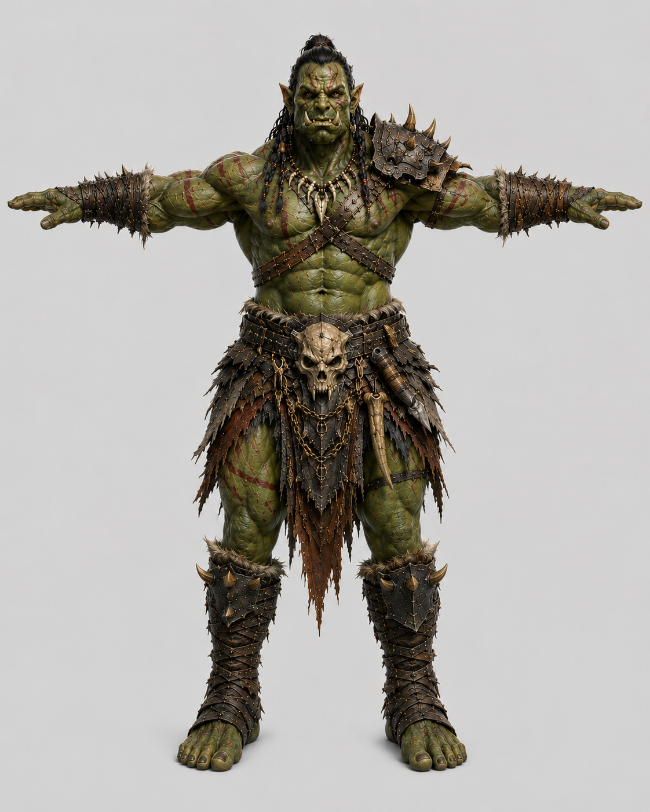
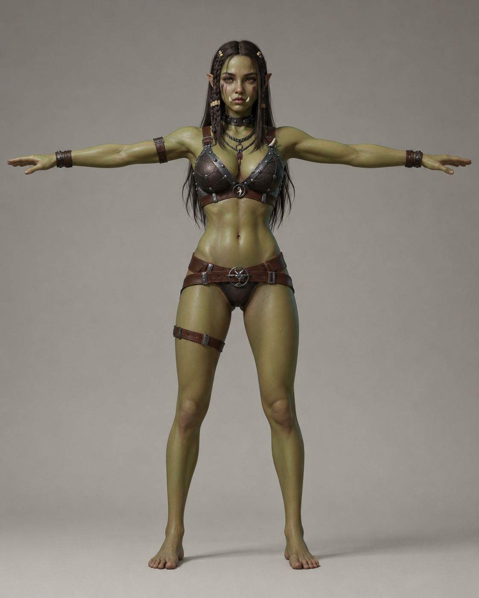
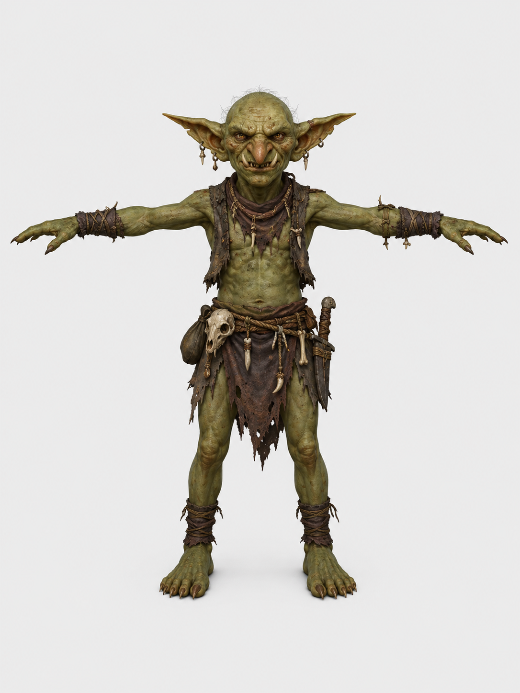
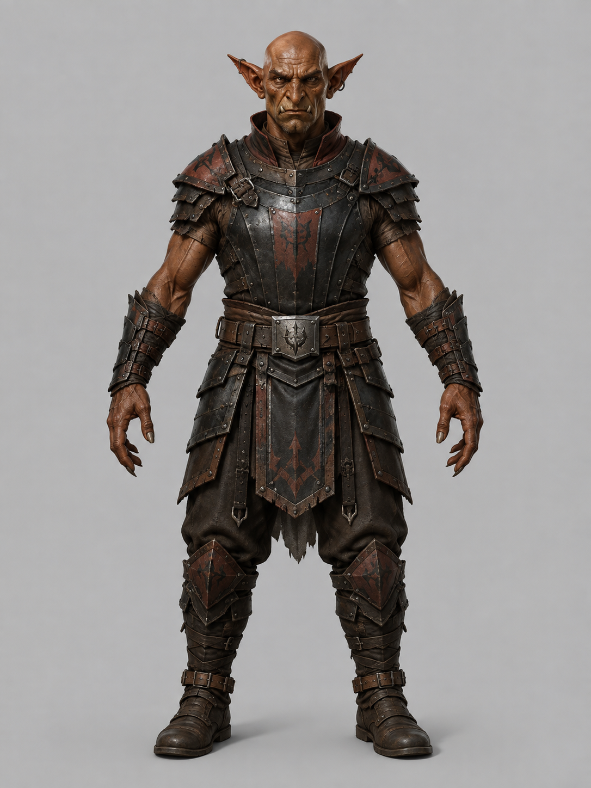
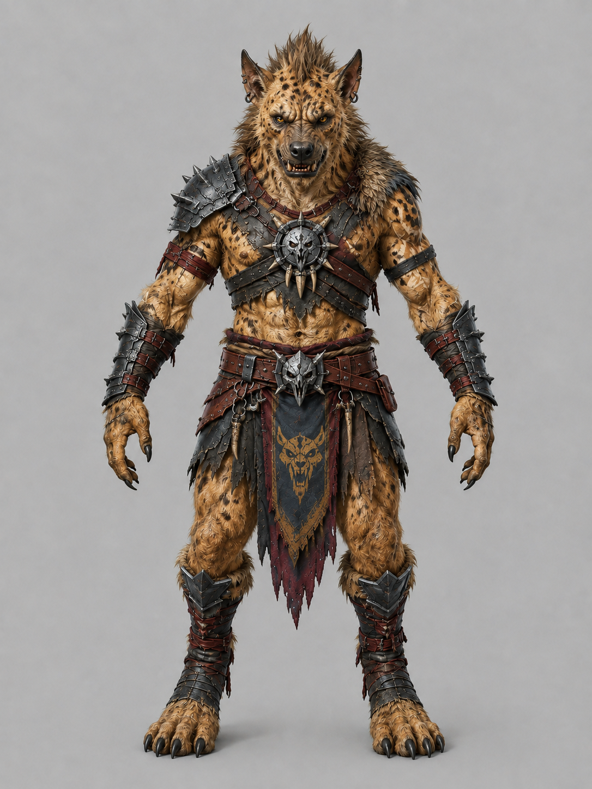
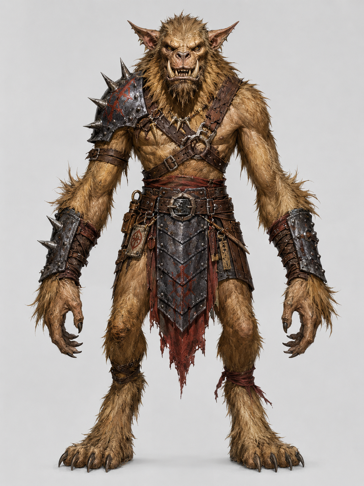
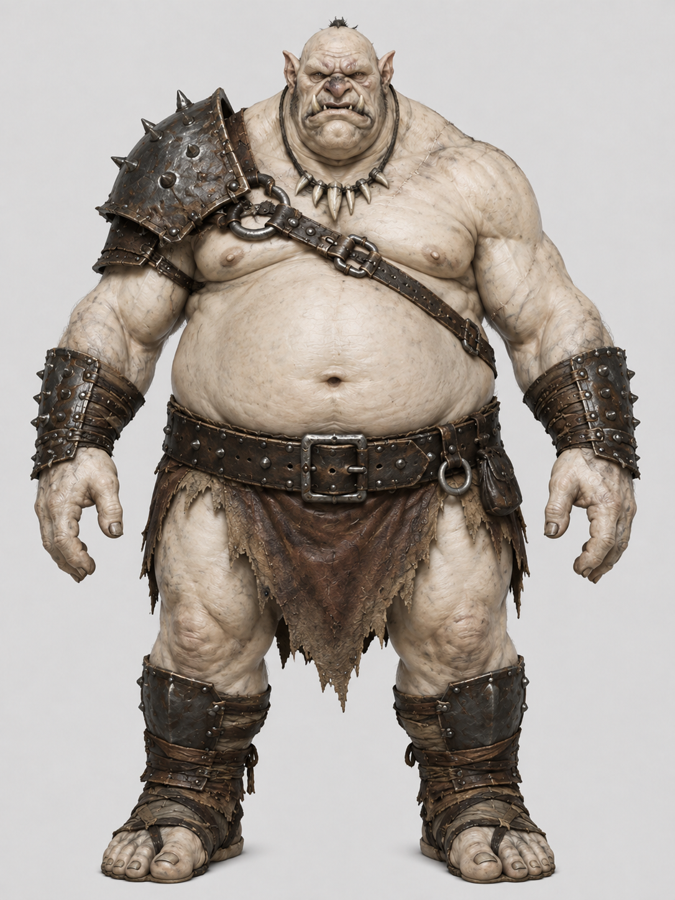
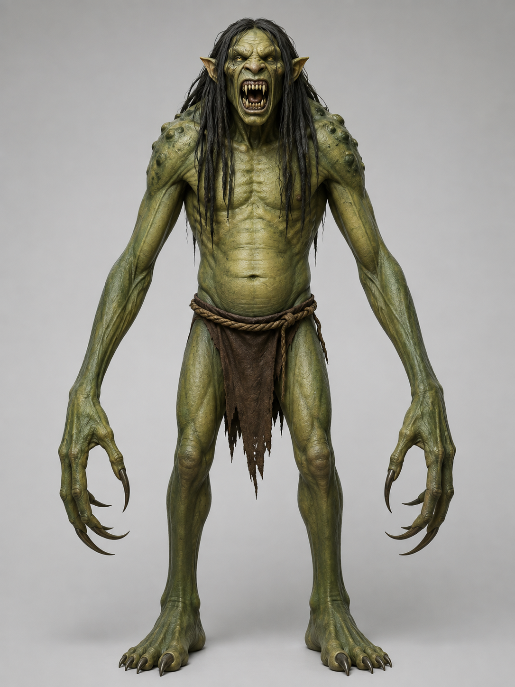
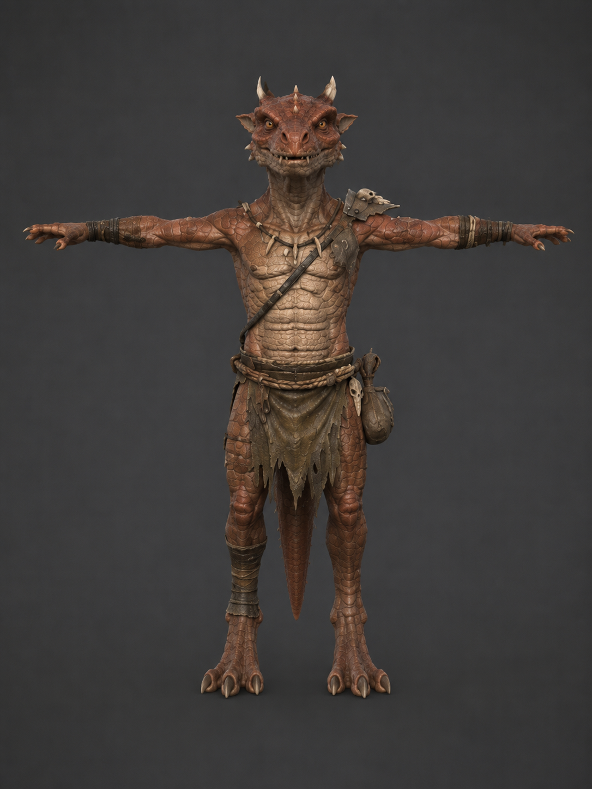

# Monster Assets

몬스터 제작 원본과 작업본은 `assets/monsters/<name>/`에 보관한다. 전용 애니메이션은 해당 몬스터 폴더에 함께 두며, 게임용 모델은 `client/public/models/monsters/`에 유지한다.

## Monster

- thief_king — 도적 소굴 보스. [원화](../images/monsters/thief-king-concept.png)는 OpenAI Codex ImageGen,
  ChatGPT Pro 20x로 2026-11-01 제작했다. OpenAI 생성 출력물 이용 조건을 따른다.
  - 3D 원본은 사용자가 2026-11-01 Tripo 웹 앱 Max 요금제로 원화에서 생성했다. Tripo 서비스 이용 조건 적용.
    원본과 생성 기록은 `assets/monsters/thief_king/tripo_v1/`에 보관한다.
  - 프로젝트 모듈형 남성의 Mixamo 호환 65본 계층과 가중치를 로컬에서 피팅했다. 메시 축소 없이
    10,823 triangles를 유지하고 바인드 포즈 높이 2.1m, 바닥 중심 원점, 스케일 1로 저장했다.
    base color·metallic/roughness·normal은 1024² WebP로 저장했다. 작업본은
    `assets/monsters/thief_king/rig_v1/`, 게임 모델은 `client/public/models/monsters/thief_king.glb`다.
  - 공용 locomotion·combat_melee 팩의 `idle1`, `walk`, `run`, `slash1`, `combat_idle`, `dying`을
    클라이언트 리타게팅 코드로 오프라인 변환해 게임 GLB에 넣었다. 힙 높이는 60Hz로 접지 보정했으며
    `sharedAnims=false`로 사용한다. 검증 수치·재현 절차·해시는 [리깅 보고서](thief-king-rig-v1.json)에 있다.
    공용 팩에는 hit 클립이 없다.
  - 오른손 손가락·엄지를 닫는 자세를 여섯 클립에 베이크했다. 오른손 로컬 부착값은
    `weaponOffset=0.118293`, `weaponOffsetX=0.008057`, `weaponOffsetZ=0.028002`,
    `weaponRotation=0.427|-17.064|18.818`(도)이다. dagger·cutthroat_dirk·shadowfang을 같은 값으로
    검사했으며 `monsters.csv`의 thief_king 행에 넣었다.
  - 캐릭터 미리보기 `modular-character-preview.html?monster=thief_king`에서 게임과 같은 모델·동작·손 무기로 볼 수 있다.
  - 정리(2026-11-01): 검토 렌더·상세 검증 JSON, 베이크 중간 GLB `game_v1/`, 쓰지 않은 Mixamo 업로드 ZIP을 삭제했다.
    Tripo 원본·리그 GLB·Blender 파일·파지 설정·게임 모델과 보고서의 검증 수치는 보존했다.

- skeleton_warrior — Tripo 모델, 2026-09-12 수령. 사용자는 앞선 스켈레톤 작업에서 Pro 요금제를 확인했다.
  이번 모델의 정확한 생성일은 미확인(로컬 다운로드 파일 생성 시각: 2026-09-12).
  - 사용자 제공 `skeleton+armor+3d+model.glb`; 원본은 `assets/monsters/skeleton_warrior/source.glb`에 보관.
    라이선스는 Tripo 유료 생성물 서비스 이용 조건을 따른다. 10,000 triangles, Tripo 41본 리그와
    1024² base color·normal·metallic/roughness 텍스처를 유지하며 높이 1.9m로 맞췄다.
  - 원화 `doc/images/monsters/skeleton_warrior_concept.png`는 이 작업의 ChatGPT 이미지 생성 도구로 만든
    낡고 부서진 갑옷의 스켈레톤 전사 T-pose 시안(플랜 미확인, 2026-09-12).
  - `tools/blender-scripts/build_skeleton_warrior.py`로 원본에서 재생성한다. 편집본은
    `assets/monsters/skeleton_warrior/skeleton_warrior.blend`, 게임 모델은
    `client/public/models/monsters/skeleton_warrior.glb`.
  - Idle·Walk·Run·Death는 기존 스켈레톤에 사용한 사용자 제공 Mixamo 65본 FBX와 동일한 파일을 재사용한다.
    Attack은 사용자 제공 `Sword And Shield Slash.fbx`(Mixamo, 2026-09-12 수령)로 교체했다. Mixamo 서비스
    이용 조건 적용. 원본은 `assets/monsters/skeleton_warrior/fbx/`에 보관하고 Tripo 리그로 리타게팅했다.
  - 게임 GLB에는 `Idle`, `Walk`, `Run`, `Attack`, `Death` 5개 클립만 포함한다. 걷기·달리기는 제자리 이동,
    Attack은 1.5초이고 오른손의 수평 도달 거리가 최대인 625ms를 타격 시점으로 사용한다. 쿨다운은 2000ms.
  - 기존 `morningstar` 아이템 모델을 `R_Hand`에 장착하고 손 가중치 정점의 중심에 맞춰 본 로컬 오프셋을
    Y 0.103m·X 0.02m·Z -0.004m로 지정했다. 무기 자체의 출처와 라이선스는
    [items.md의 morningstar](items.md) 기록을 따른다.
  - 무기 접지 보정 (2026-09-12): Attack·Death에서 모닝스타의 실제 정점을 기준으로 오른손 손목 회전을 보정해
    지면 관통을 방지한다. 보정은 주변 6프레임에 완만하게 이어지며 .blend와 게임 GLB에 베이크한다.
    검증기는 무기를 부착한 상태로 모든 클립을 120fps로 검사한다.
  - 사망음은 기존 `skeleton-death.ogg`를 재사용하고, 갑옷 피격은 `bone-hit-heavy.ogg`를 사용한다
    ([효과음 출처](sfx.md)).
  - 일반 스켈레톤의 상위종으로 조정 (2026-09-12): 레벨 20, 체력 90 (레벨 기본값), guard 24,
    기본 피해 6d8 + 모닝스타 1d8 = 총 7d8, 기본 명중 보너스 +20, 공격 간격 2초.
    일반 스켈레톤보다 체력은 25% 높고 갑옷으로 방어 +4, 무기로 추가 피해를 얻는다.
    던전 출현 설정은 비워 두며 관리자가 추후 배치한다. `material=metal`, `corpseAutoGround=false`.
- skeleton — Tripo Pro (유료), 사용자 생성일 2026-09-11.
  - 사용자 제공 `skeleton+3d+model.glb`; 원본은 `assets/monsters/skeleton/source.glb`에 보관.
  - 이용권: 사용자 확인 Tripo Pro 유료 생성물. 별도 CC 라이선스 표시는 없으며 Tripo 서비스 이용 조건 적용.
  - 원화 `doc/images/monsters/skelleton_concept.png`는 이 작업의 ChatGPT 이미지 생성 도구로 제작한 스켈레톤 T-pose 시안 (2026-09-11, 이용 플랜 미확인).
  - 8,375 triangles, Tripo 41본 리그와 2048² 텍스처를 유지. 키 1.8m, 스케일은 메시·리그·이동 키에 베이크.
  - `tools/blender-scripts/build_skeleton_monster.py`로 원본에서 재생성. 편집본은 `assets/monsters/skeleton/skeleton.blend`, 게임 모델은 `client/public/models/monsters/skeleton.glb`.
  - 애니메이션: 사용자 제공 Mixamo 65본 FBX `Idle`, `Walk`, `Run`, `Attack`, `Death` (2026-09-11 수령). Mixamo 서비스 이용 조건 적용; 원본은 `assets/monsters/skeleton/fbx/`에 보관하고 Tripo 리그로 리타게팅.
  - 게임 GLB에는 새 FBX에서 변환한 5개 클립만 포함. 걷기·달리기는 제자리 이동으로 변환. 공격 2.625초, 타격 시점 1042ms, 쿨다운 3000ms.
  - `Death` 접지 보정 (2026-09-12): Blender에서 Root 위치 키를 36~48프레임 (1.5~2초)에 걸쳐 부드럽게 원본보다 총 10cm 낮추고 마지막 71프레임까지 유지. `skeleton.blend`와 게임 GLB에 베이크하며 빌드 스크립트에도 반영.
  - 왼발 접지 보정 (2026-09-12): `Death`의 48~60프레임 (2~2.5초)에 왼쪽 고관절 회전을 추가해 발끝을 바닥에 내려놓고 마지막 자세까지 접지 유지. 최종 회전 약 15.3°, 발 메시 최저점 약 2mm. 몸통 높이와 오른쪽 다리는 유지하며 Blender 키프레임으로 베이크.
  - 이동 속도는 리타게팅 빌드 보고서의 측정값에 맞춰 걷기 0.78m/s, 달리기 3.00m/s로 설정 (2026-09-12). 클립은 원래 속도로 재생.
  - 모델·편집본·원본·FBX 5개는 [Hugging Face 에셋 PR #7](https://huggingface.co/datasets/jake-song-openmmo/onlinerpg-assets/discussions/7)에서 받아 `assets.lock`에 등록. 함께 제공된 시연 영상 `assets/skeleton/skeleton_gameplay.mp4`는 게임·제작 도구에서 사용하지 않아 사용자 요청으로 2026-10-09 삭제했다.
  - **[미사용]** 원본 Tripo 클립과 기존 idle / walk / pursuit / combat_idle / attack_swipe / death 클립은 게임 모델에서 제거.
  - 공용 캐릭터 애니메이션을 사용하지 않음. 무기·출혈 효과 없음. `material=bone`은 금속·나무 무기 피격 시 `armored-bone-hit.ogg`를 재생 ([효과음 출처](sfx.md#combat)).
  - 사망 시작 시 뼈가 부서져 흩어지는 `skeleton-death.ogg`를 재생 ([효과음 출처](sfx.md#monsters)).
  - 일반 몬스터 능력치: 레벨 16, 체력 72 (레벨 기본값), guard 20, 피해 6d8. 오거의 체력 36·무기 포함 피해 3d8의 두 배이며, 방어는 기준 10 초과분을 두 배로 설정 (`10 + 2 × (15 - 10)`).
  - 던전 출현 설정은 비워 두며 관리자가 추후 배치한다. `corpseAutoGround=false`로 베이크한 죽음 접지를 유지.

- skeleton_knight — 사용자 제공 Tripo Pro 유료 생성 모델, 2026-09-12 생성(사용자 확인).
  - 갑옷 피격음은 워리어와 같은 `bone-hit-heavy.ogg`를 사용한다 ([효과음 출처](sfx.md#combat)).
  - [컨셉아트](../images/monsters/skeleton_knight_concept.png): 이 대화에서 OpenAI 이미지 생성으로
    제작한 정예 스켈레톤 기사, 2026-09-12 생성. OpenAI 서비스 이용 조건 적용(이용 요금제 미확인).
  Tripo 서비스 이용 조건 적용. 원본 `skeleton+knight+3d+model.glb`는
  `assets/monsters/skeleton_knight/source.glb`에 보관한다. 10,002 triangles, Tripo 41본 리그,
  1024² base color·normal·metallic/roughness 텍스처를 유지하고 장식 포함 높이 2.05m로 맞췄다.
  - `tools/blender-scripts/build_skeleton_knight.py`로 재생성한다. 편집본은
    `assets/monsters/skeleton_knight/skeleton_knight.blend`, 게임 모델은
    `client/public/models/monsters/skeleton_knight.glb`.
  - Idle·Walk·Run은 기존 스켈레톤에 사용한 사용자 제공 Mixamo FBX를 재사용한다.
    Attack은 `Great Sword Slash.fbx`, Death는 `Two Handed Sword Death (1).fbx`
    (2026-09-12 수령). Mixamo 서비스 이용 조건 적용.
    원본 5개는 `assets/monsters/skeleton_knight/fbx/`에 보관하며 Tripo 리그로 리타게팅했다.
  - 대기·이동 중 오른팔을 낮춰 대검 칼날을 뒤쪽 지면에 끌도록 보정했다. 공격에서는 두 손으로
    손잡이를 잡고, 지면 관통 방지와 양손 그립을 보정한다. 24fps 원본을 72fps로 베이크해
    프레임 사이의 그립 이탈을 줄였다. 손가락 본이 없어 손가락 개별 움켜쥠은 포함하지 않는다.
  - 공격 원본 1.25초에 준비 0.417초·회수 0.583초를 더해 2.25초. 타격은 검끝 전방 도달 기준
    1083ms, 쿨다운 2800ms. 사망 중에도 대검을 오른손에 연결해 쥔 채 쓰러진다.
    사망 후반에는 망토 때문에 몸통이 뜨지 않도록 루트를 최대 0.15m 내린다.
    사망 시 검의 회전을 연속 보간하고 손목 이동을 평활화하며, 2.2초부터 그립 위치를 고정해
    착지 후 흔들림을 방지한다. 검은 계속 오른손 본에 연결된다.
    `corpseAutoGround=false`로 이 자세를 유지한다.
  - 2026-09-12 검토 수정: 착지 후 어깨 이동에도 팔이 닿는 위치에 검을 놓고, IK가 계산한
    손목 위치를 유지해 사망 중 오른팔이 늘어나지 않도록 다시 베이크했다.
    검증기는 양팔 길이 보존과 착지 위치에서 검이 계속 고정되는지도 확인한다.
  - 대검은 아래 아이템 문서에 기록한 `weapons/skeleton_greatsword.glb`를 직접 참조한다.
    `R_Hand`의 로컬 Y +0.11m에 장착하며 전용 외형으로 사용한다(아이템 드롭 없음).
    [대검 출처](items.md). 정예 일반 몬스터의 임시 능력치는 레벨 25·체력 350·guard 32·피해 6d12.
    던전 출현 설정은 비워 두어 관리자가 배치한다.
- barkan — Sundered Bastion 25층 보스, 2026-10-18. 게임 모델은 `client/public/models/monsters/barkan.glb`다.
  - [원화](../images/monsters/barkan-concept.png): OpenAI Codex built-in ImageGen, **ChatGPT Pro 20x**,
    2026-10-18. OpenAI 생성 출력물 이용 조건 적용. [프롬프트·해시](barkan-concept-sources.json).
  - 본인 기준 왼쪽(화면 오른쪽) 뿔이 부러진 악마 군주로, 등에 박쥐형 가죽 날개가 있다. 갑옷은 견갑·목가리개·건틀릿·판금 하의·정강이받이만 남겨
    가슴·팔·허벅지가 드러난다. 판금 하의는 짧은 비키니형이고 늘어진 허리천은 없다. 재질별로 색을 나눴다: 피부는 진홍,
    갑옷은 흑철에 강철 테두리, 사슬은 청동이다. 발광색은 주황 하나다.
    아이소메트릭 시점에서 읽히도록 뿔·날개 끝·견갑·가슴 룬을 위쪽과 앞쪽 실루엣에 모았다.
  - 룬 검은 드롭 아이템으로 따로 그렸으므로 맨손 T포즈로 그렸다([룬 블레이드 원화](items.md#rune-blade)).
  - 3D: Tripo API 유료 크레딧(사용자 구매 1000 크레딧), 2026-10-18. Tripo 이용 약관 적용.
    정면 원화 한 장으로 `/generation/image-to-model`을 호출했다. `P2-20260801`, face_limit 10000, PBR detailed, seed 102002.
    task `835984dc-7a92-446c-900d-465a14bddf12`, 120 크레딧 소모(잔액 840 → 720).
    원본 `assets/monsters/barkan/tripo_v2/model_url.glb`는 메시 1개, 11,551 triangles이며 4096² base color·normal·metallic/roughness 텍스처를 쓴다.
    요청·응답 기록은 같은 폴더의 `build.json`과 `generation.json`이다.
  - 앞서 정면·뒷면 multiview로도 생성했다(task `8fd4c86a-3a90-4d3c-8aa6-f0a939018ba3`, 120 크레딧, 잔액 960 → 840).
    뒷면 원화가 발을 정면처럼 그려서 발 뒤에도 발끝이 생겼으므로 버렸다. 그 파일과 뒷면 원화는 삭제했다.
  - Tripo가 발 뒤에 만든 가늘고 긴 가시는 `heel_fill.py`로 고쳤고, 결과는 `heel_fixed.glb`다. 정점을 뒤꿈치 뒤 한 점으로 모았다
    (원본 높이 1m 기준 4.5cm, 게임 크기로 약 11cm). 또 가시와 뒤꿈치 사이 아랫면 중 아래를 향한 정점만 바닥으로 내려 빈 공간을 메웠다.
    윗선은 발목에서 끝까지 곧게 내려온다.
  - 날개의 회색 배경 면은 `wing_holes.glb`에서 실제 구멍으로 잘랐다(2026-10-18).
    앞뒤 회색 윤곽을 합친 18개 기둥으로 날개 면을 관통 절단하고, 교차점에 정점과 보간된 UV·노멀을 넣었다.
    날개 끝 갈고리 안쪽과 날개막의 찢어진 틈을 함께 열었다. 날개 삼각형 169개를 수정했고 전체는 11,551 → 12,086 triangles다.
    뒤꿈치 보정본을 입력으로 쓰며 몸체의 기존 삼각형 위치·UV와 원본 WebP 텍스처 바이트를 유지한다.
    `assets/monsters/barkan/tripo_v2/wing_holes.blend`에는 결과 메시와 숨긴 절단용 기둥을 저장했다.
    [절단 윤곽](barkan-wing-hole-cutters.json), [검증 기록](barkan-wing-holes-validation.json).
    재실행: `blender -b --python tools/blender-scripts/cut_barkan_wing_holes.py -- assets/monsters/barkan/tripo_v2/heel_fixed.glb assets/monsters/barkan/tripo_v2/wing_holes.glb`.
    원본에 겹친 면·열린 경계가 있어 폐체적 Boolean 대신 각 삼각형의 기둥 내부를 제거한다.
    Python 보조 도구는 프로젝트 `.venv`의 NumPy·Shapely를 사용한다.
  - 피팅·리깅 작업본(2026-10-18): `assets/monsters/barkan/rig_v1/barkan.blend`와 `barkan.glb`.
    발바닥 0m부터 가장 높은 뿔·날개 끝까지 기준 포즈 높이를 **2.5m**로 정한 뒤 리깅했다.
    Blender는 Metric·`scale_length=1`이며 메시·Armature 오브젝트 스케일은 `(1,1,1)`이다.
    GLB의 모든 노드 스케일도 1이고 스케일 애니메이션은 없다. 게임 연결 시 확대 배율 없이 사용한다.
    게임의 `monsters.csv`도 `scale=1`이며 임시 스켈레톤 나이트의 1.2배 확대를 제거했다.
  - 기존 모듈형 남성의 Mixamo 호환 65본을 바르칸 체형과 T포즈에 맞추고, 날개 32본·손목 사슬 6본을 더해 총 103본으로 구성했다.
    크기를 반영한 도너 표면에서 몸 가중치를 옮기고 손가락·날개·갑옷·사슬을 따로 보정했다.
    원본의 12,086 triangles·UV·구멍을 유지하며 세 WebP 텍스처는 원본 바이트 그대로다.
    로컬 가공이며 추가 유료 생성은 없다. 원본 Tripo·ImageGen 및 기존 Mixamo 출처·라이선스를 유지한다.
  - `Idle`은 사용자가 Adobe Mixamo에서 내려받아 제공한 **Orc Idle**을 옮긴 5.33초 대기다(2026-10-18).
    원본 `/mnt/y/web_downloads/Orc Idle.fbx`를 `assets/monsters/barkan/fbx/Orc_Idle.fbx`에 바이트 그대로 보관했다.
    SHA-256: `7d1bbe85b789b3c8e99bcf2a96351d4deb8620ae9849f88542e0ee9205add36b`.
    팔을 아래로 내리고 몸을 조금 앞으로 두는 원본 자세를 유지하며, 바르칸 체형에 맞춰 골반 이동과 접지를 보정했다.
    기존 Mixamo 출처·이용 조건을 유지하며 로컬 변환만 했다. 추가 유료 생성은 없다.
    **[미사용]** 스켈레톤 나이트의 `Idle.fbx`에서 옮긴 이전 대기는 두리번거림·구부린 허리·앞으로 모은 손 때문에 교체했다.
  - `Walk`는 사용자가 Adobe Mixamo에서 내려받아 제공한 **Orc Walk**를 옮긴 약 1.2초 걷기다(2026-10-18).
    원본 `/mnt/y/web_downloads/Orc Walk.fbx`를 `assets/monsters/barkan/fbx/Orc_Walk.fbx`에 바이트 그대로 보관했다.
    SHA-256: `60ebcc04d684836fd052174751239f1b82e394c5b4095ef6cb8711c33da8bd3c`.
    바르칸 체형에 맞춰 골반 이동과 접지를 보정하고, 전진 이동을 제거해 제자리에서 반복 재생한다.
    원본 리그의 원점이 발바닥과 달라 골반 높이 비율로 이동을 확대하면 좌우 이동 폭이 70.6cm로 과장됐다.
    상·하퇴 길이 합의 비율로 이동 크기를 맞추고 수평 이동의 평균을 중앙에 맞춰 좌우 폭을 13.6cm로 고쳤다.
    같은 이동 크기 보정을 대기에도 적용하며 원본의 관절 회전은 유지한다.
    기존 Mixamo 출처·이용 조건을 유지하며 로컬 변환만 했다. 추가 유료 생성은 없다.
    **[미사용]** 스켈레톤 나이트의 `Walk.fbx`에서 옮긴 이전 걷기는 Orc Walk로 교체했다.
    이동은 걷기만 사용한다. 게임 설정의 `animWalk`·`animRun`은 모두 `Walk`이며 `walkSpeed`·`runSpeed`도 3.0m/s로 같다. 로컬 던전에서 4.0m/s의 미끄러짐을 확인한 뒤 사용자 요청으로 3.0m/s로 조정했고 모션 재생 속도는 유지한다.
    GLB·Blender 작업본·미리보기에서 `Run`을 제거했다. 이전 달리기 미리보기 URL도 걷기로 전환한다.
    **[미사용]** 바르칸에 임시로 옮겼던 `assets/monsters/skeleton_knight/fbx/Run.fbx` 동작은 더 이상 포함하지 않는다.
    날개는 대기·이동 중 작게 움직이며 `WingFold`는 별도로 키프레임을 만든 2초 접기·펼치기 검토 동작이다.
    손목 사슬은 팔 움직임을 따라 위치를 옮기되 아래로 늘어지는 방향을 유지한다.
  - 로컬 게임 연결본은 `assets/monsters/barkan/game_v1/barkan.glb`·`barkan.blend`와 `client/public/models/monsters/barkan.glb`다.
    티어 5 부서진 요새 25층의 기존 `barkan` 배치에 연결했다. 외형만 임시 해골 기사였으므로 보스 종류·층 배치는 바꾸지 않았다.
    대기·걷기와 별도로 기존 `skeleton_knight/fbx/Attack.fbx`·`Death.fbx`를 옮긴 임시 공격·사망 동작을 포함한다.
    공격은 1.54초, 사망은 약 2.58초이며 원본 Mixamo 출처·이용 조건을 유지한다. 게임 연결본에는 `WingFold`를 넣지 않는다.
    평타(`Attack`)는 2026-10-18 사용자 요청으로 휘두름 끝을 늘렸다. `animate_barkan.py`가 굽는 단계에서
    0.7초 이후 원본 샘플 간격을 늦추고, Spine·Spine1·Spine2를 월드 수직축으로 최대 45° 돌린다. 목은 18° 반대로 돌려 시선을 유지한다.
    검끝 최대 회전은 0.79초 28°에서 0.96초 54°로, 길이는 1.54초로 늘었다. 준비·타격 구간과 마지막 자세는 원본과 같다.
    타격·피해 표시 시점은 검끝이 정면 가장 멀리 닿는 667ms다(이전 1083ms는 2.25초 해골 기사 기준이었다).
    기존 해골 기사 대검은 제거했고, 원화에서 제작한 [룬 블레이드](items.md#rune-blade)를 오른손에 피팅했다.
    룬 블레이드 장착 시 손가락을 더 굽힌 복제 클립을 사용한다. 최종 보스 전투와 양손 전용 동작은 별도 단계다.
    이동 속도 검토용 연결이며 작업용 4096² 텍스처를 유지한다. 원본 텍스처 바이트와 기준 크기를 보존한다.
    [게임 연결 기록](barkan-game-v1.json). 게임 모델 검증은 아래 명령으로 실행한다.
    재현: `blender -b --python-exit-code 1 --python tools/blender-scripts/animate_barkan.py -- assets/monsters/barkan/rig_v1/barkan.glb --game-output assets/monsters/barkan/game_v1/barkan.glb` → `node tools/bake-barkan-rune-slash.mjs` → `node tools/validate-barkan-rig.mjs --game`.
  - [리그·피팅 기록](barkan-rig-v1.json), [Three.js 검증 도구](../../tools/validate-barkan-rig.mjs).
    개발 서버의 `/modular-character-preview.html?character=barkan`에서 기준 자세·대기·걷기·날개 접기를 확인한다.
  - 룬 검격 시각 초안(2026-10-18): 미리보기의 `RuneSlash`에서 플레이어의
    `enchant_weapon`으로 검을 머리 위에 들고 빛내는 1.6초 전조 뒤, `slash1`의 0.3초 준비 자세로 연결한다.
    원본의 첫 되감기는 건너뛰고 0.55초 동안 연결한 뒤, 첫 0.16초에 재생 속도를 올려 베기를 시작한다.
    회복과 대기를 포함한 전체 길이는 4.2초다.
    원본은 `client/public/models/characters/modular_male/animations/social.glb`와
    `combat_melee.glb`이고, 기존 캐릭터 리타게팅 경로로 바르칸 체형에 맞춘다.
    `client/src/lib/utils/barkanRuneSlash.ts`는 클립을 연결해 60fps 키프레임으로 굽는다.
    연결 중 검 방향은 월드 좌표에서 보간해 팔과 장착 회전이 겹쳐 검을 뒤집지 않도록 한다.
    위팔은 어깨의 앞쪽 축을 기준으로 바깥으로 벌린 뒤 원래 동작으로 돌아온다.
    2.30초 전후의 얼굴·가슴 관통을 피하기 위한 체형 보정이며 팔꿈치와 손목은 원본 클립의 회전을 유지한다.
    검 들기에는 플레이어의 `EnchantWeaponGrip`을 재사용하고,
    베기에는 플레이어의 검 장착 회전을 본의 기준 자세 차이에 맞춰 옮긴다.
    오른손 손가락은 바르칸의 기존 파지를 유지한다. 발바닥 접지와 손목 사슬 방향도 보정한다.
    **[미사용]** 이전 3.2초 IK 가로베기는 손목 뒤집힘과 팔 변형으로 사용자 검토에서 폐기했다.
    `client/src/lib/effects/barkan-rune-slash.ts`는 기존 룬 발광 맵의 강도를 높이고,
    실제 검 궤적에 맞춘 주황 잔상과 조명을 더한다. 일시정지·프레임 이동에도 효과 시간을 맞춘다.
    기존 Mixamo·Tripo 출처와 이용 조건을 유지한 로컬 코드 제작이며 추가 유료 생성이나 새 이미지·모델은 없다.
    평타 선택 항목은 게임 모델의 기존 1.25초 `Attack`을 재생한다.
    게임 연결(2026-10-18): `node tools/bake-barkan-rune-slash.mjs`가 같은 코드로 `game_v1/barkan.glb`에서 클립을 만들어
    60fps `RuneSlash`와 `RightHand` 아래 `WeaponSocket` 노드로 `client/public/models/monsters/barkan.glb`에 덧붙인다.
    검은 게임에서 이 소켓에 달리고, 소켓의 기본 자세는 csv 파지 값이다. 텍스처는 건드리지 않는다.
    다시 읽어 검 끝 위치가 원본 클립과 같은지 확인하고, 횡베기(2.55–2.73초, 오른쪽→왼쪽 약 170°) 측정을
    [굽기 기록](barkan-rune-slash-bake.json)에 남긴다. 서버 판정 시각과 불꽃이 부채꼴(90°)을 지나는 시각은 이 측정에서 정했다.
    `client/src/lib/effects/barkan-fire-fan.ts`는 횡베기부터 검을 따라 부채꼴에 번지는 불꽃을 그린다. 바닥 범위 경고는 없다.
    로컬 코드 제작이며 추가 유료 생성은 없다.
    검증: `node tools/validate-barkan-rune-slash.mjs` — 실제 검 메시의 바닥 간격,
    검을 세운 전조, `slash1` 팔꿈치·손목 회전의 보존, 연결의 연속성과 원래 자세 복귀를 확인한다.
    연결·베기 구간은 120fps로 검의 중앙·양쪽 날과 실제 머리·몸통 메시의 교차가 없는지 검사한다.
    상단의 **바르칸**으로 이동하며, 일시정지·재생 속도·프레임 슬라이더·뼈대·와이어프레임·1.9m 플레이어 비교를 제공한다.
    [1.9m 플레이어와 크기 비교](../images/monsters/barkan-rig-size-comparison.png),
    [날개 접기·펼치기 미리보기](../images/monsters/barkan-wing-fold.gif)는 보존 모델을 Blender에서 렌더한 검토 자료다.
    검증은 실제 크기·스케일 1·접지·정규화 가중치·텍스처 보존·손가락 굽힘·날개 단독 변형을 확인한다.
    재현: `.venv/bin/python tools/rig-barkan.py` →
    `blender -b --python-exit-code 1 --python tools/blender-scripts/animate_barkan.py -- assets/monsters/barkan/rig_v1/barkan.glb` →
    `node tools/validate-barkan-rig.mjs`.
- terraclash — 티어 5 필드 보스 대지파괴자 테라클래시, 원화만 2026-10-20 확정. 3D는 아직 없다. [설계](../TIER5_FIELD_RAID.md).
  - OpenAI Codex built-in ImageGen(`codex exec`, codex-cli 0.162.1), **ChatGPT Pro 20x**, 2026-10-20.
    OpenAI 생성 출력물 이용 조건 적용. [프롬프트·해시](terraclash-concept-sources.json).
  - [원화](../images/monsters/terraclash-concept.png): 땅에서 상반신만 솟은 화강암 거인이다. 두 주먹으로 땅을 짚었고,
    가슴 가운데에 심장이 뜯긴 빈 구멍과 봉인 룬이 있다. 용암빛 균열과 이끼가 있으며, 어깨는 산봉우리 능선이다.
    세 방향(거인 상반신·고대 짐승·살아 있는 절벽)으로 그린 첫 시안 중 거인 상반신을 골라, 팔과 몸 사이 틈을 메워 다듬었다.
  - [게임 화면 깨어난 상태](../images/monsters/terraclash-ingame-awake.png): 사용자 스크린샷에 높이·폭 약 9m 크기로 그려 넣은 목업.
  - [게임 화면 잠든 상태](../images/monsters/terraclash-ingame-dormant.png): 봉헌 전, 같은 자리·같은 크기의 평범한 바위 언덕.
    얼굴·룬·주먹 마디를 없애고 큰 윤곽만 남겼다. 두 목업 모두 생성 후 미니맵을 흐렸다.
  - Tripo 입력 원화: [깨어남](../images/monsters/terraclash-tripo-awake.png)·[잠듦](../images/monsters/terraclash-tripo-dormant.png).
    회색 배경 정면 한 장이다. 깨어남은 리깅을 위해 팔과 몸통 사이를 띄웠다.
    잠듦은 팔을 띄우기 전 깨어남 원화와 외곽선이 같아, 같은 자리에서 메시를 바꿔 끼울 수 있다.
  - 3D: Tripo API 유료 크레딧, 모델 `P2-20260801`, 텍스처 `v3.5-20260815`, detailed PBR, 목표 10,000 faces, 2026-10-20.
    깨어남 seed `102021`(11,261 triangles), 잠듦 seed `102022`(10,539 triangles), 각 **120크레딧**. Tripo 이용 약관 적용.
    원본은 `assets/monsters/terraclash/tripo_v1_{awake,dormant}/model_url.glb`, 요청·작업 기록은 같은 폴더의 `build.json`·`generation.json`.
    깨어남은 팔이 어깨에서만 몸통과 이어지고, 중간 높이 단면에서 팔과 몸통 사이에 틈이 있다.
  - 게임 모델 `client/public/models/monsters/terraclash_{awake,dormant}.glb`(리깅 전, 크기 확인용).
    `tools/blender-scripts/prepare_terraclash.py`로 정면을 +Z로 돌리고 높이 9m에 맞춘 뒤, 원점을 바닥 중심에 두었다.
    텍스처는 4096²에서 2048²로 줄여 WebP q90으로 저장했고, emissive는 끄고 용암 균열은 base color만 쓴다.
    깨어남 9.6×9.0×6.2m, 잠듦 10.2×9.0×10.9m. Blender 파일은 `assets/monsters/terraclash/game_v1/`.
  - 리깅 1차(2026-10-20): `tools/blender-scripts/rig_terraclash.py`가 깨어남 게임 GLB에 뼈 13개를 심고, 클립 6개
    (Idle·Attack·Roar·Hit·Death·Dead, 30fps)를 키프레임으로 만든다.
    뼈 위치는 메시 단면에서 잡은 어깨·팔꿈치·손목·머리 좌표다. 웨이트는 뼈 선분까지 거리의 역6제곱이며,
    팔·어깨·머리·몸통 영역별로 쓸 수 있는 뼈를 제한한다. 지면에서 주먹과 몸통 바위를 잇는 면 19개는 팔을 들 때
    늘어나므로 잘라냈다. 결과는 `assets/monsters/terraclash/rig_v1/terraclash.{glb,blend}`이며, 같은 GLB를 `client/public/models/monsters/terraclash.glb`로
    써서 `monsters.csv`의 `terraclash`(제자리 고정, 임시 능력치)로 등록했다. 미리보기: `modular-character-preview.html?character=terraclash`.
  - 왼팔 평타(2026-10-21): `Attack`(오른팔 내려찍기)을 좌우 반전한 `AttackLeft`를 같은 스크립트에서 굽는다.
    몸체가 돌지 않으므로 대상이 정면 기준 왼쪽이면 `animAttackLeft`(`AttackLeft`), 오른쪽이면 `animAttack`(`Attack`)을 쓴다. 길이는 같은 2.6초다.
  - 포효 연장(2026-10-22): 대지의 포효 전조로 쓰려고 `Roar`를 3.4초에서 6.2초로 다시 구웠다. 1.2초에 웅크리고 3.4초까지 어깨를 모은 뒤
    4초에 고개를 젖혀 포효하고 5.4초까지 버틴다. 서버 피해 시점(`EARTH_ROAR.strike_ms` 4초)이 포효 자세와 맞는다. 메시와 다른 클립은 그대로다.
  - 진형 붕괴·지진 클립(2026-10-22): 같은 스크립트에서 `Smash`(4.4초)와 `Quake`(5초)를 더 굽는다. `Smash`는 1.6초까지 두 주먹을 머리 위로
    들어 2.8초(`FORMATION_BREAK.strike_ms`)에 내려찍는다. `Quake`는 1.15초에 한 번 땅을 치고 다시 들어 3.5초(`EARTHQUAKE.strike_ms`)에
    내려친다. 두 클립 모두 `Attack`의 내려찍기 자세를 좌우 양팔에 쓴다. 메시와 기존 클립은 그대로다.
- SCP939 https://sketchfab.com/3d-models/scp939-79a749a5073b453d9d85875797bf45d7
  - 전송량 최적화 (2026-10-16): `scp939.edf348b1.glb`를 **5,776,536 → 1,395,636바이트(75.84% 감소)**로 줄였다.
    gzip level 6 예상 전송량은 **4,032,324 → 994,918바이트(75.33% 감소)**이며 다음 빌드 파일명은 `scp939.79bd676e.glb`다.
    텍스처 5장을 모두 **1024² → 512²**로 축소했다. 몸체·가시 색상맵은 WebP q90·effort 6,
    노멀·metallicRoughness·발광 맵은 축소 결과를 무손실 WebP로 저장해 추가 압축 손실이 없음을 확인했다.
    발광 강도 1.5와 재질 설정을 유지하고 meshopt 압축을 적용했다.
  - `monsters.csv`와 런타임의 `anim*` 참조를 기준으로 19개 중 6개 클립만 남겼다:
    `939_Idle`, `939_Walking`, `939_Running`, `939_Attack1`, `939_AddStagger1`, `939_DieProne`.
    미사용 `939_AddStagger2`, `939_AddStagger3`, `939_Attack2`, `939_Attack3`, `939_Dead`, `939_Die`,
    `939_FullStagger`, `939_HearSound`, `939_IdleAction1`, `939_Sleeping`, `939_TPose`, `939_VentLeap`, `939_Vocalize`는
    게임 파일에서 제거했다. 남긴 클립의 키프레임 시간·값·보간 방식과 채널 대상을 유지한다.
  - 2개 메시의 10,368 triangles·5,902정점 속성, 삼각형 순서·방향, 131본 계층·역바인드 행렬을 유지한다.
    GLB 작성기의 항등 회전 생략에 따른 노드 변환 성분 차이는 최대 0.00000287이다.
    실제 Three.js 로더에서 6개 클립을 각각 12개 시점으로 비교했고 스키닝 정점 좌표 차이는 최대 0.00000345m다.
    같은 조명·자세에서 원본 1024²와 최종 512²의 전신·작은 표시 크기·사망 마지막 자세를 비교했다.
    일반 표시 크기에서 차이가 작으며 근접 시 피부의 미세한 질감이 부드러워진다. 브라우저 오류·경고 0,
    최적화 파일의 Khronos glTF Validator 오류 0·스킨 메시 부모 경고 2개를 확인했다.
    몬스터 컴포넌트의 Threlte GLTFLoader에도 MeshoptDecoder를 연결했다.
  - 최적화 전 게임 파일은 `assets/monsters/scp939/scp939-before-optimization.glb`에 보존한다.
    기존 Sketchfab 출처·이용 조건을 유지하며 새 생성·유료 호출은 없다.
    최적화 파일과 보존 원본을 HF에 게시하고 원격 SHA-256을 확인했으며 `assets.lock`에 고정했다.
    운영 배포는 수행하지 않았다.
    보존 원본 SHA-256: `0082435d28e9da83c31d5c42dbe6757fd729ba213953f084d8e4c579a029a64d`.
    재현: `node tools/optimize-character-textures.mjs assets/monsters/scp939/scp939-before-optimization.glb client/public/models/monsters/scp939.glb 512 --all-textures --keep-animations=939_Idle,939_Walking,939_Running,939_Attack1,939_AddStagger1,939_DieProne`.
  - 미사용 UV 제거 (2026-10-17): 몸체 메시에 재질이 쓰지 않는 `TEXCOORD_1~4`가 있었다. meshopt 압축 뒤 속성이 버퍼마다
    나뉘어 WebGPU 정점 버퍼 한도(8)를 넘었고, 렌더 파이프라인 생성이 실패했다. 최적화 도구가 재질이 참조하지 않는
    UV를 지우도록 고치고 같은 재현 명령으로 다시 만들었다. 몸체 속성 10→6개, 1,395,576바이트. 텍스처·애니메이션은 이전 결과와 같다.
    최적화 파일 SHA-256: `c654e5d3e467e44aeff3cd32534b3ed90d0fb685e5a83a91fa47cb522a9de374`.
  - `939_DieProne` (2026-08-24): 원본 클립 중 죽음이 `939_Die`(상체를 들었다 웅크림)·`939_Dead`뿐이고 모두 살아
    있어 보여서 새로 구웠다: `939_Attack1` 45~63프레임(뒷다리로 크게 일어서는 구간)을 앞에 깔고, 그 정점 포즈를
    고정한 채 18~34프레임에 걸쳐 루트를 엉덩이 기준으로 넘어뜨려 척추가 수평이 되는 각도에 40°를 더 돌리면서(살짝 뒤로
    누운 자세) 12~34프레임에 목·머리를 앞으로 뻗고 팔다리 마디를 좌우 바깥으로 편다. 높이는 엉덩이·척추 정점이
    지면에 닿게 맞춘다 (총 44프레임·1.83 s). 손발은 루트 자식인 IK 컨트롤 본이라 같은 회전을 따로 먹이고 끝에서 팔다리 끝에 고정
    (`tools/blender-scripts/bake_prone_death.py` → `tools/graft-glb-clip.py`로 기존 클립은 그대로 둔 채 추가).
    `939_Die` 기반 버전과 등을 대고 뒤집히는 변형도 시험했지만 버림. animDie/animDead 모두 이 클립,
    `corpseAutoGround=false` (켜 두면 가장 낮은 정점 기준으로 다시 들어 올린다)
- Orc https://create.verse8.io/ 에서 2d -> 3d 생성함
  - 원화는 chatgpt.com에서 다음 프롬프트로 생성함

    > T-pose, fantasy concept art of an orc warrior, muscular humanoid with greyish-green leathery skin, protruding lower tusks, heavy brow ridge, pointed ears, battle-scarred face, crude iron and bone armor, tribal war paint, dramatic rim lighting, dark earthy color palette, detailed character design sheet, painterly digital art, D&D fantasy aesthetic, highly detailed, 4k

    > change it to simple background, character only, no texts

    > make the background light grey

    > make his skin more green

    
  - `Death01_Rig`은 2026-08-24에 힙을 -18.1cm 내렸다 (넘어진 뒤 몸이 지면 위 19.1cm에 떠 있어 코드가
    클립 끝에 내리던 것을 클립에 구움). 20~36프레임 사이에 서서히 적용
    (`tools/shift-glb-clip-hips.py ... --ramp 20 36`), `corpseAutoGround=false`
- female orc https://create.verse8.io/ 에서 2d -> 3d 생성함; 원화는 chatgpt.com에서 생성 
  - `Death01_Rig`은 2026-08-24에 힙을 -15.8cm 내렸다 (넘어진 뒤 몸이 지면 위 16.8cm에 떠 있어 코드가
    클립 끝에 내리던 것을 클립에 구움). 20~30프레임 사이에 서서히 적용
    (`tools/shift-glb-clip-hips.py ... --ramp 20 30`), `corpseAutoGround=false`
- goblin https://create.verse8.io/ 에서 2d -> 3d 생성함; 원화는 chatgpt.com에서 생성 
  - `Death01_Rig`은 2026-08-24에 힙을 +5.65cm 올렸다 (넘어진 뒤 몸이 지면 아래 9.7cm까지 파묻혀
    클라이언트가 죽음 클립 끝에 시체를 +10.65cm 들어 올리던 것을 클립에 굽되, 그보다 5cm 낮게 눕힌다). 쓰러지는 18~23프레임 사이에
    서서히 적용해 서 있는 시작 포즈는 그대로다 (`tools/shift-glb-clip-hips.py ... --ramp 18 23`).
    goblin/goblin_boss는 `corpseAutoGround=false` — 같은 GLB라 1.4배 보스도 함께 맞는다
- hobgoblin Meshy.ai (유료 생성, 2026-08-14, "Ironclad Warlord") 에서 2d -> 3d 생성 후
  mixamo.com에서 auto-rig (65본). 원화는 chatgpt.com에서 생성 
  - Blender: Mixamo FBX가 metallic=1 / specular 2배로 들어와 검은 크롬처럼 보이므로 되돌리고,
    텍스처는 Mixamo FBX에 임베드된 PNG(2048², 1024²·JPEG q88로 export)로 재연결. 본 이름의 `mixamorig:` 접두사를 떼어
    캐릭터 리그(knight.glb) 규약에 맞춤. 높이 1.90m(사람 크기)로 스케일 적용, 원점=바닥 중심,
    `export_yup=True`로 GLB export. 작업 blend는 `assets/monsters/hobgoblin/hobgoblin.blend`(HF 동기화)
  - 소스는 `assets/monsters/hobgoblin/`의 Mixamo FBX 하나만 보관한다. Meshy obj zip은 리깅 없는 메시 + 동일한 PNG라 삭제 (2026-08-15)
  - Meshy가 베이스 컬러만 주므로 metallic-roughness 맵은 albedo의 채도·명도에서 유도해 만들었다
    (어둡고 무채색인 판금 → metallic 0.85 / roughness 0.54, 피부는 metallic 0 / roughness 0.92). 정확한 PBR이
    필요하면 Meshy에서 PBR 맵 세트를 다시 받아 교체할 것
  - 애니메이션 클립 미탑재 — 캐릭터 공용 팩(locomotion/combat_melee)을 런타임에 리타게팅해서 쓴다
    (`monsters.csv`의 `sharedAnims` → `loadSharedPackClipsForModel`, 모델당 1회 캐시).
    팩의 리그(Medea, 힙 1.0m)와 몬스터 리그의 비율이 달라 그대로 재생하면 팔다리가 늘어난다.
    리타게팅은 힙을 소스 리그 기준으로 잡아 몸이 지면에 파묻히므로(dying이 12cm) 클립마다
    가장 깊이 잠기는 프레임만큼 힙 트랙을 올려 접지시킨다 (`groundRetargetedClips`).
    공용 팩에는 hit 리액션이 없어 `animHit`은 비워 둠
- gnoll Meshy.ai (유료 생성, 2026-08-15, "Hyena Warlord") 에서 2d -> 3d 생성 후
  mixamo.com에서 auto-rig (57본, 새끼손가락 없음). 원화는 chatgpt.com에서 생성 
  - hobgoblin과 같은 Blender 파이프라인(Mixamo 재질 되돌리기, `mixamorig:` 접두사 제거, albedo에서 유도한
    metallic-roughness 맵, 1024²·JPEG q88, `export_yup=True`). 높이 2.15m — D&D 놀은 7~7.5ft로 사람보다 크다.
    Meshy 원본이 1cm 크기로 들어와 mesh/armature data를 직접 스케일했다. 작업 blend는 `assets/monsters/gnoll/gnoll.blend`(HF 동기화)
  - 소스는 `assets/monsters/gnoll/`의 Mixamo FBX 하나만 보관한다
- bugbear Meshy.ai (유료 생성, 2026-08-16, "Fanghide Warlord") 에서 2d -> 3d 생성 후
  mixamo.com에서 auto-rig (65본). 원화는 chatgpt.com에서 생성 
  - gnoll과 같은 Blender 파이프라인. 높이 2.20m — D&D 버그베어는 7ft 이상으로 놀(2.15m)보다 조금 크게.
    Meshy 원본이 1cm 크기로 들어와 mesh/armature data를 직접 스케일했다(`Mesh.transform`/`Armature.transform`).
    작업 blend는 `assets/monsters/bugbear/bugbear.blend`(HF 동기화). 소스는 `assets/monsters/bugbear/bugbear.fbx` 하나만 보관
  - 무기는 기존 iron_sword를 들려줬다(D&D 버그베어의 모닝스타 모델이 없음)
- ogre Meshy.ai (유료 생성, 2026-08-16, "Ironhide Brute") 에서 2d -> 3d 생성 후
  mixamo.com에서 auto-rig. 원화는 chatgpt.com에서 생성 
  - bugbear와 같은 Blender 파이프라인(Mixamo 재질 되돌리기, `mixamorig:` 접두사 제거, albedo에서 유도한
    metallic-roughness 맵, 1024²·JPEG q88, 원점=바닥 중심, `export_yup=True`). 높이 2.4m.
    Meshy 원본이 1cm 크기로 들어와 mesh/armature data를 직접 스케일했다.
    작업 blend는 `assets/monsters/ogre/ogre.blend`(HF 동기화). 소스는 `assets/monsters/ogre/ogre.fbx` 하나만 보관
  - 리그가 33본뿐이라(손가락은 검지 체인만) 공용 팩을 리타게팅해도 나머지 손가락은 움직이지 않는다.
    무기는 `RightHand`에 greatclub(1.5m, 오거 키에 맞춰 sword 1.20m보다 길게).
    손 본이 손목에 있어 `weaponOffset`(본 로컬 +Y)으로 손가락 밑동까지 0.24m 밀어야 쥔 모양이 된다.
    값은 `RightHand` 가중치 정점이 본 축으로 뻗은 길이의 80% — 같은 규칙으로 벅베어 0.20, 홉고블린 0.12
  - 공용 팩을 쓰는 몬스터의 `walkSpeed`는 **Hips 본의 지면 위 높이**에 비례한다 — 리타게팅은 회전만
    옮기므로 보폭이 다리를 편 길이(엉덩이→접지점)로 정해지기 때문. 발목 높이로 재면 안 된다:
    벅베어처럼 발목이 높은 디지티그레이드 리그에서 크게 빗나간다(발목 기준으로는 1.4가 맞다고 나오는데
    실제로는 미끄러졌다). 팩 리그(Hips 1.165m)의 walk 클립은 사이클당 1.72m/0.958s = 1.8m/s이고,
    여기에 Hips 높이 비율을 곱한 값이 미끄러지지 않는 속도다:
    홉고블린 0.98→1.52(설정 1.5), 오거 1.17→1.81(1.8), 놀 1.14→1.76(설정 1.5, 아직 안 맞춤),
    벅베어 1.25→1.93(1.9). 벅베어·오거를 이 값으로 올려 미끄러짐이 사라진 걸 확인했다
  - run 클립은 체공 구간 때문에 같은 방식으로 못 잰다. 기존 값에서 역산한 팩 기준 5.3~5.5에
    Hips 비율을 곱해 잡는다 (오거 5.1, 벅베어 4.8→5.4)
- troll Meshy.ai (유료 생성, 2026-08-16, "Grimclaw Goblin") 에서 2d -> 3d 생성 후
  mixamo.com에서 auto-rig (65본). 원화는 chatgpt.com에서 생성 
  - ogre와 같은 Blender 파이프라인(Mixamo 재질 되돌리기, `mixamorig:` 접두사 제거, 1024²·JPEG q88,
    원점=바닥 중심, `export_yup=True`). 높이 2.7m — D&D 트롤은 9ft. Meshy 원본이 1cm 크기로 들어와
    mesh/armature data를 직접 스케일했다. 작업 blend는 `assets/monsters/troll/troll.blend`(HF 동기화),
    소스는 `assets/monsters/troll/troll.fbx` 하나만 보관
  - 금속 부위가 없는 모델(맨살·천 요포·머리카락·발톱)이라 metallic-roughness 맵을 만들지 않고
    metallic 0 / roughness 0.9 상수로 뒀다. albedo에서 유도하는 기존 공식은 어두운 머리카락과
    발톱을 금속으로 오인한다
  - 무기 없이 손톱으로 때린다 — 놀과 같은 `claw1|claw2` + `bleed`. Hips 높이가 1.51m로 커서
    walkSpeed 2.3(팩 1.8 × 1.51/1.165), runSpeed 6.5(팩 기준 5.05 × 같은 비율)

- kobold https://create.verse8.io/ 에서 2d -> 3d 생성함
  - 원화는 chatgpt.com에서 다음 프롬프트로 생성함
    > d&d 혹은 nethack에 나오는 kobold를 3d로 제작할 수 있게 T자형 포즈로 그려줘

    
  - `Death01_Rig`은 2026-08-24에 힙을 -18.8cm 내렸다 (코드가 죽음 클립 끝에 적용하던 접지 -0.8cm +
    `corpseGroundOffset` -0.17에 2cm 더 내려 클립에 구움; 최저 정점은 꼬리 끝이라 몸통 기준으로 눕힌 값). 쓰러지는
    22~36프레임 사이에 서서히 적용 (`tools/shift-glb-clip-hips.py ... --ramp 22 36`), `corpseAutoGround=false`

- stone_golem Meshy.ai (유료 생성, 2026-08-20, "Stone Golem") 에서 2d -> 3d 생성 후
  mixamo.com에서 auto-rig (24본). 소스는 `assets/monsters/stone_golem/stone_golem.fbx` 하나만 보관
  - troll과 같은 Blender 파이프라인(Mixamo 재질 되돌리기, `mixamorig:` 접두사 제거,
    원점=바닥 중심, `export_yup=True`). 높이 2.5m — 오거(2.4m)와 트롤(2.7m) 사이.
    금속 부위가 없어 metallic 0 / roughness 상수로 뒀다
  - 리그가 24본뿐이라(손가락/눈 본 없음) 공용 팩 대신 Meshy가 준 자체 클립 5개를
    T-pose 리그로 리타게팅해 GLB에 bake한다 — idle/walk/run/slap/dead.
    소스는 `assets/monsters/stone_golem/animations/`의 Mixamo FBX 5개
  - 리타게팅이 루트 변위를 두 리그의 Hips 높이 비로 스케일하는 탓에 몸이 떠서
    idle 26cm, slap 42cm가 공중에 뜬다. 홉고블린과 같이 T-pose base의 발바닥
    높이로 프레임마다 Hips를 내려 접지시킨다. run(체공)·dead(넘어짐)는 프레임별로
    끌어내리면 몸이 땅에 박히므로 상수 오프셋만 준다
  - GLB export 직전에 armature를 `pose_position = "REST"`로 두면 안 된다 —
    glTF 익스포터가 매 프레임을 rest 포즈로 샘플링해 클립이 키 2개짜리 정지
    애니메이션으로 나간다
  - 무기 없이 주먹으로 때린다 — `slap` 하나만 쓴다 (bleed 없음: 석재 골렘은
    출혈하지 않음). material `stone`은 타격음 규칙에 없어 기본 hit sound로 폴백
  - `attackRange`는 2.0 — 타격 순간(0.6s) 오른손이 원점에서 1.3m 앞(+Z)에 있어,
    트롤과 같은 2.8로 두면 손이 닿지 않는 거리에서 헛손질한다. `attackImpactDelay`도
    같은 0.6s에 맞춘 600ms이고, `attackCooldown`은 slap 길이(1567ms)보다 긴 1900
  - 2026-08-22 리워크: 원본 GLB가 Armature 노드에 0.0132 스케일을 남겨 바인드
    박스가 3cm로 잡혔다(호버/클릭 판정 붕괴). Blender에서 스케일을 armature
    데이터·메시·location 커브에 베이크해 스케일 1로 재익스포트(겉보기 동일,
    클립 타이밍 보존). dead 클립은 최저점 -0.50m로 끝나 코드 접지 보정이 팝을
    만들던 것을, Hips 램프로 -0.35에 끝나게 수정하고 `corpseAutoGround=false`로
    코드 보정을 껐다. 바인드 포즈가 팔 벌린 자세라 `hoverRadius=0.9`로 클램프
- cyclop (Cyclop) 2026-08-24 임포트 후 mixamo.com에서 auto-rig (24본)
  - 외부 리그 임포터(기여자 로컬 도구, 리포에 없음)로 임포트. 높이 3.00m, 원점=바닥 중심, 본 이름 표준화(23/24본 매핑), 텍스처 1024²·JPEG q88 1장, 10,270 tri
  - 모델에 포함된 클립을 그대로 쓴다 (`sharedAnims` 미사용)
  - 무기는 `RightHand`에 greatclub. 손 본이 손목에 있어 `weaponOffset` 0.315로 손가락 밑동까지 밀었다 (RightHand 가중치 정점이 본 축으로 뻗은 길이의 80%). 손바닥에 맞추려고 X 0.13, Z 0.005, 회전 -75|24|74(도) 추가 조정
- lizardfolk (Lizardfolk) 2026-08-24 임포트 후 mixamo.com에서 auto-rig (24본)
  - 외부 리그 임포터(기여자 로컬 도구, 리포에 없음)로 임포트. 높이 2.30m, 원점=바닥 중심, 본 이름 표준화(23/24본 매핑), 텍스처 1024²·JPEG q88 1장, 10,160 tri
  - 소스는 `assets/monsters/lizardfolk/lizardfolk.glb` 하나만 보관 (HF 동기화) (원본 파일명 `Meshy_AI_Meshy_Merged_Animations.glb`)
  - 모델에 포함된 클립을 그대로 쓴다 (`sharedAnims` 미사용)
  - 무기는 `RightHand`에 steel_longsword. 손 본이 손목에 있어 `weaponOffset` 0.23로 손가락 밑동까지 밀었다 (RightHand 가중치 정점이 본 축으로 뻗은 길이의 80%). 손바닥에 맞추려고 X 0.063, Z -0.042, 회전 36|83|-28(도) 추가 조정
