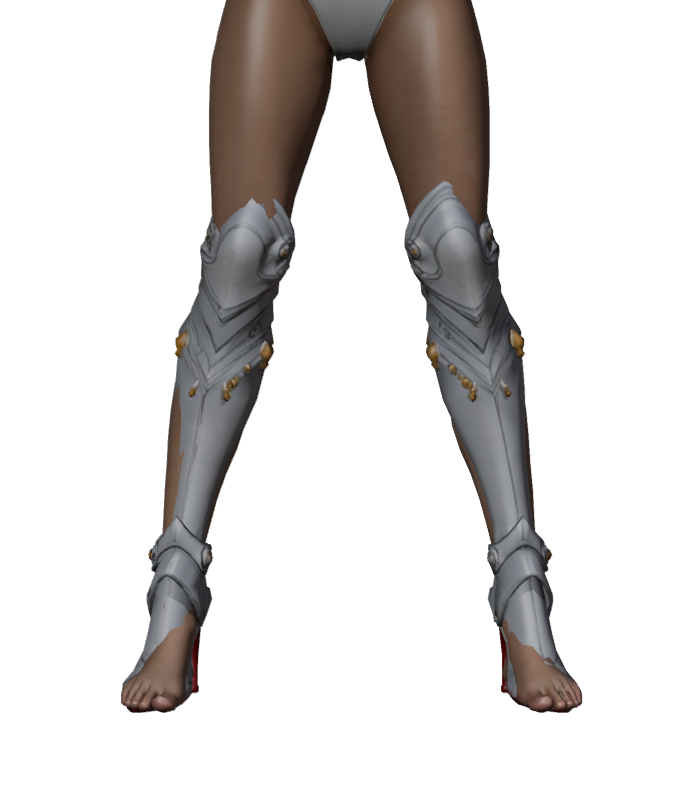
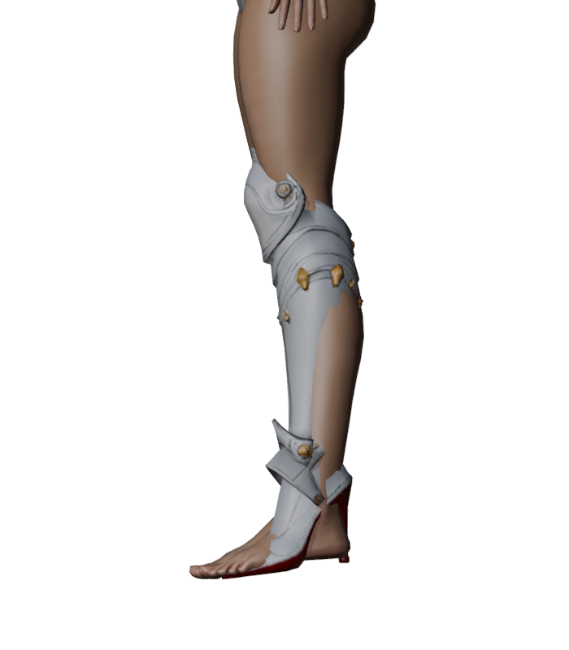

# 발키리 부츠 피팅 후보

2026-11-02. 사용자가 제공한 Tripo 분할 모델의 `tripo_part_3`을 추출했다. 양쪽 무릎 보호대, 종아리 갑옷과 하이힐이 하나의 메시다.

- [분할 원본](../../assets/items/valkyrie_boots/source/tripo-segmented.glb), SHA-256 `a794e299d6e0d97ec07b6bcd69d9fccd641c9a4c1c192de849a0869623851834`.
- [추출 부츠](../../assets/items/valkyrie_boots/fitted_v1/boots-source.glb), [피팅 메시](../../assets/items/valkyrie_boots/fitted_v1/boots-fitted-unskinned.glb), [리깅 후보](../../assets/items/valkyrie_boots/fitted_v1/boots_female_valkyrie.glb), [Blender 편집본](../../assets/items/valkyrie_boots/fitted_v1/valkyrie-boots-fitting.blend), [피팅 기록](../../assets/items/valkyrie_boots/fitted_v1/fitting.json).
- 메시 1개, 4,686삼각형, 머티리얼 2개, 내장 텍스처 3개다. 여성 기본 몸체 22,175삼각형과 가림 없이 합계 26,861삼각형이며 얼굴·다른 장비는 제외했다.
- Tripo 원본의 생성 날짜, 구독 등급, 작업 ID, 입력 원화 및 라이선스는 확인되지 않았다. 2026-11-02는 추출·피팅 작업일이다.




원본을 미터 단위로 확대하고 높이에 따라 좌우·앞뒤 위치를 보정했다. 여성 공통 몸체 `rig_v1/female-base.glb`의 동일한 65본과 bind 행렬을 복사하고, 같은 쪽 다리·발의 인접 피부 가중치를 전사했다. 가중치 합계와 좌우 본 제한은 통과했다.

미리보기에서는 발목을 36도 기울이고 발끝을 반대 방향으로 보정한다. 이전 30도 자세보다 뒤꿈치가 약 1cm 올라가며, 부츠를 착용한 기준 자세에서 피부 뒤꿈치의 평균 높이는 맨발보다 약 7.1cm 높다. 피팅 메시를 이 자세에서 역스키닝해 부츠 형태를 유지하고, 바닥에 맞게 몸체를 약 5.5cm 들어 올린다. 부츠를 벗으면 발 자세는 복원된다.

미리보기에서는 발키리 부츠 착용 시 기준 몸체를 높이 약 0.515m와 무릎 바깥쪽에 맞춘 경계에서 가린다. 경계를 지나는 삼각형을 잘라 새 정점과 본 가중치를 보간하고, 절단선 위쪽 다리 피부를 부츠 안에서 서서히 좁혀 구멍과 돌출을 줄인다. 대기 자세 뒷면과 착탈을 확인했다. 부츠를 벗으면 원본 몸체가 복원된다.

전투 대기의 무릎 굽힘에서 피부가 돌출되어 해당 구간의 최대 수축률을 36%에서 46%로 늘렸고, 이후에도 겹치는 부분이 남아 절단선을 0.49m에서 0.515m로 높였다. 전투 대기와 기본 자세의 뒷면을 확인했다.

무릎 바깥쪽 피부 돌출을 줄이기 위해 양쪽 부츠 전체를 각각 바깥으로 1.5cm 평행이동했다. 기준 자세에서 각 부츠의 형태를 유지하며, 피부와 무릎 주변의 잔여 겹침은 추가 피팅이 필요하다.

양쪽 힐 뒷면과 사용자가 지정한 연결부에 주변 판금과 비슷한 은색 금속 재질을 적용하고, 금속 사이에 남던 붉은 틈을 연결했다. 지정 영역 경계에서 기존 삼각형을 분할해 붉은 밑창을 보존했다. 새 정점의 본 가중치와 텍스처 좌표를 보간했으며, 기준 자세의 표면과 원래 정점 위치를 검증했다. 지정한 면은 피팅 전 GLB의 해시로 고정했다. 재질 분리로 미리보기에서 렌더링 호출이 하나 늘어난다.

**미완성:** 다리 단면 피팅, 동작별 접지와 다른 장비 조합은 검증하지 않았다. Blender 편집본은 초기 무스킨 피팅 장면이며 별도 리깅 후보 GLB를 포함하지 않는다. 여성 캐릭터 미리보기의 신발 목록에서 초기 피팅 후보를 볼 수 있다. 게임에는 등록하지 않았다.

## 재현

```bash
blender -b -t 2 --python-exit-code 1 --python tools/blender-scripts/fit_valkyrie_boots.py
.venv/bin/python tools/rig-valkyrie-boots.py
```
