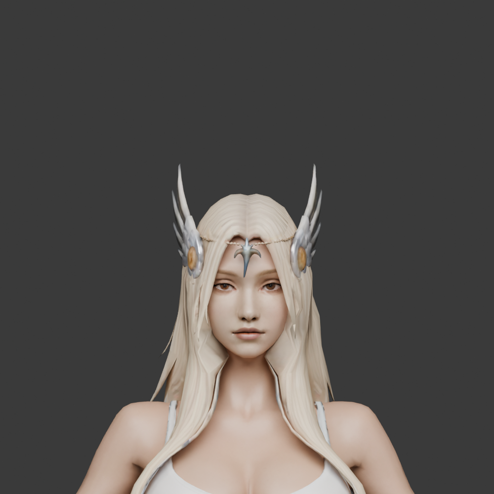

# 발키리 날개 투구

2026-11-03. 사용자가 제공한 `fantasy warrior 3d model (2).glb`의 `tripo_part_6`을 추출해 여성 모듈형 몸체에 피팅한 초기 후보다. 양쪽 날개 장식, 금색 옆 장식, 이마 사슬과 중앙 장식이 이미 한 메시 안에 있어 추가 대칭 복제는 하지 않았다. 1,343삼각형이며 원본 UV와 재질을 사용한다.



## 파일

- [사용자 제공 원본](../../assets/items/valkyrie_helmet/source/model.glb), [추출한 원본 파츠](../../assets/items/valkyrie_helmet/source/helmet-extracted.glb).
- [피팅 GLB](../../assets/items/valkyrie_helmet/fitted_v2/helmet_female_valkyrie.glb), [몸체·긴 헤어를 포함한 Blender](../../assets/items/valkyrie_helmet/fitted_v2/female-valkyrie-helmet-fitted.blend).
- [피팅 기록](../../assets/items/valkyrie_helmet/fitted_v2/fitting.json), [피부 가림 명세](../../assets/items/valkyrie_helmet/fitted_v2/body-occlusion.json), [동작 검사](../../assets/items/valkyrie_helmet/fitted_v2/animation-validation.json), [측면 검토](../images/characters/modular_human_female_01/parts/valkyrie/helmet-fit-side-v2.png).

## 피팅과 리깅

여성 몸체 `rig_v1/female-base.glb`와 기존 전사 긴 헤어를 기준으로 맞췄다. 원본의 월드 좌표에 처음 1.4배·Blender 이동 `(0, 0.012, 0.452)m`을 적용한 다음, 기존 헤어와 동일하게 중심 `(0, 0.012, 1.69)m`에서 전체 115%·높이 118%·수직 -5.1cm를 적용했다. 실제 미터 단위이며 메시와 리그 객체 스케일은 1이다.

65본의 `human_female_01_local_v1` 리그를 사용하고 전체를 Head 100%로 고정했다. 별도 흔들림 본은 없다. 피부는 가리지 않으며 발키리 투구 착용 중에도 선택한 헤어를 표시한다. 다른 투구의 기존 헤어 숨김 규칙은 유지한다.

정면·측면·후면 렌더를 만들고 정면과 측면을 확인했다. 머리 본 추종, rest 상태와 가중치 합계, 유한 좌표, 강체 형상 유지를 14개 동작 각각 61시점에서 검사했다. 이 검사는 모든 동작에서 헤어·얼굴과 충돌하지 않는다는 보장은 아니다. 다른 헤어·상의와의 혼합 착용 및 게임 등록은 미검증이다.

기준 몸체 22,175 + 전사 긴 헤어 1,871 + 투구 1,343 + 피팅 v3 보호대 1,702는 숨김 포함 27,091삼각형이다. 보호대의 피부 가림 314개를 적용하면 표시 26,777삼각형이며 다른 장비·무기는 제외했다. 얼굴 형상은 기존 몸체 그대로이며 얼굴만의 별도 삼각형 배분은 측정하지 않았다. 조립 목표 15,000–20,000삼각형을 초과하나 목표에 맞추기 위한 임의 감축은 하지 않았다.

## 출처·라이선스

- 제공 위치: `Y:\public\web_downloads\fantasy warrior 3d model (2).glb`.
- 사용자 제공 Tripo 분할 모델. 원본 SHA-256: `0d437489781fc9c6b825997e909160ea2b70dbdf02c4fa830680ba944f58f0d7`.
- 원본 제작자, 생성일, 작업 ID, 구독 등급, 비용과 구체적인 이용 조건은 미확인이다. 이번 로컬 추출·피팅·리깅에는 추가 생성 비용이 없다.
- 몸체 출처와 이용 조건은 [여성 기준 몸체 기록](modular-human-female-01.md)을 따른다. 긴 헤어는 기존 전사 긴 헤어 피팅본을 그대로 사용했다. 이번 작업에서 헤어나 텍스처를 새로 생성하지 않았다.

## 재현

```sh
blender -b --python-exit-code 1 --python tools/blender-scripts/fit_female_valkyrie_helmet.py -- --render
node tools/validate-female-valkyrie-helmet.mjs
```

## 펜던트 이마 간격 보정 v2 — 2026-11-03

사용자가 사슬의 곡선을 유지하면서 펜던트를 이마 쪽으로 붙이도록 요청했다. 양쪽 날개 메시를 그대로 두고, 사슬 전체와 중앙 펜던트의 연결 성분을 미터 기준 뒤로 12mm 평행 이동했다. 각 정점에 같은 이동을 적용해 3D 곡선과 장식의 형상·UV·삼각형 수를 유지한다. 20mm 이동도 검토했으나 사슬이 머리카락에 더 묻혀 12mm 후보를 선택했다.

현재 미리보기는 [v2 GLB](../../assets/items/valkyrie_helmet/fitted_v2/helmet_female_valkyrie.glb)를 사용한다. [Blender](../../assets/items/valkyrie_helmet/fitted_v2/female-valkyrie-helmet-fitted.blend), [피팅 기록](../../assets/items/valkyrie_helmet/fitted_v2/fitting.json), [검증](../../assets/items/valkyrie_helmet/fitted_v2/animation-validation.json), [정면](../images/characters/modular_human_female_01/parts/valkyrie/helmet-fit-front-v2.png)·[측면](../images/characters/modular_human_female_01/parts/valkyrie/helmet-fit-side-v2.png)·[위쪽](../images/characters/modular_human_female_01/parts/valkyrie/helmet-fit-top-v2.png) 검토를 보관한다. v1 GLB와 피팅 기록은 곡선·고정 날개의 회귀 검사 입력으로 보관한다. 이전 Blender·리깅 전 파생본·중복 렌더·백업은 정리했다.

내보낸 GLB에서 이동한 정점 1,159개와 고정한 정점 1,027개를 비교했다. X·Y좌표, UV, 인덱스가 같고 이동 벡터의 최대 오차는 약 0.000000002m다. 이동한 정점에서 이마 앞면까지 잰 최소 간격은 약 25.7mm에서 13.7mm로 줄었다. 이는 정점의 앞뒤 방향 표본값이며, 모든 삼각형의 최소 거리나 동작 중 무관통을 보장하지 않는다. 14개 동작 각각 61시점의 Head 추종과 강체 형상 유지 검사는 통과했다. 사용자가 미리보기에서 현재 상태를 확인했다.
